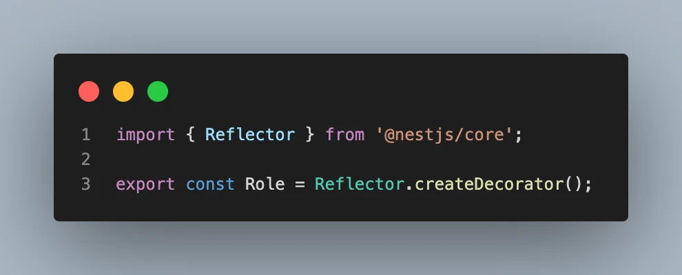
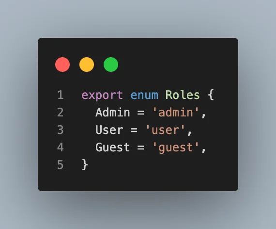
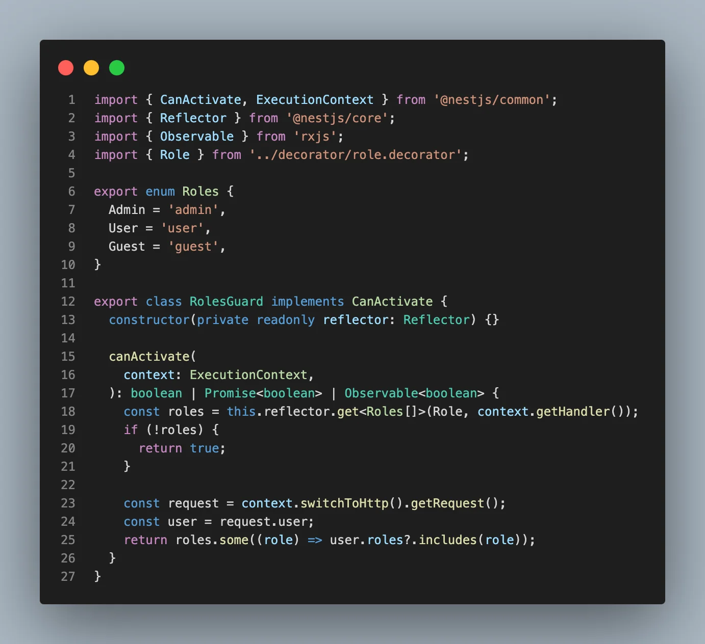

> 
> 
> <a id="26feda9b0fe181e7981bef89f51be31d"></a>
> 
> <strong>목차</strong>
> 
> - [RBAC ( Role Based Access Control )](#26feda9b0fe181819fa8dbe0b6c90a88)
> - [ 구현 방식](#26feda9b0fe181069501c4695fcb2110)

<a id="26feda9b0fe181819fa8dbe0b6c90a88"></a>

## RBAC ( Role Based Access Control )

---

> 📖 
> 
> <a id="26feda9b0fe18111ab0fe9354bb6531d"></a>
> 
> <code>RBAC</code>은 <code>Role Based Access Control</code>의 약자로,<strong><u> </u></strong><strong><u>역할(</u></strong><strong><u><code>Role</code></u></strong><strong><u>) 기반으로 권한(</u></strong><strong><u><code>Permission</code></u></strong><strong><u>)을 나눠</u></strong>서 <strong><u>특정 리소스 CRUD 작업 가능 여부를 판</u></strong>단한다&#46; 

> ❗ 
> 
> <a id="26feda9b0fe18127be71e0db3ae93804"></a>
> 
> RBAC을 복잡하게 설계하면 서비스의 복잡도가 비약적으로 높아져 버린다&#46; <br>웬만하면 간단하게 설계하는 것을 권장한다&#46; 

<a id="26feda9b0fe181069501c4695fcb2110"></a>

###  구현 방식

> ✏️ 
> 
> 1. 데코레이터 정의
> 
> 1. Enum 정의
> 
> 1. Guard 정의



<details>
<summary>&#91; 코드 &#93;  Role ( <code>데코레이터</code> )</summary>

<a id="26feda9b0fe180d3af59f05993631bca"></a>

```typescript
import { Reflector } from '@nestjs/core';

export const Role = Reflector.createDecorator();
```

</details>



<details>
<summary>&#91; 코드 &#93;  Rolse ( <code>enum</code> )</summary>

<a id="26feda9b0fe18082910ad605f8c9619d"></a>

```typescript
export enum Roles {
  Admin = 'admin',
  User = 'user',
  Guest = 'guest',
}
```

</details>



<details>
<summary>&#91; 코드 &#93;  RolesGuard</summary>

<a id="26feda9b0fe1808ca4f1f9954b73b074"></a>

```typescript
import { CanActivate, ExecutionContext } from '@nestjs/common';
import { Reflector } from '@nestjs/core';
import { Observable } from 'rxjs';
import { Role } from '../decorator/role.decorator';

export enum Roles {
  Admin = 'admin',
  User = 'user',
  Guest = 'guest',
}

export class RolesGuard implements CanActivate {
  constructor(private readonly reflector: Reflector) {}

  canActivate(
    context: ExecutionContext,
  ): boolean | Promise<boolean> | Observable<boolean> {
    const roles = this.reflector.get<Roles[]>(Role, context.getHandler());
    if (!roles) {
      return true;
    }

    const request = context.switchToHttp().getRequest();
    const user = request.user;
    return roles.some((role) => user.roles?.includes(role));
  }
}
```

</details>
