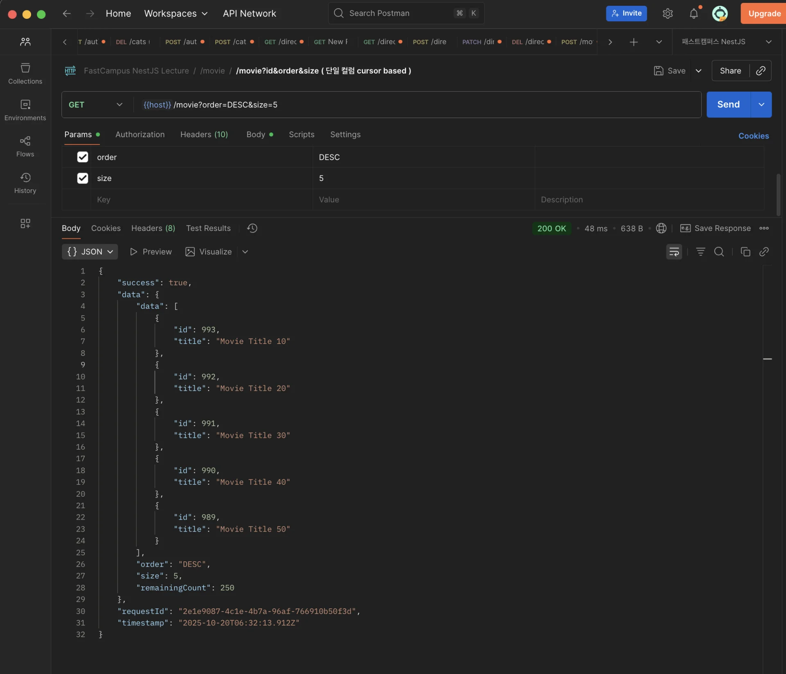
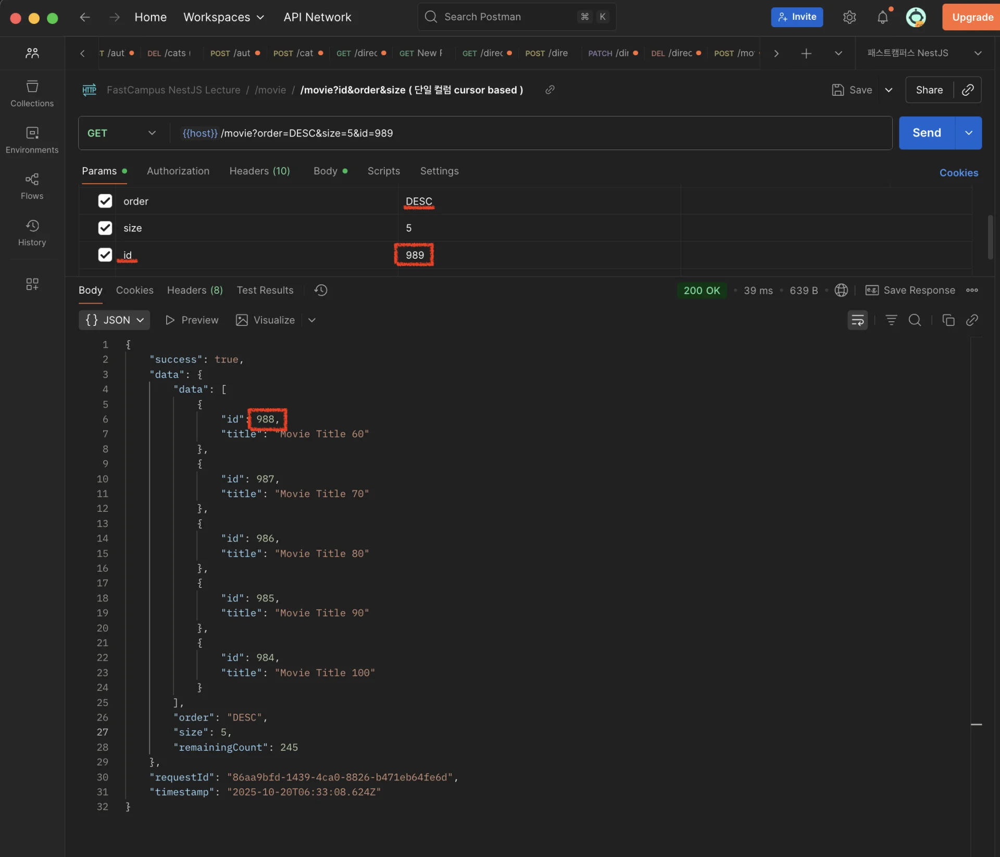
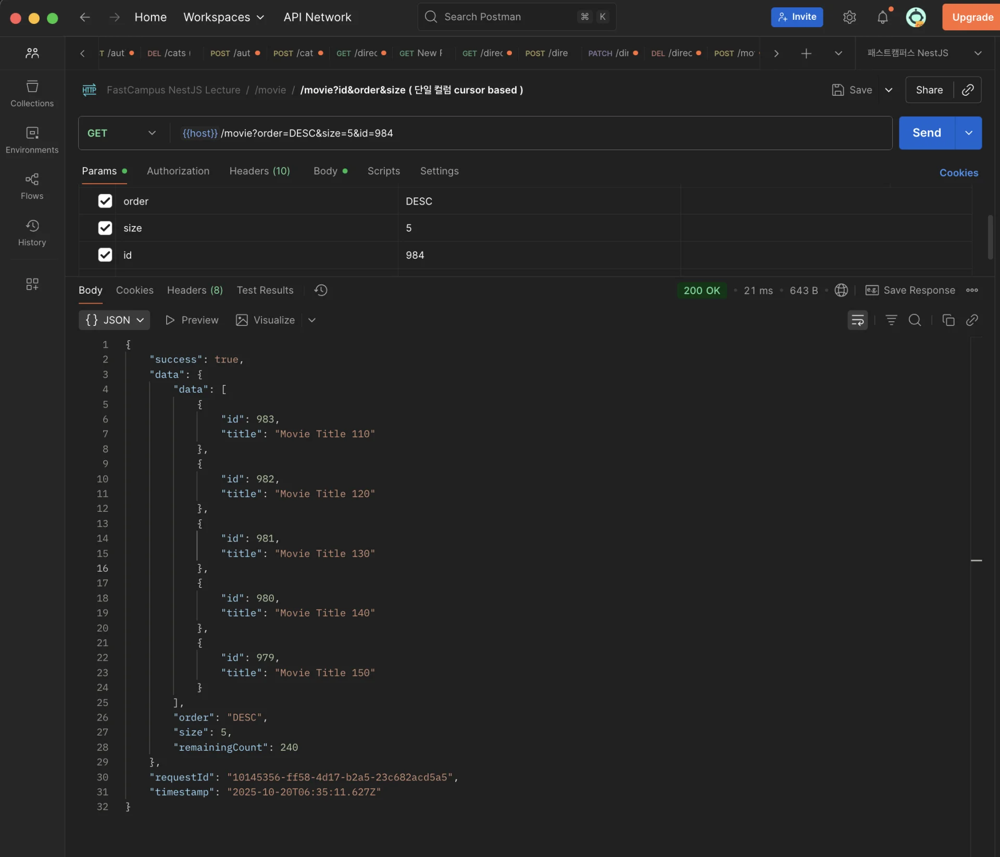

> 
> 
> <a id="272eda9b0fe18094b3afc08ac4879d66"></a>
> 
> <strong>목차</strong>
> 
> - [단일 컬럼 Cursor Based Pagination 적용](#272eda9b0fe18060a3adf85b0e5be9d1)
> - [구현 코드](#292eda9b0fe180e9a1cef5f70cba8dcc)
> - [포스트맨 테스트](#272eda9b0fe180d0bac8e707eb1aeedb)

<a id="272eda9b0fe18060a3adf85b0e5be9d1"></a>

## 단일 컬럼 Cursor Based Pagination 적용

---

> ✏️ 
> 
> <a id="292eda9b0fe18008aec2fafc56af2ca6"></a>
> 
> 마지막 요소의 조건 값(id)보다 낮은 요소들을 size(5)만큼 조회하여 가져온다&#46; 
> 
> <details>
> <summary>ex) SQL</summary>
> 
> <a id="292eda9b0fe18025a721d3f831a5d0ca"></a>
> 
> ```sql
> SELECT * from movie m
> WHERE m.id < :id
> ORDER BY DESC
> LIMIT :size;
> ```
> 
> -  내림차순(<code>DESC</code>) 정렬 후, 인자로 받는 id 보다 작은 데이터들을 size 만큼 가져온다&#46; 
> 
> </details>

<a id="292eda9b0fe180e9a1cef5f70cba8dcc"></a>

### 구현 코드

<details>
<summary><strong>&#91; 코드 &#93; CursorPaginationReqDto</strong></summary>

<a id="272eda9b0fe180eab1cac81fcf200604"></a>

```typescript
import { IsIn, IsInt, IsOptional } from 'class-validator';

export class CursorPaginationReqDto {
  @IsInt()
  @IsOptional()
  id: number;

  @IsIn(['ASC', 'DESC'])
  @IsOptional()
  order: 'ASC' | 'DESC' = 'DESC';
}
```

</details>

<details>
<summary><strong>&#91; 코드 &#93; GetMoviesReqDto</strong></summary>

<a id="292eda9b0fe180949e16d6968f71fcc0"></a>

```typescript
import { IsOptional, IsString } from 'class-validator';
import { CursorPaginationReqDto } from 'src/common/dto/cursor/cursor-pagination.request.dto';

export class GetMoviesReqDto extends CursorPaginationReqDto {
  @IsString()
  @IsOptional()
  title?: string;
}
```

</details>

<details>
<summary><strong>&#91; 코드 &#93; MovieService</strong></summary>

<a id="292eda9b0fe18065ab0ef8dfc47430d0"></a>

```typescript
@Injectable()
export class MovieService {
  constructor(
    @InjectRepository(Movie)
    private readonly movieRepository: Repository<Movie>,
    @InjectRepository(MovieDetail)
    private readonly movieDetailRepository: Repository<MovieDetail>,
    @InjectRepository(Director)
    private readonly directorRepository: Repository<Director>,
    @InjectRepository(Genre)
    private readonly genreRepository: Repository<Genre>,
    private readonly dataSource: DataSource,
    private readonly commonSerivce: CommonService,
  ) {}
  
  async findAllByTitle(dto: GetMoviesReqDto) {
    const { title, id, order, size } = dto;

    const qb = this.dataSource
      .getRepository(Movie)
      .createQueryBuilder('movie')
      .leftJoinAndSelect('movie.director', 'director')
      .leftJoinAndSelect('movie.genres', 'genres')
      .leftJoinAndSelect('movie.detail', 'detail');

    if (title) {
      qb.where('movie.title LIKE :title', { title: `%${title}%` });
    }

    this.commonSerivce.applyCursorPaginationParamsToQb(qb, dto);

    const [movies, count] = await qb.getManyAndCount();

    return CursorePaginationResDto.from(movies, order, size, count);
  }
  
  ... 
```

</details>

<details>
<summary><strong>&#91; 코드 &#93; CommonService</strong></summary>

<a id="292eda9b0fe18002acadf8d1c9703501"></a>

```typescript

@Injectable()
export class CommonService {
  constructor() {}

	applyCursorPaginationParamsToQb<T extends ObjectLiteral>(
	  qb: SelectQueryBuilder<T>,
	  dto: CursorPaginationReqDto,
	) {
	  /** 단일 컬럼(id) Cursor Pagination */
	  const { id, order, size } = dto;
	
	  if (id) {
	    const direction = order === 'ASC' ? '>' : '<';
	
	    // ex) order = 'ASC',  movie.id > :id
	    qb.where(`${qb.alias}.id ${direction} :id`, { id });
	  }
	
	  qb.orderBy(`${qb.alias}.id`, order);
	  qb.take(size);
	}
}

```

</details>

<details>
<summary><strong>&#91; 코드 &#93; CursorePaginationResDto</strong> &#45; 정적 팩토리 패턴</summary>

<a id="292eda9b0fe180eebea0e47ab272c1ca"></a>

```typescript
export class CursorePaginationResDto<T> {
  readonly data: T[];
  readonly order: 'ASC' | 'DESC';
  readonly size: number;
  readonly remainingCount?: number;

  private constructor(
    data: T[],
    order: 'ASC' | 'DESC',
    size: number,
    remainingCount?: number,
  ) {
    this.data = data;
    this.order = order;
    this.size = size;

    if (remainingCount !== undefined) {
      this.remainingCount = remainingCount;
    }

    Object.freeze(this);
  }

  static from<T>(
    data: T[],
    order: 'ASC' | 'DESC',
    size: number,
    remainingCount?: number,
  ) {
    return new CursorePaginationResDto(data, order, size, remainingCount);
  }
}
```

</details>

<a id="272eda9b0fe180d0bac8e707eb1aeedb"></a>

### 포스트맨 테스트

> ✏️ 
> 
> <a id="292eda9b0fe180269f1de1fb4b0da82c"></a>
> 
> 단일 컬럼 Cursor Pagination
> 
> > 정렬 조건의 마지막 요소 값을 넘겨 그 다음 순서를 가져온다&#46; 
> 
> - orderBy&#58; <code>DESC</code>
> 
> - size&#58; <code>5</code>
> 
> - 조건&#58; <code>id</code>

<details>
<summary>1번째 조회</summary>



- <code>limit = 5</code>

</details>

<details>
<summary>2번째 조회</summary>



- <code>id &#60; 989</code>

- <code>limit = 5</code>

</details>

<details>
<summary>3번째 조회</summary>



- <code>id &#60; 984</code>

- <code>limit = 5</code>

</details>
