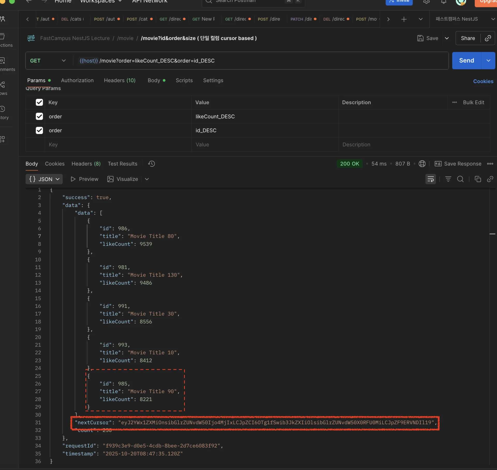
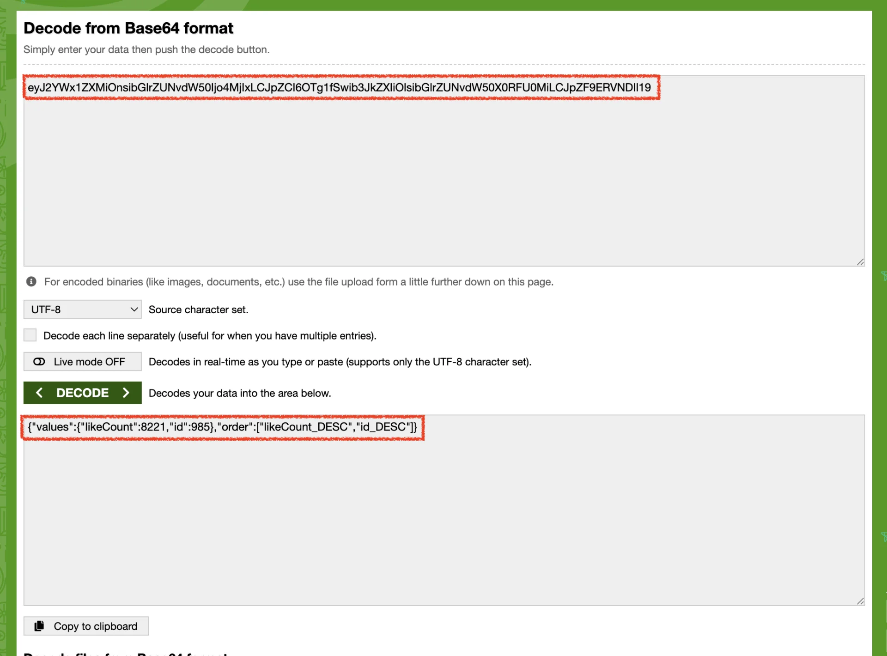
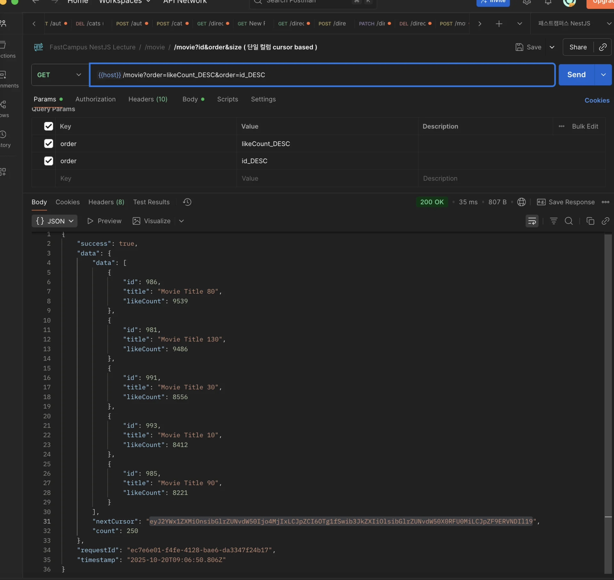
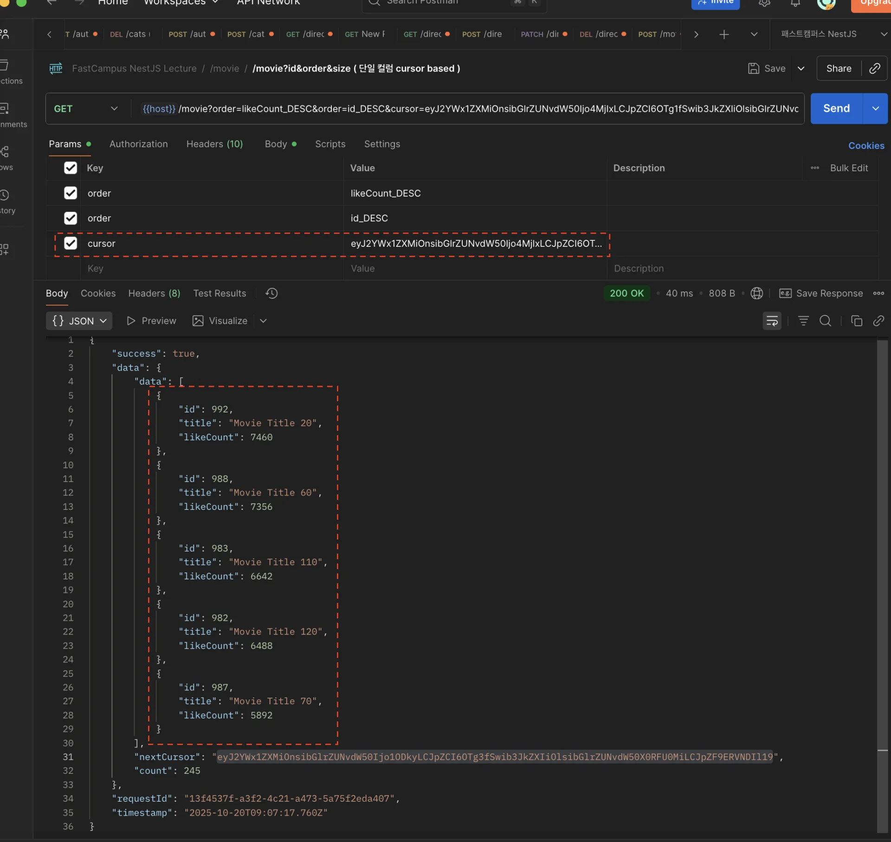
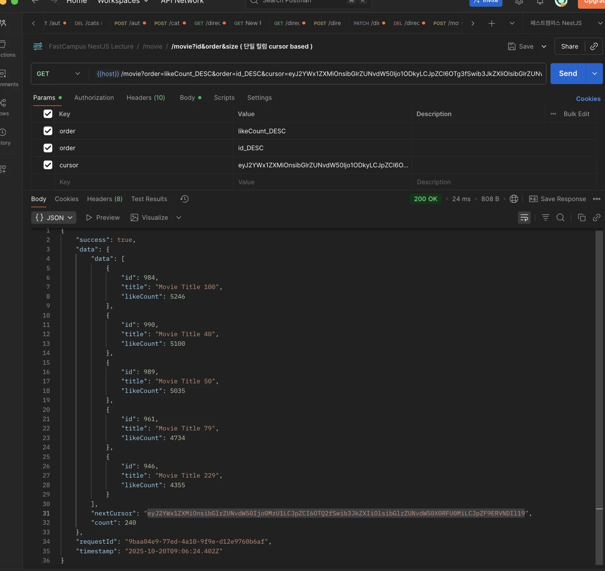

> 
> 
> <a id="272eda9b0fe1803d9f47d5eeeb7d884d"></a>
> 
> <strong>목차</strong>
> 
> - [멀티 컬럼 Cursor Based Pagination](#272eda9b0fe180e2b459cf8a89ef867d)
> - [ 1.  SQL 공식](#273eda9b0fe180469337f0469861cb7a)
> - [ 2. NestJS 코드 구현 ](#292eda9b0fe180c28757fd46d712ca2a)
> - [구현 코드 ](#273eda9b0fe18017907ce2fb15ddf631)
> - [포스트맨 테스트 ](#292eda9b0fe180ca81f2d77332298fba)

<a id="272eda9b0fe180e2b459cf8a89ef867d"></a>

## 멀티 컬럼 Cursor Based Pagination

---

<a id="273eda9b0fe180469337f0469861cb7a"></a>

###  1&#46;  SQL 공식

> 🔗 
> 
> > <a href="#/post/273eda9b-0fe1-80a8-9450-dfe4af1a0ffd">페이지</a> &#45; Cursor Based Pagination &#45; <code>멀티 컬럼</code> 참조
> 
> <a id="292eda9b0fe180a78efce2f02bf4ae20"></a>
> 
> 멀티 컬럼 Cursor Based Pagination은 아래와 같은 SQL 공식을 가진다&#46; <br>따라서 이를 코드로 구현하면 된다&#46; 
> 
> - Base64 인코딩과 같은 이외 정책들은 동료 및 팀과의 논의를 통해서 적절하게 적용하면 된다&#46; 
> 
> - 중요한 것은 아래 핵심 공식을 사용해 데이터를 적절히 필터링 가져오는 것이다&#46;

<a id="292eda9b0fe18032bf97f57fae4b7e37"></a>

```sql
// 정렬 컬럼: c1, c2, c3 ... 
// 컬럼의 마지막 값: v1, v2, v3 ...
SELECT ... FROM ...
WHERE (c1 < v1)
  OR (c1 = v1 AND c2 < v2)
  OR ( c1 = v1 AND c2 = v2 AND c3 < v3 )
  OR ...
ORDER BY c1 DESC, c2 DESC, c3 DESC ...   // ASC 경우 부호 반대 
LIMIT 5;
```

• SQL 공식

<a id="292eda9b0fe180c28757fd46d712ca2a"></a>

###  2&#46; NestJS 코드 구현 

<a id="273eda9b0fe18017907ce2fb15ddf631"></a>

### 구현 코드 

<details>
<summary><strong>&#91; 코드 &#93; </strong>CursorPaginationReqDto</summary>

<a id="292eda9b0fe18062adedfdbfa0706cf5"></a>

```typescript
import { IsArray, IsIn, IsInt, IsOptional, IsString } from 'class-validator';

export class CursorPaginationReqDto {
  @IsString()
  @IsOptional()
  cursor?: string; // ex. 'id_52,likeCount_20'

  @IsArray()
  @IsString({
    each: true,
  })
  @IsOptional()
  order: string[] = ['id_DESC']; // ex. ['likeCount_DESC', 'id_DESC']

  @IsInt()
  @IsOptional()
  size: number = 5;
}

```

</details>

<details>
<summary><strong>&#91; 코드 &#93; </strong>CommonService</summary>

<a id="272eda9b0fe1801db424e81b72aeffc2"></a>

```typescript
@Injectable()
export class CommonService {

	async applyCursorPaginationParamsToQb<T extends ObjectLiteral>(
    qb: SelectQueryBuilder<T>,
    dto: CursorPaginationReqDto,
  ) {
    let { cursor, order, size } = dto;

    // cursor 값이 존재하는 경우, 해당 정보로 오버라이딩
    if (cursor) {
      const decoderCursor = Buffer.from(cursor, 'base64').toString('utf-8');

      /** 
        { 
          values: { id: 27 },
          order: ['id_DESC']
        } 
     */
      const cursorObj = JSON.parse(decoderCursor);

      order = cursorObj.order; // array
      const { values } = cursorObj; // object

      /** Case 1. 더 세부적인 설정이 필요한 경우 ( 거의 없음 )
        WHERE (column1 > value1)
        OR  (column1 = value1 AND column2 < value2)
        OR  (column1 = value1 AND column2 = value2 AND column3 > value3)
      */
      
      /** Case 2. 같은 부호인 경우 ( 일반적인 케이스 )
        (column1, column2, column3) > (value1, value2, value3)
       */
      const columns = Object.keys(values);
      const comparisonOperator = order.some((o) => o.endsWith('DESC'))
        ? '<'
        : '>';
      const whereConditions = columns.map((c) => `${qb.alias}.${c}`).join(',');
      const whereParams = columns.map((c) => `:${c}`).join(',');

      qb.where(
        `(${whereConditions}) ${comparisonOperator} (${whereParams})`,
        values,
      );
    }

    // ["likeCount_DESC", "id_DESC"]
    for (let i = 0; i < order.length; i++) {
      const [column, direction] = order[i].split('_');
      
      if (direction !== 'ASC' && direction !== 'DESC') {
        throw new BadRequestException(
          "Order는 'ASC' 또는 'DESC'로 입력해주세요.",
        );
      }
      
      if (i === 0) {
        qb.orderBy(`${qb.alias}.${column}`, direction);
      } else {
        qb.addOrderBy(`${qb.alias}.${column}`, direction);
      }
    }
    
    qb.take(size);

    const results = await qb.getMany();
    const nextCursor = this.generateNextCursor(results, order);
    
    return { qb, nextCursor };
  }
	
  private generateNextCursor<T>(results: T[], order: string[]): string | null {
    /** 
      { 
        values: { id: 27 },
        order: ['id_DESC']
      } 
     */
    const lastItem = results[results.length - 1]; // 마지막 요소
    const values = {};

    order.forEach((ColumnOrder) => {
      const [column] = ColumnOrder.split('_');
      values[column] = lastItem[column];
    });

    const cursorObj = { values, order };
    const nextCursor = Buffer.from(JSON.stringify(cursorObj)).toString(
      'base64',
    );

    return nextCursor;
  }
}
```

</details>

<details>
<summary><strong>&#91; 코드 &#93; </strong>MovieService</summary>

<a id="292eda9b0fe180fca310d343df38cbf9"></a>

```typescript
@Injectable()
export class MovieService {
  constructor(...) {}

  async findAllByTitle(dto: GetMoviesReqDto) {
    const { title } = dto;

    const qb = this.dataSource
      .getRepository(Movie)
      .createQueryBuilder('movie')
      .leftJoinAndSelect('movie.director', 'director')
      .leftJoinAndSelect('movie.genres', 'genres')
      .leftJoinAndSelect('movie.detail', 'detail');

    if (title) {
      qb.where('movie.title LIKE :title', { title: `%${title}%` });
    }

    const { nextCursor } =
      await this.commonSerivce.applyCursorPaginationParamsToQb(qb, dto);

    const [data, count] = await qb.getManyAndCount();

    return { data, nextCursor, count };
  }
  
  ...
```

</details>

<details>
<summary>🧐 <strong>튜플 비교 방식 (PostgreSQL 지원)&#58; </strong><code>WHERE (column1, column2, column3) &#62; (value1, value2, value3)</code></summary>

> ✏️ 
> 
> <a id="292eda9b0fe18057a8e6fc371745c454"></a>
> 
> <strong>튜플 비교 방식</strong>
> 
> <a id="292eda9b0fe180aca350f257984312d7"></a>
> 
> ```sql
> WHERE (column1, column2, column3) > (value1, value2, value3)
> ```
> 
> > 모든 컬럼이 같은 연산자를 써야한다&#46;
> 
> <a id="292eda9b0fe180f48295e17253d7ad63"></a>
> 
> 장<strong>점</strong>
> 
> - 일반적인 <strong>순차적 비교</strong>에서 간단하게 사용 가능
> 
> - 가독성이 훨씬 좋음
> 
> - 컬럼이 많아도 한 줄로 표현 가능
> 
> <a id="292eda9b0fe18051a55fc60e16b2489d"></a>
> 
> <strong>단점</strong>
> 
> - <strong>컬럼별 다른 연산자를 적용할 수 없음</strong>
> 
> - 모든 비교는 동일한 부호(&#62;, &#60;, &#62;=, &#60;=)여야 함

-  <strong>PostgreSQL 튜플 비교 지원 → lexicographical(사전식) 비교</strong> 수행
    <a id="292eda9b0fe180289253ceb9d555cffb"></a>

    ```sql
    WHERE (column1, column2, column3) > (value1, value2, value3)
    ```

    <a id="292eda9b0fe180dbb61dcfaa506557c3"></a>

    위 SQL은 내부적으로 아래와 같은 의미를 갖는다&#46;

    <a id="292eda9b0fe1805b8e1edb86a5547ce5"></a>

    ```sql
    WHERE (a1 > b1)
    OR (a1 = b1 AND a2 > b2)
    OR (a1 = b1 AND a2 = b2 AND a3 > b3)
    ```

</details>

<a id="292eda9b0fe180ca81f2d77332298fba"></a>

### 포스트맨 테스트 

<details>
<summary>nextCursor 값 확인</summary>





<a id="292eda9b0fe180b7b26fda9584c6f650"></a>

응답으로 받는 nextCursor 값을 디코딩하면 마지막 요소의 value와 동일한 것을 확인할 수 있다&#46; 

</details>

<details>
<summary>1 번째 조회</summary>

> ✏️ 
> 
> <a id="292eda9b0fe18039a1f4dc42587cfd82"></a>
> 
> 위 값과 정렬 정보가 base64로 인코딩되어 nextCoursor의 값으로 응답 받아온다&#46; 
> 
> - path&#58;<code>/movie?order=</code><u><code>likeCount&#95;DESC</code></u><code>&#38;order=</code><u><code>id&#95;DESC</code></u>
> 
> - 마지막 요소
>     - likeCount&#58; <code>8221</code>
> 
>     - id&#58; <code>985</code>



</details>

<details>
<summary>2 번째 조회</summary>

> ✏️ 
> 
> <a id="292eda9b0fe180bb9a30d20b930c9ac5"></a>
> 
> 요청으로 받는 cursor 값을 디코딩하여 이전 페이지의 마지막 요소를 확인하고 정렬 조건에 따라 크거나 작은 값으로 필터링해 응답값을 보낸다&#46; 
> 
> <a id="292eda9b0fe180cab84cfe91518196ed"></a>
> 
> 여기서도 마지막 요소와 정렬 조건을 base64로 인코딩해 응답 데이터에 담아보낸다&#46; 
> 
> - path&#58;<code>/movie?<br>order=</code><u><code>likeCount&#95;DESC</code></u><code>&#38;<br>order=</code><u><code>id&#95;DESC</code></u><code>&#38;<br>cursor={nextCursor}</code>
> 
> - 마지막 요소
>     - likeCount&#58; <code>5892</code>
> 
>     - id&#58; <code>987</code>



</details>

<details>
<summary>3 번째 조회</summary>

> ✏️ 
> 
> <a id="292eda9b0fe180de892cc6873c3938e8"></a>
> 
> 2번째 경우와 동일 → 마지막 조회까지 반복
> 
> - path&#58;<code>/movie?<br>order=</code><u><code>likeCount&#95;DESC</code></u><code>&#38;<br>order=</code><u><code>id&#95;DESC</code></u><code>&#38;<br>cursor={nextCursor}</code>
> 
> - 마지막 요소
>     - likeCount&#58; <code>4355</code>
> 
>     - id&#58; <code>946</code>



</details>
