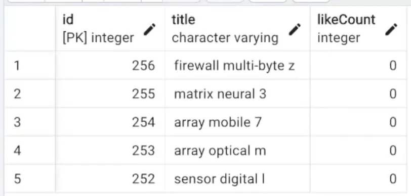
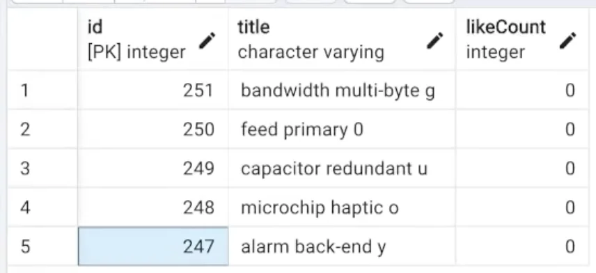
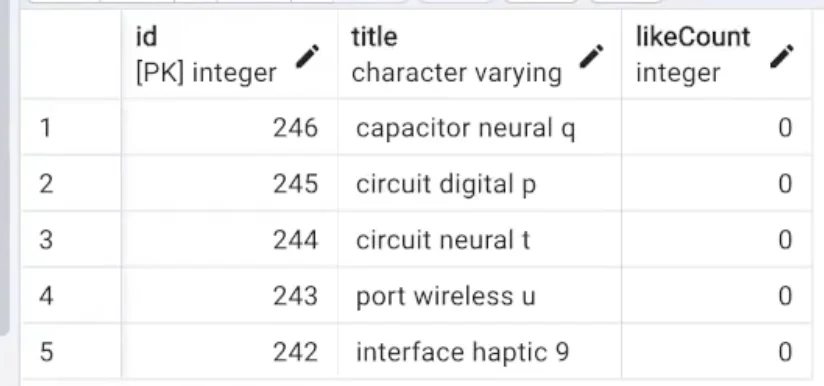
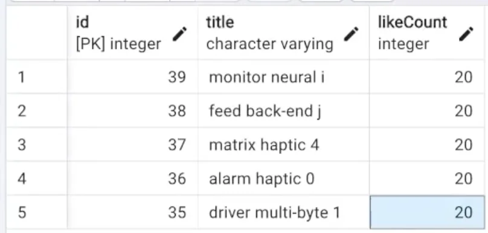
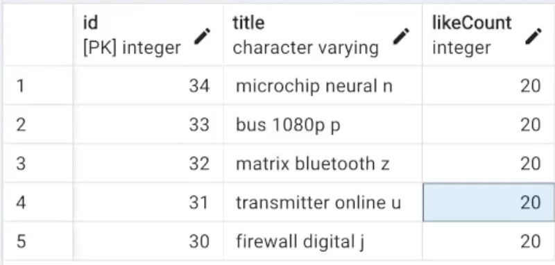
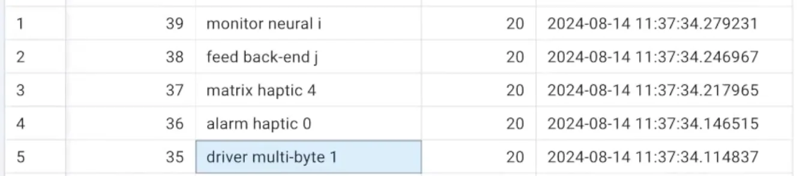
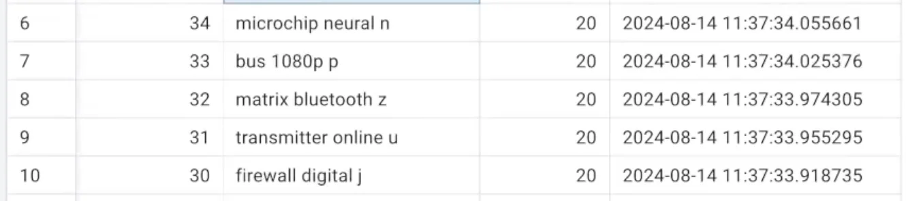

> 
> 
> <a id="273eda9b0fe1816f80a4e17b0611cfd5"></a>
> 
> <strong>목차</strong>
> 
> - [Pagination: SQL ](#273eda9b0fe181f884a9ebb8350f5ff1)
> - [1.  Page Based Pagination](#273eda9b0fe1813587b2d868b59c4f78)
> - [2. Cursor Based Pagination - 단일 컬럼](#273eda9b0fe180189678cdb811aae5f6)
> - [3. Cursor Based Pagination - 멀티 컬럼](#273eda9b0fe181a98625c737d473e347)

<a id="273eda9b0fe181f884a9ebb8350f5ff1"></a>

## Pagination&#58; <code>SQL</code> 

---

<a id="273eda9b0fe1813587b2d868b59c4f78"></a>

### 1&#46;  Page Based Pagination

> ✏️ 
> 
> <a id="273eda9b0fe1808fb5d7cf8f2c800167"></a>
> 
> 페이지 기반 페이지네이션은 <code>LIMIT</code>과 <code>OFFSET</code> 설정을 통해 간단하게 페이지 적용이 가능하다&#46; 
> 
> - <code>LIMIT</code>&#58; 페이지 마다 조회하는 데이터 사이즈
> 
> - <code>OFFSET</code>
>     - 각 페이지의 시작 데이터 <br>즉, 스킵 처리해야하는 이전 페이지 데이터 
> 
>     - <code>( page &#45; 1 ) &#42; size</code>

<details>
<summary>page&#58; <code>1</code>, size&#58; <code>5</code></summary>

<a id="273eda9b0fe18135997ec8ad3be874ae"></a>

```sql
SELECT id, title, "likeCount" FROM movie
ORDER BY id DESC
LIMIT 5;
```

</details>

<details>
<summary>page&#58; <code>2</code>, size&#58; <code>5</code></summary>

<a id="273eda9b0fe1802a98bcd4a7a2c4c791"></a>

```sql
SELECT id, title, "likeCount" FROM movie
ORDER BY id DESC
LIMIT 5;
OFFSET 5;
```

</details>

<details>
<summary>page&#58; <code>3</code>, size&#58; <code>5</code></summary>

<a id="273eda9b0fe180f78f3ecdd9ee8c5a78"></a>

```sql
SELECT id, title, "likeCount" FROM movie
ORDER BY id DESC
LIMIT 5;
OFFSET 10;
```

</details>

<a id="273eda9b0fe180189678cdb811aae5f6"></a>

### 2&#46; Cursor Based Pagination &#45; <code>단일 컬럼</code>

> ✏️ 
> 
> <a id="273eda9b0fe180628a06cd1885ee1507"></a>
> 
> 커서 기반 페이지네이션은 <strong><u>마지막 요소를 기준으로 다음 요소</u></strong>를 LIMIT 만큼 가져온다&#46;
> 
> - 단일 컬럼의 경우, 아래 예시와 같이 쉽게 조건 설정이 가능하지만, <strong>멀티 컬럼의 경우 조건 요구사항</strong>이 복잡해진다&#46; 

> 정렬 조건&#58; 컬럼 1개 (<code>id DESC</code>)

<details>
<summary>1번째 조회&#58; <code>id &#45; 256 &#126; 252</code></summary>

<a id="273eda9b0fe180eaa1ffcebaa371d9f0"></a>

```sql
SELECT id, title, "likeCount" FROM movie
ORDER BY id DESC
LIMIT 5;
```



</details>

<details>
<summary>2번째 조회&#58; <code>id &#45; 251 &#126; 247</code></summary>

<a id="273eda9b0fe18066b0f1e8bbb2285c03"></a>

```sql
SELECT id, title, "likeCount" FROM movie
WHERE id < 252 // 마자막 요소의 값보다 작은 값부터 조회
ORDER BY id DESC
LIMIT 5;
```



</details>

<details>
<summary>3번째 조회&#58; <code>id &#45; 246 &#126; 242</code></summary>

<a id="290eda9b0fe180428c52e0efa9c166ad"></a>

```sql
SELECT id, title, "likeCount" FROM movie
WHERE id < 247 // 마자막 요소의 값보다 작은 값부터 조회
ORDER BY id DESC
LIMIT 5;
```



</details>

<a id="273eda9b0fe181a98625c737d473e347"></a>

### 3&#46; Cursor Based Pagination &#45; <code>멀티 컬럼</code>

> ✏️ 
> 
> <a id="273eda9b0fe18001a7f1e0670f993558"></a>
> 
> Cursor 기반 페이징 처리에서 <strong><u>여러 컬럼을 정렬 조건</u></strong>으로 가지는 경우, 아래의 <strong><u>공식</u></strong>을 통해 다음 조회될 데이터 셋을 구한다&#46; 
> 
> > 공식
> 
> <a id="273eda9b0fe180469823c895e61ca53c"></a>
> 
> ```sql
> // 정렬 컬럼: c1, c2, c3 ... 
> // 컬럼의 마지막 값: v1, v2, v3 ...
> SELECT ... FROM ...
> WHERE (c1 < v1)
>   OR (c1 = v1 AND c2 < v2)
>   OR ( c1 = v1 AND c2 = v2 AND c3 < v3 )
>   OR ...
> ORDER BY c1 DESC, c2 DESC, c3 DESC ...   // ASC 경우 부호 반대 
> LIMIT 5;
> ```

> 정렬 조건&#58; 컬럼 2개 (<code>좋아요 수(likeCount) DESC</code>, <code>id DESC</code>)

<details>
<summary>1번째 조회</summary>

<a id="273eda9b0fe1805d95f1d59ab8f12c10"></a>

```sql
SELECT id, title, "likeCount" FROM movie
ORDER BY "likeCount" DESC, id DESC
LIMIT 5;
```



</details>

<details>
<summary>2번째 조회</summary>

<a id="273eda9b0fe1807e9378feccbf118b32"></a>

```sql
SELECT id, title, "likeCount" FROM movie
WHERE ("likeCount" < 20)
		OR ("likeCount" = 20 AND id < 35)
ORDER BY "likeCount" DESC, id DESC
LIMIT 5;
```



</details>

> 정렬 조건&#58; 컬럼 3개 (<code>좋아요 수(likeCount) DESC</code>, <code>id DESC</code>, <code>createdAt DESC</code>)

<details>
<summary>1번째 조회</summary>

<a id="273eda9b0fe18086a667f82b9d3ae005"></a>

```sql
SELECT id, title, "likeCount" FROM movie
ORDER BY "likeCount" DESC, id DESC, "createdAt" DESC
LIMIT 5;
```



</details>

<details>
<summary>2번째 조회</summary>

<a id="273eda9b0fe1800589c4e73e09dc0e48"></a>

```sql
SELECT id, title, "likeCount" FROM movie
WHERE ("likeCount" < 20)
		OR ("likeCount" = 20 AND id < 35)
		OR ("likeCount" = 20 AND id = 35 AND "createdAt" < "2024-08-14 11:37:34.114837)
ORDER BY "likeCount" DESC, id DESC
LIMIT 5;
```



</details>
