> 
> 
> <a id="274eda9b0fe1818db242c07c9a14ee2d"></a>
> 
> <strong>목차</strong>
> 
> - [TypeORM](#274eda9b0fe181458ea8d38da8ab6624)
> - [ DB 연결](#275eda9b0fe18034b5e6ce473cd1ef68)
> - [DataSource](#274eda9b0fe181c0801fc50a48533f23)
> - [ Entity ( 엔티티 )](#275eda9b0fe1809db82ae0315daf4d82)
> - [Entity](#274eda9b0fe18014aaf5df45c97f33af)
> - [Column 옵션](#274eda9b0fe18082a56ec2979a298281)
> - [주요 컬럼 옵션](#274eda9b0fe180308e9fdda4f207476e)
> - [특수 Column](#274eda9b0fe18040bf10c7270ed7c0ed)
> - [Entity Embedding ( 엔티티 임베딩 )](#274eda9b0fe180cd870bfa7c9a24d65a)
> - [Entity Inheritance  ( 엔티티 상속 )](#274eda9b0fe180388384fa21101a87d2)
> - [Single Table Inheritance ( 싱글 테이블 상속 )](#274eda9b0fe18037a34bced43367a4ce)
> - [Relationships ( 연관관계 )](#274eda9b0fe1801abb6bfabb23d53115)
> - [Relationship Annotation 적용](#274eda9b0fe180c8b2c4fdbf5058bb70)
> - [ManyToOne, OneToMany  ( N:1, 1:N )](#274eda9b0fe180c19fecc265f5daee93)
> - [OneToOne ( 1:1 )](#274eda9b0fe1803ba508d4822d076f7e)
> - [ManyToMany ( N:M )](#274eda9b0fe18070b66fc901673e9e13)
> - [ Repository](#275eda9b0fe180a8b555dc7f222fc0d3)
> - [ CRUD 메서드](#275eda9b0fe1806e8d0feb6d5a206dfb)
> - [생성 ( Create )](#275eda9b0fe180ee9afbd94a0b8fc3c6)
> - [조회 ( Read )](#275eda9b0fe1808f998bc33ac605f557)
> - [수정 ( Update )](#275eda9b0fe18010b47be70774a0188e)
> - [삭제 ( Delete )](#275eda9b0fe180a69423eeeaf01676ba)
> - [통계](#275eda9b0fe180e4ae9bf93c100afe5d)
> - [ Property](#275eda9b0fe1801eb1dde089e6e91843)
> - [FindOptions](#275eda9b0fe1801cbd1ff1ce3df2497e)
> - [FindOneOptions](#275eda9b0fe180dea19fcd41be9f0993)
> - [FindManyOptions](#275eda9b0fe1804aa322ff42e7e0e5b3)
> - [ Operator](#275eda9b0fe180938a95ff7331b6e3b8)
> - [Equal](#275eda9b0fe1808098d4fa9ee7081fc2)
> - [Not](#275eda9b0fe1806fbfbdd5fdd1fbac61)
> - [LessThan, LessThanOrEqual](#275eda9b0fe180cda7b2def3c7b6b08d)
> - [MoreThan, MoreThanOrEqual](#275eda9b0fe180b99405d9ab152fbf2a)
> - [Between](#275eda9b0fe180f6b8caea7151074597)
> - [Like, ILike](#275eda9b0fe18072b7a1d9e55dcfe4c9)
> - [In](#275eda9b0fe1804c8257d3fe01e6bead)
> - [ArrayContains, ArrayContainedBy, ArrayOverlap](#275eda9b0fe1807a8b83fc1f49362d9f)
> - [ArrayContains](#275eda9b0fe18042b37ddd11bace116a)
> - [ArrayOverlap](#275eda9b0fe18014b226e953df7dd782)
> - [IsNull](#275eda9b0fe18007b35cf1511206de8b)
> - [Or](#275eda9b0fe180ea966bd7158c756c1e)
> - [AND](#275eda9b0fe18038add4cbdcebbfd9be)
> - [ Raw Query](#275eda9b0fe180d195f9c8029944aabc)
> - [query()](#275eda9b0fe180108bb3c07420417e96)
> - [manager.query()](#275eda9b0fe1808b9ed9f166663857b8)
> - [repository.query()](#275eda9b0fe180b4ab94c4f915e826ac)
> - [createQueryRunner() ( Query Runner )](#275eda9b0fe180d7bd70e230418e310d)
> - [ 🧐 getOne(), getMany() vs getRawOne(), getRawMany()](#275eda9b0fe180e7993ffd3ad84378c3)
> - [엔티티 인스턴스(Entity Instance)와 차이점: ](#275eda9b0fe1800eb7bdf0cb78a50117)

<a id="274eda9b0fe181458ea8d38da8ab6624"></a>

# TypeORM

---

> 📖 
> 
> <a id="274eda9b0fe1819683e8f9a2d6822684"></a>
> 
> <code>OOP</code>를 사용해서 <strong><u>데이터베이스 테이블을 클래스로 관리</u></strong>할 수 있도록 해주는 <code>ORM</code>이다&#46;
> 
> <details>
> <summary>특징</summary>
> 
> - 다양한 DB 지원
>     - <code>MySQL</code>, <code>PostgreSQL</code>, <code>MariaDB</code>, <code>Oracle</code> …
> 
> - Active Record, Data Mapper 패턴을 모두 지원
> 
> - 자체적으로 Migration 기능을 지원
>     - 점진적인 데이터베이스 구조 변경과 버저닝을 모두 지원함
> 
> - Eager &#38; Lazy 로딩 모두 지원
> 
> </details>

> ❓ 
> 
> <a id="274eda9b0fe180e18ffbed11beea7688"></a>
> 
> <code>OOP</code>
> 
> <a id="274eda9b0fe1805ead5aeb940780a73f"></a>
> 
> Object Oriented Programming, 객체 지향 프로그래밍

> ❓ 
> 
> <a id="274eda9b0fe18167b5fdeefc5448f578"></a>
> 
> <code>ORM</code> ( <code>Object Relation Model</code> )
> 
> <a id="274eda9b0fe18156aff6ed48e6ec24b9"></a>
> 
> SQL을 SQL로 작성하지 않고 특정 언어(여기서는 TypeScript)의 코드 표현하고  이를, SQL로 관계(Relation) 짓는 방법론을 말한다&#46; 

<a id="275eda9b0fe18034b5e6ce473cd1ef68"></a>

##  DB 연결

---

> 📖 
> 
> <a id="275eda9b0fe18030aa39d7a252de9158"></a>
> 
> NestJS에서 DataSource 객체를 만들어 DB와 연결한다&#46;

<a id="274eda9b0fe181c0801fc50a48533f23"></a>

### DataSource

[DataSource &#124; TypeORM]()

> ✏️ 
> 
> <a id="274eda9b0fe1806ea046fca4bb2b8768"></a>
> 
> 사용할 데이터베이스 지정 및 정보 제공
> 
> - <code>type</code>&#58; DB 종류
> 
> - <code>host</code>&#58; 연결 호스트
> 
> - <code>port</code>&#58; 연결 포트
> 
> - <code>username</code>&#58; 아이디
> 
> - <code>password</code>&#58; 비밀번호
> 
> - <code>database</code>&#58; 연결 데이터베이스 
> 
> - <code>entities</code>&#58; TS 엔티티 객체

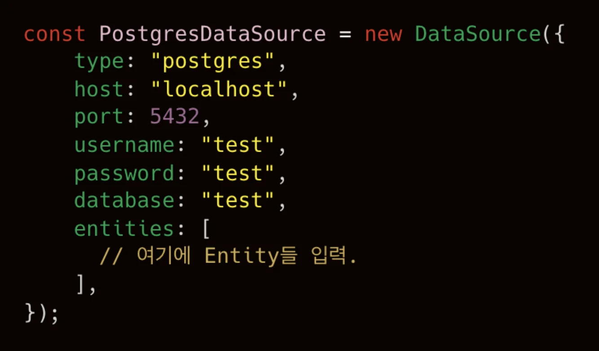

<a id="275eda9b0fe1809db82ae0315daf4d82"></a>

##  Entity ( 엔티티 )

---

> 📖 
> 
> <a id="275eda9b0fe1803e9136f736b403f5f3"></a>
> 
> DB 테이블과 매핑되는 Obejct(객체)를 일반적으로 Entity라 부른다&#46; 
> 
> - ORM을 통해 Entity를 명시하고 이를 DB 테이블에 자동 매핑하므로써 개발 생산성을 증가시킨다&#46; 

<a id="274eda9b0fe18014aaf5df45c97f33af"></a>

### Entity

> ✏️ 
> 
> <a id="275eda9b0fe1808d9840cecb8d3554db"></a>
> 
> 해당하는 데코레이터(어노테이션) 적용을 통해 클래스(엔티티)와 테이블을 매핑할 수 있다&#46;
> 
> - <code>&#64;Entity</code>&#58; 클래스 → 테이블로 매핑
> 
> - <code>&#64;Column</code>&#58; 테이블의 컬럼 생성
> 
> - <code>&#64;PrimaryGeneratedColumn</code>&#58; ID(PK) 자동 생성

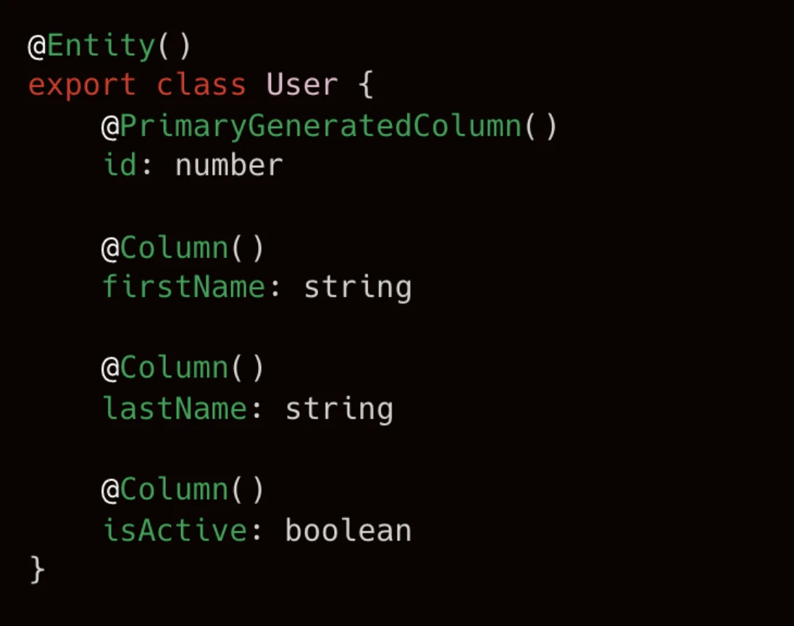

<a id="274eda9b0fe18082a56ec2979a298281"></a>

### Column 옵션

> ✏️ 
> 
> <a id="274eda9b0fe180e090c0efce7e734c77"></a>
> 
> <code>&#64;Column</code> 데코레이터에 첫번째 파라미터 객체에 옵션 값 제공 
> 
> 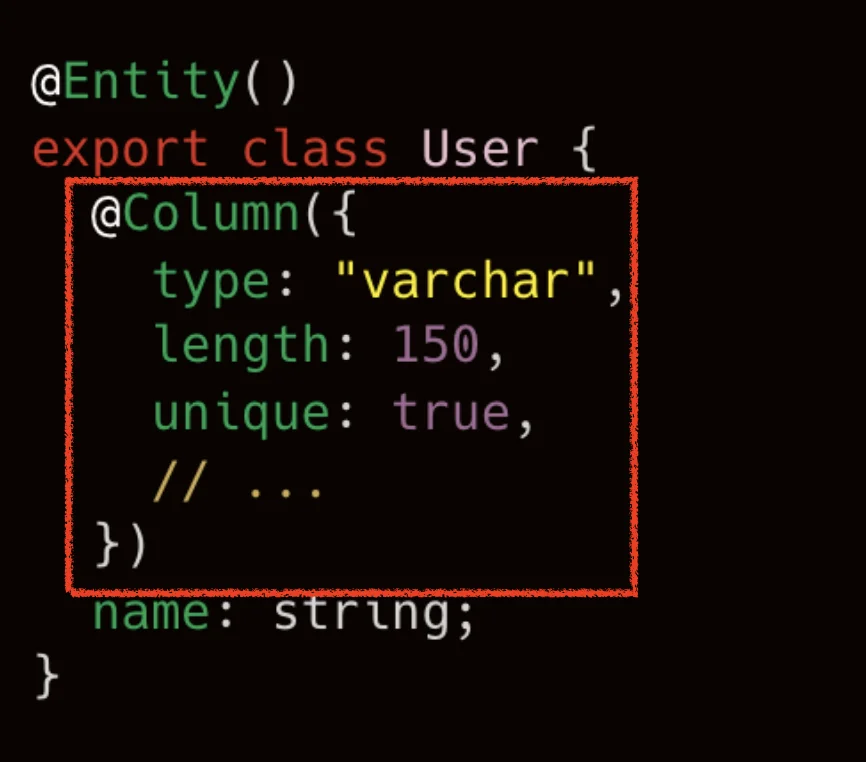

<a id="274eda9b0fe180308e9fdda4f207476e"></a>

### 주요 컬럼 옵션

> ✏️ 
> 
> - <strong><code>type</code></strong><code>&#58; ColumnType</code>
>     - 컬럼 타입 ( varchar, text, int, bool 등 )
> 
> - <strong><code>name</code></strong><code>&#58; string</code>
>     - DB에 저장될 컬럼 이름 ( 기본값은 프로퍼티 이름을 따른다&#46; )
> 
> - <strong><code>nullable</code></strong><code>&#58; boolean</code>
>     - Null 값 가능 여부 ( 기본값&#58; false )
> 
> - <strong><code>update</code></strong><code>&#58; boolean</code>
>     - 업데이트 가능여부, false일 경우 업데이트 불가 ( 기본값&#58; true )
> 
> - <strong><code>select</code></strong><code>&#58; boolean</code>
>     - 쿼리 실행 시 프로퍼티를 가져올 지 결정&#46; false일 경우 가져오지 않는게 기본
> 
> - <strong><code>default</code></strong><code>&#58; string</code>
>     - 컬럼 기본값
> 
> - <strong><code>unique</code></strong><code>&#58; boolean</code>
>     - unique constraint 적용 여부, 기본 false
> 
> - <strong><code>comment</code></strong><code>&#58; string</code>
>     - 컬럼 코멘트, 모든 데이터베이스에서 지원되진 않음
> 
> - <strong><code>enum</code></strong><code>&#58; string&#91;&#93;</code>
>     - 컬럼에 입력 가능한 값을 enum으로 나열
> 
> - <strong><code>array</code></strong><code>&#58; boolean</code>
>     - 컬럼 array 타입으로 생성 ex&#46; int&#91;&#93;

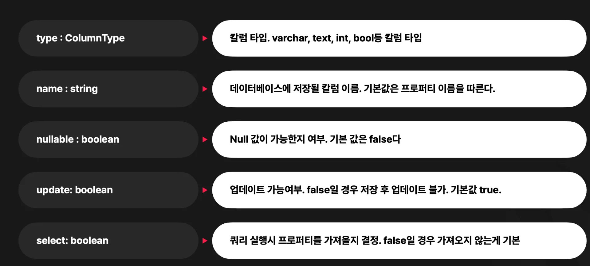

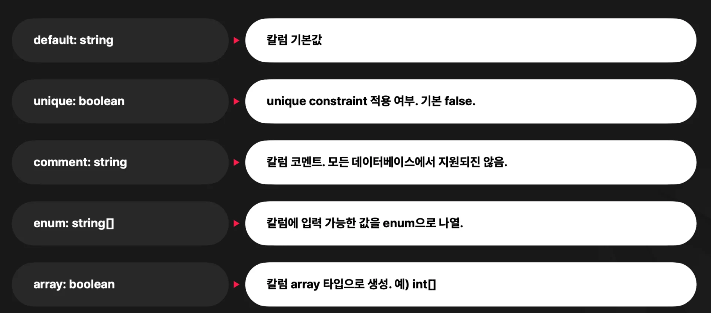

<a id="274eda9b0fe18040bf10c7270ed7c0ed"></a>

### 특수 Column

> ✏️ 
> 
> - <code>&#64;CreateDateColumn()</code>
>     - 자동으로 <strong><u>Row 생성 날짜시간</u></strong> 저장
> 
> - <code>&#64;UpdateDateColumn()</code>
>     - 자동으로 <strong><u>Row 최근 업데이트 날짜시간</u></strong> 저장
> 
> - <code>&#64;DeleteDateColumn()</code>
>     - 자동으로 <strong><u>Row의 Soft Delete 날짜시간</u></strong> 저장
> 
> - <code>&#64;VersionColumn()</code>
>     - 자동으로<strong><u> Row가 업데이트</u></strong> 될때마다 <strong><u>1씩 증가</u></strong>

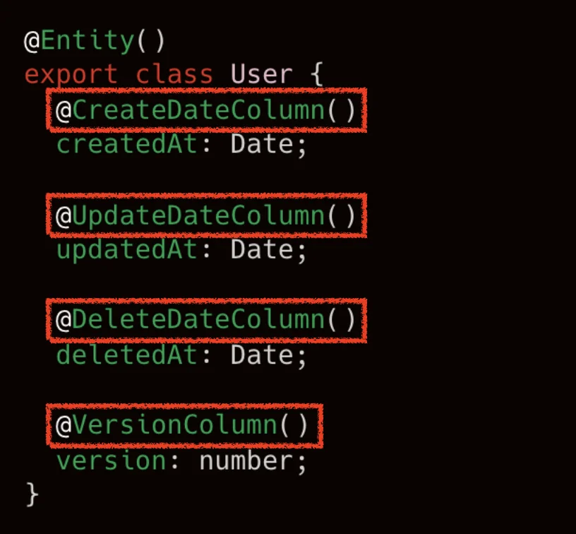

<a id="274eda9b0fe180cd870bfa7c9a24d65a"></a>

### Entity Embedding ( 엔티티 임베딩 )

[Embedded Entities &#124; TypeORM]()

> ✏️ 
> 
> <a id="274eda9b0fe180e0a2ddf673e28a1b61"></a>
> 
> 컬럼의 타입을 클래스로 정의
> 
> -  코드 중복 ↓, 유지보수 ↑ 

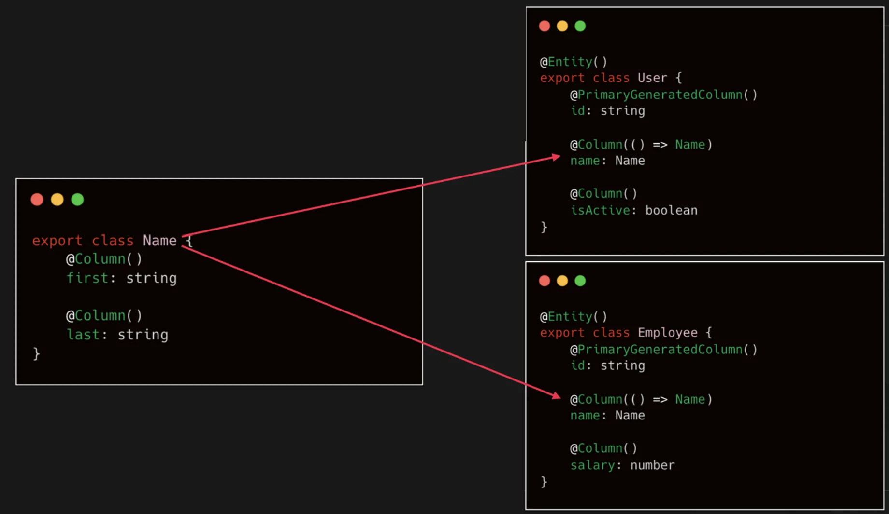

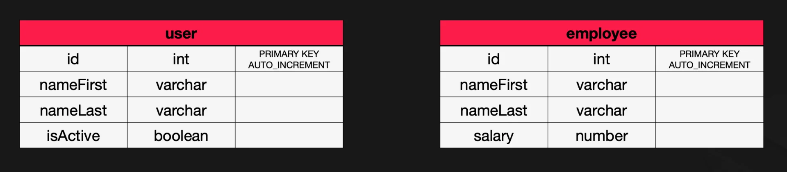

<a id="274eda9b0fe180388384fa21101a87d2"></a>

### Entity Inheritance  ( 엔티티 상속 )

[Entity Inheritance &#124; TypeORM]()

> ✏️ 
> 
> <a id="274eda9b0fe18044b20ff93d05efee6e"></a>
> 
> 공통 컬럼 추상화 후 엔티티 상속
> 
> -  코드 중복 ↓, 유지보수 ↑ 

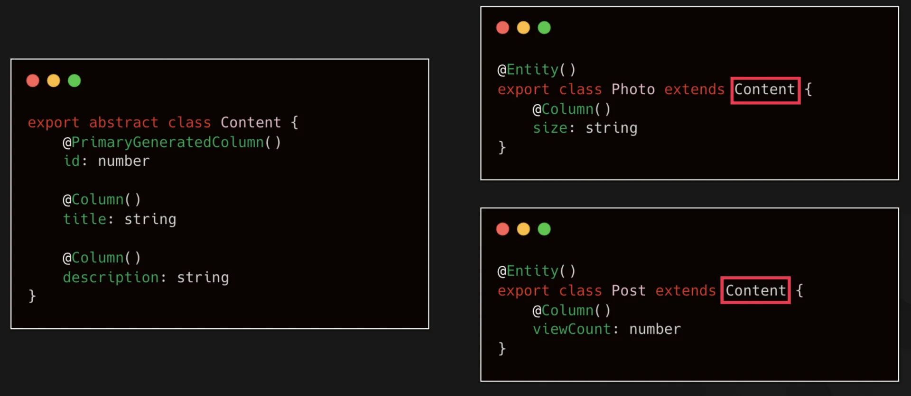

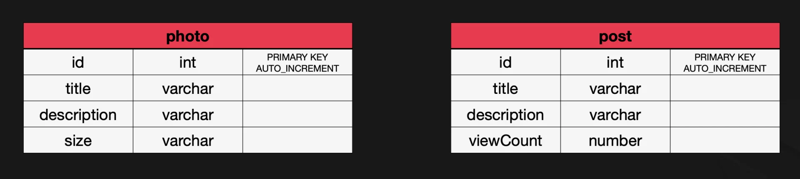

<a id="274eda9b0fe18037a34bced43367a4ce"></a>

### Single Table Inheritance ( 싱글 테이블 상속 )

> ✏️ 
> 
> <a id="274eda9b0fe180a48e29e60999dafc8b"></a>
> 
> <code>&#64;TableInheritance(&#46;&#46;&#46;)</code>를 통해 각기 다른 속성을 가진 여러 클래스들을 상속 처리할 수 있다&#46; ( 실제 DB 상에서는 같은 테이블로 저장된다&#46;  )
> 
> - <code>&#64;TableInheritance()</code>
> 
> - <code>&#64;ChildEntity()</code>

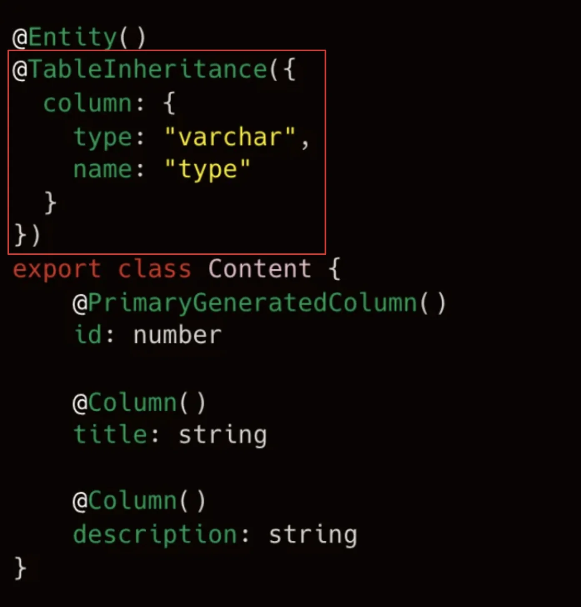

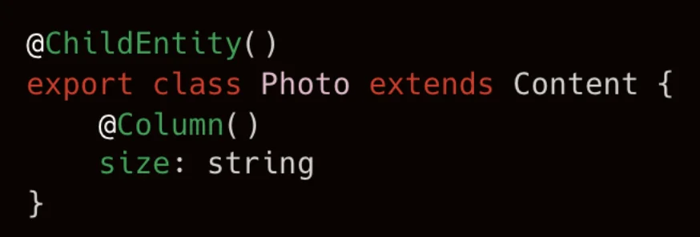

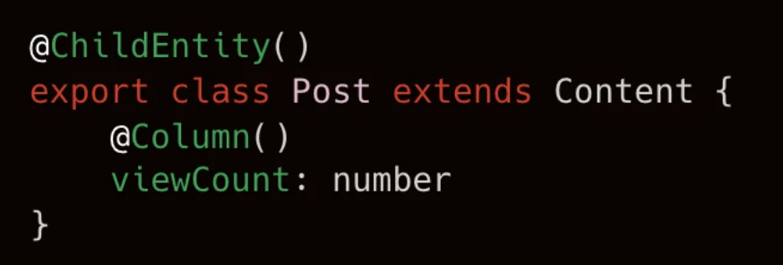

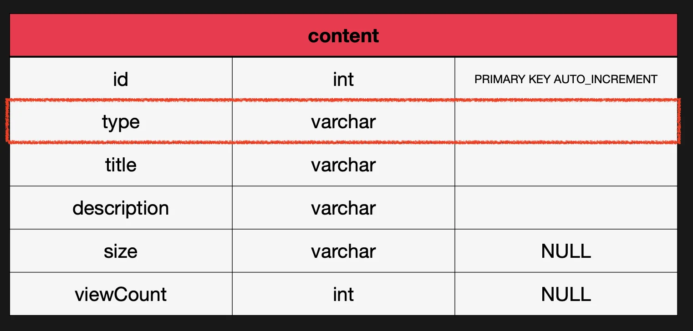

- 실제 DB 상에서는 같은 테이블로 저장된다&#46;  

<a id="274eda9b0fe1801abb6bfabb23d53115"></a>

### Relationships ( 연관관계 )

> ✏️ 
> 
> <a id="274eda9b0fe18081af59d7733aa8df09"></a>
> 
> TypeORM에서는 아래와 같은 4가지 Relation을 제공한다&#46;
> 
> - <code>&#64;OneToOne</code>&#58; <code>1&#58;1</code>
> 
> - <code>&#64;ManyToOne</code>&#58; <code>N&#58;1</code>
> 
> - <code>&#64;OneToMany</code>&#58; <code>1&#58;N</code>
> 
> - <code>&#64;ManyToMany</code>&#58; <code>N&#58;M</code>

<a id="274eda9b0fe180c8b2c4fdbf5058bb70"></a>

### Relationship Annotation 적용

> ✏️ 
> 
> 1. 첫번쨰 파라미터&#58; <strong><u>타입 반환 함수(callback</u></strong>) 입력
> 
> 1. 두번째 파라미터
>     - 첫번째 파라미터에 입력한 클래스의  컬럼 입력 
> 
>     - 해당 컬럼은 서로 연관관계를 설정할 프로퍼티여야한다&#46;
> 
>     - ex&#46; <code>1&#58;N</code> = <code>User&#46;photos ↔ Photo&#46;user</code>

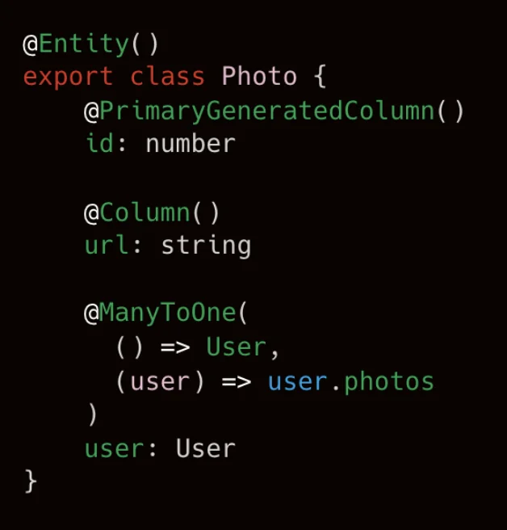

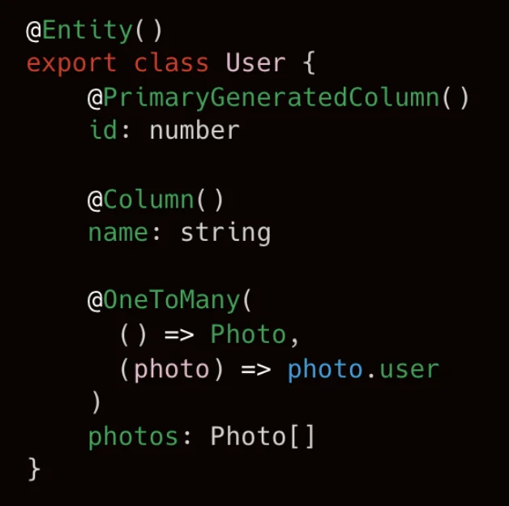

<a id="274eda9b0fe180c19fecc265f5daee93"></a>

### ManyToOne, OneToMany  ( <code>N&#58;1</code>, <code>1&#58;N</code> )

> ✏️ 
> 
> 1. photo 테이블에는 user&#95;id 칼럼이 자동으로 생긴다&#46; 
>     - 네이밍 패턴&#58; <code>{상대 테이블 이름}&#95;id</code>
> 
> 1. <code>user&#95;id</code>는 user 테이블의 id 컬럼을 <code>FK(Foreign Key)</code>로 참조한다&#46;
> 
> 1. <strong><u><code>1</code></u></strong><strong><u>에 해당되는 테이블(user)</u></strong>은 <strong><u>추가 컬럼이 생성되지 않</u></strong>는다&#46; 
>     - 참조를 가지는 <code>N 테이블</code>에만 래퍼런스 컬럼이 생성된다&#46;  


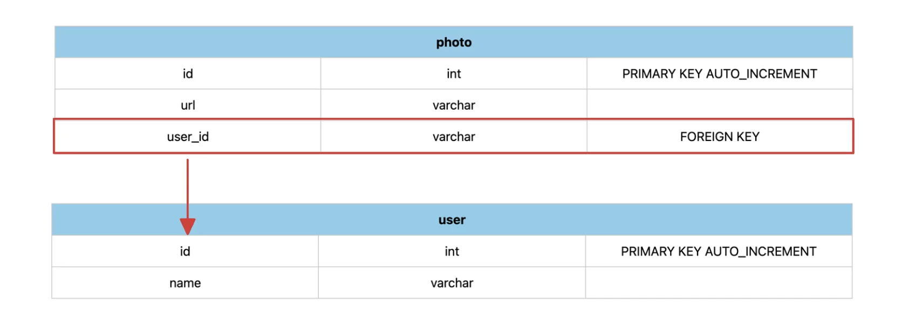

<a id="274eda9b0fe1803ba508d4822d076f7e"></a>

### OneToOne ( <code>1&#58;1</code> )

> ✏️ 
> 
> - 연관관계를 나타내는 컬럼들에 <code>&#64;OneToOne()</code> Annotation을 명시한다&#46; 
> 
> - <code>&#64;JoinTable()</code> Annotation을 래퍼런스 명시한다&#46; 
>     - <code>ManyToOne(OneToMany)</code>의 경우, 래퍼런스를 갖는 경우가 명확하다&#46; <br>( <code>Many</code> 에서 갖는다&#46; ) 
> 
>     - 그러나 <code>OneToONe</code>은 두 테이블 중 <strong><u>누가 래퍼런스를 들고 있어도 상관없</u></strong>다&#46;<br>따라서 <strong><u>어떤 테이블이 래퍼런스를 들고 있을 지를 명시</u></strong>해줘야 한다&#46; 
> 
>     - <code>&#64;JoinTable()</code>은 꼭 한쪽에만 적용해야 한다&#46; <br>( 둘 모두 적용하는 건 불가능하다&#46; )

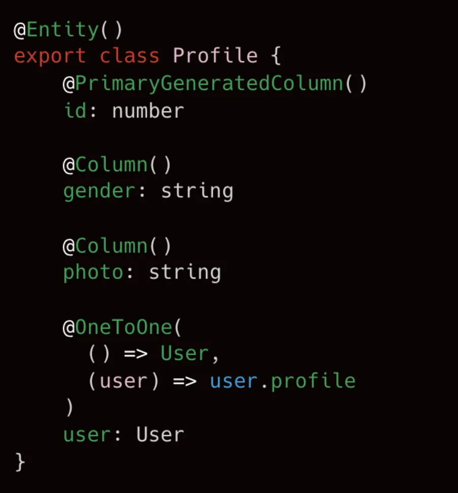

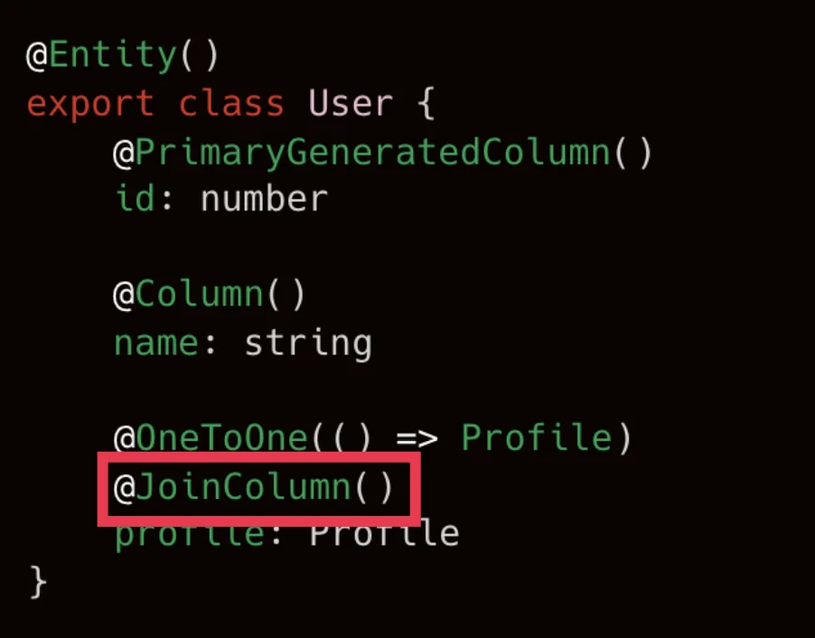

<a id="274eda9b0fe18070b66fc901673e9e13"></a>

### ManyToMany ( <code>N&#58;M</code> )

> ✏️ 
> 
> <a id="275eda9b0fe18056891cc4a0c1b29527"></a>
> 
> <code>OneToOne</code>과 마찬가지로 래퍼런스를 한쪽 엔티티에만 적용한다&#46;<br>즉, <code>&#64;JoinTable()</code> Annotation을 한쪽에만 적용한다&#46;
> 
> - 자동으로 중간 테이블 생성될 때 <code>&#64;JoinTable</code>이 적용된 테이블 이름이 먼저 위치하게 된다&#46;

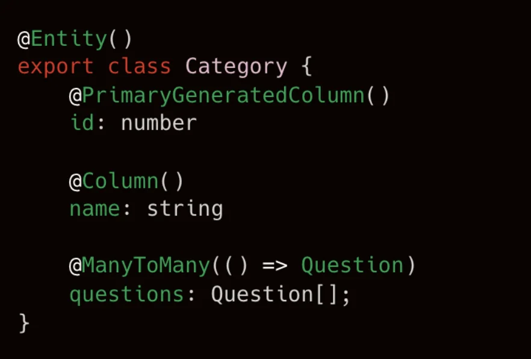

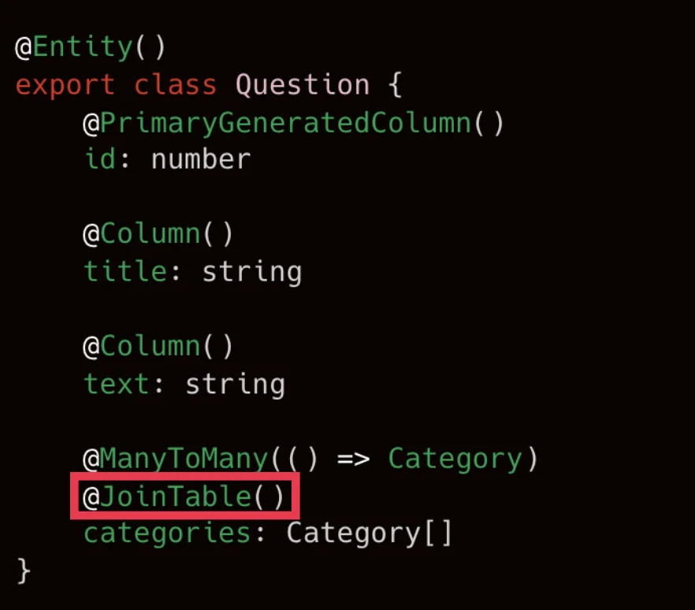

> ✏️ 
> 
> <a id="274eda9b0fe1809fae5eee2f2acc2dcd"></a>
> 
> <code>&#64;ManyToMany</code> 사용 시 <strong><u>자동으로 중간 테이블을 생성</u></strong>한다&#46;
> 
> - 중간 테이블의 컬럼은 각각 래퍼턴스 테이블의<br><code>{테이블 이름}&#95;id</code>로 정의된다&#46;

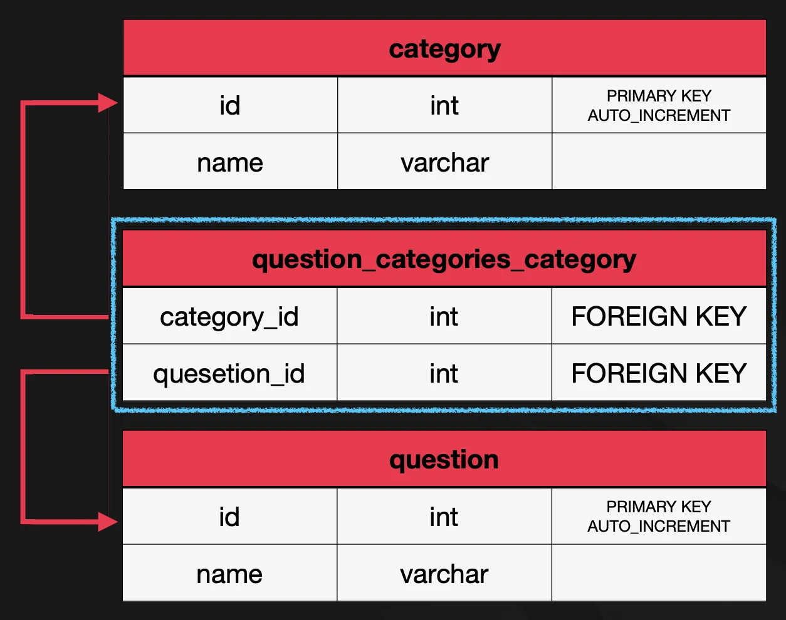

<a id="275eda9b0fe180a8b555dc7f222fc0d3"></a>

##  Repository

---

> 📖 
> 
> <a id="275eda9b0fe18092b7a6ce7ee33a527d"></a>
> 
> 지정한 Entity에 대한 CRUD 쿼리를지원한다&#46; 
> 
> - TypeORM에서 제공하는 메서드를 사용하여 직접 SQL 사용없이 데이터 관리를 할 수 있다&#46; 
> 
> <details>
> <summary>ex )</summary>
> 
> <a id="275eda9b0fe180428133ec2173c4b9fa"></a>
> 
> ```typescript
> const userRepository = dataSource.getRepository(User)
> const user = await userRepository.findIneBy({
> 		id: 1,
> })
> user,name = "test"
> await userRepository.save(user)
> ```
> 
> </details>

> ✏️ 
> 
> <a id="289eda9b0fe180e2855dfaa0ea3d66e8"></a>
> 
> 이전 정리&#58; <a href="#/post/22feda9b-0fe1-802d-8e55-ead766da19b2">페이지</a> 

<a id="275eda9b0fe1806e8d0feb6d5a206dfb"></a>

###  CRUD 메서드

| <code>Create</code>  | <code>Read</code>  | <code>Update</code>  | <code>Delete</code>  | <code>통계 및 기타</code> |
| --- | --- | --- | --- | --- |
| • create()<br>• save()<br>• upsert()<br> | • find()<br>• findAndCount()<br>• findOne()<br>• exists()<br>• preload()<br>• query() | • update()<br>• increment()<br>• decrement() | • delete()<br>• softDelete()<br>• restore() &#91;복구&#93; | • count()<br>• sum()<br>• average()<br>• minimum()<br>• maximum()<br>• query() |

<a id="275eda9b0fe180ee9afbd94a0b8fc3c6"></a>

### 생성 ( Create )

<details>
<summary>1&#46; <code>create()</code></summary>

> ✏️ 
> 
> <a id="275eda9b0fe180de8a75e3ffb2a55b76"></a>
> 
> 객체 생성 메서드
> 
> - <code>save()</code> 와 다르게 <strong><u>DB 데이터 생성 ❌</u></strong>, 객체만 생성함

<a id="275eda9b0fe18054922bcf5d7234d273"></a>

```typescript
// const user = new User();
const user = repository.create()

const user = repository.create({
		id: 1,
		firstName: "Timber",
		lastName: "Saw",
})
```

</details>

<details>
<summary>2&#46; <code>save()</code></summary>

> ✏️ 
> 
> <a id="275eda9b0fe18042bb70f57cbe1aa865"></a>
> 
> Entity를 인자로 받아 DB에 데이터 생성
> 
> - <code>create()</code>와 다르게 실제 DB에 데이터 저장됨
> 
> - 만약 이미 Row가 존재(PK로 구분) 한다면  업데이트 한다&#46; ( 주의 )
> 
> - 여러 객체 한번에 저장 가능

<a id="275eda9b0fe1806b9f45d504a2274fcb"></a>

```typescript
await repository.save(user)
await repository.save([
	category1,
	category2,
	category3,
])
```

</details>

<details>
<summary>3&#46; <code>upsert()</code></summary>

> ✏️ 
> 
> <a id="275eda9b0fe1808a822fe6ea755eb8b2"></a>
> 
> <code>upsert()</code> =   <code>update()</code> &#43; <code>insert()</code> ( 업데이트 &#43; 생성 )
> 
> - 데이터 생성 시도 후 만약 이미 존재하는 데이터면 업데이트
> 
> - <code>save()</code>와 다르게 <code>upsert(</code>)는 하나의 transaction에서 작업이 실행됨

<a id="275eda9b0fe180fdb5daf8e5844c7d5c"></a>

```typescript
await repository.upsert(
		[
				{ externalId: "abc123", firstName: "Code" },
				{ externalId: "bca312", firstName: "Factory" },
		],
		["externalId"],
)

/** executes
	INSERT INTO user
	VALUES
			(externalId = abc123, firstName = Code),
		(externalId = bca312, firstName = Factory),
	ON CONFLICT (externalId) 
	DO UPDATE firstName = EXCLUDED.firstName
**/
```

</details>

<a id="275eda9b0fe1808f998bc33ac605f557"></a>

### 조회 ( Read )

<details>
<summary>1&#46; <code>find()</code>, <code>findOne()</code>, <code>findAndCount()</code></summary>

> ✏️ 
> 
> - <code>find()</code>&#58; 해당되는 모든 Row들을 반환
> 
> - <code>findOne()</code>&#58; 해당되는 첫번쨰 Row 반환 ( 없을 경우 <code>null</code> )
> 
> - <code>findAndCount()</code>&#58; 해당되는 Row와 전체 갯수 반환

<a id="275eda9b0fe1807b8e99f0eaf0f64db2"></a>

```typescript
// find()
const rows = await repository.find({
		where: {
				firstName: "LEE"
		},
})

// findOne()
const rows = await repository.findOne({
		where: {
				firstName: "LEE"
		},
})

// findAndCount()
const rows = await repository.findAndCount({
		where: {
				firstName: "LEE"
		},
})
```

</details>

<details>
<summary>2&#46; <code>exists()</code></summary>

> ✏️ 
> 
> <a id="275eda9b0fe18089a686cea1920508a1"></a>
> 
> 특정 조건의 Row가 존재하는지 확인 
> 
> - 있는 경우 <code>True</code>, 없는 경우 <code>False</code>

<a id="275eda9b0fe18005a05bd86084862501"></a>

```typescript
const exists = await repository.exists({
		where: {
				firstName: "LEE",		
		},
})
```

</details>

<details>
<summary>3&#46; <code>preload()</code> </summary>

> ✏️ 
> 
> <a id="275eda9b0fe18090bc25defff3cb55dd"></a>
> 
> DB에 저장된 값을 불러와(PK 기준) 인자로 받는 값으로 덮어쓴다&#46; 
> 
> - 덮어쓰는 과정에 DB에 업데이트 쿼리가 발생되지 않음<br>즉, save를 해야 DB에 반영됨 

<a id="275eda9b0fe18037a19ccb3c5eebb998"></a>

```typescript
const partialUser = {
		id: 1,
		firstName: "LEE",
		profile: {
				id: 1,
		},
}

const user = await repository.preload(partialUser);
```

</details>

<a id="275eda9b0fe18010b47be70774a0188e"></a>

### 수정 ( Update )

<details>
<summary>1&#46; <code>update()</code></summary>

> ✏️ 
> 
> - 첫번째 파라미터에 <strong><u>검색 조건</u></strong>을 입력
> 
> - 두번째 파라미터에 <strong><u>변경 필드</u></strong> 입력

<a id="275eda9b0fe18035ae87ea46d54b5e34"></a>

```typescript
/** ex 1)
	UPDATE user
	SET category = ADULT
	WHERE age = 18
**/
await repository.update(
	{ age: 18 },
	{ category: "ADULT" }
)
```

<a id="275eda9b0fe180709a0ffb65d880d142"></a>

```typescript
/** ex 2)
	UPDATE user
	SET firstName = Test
	WHERE id = 1
**/
await repository.update(1, {
	firstName: "Test" 
})
```

</details>

<a id="275eda9b0fe180a69423eeeaf01676ba"></a>

### 삭제 ( Delete )

<details>
<summary>1&#46; <code>delete()</code></summary>

> ✏️ 
> 
> <a id="275eda9b0fe18065aa80f41cdc5a6b7d"></a>
> 
> Row 삭제 시 사용
> 
> - 일반적으로 PK(Primary Key)를 사용해 삭제 
> 
> - <code>findOptionsWhere</code> 조건으로 여러 값 삭제 가능

<a id="275eda9b0fe1806ba298d5bcd1fe573c"></a>

```typescript
await repository.delete(1)
await repository.delete([1, 2, 3])
await repository.delete({ firstName: "Timber" })
```

</details>

<details>
<summary>2&#46; <code>softDelete()</code>, <code>restore()</code></summary>

> ✏️ 
> 
> <a id="275eda9b0fe180e9a403c49308de2e96"></a>
> 
> 비영구적 삭제
> 
> - <code>restore()</code>를 통해 복구 가능

<a id="275eda9b0fe1801da890c389a513c6ec"></a>

```typescript
// 삭제
await repository.softDelete(1)

// 복구
await repository.restore(1)
```

</details>

<a id="275eda9b0fe180e4ae9bf93c100afe5d"></a>

### 통계

<details>
<summary>1&#46; <code>count()</code></summary>

> ✏️ 
> 
> <a id="275eda9b0fe180c6a3a6ec98feae6de2"></a>
> 
> 해당되는 갯수 반환

<a id="275eda9b0fe180fd93e0fe42a5960fd4"></a>

```typescript
const count = await repository.count({
		where: {
				firstName: "LEE"
		},
})
```

</details>

<details>
<summary>2&#46; <code>sum()</code></summary>

> ✏️ 
> 
> <a id="275eda9b0fe18050996ffb4162be4ab7"></a>
> 
> 해당되는 컬럼 값을 모두 더함

<a id="275eda9b0fe1801ca466f443a57cea05"></a>

```typescript
const count = await repository.sum({
		"age",
		{ firstName: "LEE" }
})
```

</details>

<details>
<summary>3&#46; <code>average()</code></summary>

> ✏️ 
> 
> <a id="275eda9b0fe18071861ff615f8ba50c2"></a>
> 
> 해당되는 컬럼의 평균 값 반환

<a id="275eda9b0fe1803bb6e5e0d758479e67"></a>

```typescript
const count = await repository.average({
		"age",
		{ firstName: "LEE" }
})
```

</details>

<details>
<summary>4&#46; <code>minimum()</code></summary>

> ✏️ 
> 
> <a id="275eda9b0fe18014bd4feab27d560bc8"></a>
> 
> 해당되는 컬럼의 최솟값 반환

<a id="275eda9b0fe180ddb853de7b3e8d14d0"></a>

```typescript
const count = await repository.minimum({
		"age",
		{ firstName: "LEE" }
})
```

</details>

<details>
<summary>5&#46; <code>maximum()</code></summary>

> ✏️ 
> 
> <a id="275eda9b0fe180929f91e13378e3ee2a"></a>
> 
> 해당되는 컬럼의 최댓값 반환

<a id="275eda9b0fe180809c8cdad2bb086995"></a>

```typescript
const count = await repository.maximum({
		"age",
		{ firstName: "LEE" }
})
```

</details>

<a id="275eda9b0fe1801eb1dde089e6e91843"></a>

###  Property

<a id="275eda9b0fe1801cbd1ff1ce3df2497e"></a>

### FindOptions

> ✏️ 
> 
> - 모든 find 관련된 API는 <code>FindOptions</code>를 <strong><u>arguments로 받</u></strong>는다&#46; 
> 
> - <code>FindOptions</code>는 <strong><u>어떤 값들을 불러올 지 필터링</u></strong> 하는 역할을 한다&#46; 
> 
> - <code>FindOptions</code>의 정확한 TS 타입 명칭은 <code>FindIOneOptions</code>와 <code>FindManyOptions</code>로 정의 되어 있다&#46; 
> 
> - <code>FIndManyOptions</code>는 <strong><u><code>FindOneOptions</code></u></strong><strong><u>를 상속 받</u></strong>으며 추가로 <code>skip</code>, <code>take</code> 프로퍼티가 더 존재한다&#46; 

- FIndOneOptions
    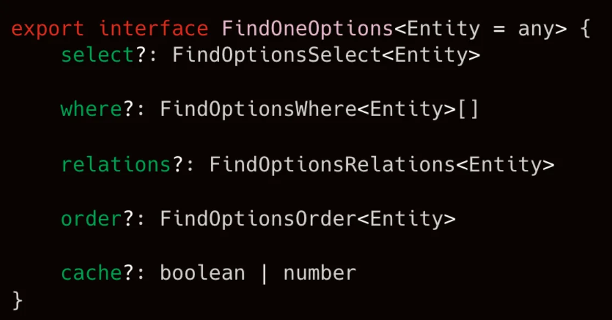

- FindManyOptions
    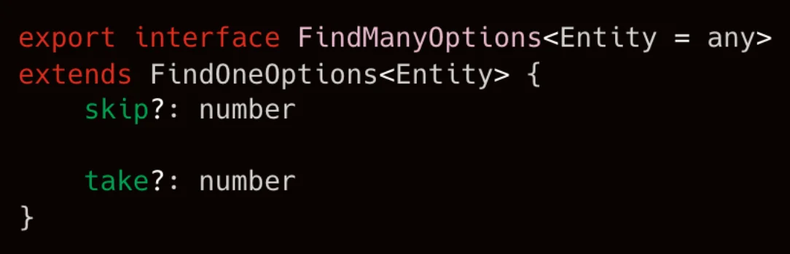

- ex) find(), findOne(), findAndCount()
    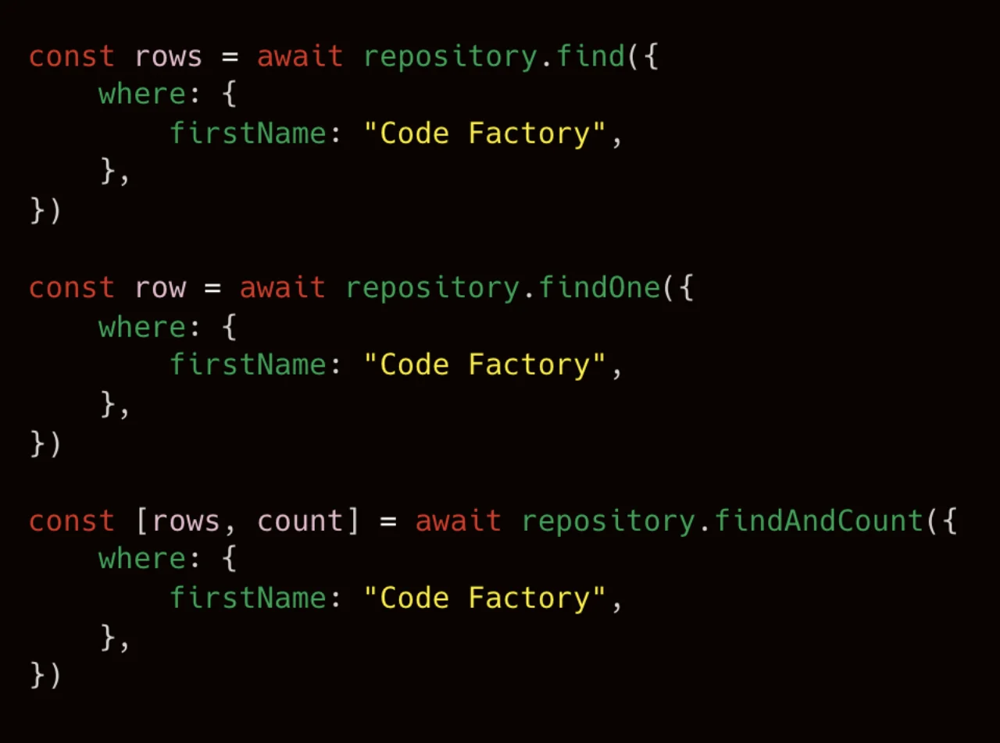

<a id="275eda9b0fe180dea19fcd41be9f0993"></a>

### FindOneOptions

<a id="275eda9b0fe180eaa14efd98444c69ef"></a>

```typescript
export interface FindOneOptions<Entity = any> {
		select?: FindOptionsSelect<Entity>

		where?: FindOptionsWhere<Entity>[]

		relations?: FindOptionsRelations<Entity>

		order?: FindOptionsOrder<Entity>

		cache?: boolean | number		
}
```

> ✏️ 
> 
> - <code>select</code>&#58; 불러올 Column 지정 
> 
> - <code>where</code>&#58; 필러링 조건 설정 
> 
> - <code>relations</code>&#58; 불러올 관계 테이블 지정
> 
> - <code>order</code>&#58; 정렬 지정
> 
> - <code>cache</code>&#58; 캐싱 기간 지정

<details>
<summary>1&#46; select</summary>

> 조회할 컬럼 지정 ( Projection 이라고도 부름 )

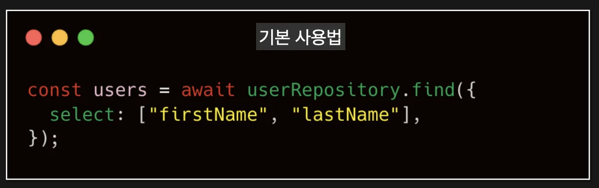

<a id="275eda9b0fe180fdbe66eaef058b2ad8"></a>

```typescript
// TypeORM
const user = await userRepository.findOne({
  select: { id: true, name: true }, // id와 name만 조회
  where: { id: 1 },
});
```

<a id="275eda9b0fe1804aa274df74ff986076"></a>

```sql
// SQL
SELECT id, name FROM user WHERE id = 1;
```

</details>

<details>
<summary>2&#46; where</summary>

> 조회 조건 지정 ( 여러 개 배열로 넣으면 OR 조건으로 동작 )

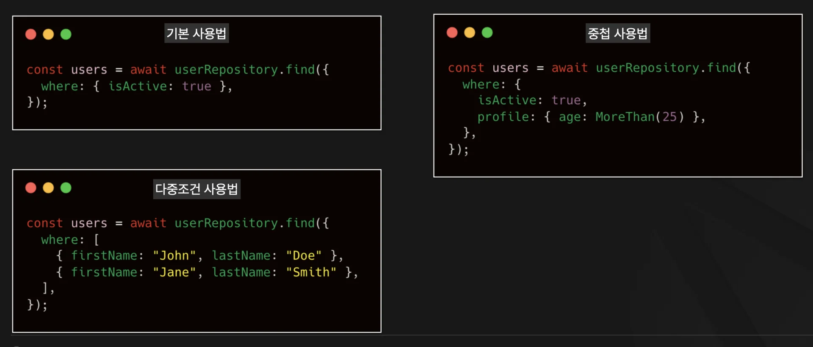

<a id="275eda9b0fe180fd94dff363c945847e"></a>

```typescript
// TypeORM
const user = await userRepository.findOne({
  where: [
    { id: 1 }, 
    { name: 'Kim' }
  ],
});
```

<a id="275eda9b0fe1803b82d0fb207f200b18"></a>

```sql
// SQL
SELECT * FROM user WHERE id = 1 OR name = 'Kim';
```

</details>

<details>
<summary>3&#46; relations</summary>

> 연관관계 로드 ( Eager Loading )


<a id="275eda9b0fe180e5ae53ee182be495c7"></a>

```typescript
// TypeORM
const user = await userRepository.findOne({
  where: { id: 1 },
  relations: { profile: true, posts: true },
});
```

<a id="275eda9b0fe1809aab64cae7fdc182f1"></a>

```sql
// SQL
SELECT * FROM user u
LEFT JOIN profile p ON u.id = p.user_id
LEFT JOIN post po ON u.id = po.user_id
WHERE u.id = 1;
```

</details>

<details>
<summary>4&#46; order</summary>

> 정렬 조건 지정

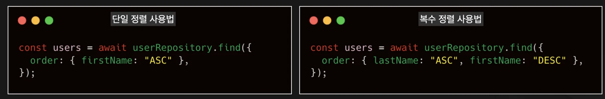

<a id="275eda9b0fe180aeaab3e841fefa96b4"></a>

```typescript
// TypeORM
const user = await userRepository.findOne({
  where: { isActive: true },
  order: { createdAt: 'DESC' },
});
```

<a id="275eda9b0fe1806db196df7c66665f7f"></a>

```sql
// SQL
SELECT * FROM user WHERE isActive = true ORDER BY createdAt DESC;
```

</details>

<details>
<summary><strong>5&#46; cache</strong></summary>

> 쿼리 결과 캐싱
> 
> - <code>true</code>&#58; 기본 캐시 (TypeORM 내부 캐시 매커니즘에 저장 )
> 
> - <code>number</code>&#58; 밀리초 단위 TTL(Time To Live)

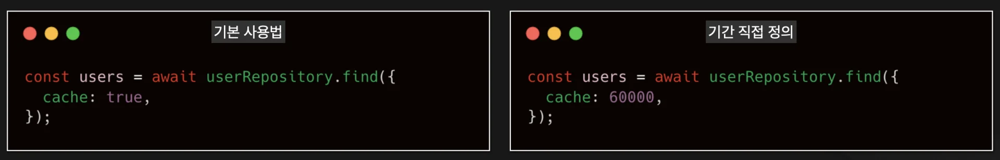

<a id="275eda9b0fe180f6a188df38f4b4fbf7"></a>

```typescript
// TypeORM
const user = await userRepository.findOne({
  where: { id: 1 },
  cache: 60000, // 60초 동안 캐시
});
```

</details>

> ❗ 
> 
> <a id="275eda9b0fe18029914ff3d50191cdfc"></a>
> 
> <code>TypeORM</code>의 <code>cache</code>는 <u>쿼리 결과를 Redis나 DB 캐시 테이블에 저장해서 재사용</u>하는 <strong><code>쿼리 캐시(Query Cache)</code></strong><strong>이다&#46;</strong>

<a id="275eda9b0fe1804aa322ff42e7e0e5b3"></a>

### FindManyOptions

<a id="275eda9b0fe18001ad4fccf103d9e5d3"></a>

```typescript
export interface FindManyOptions<Entity = any> extends FindOneOptions<Entity> {
		skip?: number
		
		take?: number
}

export interface FindOneOptions<Entity = any> {
		select?: FindOptionsSelect<Entity>

		where?: FindOptionsWhere<Entity>[]

		relations?: FindOptionsRelations<Entity>

		order?: FindOptionsOrder<Entity>

		cache?: boolean | number		
}
```

> ✏️ 
> 
> - <code>skip</code>&#58; 몇 개를 건너뛸지 ( = <code>OFFSET</code> )
> 
> - <code>take</code>&#58; 몇 개를 가져올지  ( = <code>LIMIT</code> )

<details>
<summary>skip, take</summary>

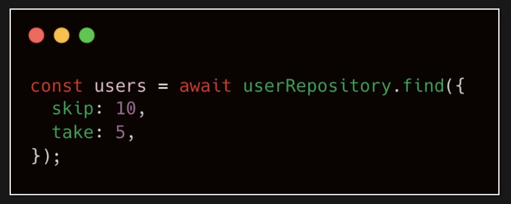

<details>
<summary>단순 페이징</summary>

<a id="275eda9b0fe180258aa1ebe2d4d88c5f"></a>

```typescript
// 1 페이지
const users = await userRepository.find({
  skip: 0,     // 처음부터
  take: 10,    // 10개만 가져오기
  order: { id: 'ASC' },
});
```

<a id="275eda9b0fe180d4a40ceb7be60da5a4"></a>

```sql
SELECT * FROM user ORDER BY id ASC LIMIT 10 OFFSET 0;
```

<a id="275eda9b0fe180aeb423ccdb07236c67"></a>

```typescript
// 2 페이지
const users = await userRepository.find({
  skip: 10,    // 앞의 10개 건너뛰기
  take: 10,    // 다음 10개 가져오기
  order: { id: 'ASC' },
});
```

<a id="275eda9b0fe1809db703db6fe8d758bc"></a>

```sql
SELECT * FROM user ORDER BY id ASC LIMIT 10 OFFSET 10;
```

</details>

<details>
<summary>실무 ) 페이지네이션</summary>

<a id="275eda9b0fe180188a71e26ef8e3c148"></a>

```typescript
// GET /users?page=2&pageSize=20
async findUsers(page: number, pageSize: number) {
  return this.userRepository.find({
    skip: (page - 1) * pageSize,
    take: pageSize,
    order: { createdAt: 'DESC' },
  });
}
```

</details>

</details>

> ❗ 
> 
> <a id="275eda9b0fe1805a839ac6e67fa7080a"></a>
> 
> <code>TypeORM</code>의 <code>cache</code>는 <u>쿼리 결과를 Redis나 DB 캐시 테이블에 저장해서 재사용</u>하는 <strong><code>쿼리 캐시(Query Cache)</code></strong><strong>이다&#46;</strong>

<a id="275eda9b0fe180938a95ff7331b6e3b8"></a>

###  Operator

<a id="275eda9b0fe1808098d4fa9ee7081fc2"></a>

### <code>Equal</code>

> ✏️ 
> 
> <a id="275eda9b0fe18061b6e9e0281a1939d8"></a>
> 
> 같은 값을 찾을 때 사용

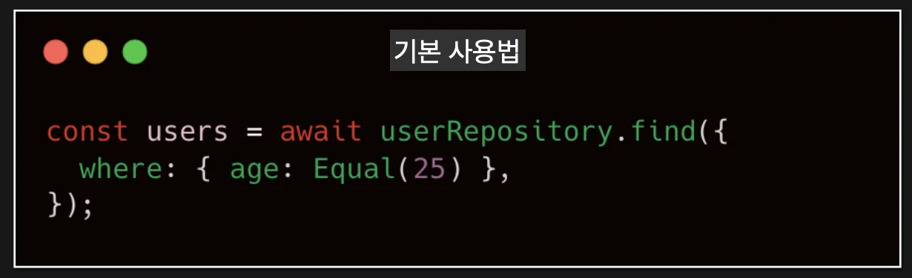

<a id="275eda9b0fe1806fbfbdd5fdd1fbac61"></a>

### <code>Not</code>

> ✏️ 
> 
> <a id="275eda9b0fe18012bdfdf1311061c688"></a>
> 
> 아닌 값을 찾을 때 사용

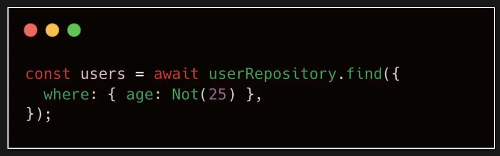

<a id="275eda9b0fe180cda7b2def3c7b6b08d"></a>

### <code>LessThan</code>, <code>LessThanOrEqual</code>

> ✏️ 
> 
> <a id="275eda9b0fe180e2b866fd0e7fbba1c3"></a>
> 
> <strong><u>적은값</u></strong>, <strong><u>적거나 같은 값</u></strong>을 찾을 때 사용

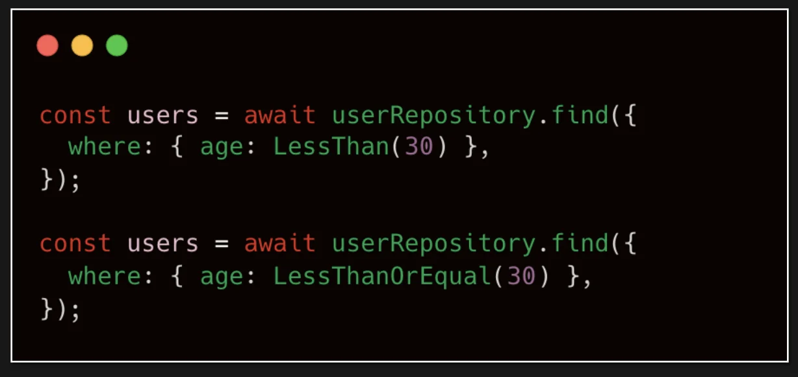

<a id="275eda9b0fe180b99405d9ab152fbf2a"></a>

### <code>MoreThan</code>, <code>MoreThanOrEqual</code>

> ✏️ 
> 
> <a id="275eda9b0fe180a49aacec7bdf90ef4c"></a>
> 
> <strong><u>더 큰값</u></strong>, <strong><u>크거나 같은 값</u></strong>을 찾을 때 사용

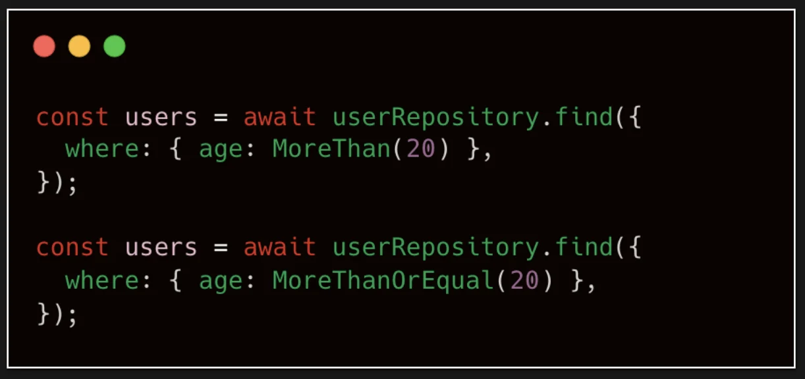

<a id="275eda9b0fe180f6b8caea7151074597"></a>

### <code>Between</code>

> ✏️ 
> 
> <a id="275eda9b0fe180339878f586d0b4e620"></a>
> 
> 사이 값을 찾을 때 사용

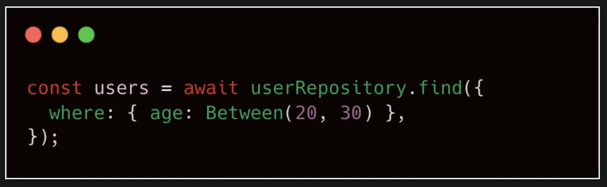

<a id="275eda9b0fe18072b7a1d9e55dcfe4c9"></a>

### <code>Like</code>, <code>ILike</code>

> ✏️ 
> 
> <a id="275eda9b0fe180908c1dd7c7c6ce1728"></a>
> 
> 스트링에 매칭되는 값을 찾을 때 사용
> 
> - <code>Like</code>&#58; 대소문자 구분
> 
> - <code>ILike</code>&#58; 대소문자 구분  ❌


<a id="275eda9b0fe1804c8257d3fe01e6bead"></a>

### <code>In</code>

> ✏️ 
> 
> <a id="275eda9b0fe180fda9f5c73f7b038340"></a>
> 
> 리스트에 매칭되는 값 찾음

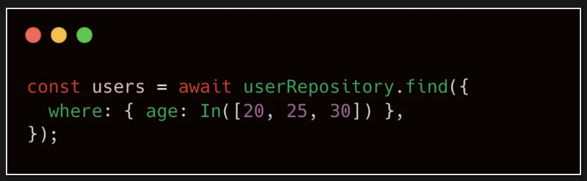

<a id="275eda9b0fe1807a8b83fc1f49362d9f"></a>

### <code>ArrayContains</code>, <code>ArrayContainedBy</code>, <code>ArrayOverlap</code>

> ✏️ 
> 
> - <code>ArrayContains</code> &#58; 엔티티 리스트 값이 타겟 리스트와 완전 똑같은 경우를 필터링
> 
> - <code>ArrayContainedBy</code> &#58; 엔티티 리스트 값이 타겟 리스트 안에 모두 포함되는 경우를 필터링
> 
> - <code>ArrayOverlap</code> &#58; 엔티티 리스트 값이 타겟 리스트와 겹치는 경우를 필터링

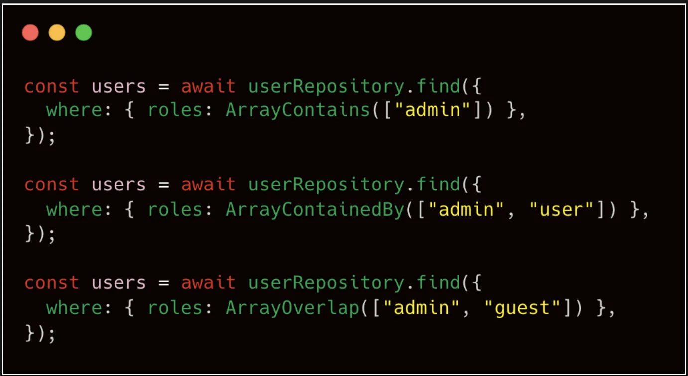

<a id="275eda9b0fe18042b37ddd11bace116a"></a>

### <code>ArrayContains</code>

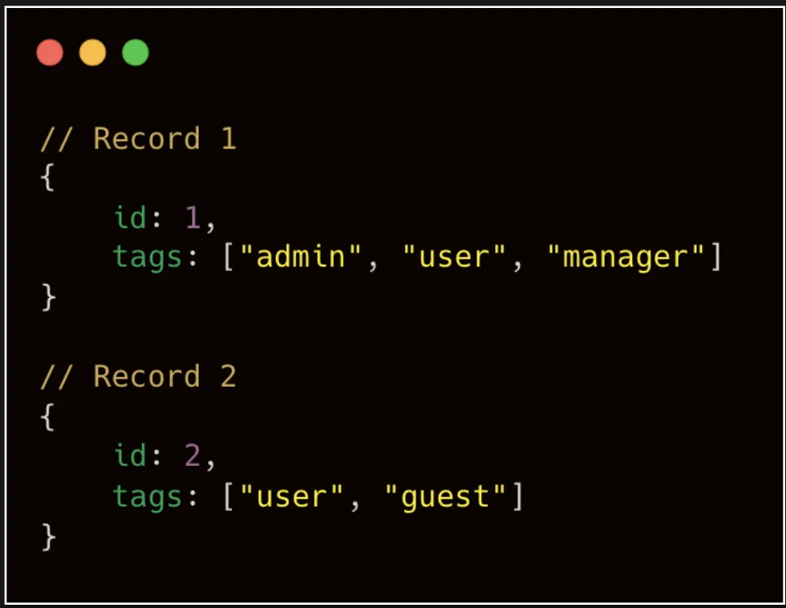

> ✏️ 
> 
> <a id="275eda9b0fe180b88a6af26bfb3d0e13"></a>
> 
> 완전히 같은 배열만 반환

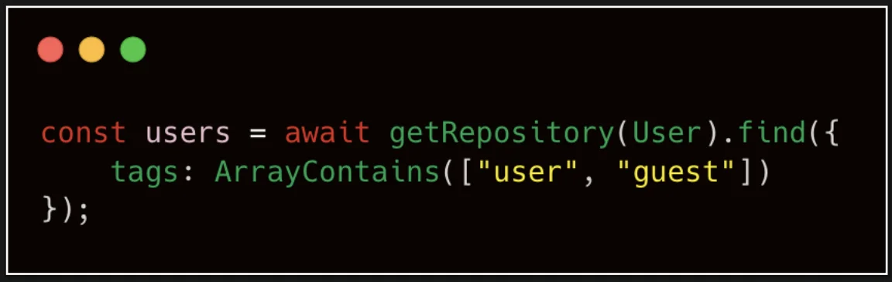

- Record 2의 Tags가 완전히 같으니 Record 2만 반환

<a id="275eda9b0fe18014b226e953df7dd782"></a>

### <code>ArrayOverlap</code>


> ✏️ 
> 
> <a id="275eda9b0fe1805c865bc00885ce9ff7"></a>
> 
> 조건에 포함되는 값이 있으면 모두 반환

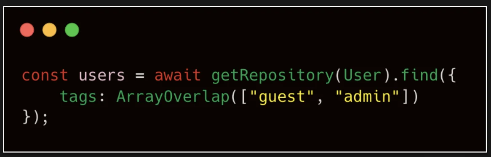

- Record 1의 Tags와 Record 2의 Tags가 모두 필터 리스트와 겹치는 부분이 있기 때문에 둘 다 반환

<a id="275eda9b0fe18007b35cf1511206de8b"></a>

### <code>IsNull</code>

> ✏️ 
> 
> <a id="275eda9b0fe18055b10ac345a5a3b9b2"></a>
> 
> Null인 값을 필터링할때 사용

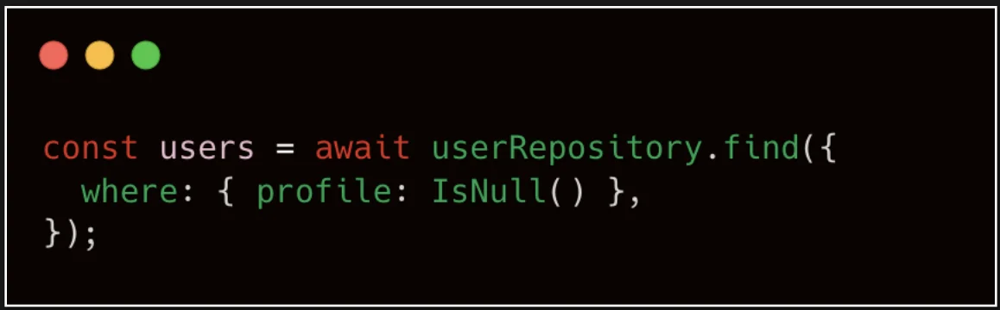

<a id="275eda9b0fe180ea966bd7158c756c1e"></a>

### <code>Or</code>

> ✏️ 
> 
> <a id="275eda9b0fe180aea07ee6298a1d4f62"></a>
> 
> OR 로직 연산할때 사용

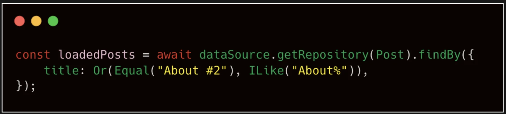

<a id="275eda9b0fe18038add4cbdcebbfd9be"></a>

### <code>AND</code>

> ✏️ 
> 
> <a id="275eda9b0fe1800992b1d21832557a53"></a>
> 
> AND 로직 연산할때 사용

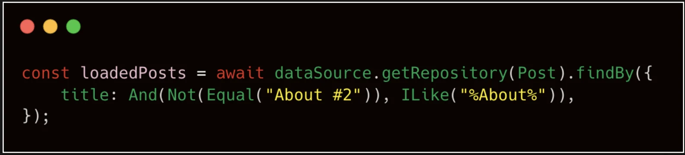

<details>
<summary>복잡한 쿼리</summary>

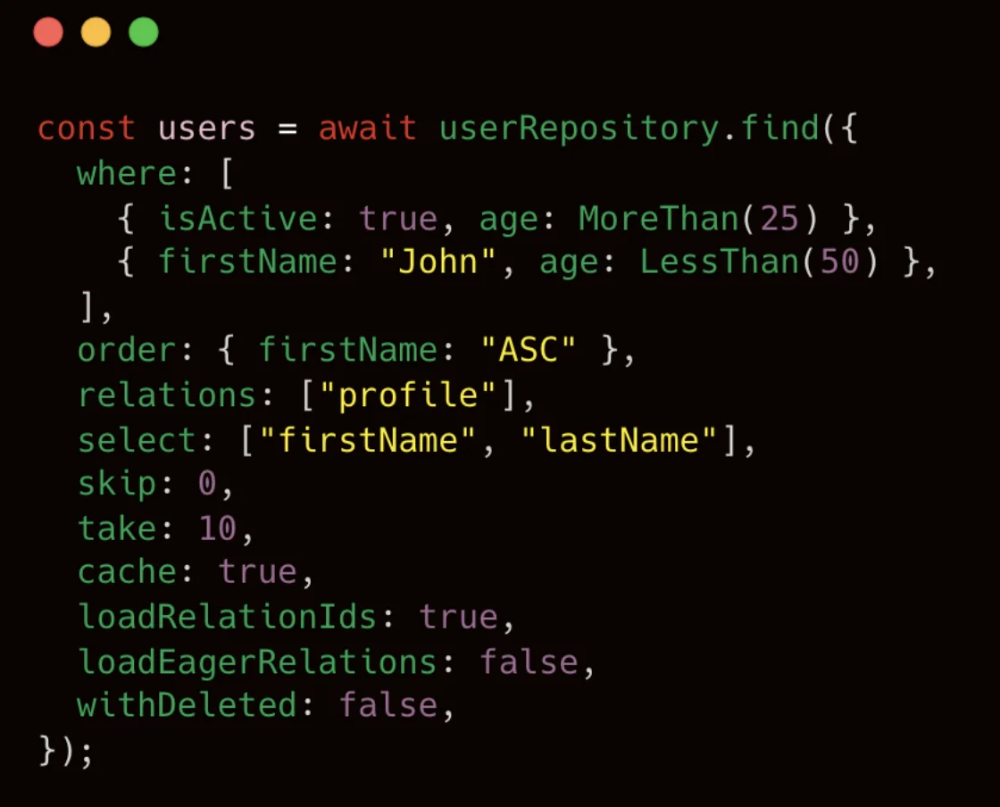

</details>

<a id="275eda9b0fe180d195f9c8029944aabc"></a>

##  Raw Query

---

> ✏️ 
> 
> <a id="275eda9b0fe1806882b7c992cecb2d2e"></a>
> 
> TypeORM에서는 <strong>QueryBuilder 외</strong> <strong><u>Raw SQL을 직접 실</u></strong>행할 수 있는 메서드들을 제공한다&#46; 
> 
> | <strong>메서드</strong> | <strong>위치</strong> | <strong>특징</strong> |
> | --- | --- | --- |
> | <code>dataSource&#46;query()</code> | DataSource | 가장 기본적인 raw SQL 실행 |
> | <code>manager&#46;query()</code> | EntityManager | 트랜잭션 안에서도 사용 가능 |
> | <code>repository&#46;query()</code> | Repository | 특정 엔티티 레포지토리 기준 실행 |
> | <code>queryRunner&#46;query()</code> | QueryRunner | 수동 트랜잭션 &#43; low&#45;level |

<a id="275eda9b0fe180108bb3c07420417e96"></a>

### <code>query()</code>

> ✏️ 
> 
> <a id="275eda9b0fe1806d8b14f47f946c7bdc"></a>
> 
> 가장 기본적인 Raw SQL 실행
> 
> - SQL 문자열 그대로 실행
> 
> - 바인딩 파라미터 배열 지원

> ❗ 
> 
> <a id="275eda9b0fe180599c3cc56489f76ccd"></a>
> 
> <code>query()</code>는 ORM 기능을 완전히 무시하고, <strong><u>DB 드라이버 레벨에서 쿼리를 실행</u></strong>한다&#46;<br>즉, Entity 매핑 ❌, Relation ❌, Validation ❌

<a id="275eda9b0fe180a88fc6dd0823217138"></a>

```typescript
const rawUsers = await dataSource.query(
  `SELECT id, name FROM user WHERE is_active = ?`,
  [true],
);

console.log(rawUsers);
// [ { id: 1, name: "Kim" }, { id: 2, name: "Lee" } ]
```

<a id="275eda9b0fe1808b9ed9f166663857b8"></a>

### <strong><code>manager&#46;query()</code></strong>

> ✏️ 
> 
> <a id="275eda9b0fe1805db122fb52f6bc62f7"></a>
> 
> <code>EntityManager</code>를 통한 raw query
> 
> - <code>dataSource&#46;manager&#46;query()</code> 형태
> 
> - 트랜잭션(manager) 안에서도 사용 가능

<a id="275eda9b0fe18099b607c9662d7924bf"></a>

```typescript
await dataSource.manager.transaction(async (manager) => {
  const result = await manager.query(
    `INSERT INTO log (message) VALUES (?)`,
    ['User created'],
  );
  console.log(result);
});
```

<a id="275eda9b0fe180b4ab94c4f915e826ac"></a>

### <strong><code>repository&#46;query()</code></strong>

> ✏️ 
> 
> <a id="275eda9b0fe180698a7af4a0cd81bd4b"></a>
> 
> <strong><u>특정 엔티티 레포지토리</u></strong>에서 raw query 실행
> 
> - EntityRepository에 직접 연결된 Raw Query
> 
> - 기능적으로는 dataSource&#46;query()와 동일

<a id="275eda9b0fe180d7b9afc1483e8183ee"></a>

```typescript
const userRepo = dataSource.getRepository(User);

const users = await userRepo.query(
  `SELECT * FROM user WHERE name LIKE ?`,
  ['%Kim%'],
);

console.log(users);
```

<a id="275eda9b0fe180d7bd70e230418e310d"></a>

### <strong><code>createQueryRunner()</code></strong><strong> ( </strong>Query Runner )

[Query Runner &#124; TypeORM]()

> ✏️ 
> 
> <a id="275eda9b0fe1804fa2aef42a39a8a2fa"></a>
> 
> Connection 레벨에서 low&#45;level control
> 
> - <strong><u>트랜잭션 수동 제어</u></strong> 가능
>     - <code>startTransaction</code>, <code>commitTransaction</code>, <code>rollbackTransaction</code>
> 
> - <code>queryRunner&#46;query()</code> 메서드로 Raw SQL 실행

> ❗ 
> 
> <a id="275eda9b0fe18002a4dad0809d88d590"></a>
> 
> 사용이 끝난 후 반드시 종료(<code>release()</code>)를 통해 자원을 정리해야 한다&#46;

<a id="275eda9b0fe1801a9de1c93a49465d0a"></a>

```typescript
// 1. QueryRunner 인스턴스 생성
const queryRunner = dataSource.createQueryRunner()

// 2. 연결 -  connection pool 로부터 conntect를 가져와 사용한다.
await queryRunner.connect();

// 3. 데이터 조작
const users = await queryRunner.manager.find(User)
 // ...

// 4. 종료 - 사용 이후 반드시 종료를 해야한다. ( 커넥션 풀로 돌아가 다시 재사용됨 )
await queryRunner.release();
```

<details>
<summary>ex) </summary>

<a id="275eda9b0fe18025a753d7a096e08631"></a>

```typescript
const queryRunner = dataSource.createQueryRunner();
await queryRunner.connect();

await queryRunner.startTransaction();
try {
	// 데이터 조작
  const users = await queryRunner.query(`SELECT * FROM user`);
  console.log(users);

  await queryRunner.commitTransaction();
} catch (err) {
  await queryRunner.rollbackTransaction();
} finally {
  await queryRunner.release();
}
```

</details>

<a id="275eda9b0fe180e7993ffd3ad84378c3"></a>

###  🧐 <code>getOne()</code>, <code>getMany()</code> vs <code>getRawOne()</code>, <code>getRawMany()</code>

| <strong>메서드</strong> | <strong>반환 타입</strong> | <strong>매핑 여부</strong> | <strong>결과 개수</strong> | <strong>주 사용처</strong> |
| --- | --- | --- | --- | --- |
| <code>getOne()</code> | 엔티티 객체 | ✅  매핑됨 | 1개 <br>(없으면 null, <br>여러 개면 에러) | 단일 엔티티 조회 |
| <code>getMany()</code> | 엔티티 객체 배열 | ✅  매핑됨 | 여러 개 | 일반 리스트 조회 |
| <code>getRawOne()</code> | plain object | ❌  매핑 안됨 | 1개 (없으면 null, 여러 개면 첫 row) | 단일 DTO/집계 결과 |
| <code>getRawMany()</code> | plain object 배열 | ❌  매핑 안됨 | 여러 개 | 집계/커스텀 SELECT |

<details>
<summary><strong><code>getOne()</code></strong></summary>

> ✏️ 
> 
> <a id="275eda9b0fe18058af9bfceda6f5e4b5"></a>
> 
> Entity 매핑이 적용된 <strong>한 건</strong>만 조회
> 
> - <strong><code>반환 타입</code></strong>&#58; 단일 <strong>엔티티 객체</strong> (없으면 null)
> 
> - 여러 건이 조회되면 에러(<code>MoreThanOneRowError</code>) 발생&#46;

<a id="275eda9b0fe1805b8a50e5035ddad028"></a>

```typescript
const user = await dataSource
  .getRepository(User)
  .createQueryBuilder('u')
  .where('u.id = :id', { id: 1 })
  .getOne();

console.log(user);
// User { id: 1, name: 'Kim', isActive: true }
```

</details>

<details>
<summary><strong><code>getMany()</code></strong></summary>

> ✏️ 
> 
> <a id="275eda9b0fe180d19d30ee85e672be99"></a>
> 
> Entity 매핑된 여러 데이터들 조회
> 
> - <strong><code>반환 타입</code></strong>&#58; <strong>엔티티 객체 배열</strong>
> 
> - 관계(Relation)까지 매핑됨&#46;

<a id="275eda9b0fe1800b92a3e5bad6b020e9"></a>

```typescript
const users = await dataSource
  .getRepository(User)
  .createQueryBuilder('u')
  .where('u.isActive = :isActive', { isActive: true })
  .getMany();

console.log(users);
// [ User { id: 1, name: 'Kim' }, User { id: 2, name: 'Lee' } ]
```

</details>

<details>
<summary><strong><code>getRawOne()</code></strong></summary>

> ✏️ 
> 
> - <strong><code>반환 타입</code></strong>&#58;  단일 <strong>plain object</strong> (없으면 null)
> 
> - SQL 결과를 그대로 반환, Entity 매핑 ❌
> 
> - alias 기반 키값으로 접근해야 함&#46;
> 
> - 여러 건이 나오면 첫 번째 row만 반환&#46;

<a id="275eda9b0fe180d0a99ac0e3123cadc8"></a>

```typescript
const rawUser = await dataSource
  .getRepository(User)
  .createQueryBuilder('u')
  .select(['u.id AS userId', 'u.name AS userName'])
  .where('u.id = :id', { id: 1 })
  .getRawOne();

console.log(rawUser);
// { userId: 1, userName: 'Kim' }
```

</details>

<details>
<summary><strong><code>getRawMany()</code></strong></summary>

> ✏️ 
> 
> <a id="275eda9b0fe180c7b1e3ec26ac3fbb33"></a>
> 
> Entity 매핑된 여러 Row들 조회
> 
> - <strong><code>반환 타입</code></strong>&#58; <strong>plain object 배열</strong>
> 
> - 여러 row를 <strong>그대로</strong> 반환
> 
> - 집계 쿼리(Aggregate), DTO 매핑할 때 유용

<a id="275eda9b0fe1806cb2d4e450224d4c6e"></a>

```typescript
const rawUsers = await dataSource
  .getRepository(User)
  .createQueryBuilder('u')
  .select(['u.id AS userId', 'u.name AS userName'])
  .where('u.isActive = :isActive', { isActive: true })
  .getRawMany();

console.log(rawUsers);
// [ { userId: 1, userName: 'Kim' }, { userId: 2, userName: 'Lee' } ]
```

</details>

<details>
<summary><strong>🧐 Plain Object </strong></summary>

> ✏️ 
> 
> <a id="275eda9b0fe180deb121e10c22137ebf"></a>
> 
> Object 타입의 단순한 데이터 컨테이너
> 
> - class나 Entity에서 생성된 인스턴스가 아님
> 
> - Prototype 체인도 특별히 확장되지 않음
> 
> - 데이터만 담고 있는 <code>{ key&#58; value }</code> 구조

<a id="275eda9b0fe180008473fce67770a840"></a>

```typescript
const user = {
  id: 1,
  name: 'Kim',
  isActive: true,
};

console.log(user.constructor.name); // "Object"
```

- 그냥 JSON처럼 키&#45;값만 있는 <strong>순수 데이터 구조</strong>

<a id="275eda9b0fe1800eb7bdf0cb78a50117"></a>

### 엔티티 인스턴스<strong>(Entity Instance)</strong>와 차이점&#58; 

<a id="275eda9b0fe180c9a5d8fb12d2f86a7f"></a>

```typescript
class User {
  constructor(
    public id: number,
    public name: string,
    public isActive: boolean,
  ) {}

  greet() {
    return `Hello, ${this.name}`;
  }
}

const user = new User(1, 'Kim', true);

console.log(user.constructor.name); // "User"
console.log(user.greet());          // "Hello, Kim"
```

- User 클래스에서 생성된 객체라서 <strong><u>메서드(greet)도 가지고 있</u></strong>음

- TypeORM의 getOne / getMany 는 이런 <strong>엔티티 인스턴스</strong>를 반환합니다&#46;

<a id="275eda9b0fe180d486b4f220b5f8ef80"></a>

```typescript
const rawUser = await dataSource
  .getRepository(User)
  .createQueryBuilder('u')
  .select(['u.id AS userId', 'u.name AS userName'])
  .getRawOne();

console.log(rawUser);
// { userId: 1, userName: 'Kim' }   ← plain object
```

- 여기서 반환된 건 단순 { userId&#58; 1, userName&#58; &#39;Kim&#39; }

- User 클래스의 메서드(greet) 같은 건 없음

<a id="275eda9b0fe180bb97cbf305860d3627"></a>

반면&#58; 

<a id="275eda9b0fe1801ab602e5de1507b0e4"></a>

```typescript
const entityUser = await dataSource
  .getRepository(User)
  .createQueryBuilder('u')
  .where('u.id = :id', { id: 1 })
  .getOne();

console.log(entityUser instanceof User); // true
```

-  여기서는 <strong>User 클래스 인스턴스</strong>로 반환

</details>

> 📑 
> 
> <a id="275eda9b0fe1800ea24ec0843d0a7c91"></a>
> 
> <strong>실무 팁</strong>
> 
> - <strong>CRUD (엔티티 중심 로직)&#58;</strong> <code>getOne</code>, <code>getMany</code>
> 
> - <strong>통계, 집계, DTO 매핑&#58;</strong> <code>getRawOne</code>, <code>getRawMany</code>
> 
> <details>
> <summary>alias를 DTO 필드명과 맞추면 변환 과정이 단순해짐</summary>
> 
> <a id="275eda9b0fe180798a7cf40a80150bb5"></a>
> 
> ```typescript
> .select('COUNT(*)', 'totalCount')
> // => { totalCount: 5 }
> ```
> 
> </details>
