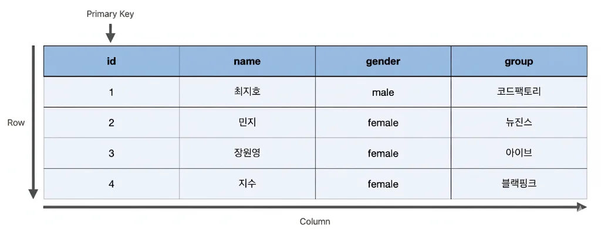
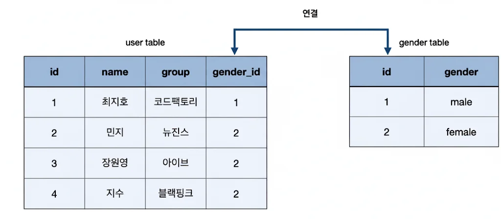

> 
> 
> <a id="274eda9b0fe18151bed0d7805111f4f6"></a>
> 
> <strong>목차</strong>
> 
> - [SQL](#274eda9b0fe1817b897ac0378ba9211e)
> - [ 조회](#274eda9b0fe1800db09ae295cf1f2bd3)
> - [SELECT](#274eda9b0fe180689826f1583ed8567f)
> - [WHERE](#274eda9b0fe18062843ef527a19057ae)
> - [ORDER BY](#274eda9b0fe180598b67f75b8ef90226)
> - [AGGREGATE FUNCTION ( 집계 함수 )](#274eda9b0fe1809f8085c6a2d5fbce2e)
> - [GROUP BY](#274eda9b0fe180668e89ddc37b6332c2)
> - [HAVING](#274eda9b0fe1803da1f9cd2e2948d7a9)
> - [JOIN](#274eda9b0fe18032910bf8e6a1279995)
> - [ 나머지 ](#274eda9b0fe180408e5dc6a086f7f84c)
> - [INSERT](#274eda9b0fe180219119efeccf04e09e)
> - [DELETE](#274eda9b0fe180ecba03d598311413a5)
> - [Subqueries ( 서브 쿼리 )](#274eda9b0fe18036a1fbc15c35e68501)

> ✏️ 
> 
> <a id="274eda9b0fe181d09336c7a7e30461f5"></a>
> 
> 이전 정리 내용 
> 
> - <a href="#/post/1c3eda9b-0fe1-8114-a6f8-e8c2debc9fa0">페이지</a> 

<a id="274eda9b0fe1817b897ac0378ba9211e"></a>

## SQL

---

> 📖 
> 
> <a id="274eda9b0fe1811093cbf109c8d63ffa"></a>
> 
> SQL은 Structured Query Language의 약자로, 관계형 데이터 베이스 (RDBMS)를 다루는데 사용되는 통합 언어이다&#46; 
> 
> - <code>INSERT</code>, <code>SELECT</code>, <code>UPDATE</code>, <code>DELETE</code> 키워드(DML)를 통해 데이터(컬럼) CRUD 작업이 가능하다&#46; 
> 
> - <code>CREATE</code>, <code>ALTER</code>, <code>RENAME</code>, <code>DROP</code> 키워드(DDL)를 통해 데이터베이스 스키마 CRUD 작업이 가능하다&#46;
> 
> - <code>BEGIN</code>, <code>COMMIT</code>, <code>ROLLBACK</code> 키워드(TCL)를 통한 ACID Transaction을 지원한다&#46;

<a id="274eda9b0fe1800db09ae295cf1f2bd3"></a>

##  조회



<a id="274eda9b0fe180689826f1583ed8567f"></a>

### SELECT

> ✏️ 
> 
> <a id="274eda9b0fe18090946ff21b2fec92f4"></a>
> 
> 데이터 조회

<a id="274eda9b0fe181208e28ee6d6316c375"></a>

```sql
// 문법 
SELECT column1, column2
FROM table_name;

// 예제
SELECT name, age
FROM students;
```

<a id="274eda9b0fe18062843ef527a19057ae"></a>

### WHERE

> ✏️ 
> 
> <a id="274eda9b0fe18030a7c9e24708603f14"></a>
> 
> 데이터 필터링

<a id="274eda9b0fe180f693d1f6cecb94d7c8"></a>

```sql
// 문법
SELECT column1
FROM table_name
WHERE condition;

// 예제
SELECT name
FROM students
WHERE age > 18;
```

<a id="274eda9b0fe180598b67f75b8ef90226"></a>

### ORDER BY

> ✏️ 
> 
> <a id="274eda9b0fe1801fbe89e7e5a517f275"></a>
> 
> 데이터 정렬
> 
> - <code>ASC</code>&#58; 오름차순
> 
> - <code>DESC</code>&#58; 내림차순

<a id="274eda9b0fe18033804def43ae790968"></a>

```sql
// 문법
SELECT column1
FROM table_name
ORDER BY column1 ASC/DESC;

// 예제
SELECT name, age
FROM students
ORDER BY age DESC;
```

<a id="274eda9b0fe1809f8085c6a2d5fbce2e"></a>

### AGGREGATE FUNCTION ( 집계 함수 )

> ✏️ 
> 
> <a id="274eda9b0fe18074b1f1e1991a55ea52"></a>
> 
> 데이터 통계 
> 
> - 테이블의 <strong><u>“행(row)” 즉, 레코드가  몇 개인지 반환</u></strong>한다&#46;

<a id="274eda9b0fe180ff952cec6d7000ddaf"></a>

```sql
// 문법
SELECT COUNT(*)
FROM table_name;
```

<a id="274eda9b0fe180d69444eba77090bb7a"></a>

```sql
// 테이블 예시
---- students ----
id | name   | age
---+--------+-----
 1 | Kim    | 20
 2 | Lee    | NULL
 3 | Park   | 25
------------------

// 예제 1
SELECT COUNT(*)
FROM students;  
	// return 3  ( 행(레코드) 개수 그대로 )
 
// 예제 2
SELECT COUNT(age)
FROM students;
	// return 2 ( NULL 제외 )
```

<a id="274eda9b0fe180668e89ddc37b6332c2"></a>

### GROUP BY

> ✏️ 
> 
> <a id="274eda9b0fe1800a808ed950c6c6d93d"></a>
> 
> 통계를 그룹으로 나눌 때 사용

> ❗ 
> 
> <details>
> <summary><em><strong><u>GROUP BY</u></strong></em><em><strong> </strong></em>는 집계함수(<code>COUNT()</code>)가 없는 경우에도 사용 가능하지만, <strong>고유 값(distinct value)만 반환</strong>한다&#46; </summary>
> 
> <a id="274eda9b0fe1801490eaf3cae2d65c10"></a>
> 
> ```sql
> SELECT age
> FROM students
> GROUP BY age;
> ```
> 
> <a id="274eda9b0fe1808683dfe65cc6d71cc0"></a>
> 
> ```sql
> SELECT DISTINCT age 
> FROM students;
> ```
> 
> <a id="274eda9b0fe1803381ccf6f43d496a5d"></a>
> 
> 즉, 위와 같이 집계함수 없이 <code>GROUP BY</code> 사용 시 DISTICT 키워드를 적용하여 조회하는 것과 같은 결과를 반환한다&#46; 
> 
> </details>
> 
> <a id="274eda9b0fe1805f8261ed92d3b8eba6"></a>
> 
> 즉, 집계함수 없이 사용하는 경우 <code>DISTICT</code> 키워드를 사용하는 것을 권장한다&#46;

<a id="274eda9b0fe180219f47efc0d0a05585"></a>

```sql
// 문법
SELECT column1, COUNT(*)
FROM table_name
GROUP BY column1;
```

<a id="274eda9b0fe180da86cfef1259c20070"></a>

```sql
// 테이블 예시
---- students ----
id | name  | age
---+-------+-----
 1 | Kim   | 20
 2 | Lee   | 20
 3 | Park  | 25
 4 | Choi  | 25
 5 | Han   | NULL
```

<a id="274eda9b0fe180f88059da54ce26d3b2"></a>

```sql
SELECT age, COUNT(*)
FROM students
GROUP BY age;
```

- 동작 순서
    1. <code>FROM students</code>
        - <code>students</code> 테이블의 모든 행을 불러옴

    1. <code>GROUP BY age</code>
        - age 값이 같은 행들을 묶음 (그룹화)
            - <code>age = 20</code>인 학생들끼리 한 그룹

            - <code>age = 25</code>인 학생들끼리 한 그룹

    1. <code>COUNT(&#42;)</code>
        - 각 그룹별로 행의 개수 카운팅

    1. <code>SELECT age, COUNT(&#42;)</code>
        - 그룹별 대표 컬럼(age)과  그룹 내 개수(<code>COUNT(&#42;)</code>)를 결과로 출력

- 쿼리 결과
    <a id="274eda9b0fe1801187bdcb81ddab806b"></a>

    ```sql
    // GROUP BY에 명시한 컬럼(age)의 값들로 그룹화 
    ---- students ----
    age | COUNT(*)
    ----+-------------
    20  | 2        -- age=20 학생은 Kim, Lee → 2명
    25  | 2        -- age=25 학생은 Park, Choi → 2명
    NULL| 1        -- Han → 1명 (GROUP BY는 NULL 값도 별도의 그룹으로 취급)
    ```

<a id="274eda9b0fe1803da1f9cd2e2948d7a9"></a>

### HAVING

> ✏️ 
> 
> <a id="274eda9b0fe1802d98b1ce09669e0a18"></a>
> 
> 집계 함수(<code>AGGREGATE FUNCTION</code>) 에 <strong><u>조건 추가</u></strong> 시 사용한다&#46; 
> 
> - 조회 시 <code>WHERE</code> 사용하여 필터링 하는 것과 의미상으로 동일하며, <strong><u>집계 시 필터링 조건</u></strong>을 정의한다&#46;

<a id="274eda9b0fe180299343d580d98a5bb6"></a>

```sql
// 문법
SELECT column1, COUNT(*)
FROM table_name
GROUP BY column1
HAVING condition;
```

<a id="274eda9b0fe180198203de92f1979227"></a>

```sql
// 테이블 예시
---- students ----
id | name  | age
---+-------+-----
 1 | Kim   | 20
 2 | Lee   | 20
 3 | Park  | 25
 4 | Choi  | 25
 5 | Han   | NULL
```

<a id="274eda9b0fe180a09158cbfccc8d5194"></a>

```sql
// 예시 
SELECT age, COUNT(*)
FROM students
GROUP BY age
HAVING COUNT(*) > 1;
```

- 동작 순서
    1. <code>FROM students</code>
        - <code>students</code> 테이블의 모든 행을 불러옴

    1. <code>GROUP BY age</code>
        - 같은 age 값을 가진 행끼리 그룹으로 묶음 (그룹화)

    1.  <code>COUNT(&#42;)</code> (집계)
        - 각 그룹별로 행의 개수(학생 수) 카운팅

    1. <code>HAVING COUNT(&#42;) &#62; 1</code>
        - 집계된 그룹을 필터링 

    1. <code>SELECT age, COUNT(&#42;)</code>
        - HAVING 조건을 통과한 그룹에 대해 age와 해당 인원수를 출력

- 쿼리 결과
    <a id="274eda9b0fe180a9ae32c359df3dd2a0"></a>

    ```sql
    // GROUP BY age
    ------------------
    age | COUNT(*)
    ----+-------------
    20  | 2      
    25  | 2      
    NULL| 1  
    -----------------

    // HAVING : COUNT(*) > 1
    -----------------
    age   | COUNT(*)
    ------+----------
    20    | 2
    25    | 2
    -----------------
    ```

<a id="274eda9b0fe18032910bf8e6a1279995"></a>

### JOIN



> ✏️ 
> 
> <a id="274eda9b0fe18015afe3e94f0fe0afa6"></a>
> 
> <strong><u>여러 테이블을 합칠 때</u></strong> 사용
> 
> - <strong><code>INNER JOIN</code></strong>
>     - 교집합 (조건이 일치하는 것만)
> 
> - <strong><code>LEFT JOIN</code></strong>
>     - 왼쪽 테이블(user) 기준으로 모두 가져오고,<br> 매칭 안 되는 건 NULL로 채움
> 
> - <strong><code>RIGHT JOIN</code></strong>
>     -  오른쪽 테이블(gender) 기준으로 모두 가져옴
> 
> - <strong><code>FULL OUTER JOIN</code></strong>
>     -  양쪽 다 포함 
> 
>     - (MySQL은 기본 미지원, 다른 DBMS에서 사용)

<a id="274eda9b0fe180fd8d25f182f17d92c0"></a>

```sql
// 문법
SELECT columns
FROM table1
INNER JOIN table2
ON table1.column = table2.column;
```

- 테이블 예시 
    <a id="274eda9b0fe180f2b786e9835676f6bc"></a>

    ```sql
    -------- user ---------
    id | name  | gender_id
    ---+-------+-----------
     1 | Kim   | 1
     2 | Lee   | 2
     3 | Park  | 3
     4 | Han  | NULL
    ----------------------
    ```

    <a id="274eda9b0fe180b286aef2d63d2e3c2e"></a>

    ```sql
    --- gender ---
    id | gender
    ---+----------
     1 | Male   
     2 | Female 
    --------------
    ```

- 쿼리 예시 
    <a id="274eda9b0fe180558519e047195cbc5a"></a>

    ```sql
    // 예시 
    SELECT *
    FROM user
    INNER JOIN gender
    	ON user.gender_id = gender.id;
    ```

- 쿼리 결과
    <a id="274eda9b0fe180fead10c183f11db526"></a>

    ```sql
    ------------------------------------------------
    user.id | name | gender_id | gender.id | gender
    --------+------+-----------+-----------+--------
    1       | Kim  | 1         | 1         | Male
    2       | Lee  | 2         | 2         | Female
    ------------------------------------------------
    ```

    - <code>Park (gender&#95;id=3)</code>&#58;gender 테이블에 id=3이 없으므로 제외됨

    - <code>Han (gender&#95;id=NULL)</code>&#58; NULL은 매칭 불가라 제외됨<br><br>

<a id="274eda9b0fe180408e5dc6a086f7f84c"></a>

##  나머지 

<a id="274eda9b0fe180219119efeccf04e09e"></a>

### INSERT

> ✏️ 
> 
> <a id="274eda9b0fe18066af9dc31063393641"></a>
> 
> 데이터 생성

<a id="274eda9b0fe180b9b68fd5cc68ac9b49"></a>

```sql
// 문법
INSERT INTO table_name (column1, column2)
VALUES (value1, value2)

// 예제
INSERT INTO students (name, age)
VALUES ('John Doe', 22);
```

<a id="274eda9b0fe180ecba03d598311413a5"></a>

### DELETE

> ✏️ 
> 
> <a id="274eda9b0fe180978e57d3e65fadfc83"></a>
> 
> 데이터 삭제

<a id="274eda9b0fe1803bb13ad6e3859e6803"></a>

```sql
// 문법
DELETE FROM table_name
WHERE condition;

// 예제
DELETE FROM students
WHERE name = 'John Doe';
```

<a id="274eda9b0fe18036a1fbc15c35e68501"></a>

### Subqueries ( 서브 쿼리 )

> ✏️ 
> 
> <a id="274eda9b0fe180ba955fc931295e6625"></a>
> 
> 쿼리 내부 또다른 쿼리 사용

<a id="274eda9b0fe1808f8206f07a4769f519"></a>

```sql
// 문법
SELECT name 
FROM students
WHERE age > (SELECT AVG(age) FROM students);
```
