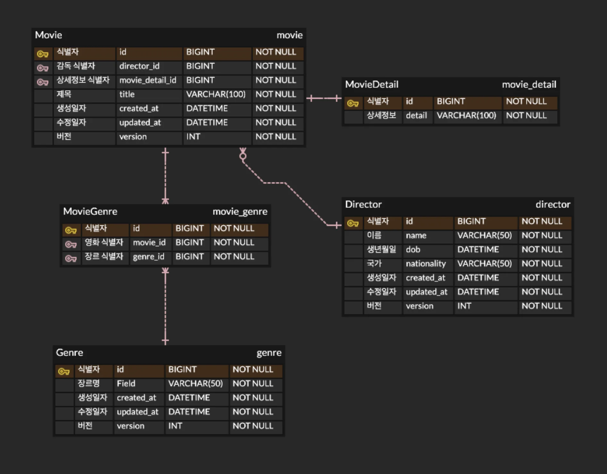

> 
> 
> <a id="27deda9b0fe181e68174cae1190d5dea"></a>
> 
> <strong>목차</strong>
> 
> - [TypeORM CRUD](#27deda9b0fe181bc9c1fedd56427bf41)
> - [1. 엔티티 설정](#289eda9b0fe180d4b698d39b6e277e19)
> - [2.  TypeORM의 Repository를 사용한 CRUD 실습](#27deda9b0fe181678519cd07a345787b)
> - [ 3.  API 테스트](#289eda9b0fe18068835ddb0304df10ce)
> - [4. DB I/O 병목 문제 해결](#27deda9b0fe1817b884dd4cf92399233)

<a id="27deda9b0fe181bc9c1fedd56427bf41"></a>

## TypeORM CRUD

---

<a id="289eda9b0fe180d4b698d39b6e277e19"></a>

### 1&#46; 엔티티 설정



> ✏️ 
> 
> - <code>&#64;Entity()</code>
> 
> - <code>&#64;PrimaryGeneratedColumn()</code>
> 
> - <code>&#64;Column()</code>
> 
> <details>
> <summary>연관관계</summary>
> 
> - <code>&#64;OneToOne()</code>
> 
> - <code>&#64;OneToMany()</code>
> 
> - <code>&#64;ManyToOne()</code>
> 
> - <code>&#64;ManyToMany()</code>
> 
> </details>

<details>
<summary><strong>&#91; 코드 &#93; </strong>BaseTable</summary>

<a id="289eda9b0fe180b9ba68e38a15f40fd0"></a>

```typescript
import { ApiHideProperty } from '@nestjs/swagger';
import { Exclude } from 'class-transformer';
import { CreateDateColumn, UpdateDateColumn, VersionColumn } from 'typeorm';

export class BaseTable {
  @CreateDateColumn()
  @Exclude()
  @ApiHideProperty()
  createdAt: Date;

  @UpdateDateColumn()
  @Exclude()
  @ApiHideProperty()
  updatedAt: Date;

  @VersionColumn()
  @Exclude()
  @ApiHideProperty()
  version: number;
}
```

</details>

<details>
<summary><strong>&#91; 코드 &#93; </strong>Movie</summary>

<a id="289eda9b0fe18017a163c30f38b4913c"></a>

```typescript
import { BaseTable } from 'src/common/entity/base-table.entity';
import { Genre } from 'src/genre/entities/genre.entity';
import { User } from 'src/user/entities/user.entity';
import {
  Column,
  Entity,
  JoinColumn,
  JoinTable,
  ManyToMany,
  ManyToOne,
  OneToOne,
  PrimaryGeneratedColumn,
} from 'typeorm';
import { MovieDetail } from './movie-datail.entity';
import { Director } from 'src/director/entities/director.entity';

/* 연관관계
 - 영화(Movie) : 감독(Director) = N : 1
 - 영화(Movie) : 영화 상세정보(MovieDetail) = 1 : 1
 - 영화(Movie) : 장르(Genre) = N : M
 */
@Entity()
export class Movie extends BaseTable {
  @PrimaryGeneratedColumn()
  id: number;

  @ManyToOne(() => User, (user) => user.createdMovies)
  creator: User;

  @Column({
    unique: true,
  })
  title: string;

  @ManyToMany(() => Genre, (genre) => genre.movies)
  @JoinTable()
  genres: Genre[];

  @OneToOne(() => MovieDetail, (movieDetail) => movieDetail.id, {
    cascade: true,
    nullable: false,
  })
  @JoinColumn()
  detail: MovieDetail;

  @ManyToOne(() => Director, (director) => director.id, {
    nullable: false,
  })
  director: Director;
}
```

</details>

<details>
<summary><strong>&#91; 코드 &#93; </strong>MovieDetail</summary>

<a id="289eda9b0fe180d9a8c2d783cbd490f1"></a>

```typescript
import { Column, Entity, OneToOne, PrimaryGeneratedColumn } from 'typeorm';
import { Movie } from './movie.entity';

@Entity()
export class MovieDetail {
  @PrimaryGeneratedColumn()
  id: number;

  @Column()
  detail: string;

  @OneToOne(() => Movie, (movie) => movie.id)
  movie: Movie;
}
```

</details>

<details>
<summary><strong>&#91; 코드 &#93; </strong>Director</summary>

<a id="289eda9b0fe1801d9975e67079ba6279"></a>

```typescript
import { BaseTable } from 'src/common/entity/base-table.entity';
import { Movie } from 'src/movie/entities/movie.entity';
import { Column, Entity, OneToMany, PrimaryGeneratedColumn } from 'typeorm';

@Entity()
export class Director extends BaseTable {
  @PrimaryGeneratedColumn()
  id: number;

  @Column()
  name: string;

  @Column()
  dob: Date;

  @Column()
  nationality: string;

  @OneToMany(() => Movie, (movie) => movie.director)
  movies: Movie[];
}
```

</details>

<details>
<summary><strong>&#91; 코드 &#93; </strong>Genre</summary>

<a id="289eda9b0fe180ec90b1d2c51cda8392"></a>

```typescript
import { BaseTable } from 'src/common/entity/base-table.entity';
import { Movie } from 'src/movie/entities/movie.entity';
import { Column, Entity, ManyToMany, PrimaryGeneratedColumn } from 'typeorm';

@Entity()
export class Genre extends BaseTable {
  @PrimaryGeneratedColumn()
  id: number;

  @Column({
    unique: true,
  })
  name: string;

  @ManyToMany(() => Movie, (movie) => movie.genres)
  movies: Movie[];
}
```

</details>

<a id="27deda9b0fe181678519cd07a345787b"></a>

### 2&#46;  TypeORM의 <code>Repository</code>를 사용한 CRUD 실습

> ✏️ 
> 
> - <strong><u>C</u></strong><strong>reate</strong>&#58; <code>save()</code>
> 
> - <strong><u>R</u></strong><strong>ead</strong>&#58; <code>find()</code>, <code>findOne()</code>
> 
> - <strong><u>U</u></strong><strong>pdate</strong>&#58; <code>update()</code>
> 
> - <strong><u>D</u></strong><strong>elete</strong>&#58; <code>delete()</code>

<details>
<summary><strong>&#91; 코드 &#93; MovieService</strong></summary>

<details>
<summary>🧐 <code>Object&#46;assign</code></summary>

<a id="289eda9b0fe1805e84a4d175056a1b85"></a>

```typescript
const target = { a: 1, b: 2 };
const source = { b: 99, c: 3 };

Object.assign(target, source);

console.log(target); // { a: 1, b: 99, c: 3 }
```

</details>

<a id="289eda9b0fe18009b15fe0a08d62623a"></a>

```typescript
import { Injectable, NotFoundException } from '@nestjs/common';
import { CreateMovieDto } from './dto/create-movie.dto';
import { UpdateMovieDto } from './dto/update-movie.dto';
import { InjectRepository } from '@nestjs/typeorm';
import { Movie } from './entities/movie.entity';
import { DataSource, In, Like, Repository } from 'typeorm';
import { MovieDetail } from './entities/movie-datail.entity';
import { Director } from 'src/director/entities/director.entity';
import { Genre } from 'src/genre/entities/genre.entity';
import { User } from 'src/user/entities/user.entity';

@Injectable()
export class MovieService {
  constructor(
    @InjectRepository(Movie)
    private readonly movieRepository: Repository<Movie>,
    @InjectRepository(MovieDetail)
    private readonly movieDetailRepository: Repository<MovieDetail>,
    @InjectRepository(Director)
    private readonly directorRepository: Repository<Director>,
    @InjectRepository(Genre)
    private readonly genreRepository: Repository<Genre>,
    private readonly dataSource: DataSource,
  ) {}

  async findAll(title?: string) {
    // title 이 없는 경우
    if (!title) {
      return [
        await this.movieRepository.find({
          relations: ['director', 'genres'],
        }),
        await this.movieRepository.count(),
      ];
    }

    // title이 있는 경우
    return this.movieRepository.findAndCount({
      where: {
        title: Like(`%${title}%`),
      },
      relations: ['director', 'genres'],
    });
  }

  async findOne(id: number) {
    const movie = await this.movieRepository.findOne({
      where: {
        id,
      },
      relations: ['detail', 'director', 'genres'],
    });

    if (!movie) {
      throw new NotFoundException('존재하지 않는 영화입니다.');
    }

    return movie;
  }

  async create(createMovieDto: CreateMovieDto, creator: User) {
    // 1. Director 검증
    const director = await this.directorRepository.findOne({
      where: { id: createMovieDto.directorId },
    });

    if (!director) {
      throw new NotFoundException('존재하지 않는 Director 입니다.');
    }

    // 2. Genres 검증
    const genres = await this.genreRepository.findBy({
      id: In(createMovieDto.genreIds),
    });

    if (genres.length !== createMovieDto.genreIds.length) {
      throw new NotFoundException(
        `존재하지 않는 장르가 있습니다. ids: ${genres.map((genre) => genre.id).join(',')}`,
      );
    }

    // 3. Movie 생성
    const movie = this.movieRepository.create({
      title: createMovieDto.title,
      director,
      detail: { detail: createMovieDto.detail }, // cascade로 MovieDetail 자동 저장
      genres,
      creator,
    });

    // 4. 한 번의 save로 Movie + MovieDetail + ManyToMany genres 연결
    const savedMovie = await this.movieRepository.save(movie);

    return await this.movieRepository.findOne({
      where: { id: savedMovie.id },
      relations: ['detail', 'director', 'genres', 'creator'],
    });
  }

  async update(id: number, updateMovieDto: UpdateMovieDto) {
    const movie = await this.movieRepository.findOne({
      where: { id },
      relations: ['detail', 'genres', 'director'],
    });

    if (!movie) {
      throw new NotFoundException('존재하지 않는 영화입니다.');
    }

    const { detail, directorId, genreIds, ...movieRest } = updateMovieDto;

    // 1. Movie 필드 업데이트
    Object.assign(movie, movieRest);

    // 2. detail 업데이트
    if (detail) {
      movie.detail.detail = detail;
    }

    // 3. director 교체
    if (directorId) {
      const director = await this.directorRepository.findOne({
        where: { id: directorId },
      });

      if (!director) {
        throw new NotFoundException('존재하지 않는 감독입니다. ');
      }

      movie.director = director;
    }

    // 4. genres 교체
    if (genreIds) {
      const genres = await this.genreRepository.findBy({ id: In(genreIds) });

      if (genres.length !== updateMovieDto.genreIds?.length) {
        throw new NotFoundException(
          `존재하지 않는 장르가 있습니다. ids:  ${genres.map((genre) => genre.id).join(',')}`,
        );
      }

      movie.genres = genres;
    }

    await this.movieRepository.save(movie);

    return this.movieRepository.findOne({
      where: { id },
      relations: ['detail', 'director', 'genres'],
    });
  }

  async remove(id: number) {
    const movie = await this.movieRepository.findOne({
      where: { id },
    });

    if (!movie) {
      throw new NotFoundException('존재하지 않는 영화입니다.');
    }

    // detail은 cascade: true 설정으로 삭제 시 자동 삭제됨
    await this.movieRepository.delete(movie);

    return id;
  }
}

```

</details>

<details>
<summary><strong>&#91; 코드 &#93; GenreService</strong></summary>

<a id="289eda9b0fe180559103cebc089ca1df"></a>

```typescript
import { Injectable, NotFoundException } from '@nestjs/common';
import { CreateGenreDto } from './dto/create-genre.dto';
import { UpdateGenreDto } from './dto/update-genre.dto';
import { InjectRepository } from '@nestjs/typeorm';
import { Genre } from './entities/genre.entity';
import { Repository } from 'typeorm';

@Injectable()
export class GenreService {
  constructor(
    @InjectRepository(Genre)
    private readonly genreRepository: Repository<Genre>,
  ) {}

  async create(dto: CreateGenreDto) {
	  // 예외처리 
    const genre = await this.genreRepository.findOne({
      where: { name: dto.name },
    });

    if (genre) {
      throw new NotFoundException('이미 존재하는 장르입니다.');
    }

    return this.genreRepository.save(dto);
  }

  findAll() {
    return this.genreRepository.find();
  }

  async findOne(id: number) {
	  // 예외처리 
    const genre = await this.genreRepository.findOne({
      where: { id },
    });

    if (!genre) {
      throw new NotFoundException('존재하지 않는 장르입니다.');
    }

    return genre;
  }

  async update(id: number, updateGenreDto: UpdateGenreDto) {
	  // 예외처리 
    const genre = await this.genreRepository.findOne({
      where: { id },
    });

    if (!genre) {
      throw new NotFoundException('존재하지 않는 장르입니다.');
    }
		
		// 업데이트
    await this.genreRepository.update({ id }, { ...updateGenreDto });

    return await this.genreRepository.findOne({
      where: { id },
    });
  }

  async remove(id: number) {
	  // 예외처리 
    const genre = await this.genreRepository.findOne({
      where: { id },
    });

    if (!genre) {
      throw new NotFoundException('존재하지 않는 장르입니다.');
    }
		
		// 삭제
    await this.genreRepository.delete(id);

    return id;
  }
}
```

</details>

<details>
<summary><strong>&#91; 코드 &#93; DirectorService</strong></summary>

<a id="289eda9b0fe1801eaf20f7a224eab1d6"></a>

```typescript
import { Injectable, NotFoundException } from '@nestjs/common';
import { CreateDirectorDto } from './dto/create-director.dto';
import { UpdateDirectorDto } from './dto/update-director.dto';
import { InjectRepository } from '@nestjs/typeorm';
import { Director } from './entities/director.entity';
import { Repository } from 'typeorm';

@Injectable()
export class DirectorService {
  constructor(
    @InjectRepository(Director)
    private readonly directorRepository: Repository<Director>,
  ) {}

  create(createDirectorDto: CreateDirectorDto) {
    return this.directorRepository.save(createDirectorDto);
  }

  findAll() {
    return this.directorRepository.find();
  }

  findOne(id: number) {
    return this.directorRepository.findOne({ where: { id } });
  }

  async update(id: number, updateDirectorDto: UpdateDirectorDto) {
    const director = await this.directorRepository.findOne({ where: { id } });

    if (!director) {
      throw new NotFoundException('존재하지 않는 영화입니다.');
    }

    await this.directorRepository.update({ id }, { ...updateDirectorDto });

    return await this.directorRepository.findOne({
      where: { id },
    });
  }

  async remove(id: number) {
    const director = await this.directorRepository.findOne({
      where: { id },
    });

    if (!director) {
      throw new NotFoundException('존재하지 않는 영화입니다.');
    }

    await this.directorRepository.delete(id);

    return id;
  }
}
```

</details>

<a id="289eda9b0fe18068835ddb0304df10ce"></a>

###  3&#46;  API 테스트

<details>
<summary>postman api 테스트 &#45; JSON</summary>

<a id="28aeda9b0fe180d1a9a9cbb4347e5219"></a>

```json
{
	"info": {
		"_postman_id": "e6eba511-dca8-45bb-8bd4-c1090490fcf7",
		"name": "FastCampus NestJS Lecture",
		"description": "This template contains a boilerplate for documentation that you can quickly customize and reuse.\n\n### How to use this template:\n\n- Replace the content given brackets (()) with your API's details.\n- Tips are formatted in `codespan` - feel free to read and remove them.\n    \n\n---\n\n`Start with a brief overview of what your API offers.`\n\nThe ((product name)) provides many API products, tools, and resources that enable you to ((add product value here)).\n\n`You can also list the APIs you offer, link to the relevant pages, or do both in this section.`\n\n## **Getting started guide**\n\n`List the steps or points required to start using your APIs. Make sure to cover everything required to reach success with your API as quickly as possible.`\n\nTo start using the ((add APIs here)), you need to -\n\n`The points given below are from The Postman API's documentation. You can reference it to write your own getting started guide.`\n\n- You must use a valid API Key to send requests to the API endpoints. You can get your API key from Postman's [integrations dashboard](https://go.postman.co/settings/me/api-keys).\n- The API has [rate and usage limits](https://learning.postman.com/docs/developer/postman-api/postman-api-rate-limits/).\n- The API only responds to HTTPS-secured communications. Any requests sent via HTTP return an HTTP 301 redirect to the corresponding HTTPS resources.\n- The API returns request responses in JSON format. When an API request returns an error, it is sent in the JSON response as an error key.\n    \n\n## Authentication\n\n`Add details on the authorization keys/tokens required, steps that cover how to get them, and the relevant error codes.`\n\nThe ((product name)) API uses ((add your API's authorization type)) for authentication.\n\n`The details given below are from the Postman API's documentation. You can reference it to write your own authentication section.`\n\nPostman uses API keys for authentication. You can generate a Postman API key in the [API keys](https://postman.postman.co/settings/me/api-keys) section of your Postman account settings.\n\nYou must include an API key in each request to the Postman API with the X-Api-Key request header.\n\n### Authentication error response\n\nIf an API key is missing, malformed, or invalid, you will receive an HTTP 401 Unauthorized response code.\n\n## Rate and usage limits\n\n`Use this section to cover your APIs' terms of use. Include API limits, constraints, and relevant error codes, so consumers understand the permitted API usage and practices.`\n\n`The example given below is from The Postman API's documentation. Use it as a reference to write your APIs' terms of use.`\n\nAPI access rate limits apply at a per-API key basis in unit time. The limit is 300 requests per minute. Also, depending on your plan, you may have usage limits. If you exceed either limit, your request will return an HTTP 429 Too Many Requests status code.\n\nEach API response returns the following set of headers to help you identify your use status:\n\n| Header | Description |\n| --- | --- |\n| `X-RateLimit-Limit` | The maximum number of requests that the consumer is permitted to make per minute. |\n| `X-RateLimit-Remaining` | The number of requests remaining in the current rate limit window. |\n| `X-RateLimit-Reset` | The time at which the current rate limit window resets in UTC epoch seconds. |\n\n### 503 response\n\nAn HTTP `503` response from our servers indicates there is an unexpected spike in API access traffic. The server is usually operational within the next five minutes. If the outage persists or you receive any other form of an HTTP `5XX` error, [contact support](https://support.postman.com/hc/en-us/requests/new/).\n\n### **Need some help?**\n\n`Add links that customers can refer to whenever they need help.`\n\nIn case you have questions, go through our tutorials ((link to your video or help documentation here)). Or visit our FAQ page ((link to the relevant page)).\n\nOr you can check out our community forum, there’s a good chance our community has an answer for you. Visit our developer forum ((link to developer forum)) to review topics, ask questions, and learn from others.\n\n`You can also document or add links to libraries, code examples, and other resources needed to make a request.`",
		"schema": "https://schema.getpostman.com/json/collection/v2.1.0/collection.json",
		"_exporter_id": "40246387",
		"_collection_link": "https://personal-1854.postman.co/workspace/%EC%9D%B4%EA%B2%BD%EC%84%AD~e96c4486-5d55-4934-a324-3a1fa9e88d7d/collection/40246387-e6eba511-dca8-45bb-8bd4-c1090490fcf7?action=share&source=collection_link&creator=40246387"
	},
	"item": [
		{
			"name": "/user",
			"item": [
				{
					"name": "/user",
					"event": [
						{
							"listen": "test",
							"script": {
								"exec": [
									""
								],
								"type": "text/javascript",
								"packages": {}
							}
						}
					],
					"request": {
						"method": "POST",
						"header": [
							{
								"key": "Content-Type",
								"value": "application/json"
							}
						],
						"body": {
							"mode": "raw",
							"raw": "{\n    \"collection\": {\n        \"info\": {\n            \"name\": \"{{collectionName}}\",\n            \"schema\": \"{{collectionSchemaUrl}}\"\n        },\n        \"item\": [\n            {\n                \"request\": {}\n            }\n        ]\n    }\n}"
						},
						"url": {
							"raw": "{{host}}/user",
							"host": [
								"{{host}}"
							],
							"path": [
								"user"
							]
						},
						"description": "Creates a collection using the [Postman Collection v2 schema format](https://schema.postman.com/json/collection/v2.1.0/docs/index.html). Include a `collection` object in the request body that contains the following required properties:\n\n*   `info` — An **object** that contains the following properties:\n    *   `name` — A **string** value that contains the collection's name.\n    *   `schema` — A **string** that contains a URL to the collection's schema. For example, the `https://schema.getpostman.com/collection/v1` URL.\n*   `item` — An **object** that contains the HTTP request and response information.\n    *   `request` — An **object** that contains the collection's request information. For a complete list of values, refer to the `definitions.request` entry in the [collection.json schema file](https://schema.postman.com/json/collection/v2.1.0/collection.json). If you pass an empty object for this value, the system defaults to an untitled GET request.\n\n**Note:**\n\n*   For a complete list of available property values for this endpoint, use the following references available in the [collection.json schema file](https://schema.postman.com/json/collection/v2.1.0/collection.json):\n    *   `info` object — Use the `definitions.info` entry.\n    *   `item` object — Use the `definitions.items` entry.\n*   For all other possible values, refer to the [collection.json schema file](https://schema.postman.com/json/collection/v2.1.0/collection.json)."
					},
					"response": [
						{
							"name": "Successful Response",
							"originalRequest": {
								"method": "POST",
								"header": [
									{
										"key": "Content-Type",
										"value": "application/json"
									}
								],
								"body": {
									"mode": "raw",
									"raw": "{\n    \"collection\": {\n        \"info\": {\n            \"name\": \"Test Collection\",\n            \"description\": \"This collection makes a request to the Postman Echo service to get a list of request headers sent by an HTTP client.\",\n            \"schema\": \"https://schema.getpostman.com/json/collection/v2.1.0/collection.json\"\n        },\n        \"item\": [\n            {\n                \"name\": \"Test GET Response\",\n                \"event\": [\n                    {\n                        \"listen\": \"test\",\n                        \"script\": {\n                            \"id\": \"7d2334fc-a84a-4c3d-b26c-7529afa4c0ae\",\n                            \"exec\": [\n                                \"pm.test(\\\"Status code is 200\\\", function () {\",\n                                \"    pm.response.to.have.status(200);\",\n                                \"});\"\n                                ],\n                            \"type\": \"text/javascript\"\n                            }\n                        }\n                    ],\n                \"request\": {\n                    \"url\": \"https://echo.getpostman.com/headers\",\n                    \"method\": \"GET\",\n                    \"header\": [\n                        {\n                            \"key\": \"Content-Type\",\n                            \"value\": \"application/json\"\n                        }\n                    ]\n                }\n            }\n        ]\n    }\n}",
									"options": {
										"raw": {
											"language": "json"
										}
									}
								},
								"url": {
									"raw": "https://api.getpostman.com/collections",
									"protocol": "https",
									"host": [
										"api",
										"getpostman",
										"com"
									],
									"path": [
										"collections"
									],
									"query": [
										{
											"key": "workspace",
											"value": "1f0df51a-8658-4ee8-a2a1-d2567dfa09a9",
											"description": "Optional. A workspace ID in which to create the collection.\n\nIf you do not include this query parameter, the system creates the collection in your \"My Workspace\" workspace.",
											"disabled": true
										}
									]
								}
							},
							"status": "OK",
							"code": 200,
							"_postman_previewlanguage": "json",
							"header": [
								{
									"key": "Content-Type",
									"value": "application/json",
									"name": "Content-Type",
									"description": {
										"content": "",
										"type": "text/plain"
									}
								}
							],
							"cookie": [],
							"body": "{\n    \"collection\": {\n        \"id\": \"12ece9e1-2abf-4edc-8e34-de66e74114d2\",\n        \"name\": \"Test Collection\",\n        \"uid\": \"12345678-12ece9e1-2abf-4edc-8e34-de66e74114d2\"\n    }\n}"
						},
						{
							"name": "Bad Request",
							"originalRequest": {
								"method": "POST",
								"header": [
									{
										"key": "Content-Type",
										"value": "application/json"
									}
								],
								"body": {
									"mode": "raw",
									"raw": "{\n    \"collection\": {\n        \"info\": {\n            \"name\": \"Test Collection\",\n            \"description\": \"This collection makes a request to the Postman Echo service to get a list of request headers sent by an HTTP client.\",\n            \"schema\": \"https://schema.getpostman.com/json/collection/v2.1.0/collection.json\"\n        },\n        \"item\": [\n            {\n                \"name\": \"Test GET Response\",\n                \"event\": [\n                    {\n                        \"listen\": \"test\",\n                        \"script\": {\n                            \"id\": \"7d2334fc-a84a-4c3d-b26c-7529afa4c0ae\",\n                            \"exec\": [\n                                \"pm.test(\\\"Status code is 200\\\", function () {\",\n                                \"    pm.response.to.have.status(200);\",\n                                \"});\"\n                                ],\n                            \"type\": \"text/javascript\"\n                            }\n                        }\n                    ],\n                \"request\": {\n                    \"url\": \"https://echo.getpostman.com/headers\",\n                    \"method\": \"GET\",\n                    \"header\": [\n                        {\n                            \"key\": \"Content-Type\",\n                            \"value\": \"application/json\"\n                        }\n                    ]\n                }\n            }\n        ]\n    }\n}",
									"options": {
										"raw": {
											"language": "json"
										}
									}
								},
								"url": {
									"raw": "https://api.getpostman.com/collections",
									"protocol": "https",
									"host": [
										"api",
										"getpostman",
										"com"
									],
									"path": [
										"collections"
									],
									"query": [
										{
											"key": "workspace",
											"value": "1f0df51a-8658-4ee8-a2a1-d2567dfa09a9",
											"description": "Optional. A workspace ID in which to create the collection.\n\nIf you do not include this query parameter, the system creates the collection in your \"My Workspace\" workspace.",
											"disabled": true
										}
									]
								}
							},
							"status": "Bad Request",
							"code": 400,
							"_postman_previewlanguage": "json",
							"header": [
								{
									"key": "Content-Type",
									"value": "application/json",
									"name": "Content-Type",
									"description": {
										"content": "",
										"type": "text/plain"
									}
								}
							],
							"cookie": [],
							"body": "{\n    \"error\": {\n        \"name\": \"instanceFoundError\",\n        \"message\": \"The specified item already exists.\",\n        \"details\": {\n            \"item\": \"collection\",\n            \"id\": \"12ece9e1-2abf-4edc-8e34-de66e74114d2\"\n        }\n    }\n}"
						},
						{
							"name": "Malformed Request",
							"originalRequest": {
								"method": "POST",
								"header": [
									{
										"key": "Content-Type",
										"value": "application/json",
										"name": "Content-Type",
										"type": "text"
									}
								],
								"body": {
									"mode": "raw",
									"raw": "{\n    \"collection\": {\n        \"item\": [\n            {\n                \"name\": \"Test GET Response\",\n                \"event\": [\n                    {\n                        \"listen\": \"test\",\n                        \"script\": {\n                            \"id\": \"7d2334fc-a84a-4c3d-b26c-7529afa4c0ae\",\n                            \"exec\": [\n                                \"pm.test(\\\"Status code is 200\\\", function () {\",\n                                \"    pm.response.to.have.status(200);\",\n                                \"});\"\n                                ],\n                            \"type\": \"text/javascript\"\n                            }\n                        }\n                    ],\n                \"request\": {\n                    \"url\": \"https://echo.getpostman.com/headers\",\n                    \"method\": \"GET\",\n                    \"header\": [\n                        {\n                            \"key\": \"Content-Type\",\n                            \"value\": \"application/json\"\n                        }\n                    ]\n                }\n            }\n        ]\n    }\n}",
									"options": {
										"raw": {
											"language": "json"
										}
									}
								},
								"url": {
									"raw": "https://api.getpostman.com/collections",
									"protocol": "https",
									"host": [
										"api",
										"getpostman",
										"com"
									],
									"path": [
										"collections"
									],
									"query": [
										{
											"key": "workspace",
											"value": "1f0df51a-8658-4ee8-a2a1-d2567dfa09a9",
											"description": "Optional. A workspace ID in which to create the collection.\n\nIf you do not include this query parameter, the system creates the collection in your \"My Workspace\" workspace.",
											"disabled": true
										}
									]
								}
							},
							"status": "Bad Request",
							"code": 400,
							"_postman_previewlanguage": "json",
							"header": [
								{
									"key": "Content-Type",
									"value": "application/json; charset=utf-8"
								}
							],
							"cookie": [],
							"body": "{\n    \"error\": {\n        \"name\": \"malformedRequestError\",\n        \"message\": \"Found 1 errors with the supplied collection.\",\n        \"details\": [\n            \": must have required property 'info'\"\n        ]\n    }\n}"
						},
						{
							"name": "Rate Limit Exceeded",
							"originalRequest": {
								"method": "POST",
								"header": [
									{
										"key": "Content-Type",
										"value": "application/json"
									}
								],
								"body": {
									"mode": "raw",
									"raw": "{\n    \"collection\": {\n        \"item\": [\n            {\n                \"name\": \"Test GET Response\",\n                \"event\": [\n                    {\n                        \"listen\": \"test\",\n                        \"script\": {\n                            \"id\": \"7d2334fc-a84a-4c3d-b26c-7529afa4c0ae\",\n                            \"exec\": [\n                                \"pm.test(\\\"Status code is 200\\\", function () {\",\n                                \"    pm.response.to.have.status(200);\",\n                                \"});\"\n                                ],\n                            \"type\": \"text/javascript\"\n                            }\n                        }\n                    ],\n                \"request\": {\n                    \"url\": \"https://echo.getpostman.com/headers\",\n                    \"method\": \"GET\",\n                    \"header\": [\n                        {\n                            \"key\": \"Content-Type\",\n                            \"value\": \"application/json\"\n                        }\n                    ]\n                }\n            }\n        ]\n    }\n}",
									"options": {
										"raw": {
											"language": "json"
										}
									}
								},
								"url": {
									"raw": "https://api.getpostman.com/collections",
									"protocol": "https",
									"host": [
										"api",
										"getpostman",
										"com"
									],
									"path": [
										"collections"
									],
									"query": [
										{
											"key": "workspace",
											"value": "1f0df51a-8658-4ee8-a2a1-d2567dfa09a9",
											"description": "Optional. A workspace ID in which to create the collection.\n\nIf you do not include this query parameter, the system creates the collection in your \"My Workspace\" workspace.",
											"disabled": true
										}
									]
								}
							},
							"status": "Too Many Requests",
							"code": 429,
							"_postman_previewlanguage": "json",
							"header": [
								{
									"key": "Content-Type",
									"value": "application/json",
									"description": ""
								}
							],
							"cookie": [],
							"body": "{\n    \"error\": \"rateLimited\",\n    \"message\": \"Rate limit exceeded. Please retry after 1669048687\"\n}"
						}
					]
				},
				{
					"name": "/user",
					"event": [
						{
							"listen": "test",
							"script": {
								"exec": [
									""
								],
								"type": "text/javascript",
								"packages": {}
							}
						}
					],
					"request": {
						"method": "GET",
						"header": [
							{
								"key": "Content-Type",
								"value": "application/json"
							}
						],
						"body": {
							"mode": "raw",
							"raw": "{\n    \"collection\": {\n        \"info\": {\n            \"name\": \"{{collectionName}}\",\n            \"schema\": \"{{collectionSchemaUrl}}\"\n        },\n        \"item\": [\n            {\n                \"request\": {}\n            }\n        ]\n    }\n}"
						},
						"url": {
							"raw": "{{host}}/user",
							"host": [
								"{{host}}"
							],
							"path": [
								"user"
							]
						},
						"description": "Gets all of your [collections](https://www.getpostman.com/docs/collections). The response includes all of your subscribed collections."
					},
					"response": [
						{
							"name": "Successful Response",
							"originalRequest": {
								"method": "GET",
								"header": [],
								"url": {
									"raw": "https://api.getpostman.com/collections",
									"protocol": "https",
									"host": [
										"api",
										"getpostman",
										"com"
									],
									"path": [
										"collections"
									],
									"query": [
										{
											"key": "workspace",
											"value": "1f0df51a-8658-4ee8-a2a1-d2567dfa09a9",
											"description": "Optional. A workspace ID.",
											"disabled": true
										}
									]
								}
							},
							"status": "OK",
							"code": 200,
							"_postman_previewlanguage": "json",
							"header": [
								{
									"key": "Content-Type",
									"value": "application/json",
									"description": {
										"content": "",
										"type": "text/plain"
									}
								}
							],
							"cookie": [],
							"body": "{\n    \"collections\": [\n        {\n            \"id\": \"dac5eac9-148d-a32e-b76b-3edee9da28f7\",\n            \"name\": \"Cloud API\",\n            \"owner\": \"12345678\",\n            \"createdAt\": \"2022-04-12T10:29:46.000Z\",\n            \"updatedAt\": \"2022-04-12T10:29:56.000Z\",\n            \"uid\": \"12345678-dac5eac9-148d-a32e-b76b-3edee9da28f7\",\n            \"isPublic\": true\n        },\n        {\n            \"id\": \"12ece9e1-2abf-4edc-8e34-de66e74114d2\",\n            \"name\": \"Test Collection\",\n            \"owner\": \"12345678\",\n            \"createdAt\": \"2022-01-13T10:21:46.000Z\",\n            \"updatedAt\": \"2022-02-12T11:29:56.000Z\",\n            \"uid\": \"12345678-12ece9e1-2abf-4edc-8e34-de66e74114d2\",\n            \"isPublic\": false,\n            \"fork\": {\n                \"label\": \"Test Fork\",\n                \"createdAt\": \"2022-06-16T19:51:44.069Z\",\n                \"from\": \"12345678-12ece9e1-2abf-4edc-8e34-de66e74114d2\"\n            }\n        },\n        {\n            \"id\": \"f695cab7-6878-eb55-7943-ad88e1ccfd65\",\n            \"name\": \"Postman Echo\",\n            \"owner\": \"12345678\",\n            \"createdAt\": \"2021-04-11T09:18:26.000Z\",\n            \"updatedAt\": \"2022-05-01T15:29:32.000Z\",\n            \"uid\": \"12345678-f695cab7-6878-eb55-7943-ad88e1ccfd65\",\n            \"isPublic\": true\n        }\n    ]\n}"
						},
						{
							"name": "Filter by Workspace",
							"originalRequest": {
								"method": "GET",
								"header": [],
								"url": {
									"raw": "https://api.getpostman.com/collections?workspace=1f0df51a-8658-4ee8-a2a1-d2567dfa09a9",
									"protocol": "https",
									"host": [
										"api",
										"getpostman",
										"com"
									],
									"path": [
										"collections"
									],
									"query": [
										{
											"key": "workspace",
											"value": "1f0df51a-8658-4ee8-a2a1-d2567dfa09a9",
											"description": "Optional. A workspace ID."
										}
									]
								}
							},
							"status": "OK",
							"code": 200,
							"_postman_previewlanguage": "json",
							"header": [
								{
									"key": "Content-Type",
									"value": "application/json",
									"description": {
										"content": "",
										"type": "text/plain"
									}
								}
							],
							"cookie": [],
							"body": "{\n    \"collections\": [\n        {\n            \"id\": \"dac5eac9-148d-a32e-b76b-3edee9da28f7\",\n            \"name\": \"Cloud API\",\n            \"owner\": \"12345678\",\n            \"createdAt\": \"2022-04-12T10:29:46.000Z\",\n            \"updatedAt\": \"2022-04-12T10:29:56.000Z\",\n            \"uid\": \"12345678-dac5eac9-148d-a32e-b76b-3edee9da28f7\",\n            \"isPublic\": true\n        }\n    ]\n}"
						},
						{
							"name": "Rate Limit Exceeded",
							"originalRequest": {
								"method": "GET",
								"header": [],
								"url": {
									"raw": "https://api.getpostman.com/collections",
									"protocol": "https",
									"host": [
										"api",
										"getpostman",
										"com"
									],
									"path": [
										"collections"
									],
									"query": [
										{
											"key": "workspace",
											"value": "1f0df51a-8658-4ee8-a2a1-d2567dfa09a9",
											"description": "Optional. A workspace ID.",
											"disabled": true
										}
									]
								}
							},
							"status": "Too Many Requests",
							"code": 429,
							"_postman_previewlanguage": "json",
							"header": [
								{
									"key": "Content-Type",
									"value": "application/json",
									"description": {
										"content": "",
										"type": "text/plain"
									}
								}
							],
							"cookie": [],
							"body": "{\n    \"error\": \"rateLimited\",\n    \"message\": \"Rate limit exceeded. Please retry after 1669048687\"\n}"
						}
					]
				},
				{
					"name": "/user/:id",
					"event": [
						{
							"listen": "test",
							"script": {
								"exec": [
									""
								],
								"type": "text/javascript",
								"packages": {}
							}
						}
					],
					"request": {
						"method": "GET",
						"header": [],
						"url": {
							"raw": "{{host}}/user/:id",
							"host": [
								"{{host}}"
							],
							"path": [
								"user",
								":id"
							],
							"query": [
								{
									"key": "access_key",
									"value": "{{accessKey}}",
									"description": "Optional. A collection's read-only access key. Using this query parameter does not require an API key to call the endpoint.",
									"disabled": true
								}
							],
							"variable": [
								{
									"key": "id",
									"value": "2"
								}
							]
						},
						"description": "Gets information about a collection. For a complete list of this endpoint's possible values, use the [collection.json schema file](https://schema.postman.com/json/collection/v2.1.0/collection.json)."
					},
					"response": [
						{
							"name": "Successful Response",
							"originalRequest": {
								"method": "GET",
								"header": [],
								"url": {
									"raw": "https://api.getpostman.com/collections/12ece9e1-2abf-4edc-8e34-de66e74114d2",
									"protocol": "https",
									"host": [
										"api",
										"getpostman",
										"com"
									],
									"path": [
										"collections",
										"12ece9e1-2abf-4edc-8e34-de66e74114d2"
									]
								}
							},
							"status": "OK",
							"code": 200,
							"_postman_previewlanguage": "json",
							"header": [
								{
									"key": "Content-Type",
									"value": "application/json",
									"name": "Content-Type",
									"description": {
										"content": "",
										"type": "text/plain"
									}
								}
							],
							"cookie": [],
							"body": "{\n    \"collection\": {\n        \"info\": {\n            \"name\": \"Test Collection\",\n            \"description\": \"This is a test collection that makes a tiny request to Postman Echo service to get the list of request headers sent by a HTTP client.\",\n            \"_postman_id\": \"12ece9e1-2abf-4edc-8e34-de66e74114d2\",\n            \"schema\": \"https://schema.getpostman.com/json/collection/v2.0.0/collection.json\",\n            \"updatedAt\": \"2022-06-16T20:21:13.000Z\",\n            \"fork\": {\n                \"label\": \"Test Fork\",\n                \"createdAt\": \"2022-06-16T19:51:44.069Z\",\n                \"from\": \"12345678-12ece9e1-2abf-4edc-8e34-de66e74114d2\"\n            }\n        },\n        \"item\": [\n            {\n                \"name\": \"Test GET Response\",\n                \"id\": \"82ee981b-e19f-962a-401e-ea34ebfb4848\",\n                \"event\": [\n                    {\n                        \"listen\": \"test\",\n                        \"script\": {\n                            \"id\": \"7d2334fc-a84a-4c3d-b26c-7529afa4c0ae\",\n                            \"exec\": [\n                                \"pm.test(\\\"Status code is 200\\\", function () {\",\n                                \"    pm.response.to.have.status(200);\",\n                                \"});\"\n                            ],\n                            \"type\": \"text/javascript\"\n                        }\n                    }\n                ],\n                \"request\": {\n                    \"url\": \"https://echo.getpostman.com/headers\",\n                    \"method\": \"GET\",\n                    \"header\": [\n                        {\n                            \"key\": \"Content-Type\",\n                            \"value\": \"application/json\"\n                        }\n                    ]\n                },\n                \"response\": []\n            }\n        ]\n    }\n}"
						},
						{
							"name": "Get Collection with Access Token",
							"originalRequest": {
								"method": "GET",
								"header": [],
								"url": {
									"raw": "https://api.getpostman.com/collections/12ece9e1-2abf-4edc-8e34-de66e74114d2?access_key={{accessKey}}",
									"protocol": "https",
									"host": [
										"api",
										"getpostman",
										"com"
									],
									"path": [
										"collections",
										"12ece9e1-2abf-4edc-8e34-de66e74114d2"
									],
									"query": [
										{
											"key": "access_key",
											"value": "{{accessKey}}"
										}
									]
								}
							},
							"status": "OK",
							"code": 200,
							"_postman_previewlanguage": "json",
							"header": [
								{
									"key": "Content-Type",
									"value": "application/json",
									"description": {
										"content": "",
										"type": "text/plain"
									}
								}
							],
							"cookie": [],
							"body": "{\n    \"collection\": {\n        \"info\": {\n            \"name\": \"Test Collection\",\n            \"description\": \"This is a test collection that makes a tiny request to Postman Echo service to get the list of request headers sent by a HTTP client.\",\n            \"_postman_id\": \"12ece9e1-2abf-4edc-8e34-de66e74114d2\",\n            \"schema\": \"https://schema.getpostman.com/json/collection/v2.0.0/collection.json\",\n            \"updatedAt\": \"2022-06-16T20:21:13.000Z\",\n            \"fork\": {\n                \"label\": \"Test Fork\",\n                \"createdAt\": \"2022-06-16T19:51:44.069Z\",\n                \"from\": \"12345678-12ece9e1-2abf-4edc-8e34-de66e74114d2\"\n            }\n        },\n        \"item\": [\n            {\n                \"name\": \"Test GET Response\",\n                \"id\": \"82ee981b-e19f-962a-401e-ea34ebfb4848\",\n                \"event\": [\n                    {\n                        \"listen\": \"test\",\n                        \"script\": {\n                            \"id\": \"7d2334fc-a84a-4c3d-b26c-7529afa4c0ae\",\n                            \"exec\": [\n                                \"pm.test(\\\"Status code is 200\\\", function () {\",\n                                \"    pm.response.to.have.status(200);\",\n                                \"});\"\n                            ],\n                            \"type\": \"text/javascript\"\n                        }\n                    }\n                ],\n                \"request\": {\n                    \"url\": \"https://echo.getpostman.com/headers\",\n                    \"method\": \"GET\",\n                    \"header\": [\n                        {\n                            \"key\": \"Content-Type\",\n                            \"value\": \"application/json\"\n                        }\n                    ]\n                },\n                \"response\": []\n            }\n        ]\n    }\n}"
						},
						{
							"name": "Not Found",
							"originalRequest": {
								"method": "GET",
								"header": [],
								"url": {
									"raw": "https://api.getpostman.com/collections/12ece9e1-2abf-4edc-8e34-de66e74114d2",
									"protocol": "https",
									"host": [
										"api",
										"getpostman",
										"com"
									],
									"path": [
										"collections",
										"12ece9e1-2abf-4edc-8e34-de66e74114d2"
									]
								}
							},
							"status": "Not Found",
							"code": 404,
							"_postman_previewlanguage": "json",
							"header": [],
							"cookie": [],
							"body": "{\n    \"error\": {\n        \"name\": \"instanceNotFoundError\",\n        \"message\": \"We could not find the collection you are looking for\"\n    }\n}"
						},
						{
							"name": "Rate Limit Exceeded",
							"originalRequest": {
								"method": "GET",
								"header": [],
								"url": {
									"raw": "https://api.getpostman.com/collections/12ece9e1-2abf-4edc-8e34-de66e74114d2",
									"protocol": "https",
									"host": [
										"api",
										"getpostman",
										"com"
									],
									"path": [
										"collections",
										"12ece9e1-2abf-4edc-8e34-de66e74114d2"
									]
								}
							},
							"status": "Too Many Requests",
							"code": 429,
							"_postman_previewlanguage": "json",
							"header": [],
							"cookie": [],
							"body": "{\n    \"error\": \"rateLimited\",\n    \"message\": \"Rate limit exceeded. Please retry after 1669048687\"\n}"
						}
					]
				},
				{
					"name": "/user/:id",
					"event": [
						{
							"listen": "test",
							"script": {
								"exec": [
									""
								],
								"type": "text/javascript",
								"packages": {}
							}
						}
					],
					"request": {
						"method": "PATCH",
						"header": [
							{
								"key": "Content-Type",
								"value": "application/json"
							}
						],
						"body": {
							"mode": "raw",
							"raw": "{\n    \"collection\": {\n        \"info\": {\n            \"name\": \"{{collectionName}}\",\n            \"schema\": \"{{collectionSchemaUrl}}\"\n        },\n        \"item\": [\n            {\n                \"request\": {}\n            }\n        ]\n    }\n}"
						},
						"url": {
							"raw": "{{host}}/user/:id",
							"host": [
								"{{host}}"
							],
							"path": [
								"user",
								":id"
							],
							"variable": [
								{
									"key": "id",
									"value": ""
								}
							]
						},
						"description": "Updates a collection using the [Postman Collection v2 schema format](https://schema.postman.com/json/collection/v2.1.0/docs/index.html). Include a `collection` object in the request body that contains the following required properties:\n\n- `info` — An **object** that contains the following properties:\n    - `name` — A **string** value that contains the collection's name.\n    - `schema` — A **string** that contains a URL to the collection's schema. For example, the `https://schema.getpostman.com/collection/v1` URL.\n- `item` — An **object** that contains the HTTP request and response information.\n    - `request` — An **object** that contains the collection's request information. For a complete list of values, refer to the `definitions.request` entry in the [collection.json schema file](https://schema.postman.com/json/collection/v2.1.0/collection.json). If you pass an empty object for this value, the system defaults to an untitled GET request.\n\n**Note:**\n\n- For a complete list of available property values for this endpoint, use the following references available in the [collection.json schema file](https://schema.postman.com/json/collection/v2.1.0/collection.json):\n    - `info` object — Use the `definitions.info` entry.\n    - `item` object — Use the `definitions.items` entry.\n- For all other possible values, refer to the [collection.json schema file](https://schema.postman.com/json/collection/v2.1.0/collection.json).\n    \n\n### Important\n\nUse caution when using this endpoint. The system will replace the existing collection with the values passed in the request body."
					},
					"response": [
						{
							"name": "Successful Response",
							"originalRequest": {
								"method": "PUT",
								"header": [
									{
										"key": "Content-Type",
										"value": "application/json"
									}
								],
								"body": {
									"mode": "raw",
									"raw": "{\n    \"collection\": {\n        \"info\": {\n            \"name\": \"Test Collection\",\n            \"description\": \"This collection makes a request to the Postman Echo service to get a list of request headers sent by an HTTP client.\",\n            \"schema\": \"https://schema.getpostman.com/json/collection/v2.1.0/collection.json\"\n        },\n        \"item\": [\n            {\n                \"name\": \"Test POST Response\",\n                \"event\": [\n                    {\n                        \"listen\": \"test\",\n                        \"script\": {\n                            \"id\": \"7d2334fc-a84a-4c3d-b26c-7529afa4c0ae\",\n                            \"exec\": [\n                                \"pm.test(\\\"Status code is 200\\\", function () {\",\n                                \"    pm.response.to.have.status(200);\",\n                                \"});\"\n                                ],\n                            \"type\": \"text/javascript\"\n                            }\n                        }\n                    ],\n                \"request\": {\n                    \"url\": \"https://echo.getpostman.com/headers\",\n                    \"method\": \"POST\",\n                    \"header\": [\n                        {\n                            \"key\": \"Content-Type\",\n                            \"value\": \"application/json\"\n                        }\n                    ]\n                }\n            }\n        ]\n    }\n}",
									"options": {
										"raw": {
											"language": "json"
										}
									}
								},
								"url": {
									"raw": "https://api.getpostman.com/collections/12ece9e1-2abf-4edc-8e34-de66e74114d2",
									"protocol": "https",
									"host": [
										"api",
										"getpostman",
										"com"
									],
									"path": [
										"collections",
										"12ece9e1-2abf-4edc-8e34-de66e74114d2"
									]
								}
							},
							"status": "OK",
							"code": 200,
							"_postman_previewlanguage": "json",
							"header": [
								{
									"key": "Content-Type",
									"value": "application/json",
									"name": "Content-Type",
									"description": {
										"content": "",
										"type": "text/plain"
									}
								}
							],
							"cookie": [],
							"body": "{\n    \"collection\": {\n        \"id\": \"12ece9e1-2abf-4edc-8e34-de66e74114d2\",\n        \"name\": \"Test Collection\",\n        \"uid\": \"12345678-12ece9e1-2abf-4edc-8e34-de66e74114d2\"\n    }\n}"
						},
						{
							"name": "Forbidden",
							"originalRequest": {
								"method": "PUT",
								"header": [
									{
										"key": "Content-Type",
										"value": "application/json"
									}
								],
								"body": {
									"mode": "raw",
									"raw": "{\n    \"collection\": {\n        \"info\": {\n            \"name\": \"Test Collection\",\n            \"description\": \"This collection makes a request to the Postman Echo service to get a list of request headers sent by an HTTP client.\",\n            \"schema\": \"https://schema.getpostman.com/json/collection/v2.1.0/collection.json\"\n        },\n        \"item\": [\n            {\n                \"name\": \"Test POST Response\",\n                \"event\": [\n                    {\n                        \"listen\": \"test\",\n                        \"script\": {\n                            \"id\": \"7d2334fc-a84a-4c3d-b26c-7529afa4c0ae\",\n                            \"exec\": [\n                                \"pm.test(\\\"Status code is 200\\\", function () {\",\n                                \"    pm.response.to.have.status(200);\",\n                                \"});\"\n                                ],\n                            \"type\": \"text/javascript\"\n                            }\n                        }\n                    ],\n                \"request\": {\n                    \"url\": \"https://echo.getpostman.com/headers\",\n                    \"method\": \"POST\",\n                    \"header\": [\n                        {\n                            \"key\": \"Content-Type\",\n                            \"value\": \"application/json\"\n                        }\n                    ]\n                }\n            }\n        ]\n    }\n}",
									"options": {
										"raw": {
											"language": "json"
										}
									}
								},
								"url": {
									"raw": "https://api.getpostman.com/collections/12ece9e1-2abf-4edc-8e34-de66e74114d2",
									"protocol": "https",
									"host": [
										"api",
										"getpostman",
										"com"
									],
									"path": [
										"collections",
										"12ece9e1-2abf-4edc-8e34-de66e74114d2"
									]
								}
							},
							"status": "Forbidden",
							"code": 403,
							"_postman_previewlanguage": "json",
							"header": [
								{
									"key": "Content-Type",
									"value": "application/json",
									"description": {
										"content": "",
										"type": "text/plain"
									}
								}
							],
							"cookie": [],
							"body": "{\n    \"error\": {\n        \"name\": \"forbiddenError\",\n        \"message\": \"You do not have enough permissions to perform this action.\"\n    }\n}"
						},
						{
							"name": "Not Found",
							"originalRequest": {
								"method": "PUT",
								"header": [
									{
										"key": "Content-Type",
										"value": "application/json"
									}
								],
								"body": {
									"mode": "raw",
									"raw": "{\n    \"collection\": {\n        \"info\": {\n            \"name\": \"Test Collection\",\n            \"description\": \"This collection makes a request to the Postman Echo service to get a list of request headers sent by an HTTP client.\",\n            \"schema\": \"https://schema.getpostman.com/json/collection/v2.1.0/collection.json\"\n        },\n        \"item\": [\n            {\n                \"name\": \"Test POST Response\",\n                \"event\": [\n                    {\n                        \"listen\": \"test\",\n                        \"script\": {\n                            \"id\": \"7d2334fc-a84a-4c3d-b26c-7529afa4c0ae\",\n                            \"exec\": [\n                                \"pm.test(\\\"Status code is 200\\\", function () {\",\n                                \"    pm.response.to.have.status(200);\",\n                                \"});\"\n                                ],\n                            \"type\": \"text/javascript\"\n                            }\n                        }\n                    ],\n                \"request\": {\n                    \"url\": \"https://echo.getpostman.com/headers\",\n                    \"method\": \"POST\",\n                    \"header\": [\n                        {\n                            \"key\": \"Content-Type\",\n                            \"value\": \"application/json\"\n                        }\n                    ]\n                }\n            }\n        ]\n    }\n}",
									"options": {
										"raw": {
											"language": "json"
										}
									}
								},
								"url": {
									"raw": "https://api.getpostman.com/collections/12ece9e1-2abf-4edc-8e34-de66e74114d2",
									"protocol": "https",
									"host": [
										"api",
										"getpostman",
										"com"
									],
									"path": [
										"collections",
										"12ece9e1-2abf-4edc-8e34-de66e74114d2"
									]
								}
							},
							"status": "Not Found",
							"code": 404,
							"_postman_previewlanguage": "json",
							"header": [
								{
									"key": "Content-Type",
									"value": "application/json",
									"name": "Content-Type",
									"description": {
										"content": "",
										"type": "text/plain"
									}
								}
							],
							"cookie": [],
							"body": "{\n    \"error\": {\n        \"name\": \"instanceNotFoundError\",\n        \"message\": \"The specified item does not exist.\",\n        \"details\": {\n            \"item\": \"collection\",\n            \"id\": \"12ece9e1-2abf-4edc-8e34-de66e74114d2\"\n        }\n    }\n}"
						},
						{
							"name": "Malformed Request",
							"originalRequest": {
								"method": "PUT",
								"header": [
									{
										"key": "Content-Type",
										"value": "application/json"
									}
								],
								"body": {
									"mode": "raw",
									"raw": "{\n    \"collection\": {\n        \"info\": {\n            \"name\": \"Test Collection\"\n        }\n    }\n}",
									"options": {
										"raw": {
											"language": "json"
										}
									}
								},
								"url": {
									"raw": "https://api.getpostman.com/collections/12ece9e1-2abf-4edc-8e34-de66e74114d2",
									"protocol": "https",
									"host": [
										"api",
										"getpostman",
										"com"
									],
									"path": [
										"collections",
										"12ece9e1-2abf-4edc-8e34-de66e74114d2"
									]
								}
							},
							"status": "Bad Request",
							"code": 400,
							"_postman_previewlanguage": "json",
							"header": [
								{
									"key": "Content-Type",
									"value": "application/json",
									"name": "Content-Type",
									"description": {
										"content": "",
										"type": "text/plain"
									}
								}
							],
							"cookie": [],
							"body": "{\n    \"error\": {\n        \"name\": \"malformedRequestError\",\n        \"message\": \"Found 2 errors with the supplied collection.\",\n        \"details\": [\n            \": must have required property 'item'\",\n            \"info: must have required property 'schema'\"\n        ]\n    }\n}"
						},
						{
							"name": "Collection ID Mismatch",
							"originalRequest": {
								"method": "PUT",
								"header": [
									{
										"key": "Content-Type",
										"value": "application/json"
									}
								],
								"body": {
									"mode": "raw",
									"raw": "{\n    \"collection\": {\n        \"info\": {\n            \"name\": \"Test Collection\",\n            \"description\": \"This collection makes a request to the Postman Echo service to get a list of request headers sent by an HTTP client.\",\n            \"schema\": \"https://schema.getpostman.com/json/collection/v2.1.0/collection.json\"\n        },\n        \"item\": [\n            {\n                \"name\": \"Test POST Response\",\n                \"event\": [\n                    {\n                        \"listen\": \"test\",\n                        \"script\": {\n                            \"id\": \"7d2334fc-a84a-4c3d-b26c-7529afa4c0ae\",\n                            \"exec\": [\n                                \"pm.test(\\\"Status code is 200\\\", function () {\",\n                                \"    pm.response.to.have.status(200);\",\n                                \"});\"\n                                ],\n                            \"type\": \"text/javascript\"\n                            }\n                        }\n                    ],\n                \"request\": {\n                    \"url\": \"https://echo.getpostman.com/headers\",\n                    \"method\": \"POST\",\n                    \"header\": [\n                        {\n                            \"key\": \"Content-Type\",\n                            \"value\": \"application/json\"\n                        }\n                    ]\n                }\n            }\n        ]\n    }\n}",
									"options": {
										"raw": {
											"language": "json"
										}
									}
								},
								"url": {
									"raw": "https://api.getpostman.com/collections/12ece9e1-2abf-4edc-8e34-de66e74114d2",
									"protocol": "https",
									"host": [
										"api",
										"getpostman",
										"com"
									],
									"path": [
										"collections",
										"12ece9e1-2abf-4edc-8e34-de66e74114d2"
									]
								}
							},
							"status": "Bad Request",
							"code": 400,
							"_postman_previewlanguage": "json",
							"header": [
								{
									"key": "Content-Type",
									"value": "application/json",
									"name": "Content-Type",
									"description": {
										"content": "",
										"type": "text/plain"
									}
								}
							],
							"cookie": [],
							"body": "{\n    \"error\": {\n        \"name\": \"collectionMismatchError\",\n        \"message\": \"The collection ID in the path does not match the collection ID in the request body.\"\n    }\n}"
						},
						{
							"name": "Rate Limit Exceeded",
							"originalRequest": {
								"method": "PUT",
								"header": [
									{
										"key": "Content-Type",
										"value": "application/json"
									}
								],
								"body": {
									"mode": "raw",
									"raw": "{\n    \"collection\": {\n        \"info\": {\n            \"name\": \"Test Collection\",\n            \"description\": \"This collection makes a request to the Postman Echo service to get a list of request headers sent by an HTTP client.\",\n            \"schema\": \"https://schema.getpostman.com/json/collection/v2.1.0/collection.json\"\n        },\n        \"item\": [\n            {\n                \"name\": \"Test POST Response\",\n                \"event\": [\n                    {\n                        \"listen\": \"test\",\n                        \"script\": {\n                            \"id\": \"7d2334fc-a84a-4c3d-b26c-7529afa4c0ae\",\n                            \"exec\": [\n                                \"pm.test(\\\"Status code is 200\\\", function () {\",\n                                \"    pm.response.to.have.status(200);\",\n                                \"});\"\n                                ],\n                            \"type\": \"text/javascript\"\n                            }\n                        }\n                    ],\n                \"request\": {\n                    \"url\": \"https://echo.getpostman.com/headers\",\n                    \"method\": \"POST\",\n                    \"header\": [\n                        {\n                            \"key\": \"Content-Type\",\n                            \"value\": \"application/json\"\n                        }\n                    ]\n                }\n            }\n        ]\n    }\n}",
									"options": {
										"raw": {
											"language": "json"
										}
									}
								},
								"url": {
									"raw": "https://api.getpostman.com/collections/12ece9e1-2abf-4edc-8e34-de66e74114d2",
									"protocol": "https",
									"host": [
										"api",
										"getpostman",
										"com"
									],
									"path": [
										"collections",
										"12ece9e1-2abf-4edc-8e34-de66e74114d2"
									]
								}
							},
							"status": "Too Many Requests",
							"code": 429,
							"_postman_previewlanguage": "json",
							"header": [
								{
									"key": "Content-Type",
									"value": "application/json",
									"description": {
										"content": "",
										"type": "text/plain"
									}
								}
							],
							"cookie": [],
							"body": "{\n    \"error\": \"rateLimited\",\n    \"message\": \"Rate limit exceeded. Please retry after 1669048687\"\n}"
						}
					]
				},
				{
					"name": "/user/:id",
					"event": [
						{
							"listen": "test",
							"script": {
								"exec": [
									""
								],
								"type": "text/javascript",
								"packages": {}
							}
						}
					],
					"request": {
						"method": "DELETE",
						"header": [],
						"url": {
							"raw": "{{host}}/user/:id",
							"host": [
								"{{host}}"
							],
							"path": [
								"user",
								":id"
							],
							"variable": [
								{
									"key": "id",
									"value": "1"
								}
							]
						},
						"description": "Deletes a collection."
					},
					"response": [
						{
							"name": "Successful Response",
							"originalRequest": {
								"method": "DELETE",
								"header": [],
								"url": {
									"raw": "https://api.getpostman.com/collections/12ece9e1-2abf-4edc-8e34-de66e74114d2",
									"protocol": "https",
									"host": [
										"api",
										"getpostman",
										"com"
									],
									"path": [
										"collections",
										"12ece9e1-2abf-4edc-8e34-de66e74114d2"
									]
								}
							},
							"status": "OK",
							"code": 200,
							"_postman_previewlanguage": "json",
							"header": [
								{
									"key": "Content-Type",
									"value": "application/json",
									"description": {
										"content": "",
										"type": "text/plain"
									}
								}
							],
							"cookie": [],
							"body": "{\n    \"collection\": {\n        \"id\": \"12ece9e1-2abf-4edc-8e34-de66e74114d2\",\n        \"uid\": \"12345678-12ece9e1-2abf-4edc-8e34-de66e74114d2\"\n    }\n}"
						},
						{
							"name": "Not Found",
							"originalRequest": {
								"method": "DELETE",
								"header": [],
								"url": {
									"raw": "https://api.getpostman.com/collections/12ece9e1-2abf-4edc-8e34-de66e74114d2",
									"protocol": "https",
									"host": [
										"api",
										"getpostman",
										"com"
									],
									"path": [
										"collections",
										"12ece9e1-2abf-4edc-8e34-de66e74114d2"
									]
								}
							},
							"status": "Not Found",
							"code": 404,
							"_postman_previewlanguage": "json",
							"header": [
								{
									"key": "Content-Type",
									"value": "application/json",
									"name": "Content-Type",
									"description": {
										"content": "",
										"type": "text/plain"
									}
								}
							],
							"cookie": [],
							"body": "{\n    \"error\": {\n        \"name\": \"instanceNotFoundError\",\n        \"message\": \"The specified item does not exist.\",\n        \"details\": {\n            \"item\": \"collection\",\n            \"id\": \"12ece9e1-2abf-4edc-8e34-de66e74114d2\"\n        }\n    }\n}"
						},
						{
							"name": "Rate Limit Exceeded",
							"originalRequest": {
								"method": "DELETE",
								"header": [],
								"url": {
									"raw": "https://api.getpostman.com/collections/12ece9e1-2abf-4edc-8e34-de66e74114d2",
									"protocol": "https",
									"host": [
										"api",
										"getpostman",
										"com"
									],
									"path": [
										"collections",
										"12ece9e1-2abf-4edc-8e34-de66e74114d2"
									]
								}
							},
							"status": "Too Many Requests",
							"code": 429,
							"_postman_previewlanguage": "json",
							"header": [
								{
									"key": "Content-Type",
									"value": "application/json",
									"description": {
										"content": "",
										"type": "text/plain"
									}
								}
							],
							"cookie": [],
							"body": "{\n    \"error\": \"rateLimited\",\n    \"message\": \"Rate limit exceeded. Please retry after 1669048687\"\n}"
						}
					]
				}
			],
			"description": "The `/collections` endpoints let you manage your [collections](https://learning.postman.com/docs/sending-requests/intro-to-collections/)."
		},
		{
			"name": "/auth",
			"item": [
				{
					"name": "/auth/register/user",
					"request": {
						"auth": {
							"type": "basic",
							"basic": [
								{
									"key": "username",
									"value": "test7@gmail.com",
									"type": "string"
								},
								{
									"key": "password",
									"value": "testtest",
									"type": "string"
								}
							]
						},
						"method": "POST",
						"header": [],
						"url": {
							"raw": "{{host}}/auth/register",
							"host": [
								"{{host}}"
							],
							"path": [
								"auth",
								"register"
							]
						}
					},
					"response": []
				},
				{
					"name": "/auth/register/admin",
					"request": {
						"auth": {
							"type": "basic",
							"basic": [
								{
									"key": "password",
									"value": "admin",
									"type": "string"
								},
								{
									"key": "username",
									"value": "admin@gmail.com",
									"type": "string"
								}
							]
						},
						"method": "POST",
						"header": [],
						"url": {
							"raw": "{{host}}/auth/register/admin",
							"host": [
								"{{host}}"
							],
							"path": [
								"auth",
								"register",
								"admin"
							]
						}
					},
					"response": []
				},
				{
					"name": "/auth/login ( user )",
					"event": [
						{
							"listen": "test",
							"script": {
								"exec": [
									"pm.test(\"Status code is 201\", function () {",
									"    pm.response.to.have.status(201);",
									"",
									"    const body = pm.response.json();",
									"",
									"    pm.environment.set('refreshToken', body.refreshToken)",
									"    pm.environment.set('accessToken', body.accessToken)",
									"});"
								],
								"type": "text/javascript",
								"packages": {}
							}
						}
					],
					"request": {
						"auth": {
							"type": "basic",
							"basic": [
								{
									"key": "password",
									"value": "user",
									"type": "string"
								},
								{
									"key": "username",
									"value": "user@gmail.com",
									"type": "string"
								}
							]
						},
						"method": "POST",
						"header": [],
						"url": {
							"raw": "{{host}}/auth/login",
							"host": [
								"{{host}}"
							],
							"path": [
								"auth",
								"login"
							]
						}
					},
					"response": []
				},
				{
					"name": "/auth/login ( admin )",
					"event": [
						{
							"listen": "test",
							"script": {
								"exec": [
									"pm.test(\"Status code is 201\", function () {",
									"    pm.response.to.have.status(201);",
									"",
									"    const body = pm.response.json();",
									"",
									"    pm.environment.set('refreshToken', body.refreshToken)",
									"    pm.environment.set('accessToken', body.accessToken)",
									"});"
								],
								"type": "text/javascript",
								"packages": {}
							}
						}
					],
					"request": {
						"auth": {
							"type": "basic",
							"basic": [
								{
									"key": "password",
									"value": "admin",
									"type": "string"
								},
								{
									"key": "username",
									"value": "admin@gmail.com",
									"type": "string"
								}
							]
						},
						"method": "POST",
						"header": [],
						"url": {
							"raw": "{{host}}/auth/login",
							"host": [
								"{{host}}"
							],
							"path": [
								"auth",
								"login"
							]
						}
					},
					"response": []
				},
				{
					"name": "/auth/login/passport",
					"request": {
						"method": "POST",
						"header": [],
						"body": {
							"mode": "raw",
							"raw": "{\n    \"email\": \"test4@gmail.com\",\n    \"password\": \"testtest\"\n}",
							"options": {
								"raw": {
									"language": "json"
								}
							}
						},
						"url": {
							"raw": "{{host}}/auth/login/passport",
							"host": [
								"{{host}}"
							],
							"path": [
								"auth",
								"login",
								"passport"
							]
						}
					},
					"response": []
				},
				{
					"name": "/auth/private",
					"protocolProfileBehavior": {
						"disableBodyPruning": true
					},
					"request": {
						"method": "GET",
						"header": [],
						"body": {
							"mode": "raw",
							"raw": "",
							"options": {
								"raw": {
									"language": "json"
								}
							}
						},
						"url": {
							"raw": "{{host}}/auth/private",
							"host": [
								"{{host}}"
							],
							"path": [
								"auth",
								"private"
							]
						}
					},
					"response": []
				},
				{
					"name": "/auth/token/access",
					"event": [
						{
							"listen": "test",
							"script": {
								"exec": [
									"pm.test(\"Status code is 201\", function () {",
									"    pm.response.to.have.status(201);",
									"",
									"    const body = pm.response.json()",
									"",
									"    pm.environment.set('accessToken', body.accessToken)",
									"});"
								],
								"type": "text/javascript",
								"packages": {},
								"requests": {}
							}
						}
					],
					"request": {
						"auth": {
							"type": "bearer",
							"bearer": [
								{
									"key": "token",
									"value": "{{refreshToken}}",
									"type": "string"
								}
							]
						},
						"method": "POST",
						"header": [],
						"url": {
							"raw": "{{host}}/auth/token/access",
							"host": [
								"{{host}}"
							],
							"path": [
								"auth",
								"token",
								"access"
							]
						}
					},
					"response": []
				}
			]
		},
		{
			"name": "/genre",
			"item": [
				{
					"name": "/genre",
					"request": {
						"method": "POST",
						"header": [],
						"body": {
							"mode": "raw",
							"raw": "{\n  \"name\": \"test genre\"\n}",
							"options": {
								"raw": {
									"language": "json"
								}
							}
						},
						"url": {
							"raw": "{{host}}/genre",
							"host": [
								"{{host}}"
							],
							"path": [
								"genre"
							]
						}
					},
					"response": []
				},
				{
					"name": "/genre",
					"protocolProfileBehavior": {
						"disableBodyPruning": true
					},
					"request": {
						"method": "GET",
						"header": [],
						"body": {
							"mode": "raw",
							"raw": "{\n    \"name\": \"테스트\",\n    \"dob\": \"\",\n    \"national\": \"테스트\"\n}",
							"options": {
								"raw": {
									"language": "json"
								}
							}
						},
						"url": {
							"raw": "{{host}}/genre",
							"host": [
								"{{host}}"
							],
							"path": [
								"genre"
							]
						}
					},
					"response": []
				},
				{
					"name": "/genre/:id",
					"request": {
						"method": "GET",
						"header": [],
						"url": {
							"raw": "{{host}}/genre/:id",
							"host": [
								"{{host}}"
							],
							"path": [
								"genre",
								":id"
							],
							"variable": [
								{
									"key": "id",
									"value": ""
								}
							]
						}
					},
					"response": []
				},
				{
					"name": "/genre/:id",
					"request": {
						"method": "PATCH",
						"header": [],
						"url": {
							"raw": "{{host}}/genre/:id",
							"host": [
								"{{host}}"
							],
							"path": [
								"genre",
								":id"
							],
							"variable": [
								{
									"key": "id",
									"value": ""
								}
							]
						}
					},
					"response": []
				},
				{
					"name": "/genre/:id",
					"request": {
						"method": "DELETE",
						"header": [],
						"url": {
							"raw": "{{host}}/genre/:id",
							"host": [
								"{{host}}"
							],
							"path": [
								"genre",
								":id"
							],
							"variable": [
								{
									"key": "id",
									"value": ""
								}
							]
						}
					},
					"response": []
				}
			]
		},
		{
			"name": "/movie",
			"item": [
				{
					"name": "/movie",
					"request": {
						"method": "POST",
						"header": [],
						"body": {
							"mode": "raw",
							"raw": "{\n  \"title\": \"test movie\",\n  \"detail\": \"detail 11\",\n  \"directorId\": 3,\n  \"genreIds\": [1, 2, 3]\n}",
							"options": {
								"raw": {
									"language": "json"
								}
							}
						},
						"url": {
							"raw": "{{host}}/movie",
							"host": [
								"{{host}}"
							],
							"path": [
								"movie"
							]
						}
					},
					"response": []
				},
				{
					"name": "/movie",
					"protocolProfileBehavior": {
						"disableBodyPruning": true
					},
					"request": {
						"method": "GET",
						"header": [],
						"body": {
							"mode": "raw",
							"raw": "{\n    \"name\": \"테스트\",\n    \"dob\": \"\",\n    \"national\": \"테스트\"\n}",
							"options": {
								"raw": {
									"language": "json"
								}
							}
						},
						"url": {
							"raw": "{{host}}/movie",
							"host": [
								"{{host}}"
							],
							"path": [
								"movie"
							]
						}
					},
					"response": []
				},
				{
					"name": "/movie/:id",
					"request": {
						"method": "GET",
						"header": [],
						"url": {
							"raw": "{{host}}/movie/:id",
							"host": [
								"{{host}}"
							],
							"path": [
								"movie",
								":id"
							],
							"variable": [
								{
									"key": "id",
									"value": "1"
								}
							]
						}
					},
					"response": []
				},
				{
					"name": "/movie/:id",
					"request": {
						"method": "PATCH",
						"header": [],
						"url": {
							"raw": "{{host}}/movie/:id",
							"host": [
								"{{host}}"
							],
							"path": [
								"movie",
								":id"
							],
							"variable": [
								{
									"key": "id",
									"value": "1"
								}
							]
						}
					},
					"response": []
				},
				{
					"name": "/movie/:id",
					"request": {
						"method": "DELETE",
						"header": [],
						"url": {
							"raw": "{{host}}/movie/:id",
							"host": [
								"{{host}}"
							],
							"path": [
								"movie",
								":id"
							],
							"variable": [
								{
									"key": "id",
									"value": ""
								}
							]
						}
					},
					"response": []
				}
			]
		},
		{
			"name": "/director",
			"item": [
				{
					"name": "/director",
					"request": {
						"method": "POST",
						"header": [],
						"body": {
							"mode": "raw",
							"raw": "{\n  \"name\": \"Christopher Nolan\",\n  \"dob\": \"1970-07-30T00:00:00.000Z\",\n  \"nationality\": \"British-American\"\n}",
							"options": {
								"raw": {
									"language": "json"
								}
							}
						},
						"url": {
							"raw": "{{host}}/director",
							"host": [
								"{{host}}"
							],
							"path": [
								"director"
							]
						}
					},
					"response": []
				},
				{
					"name": "/director",
					"protocolProfileBehavior": {
						"disableBodyPruning": true
					},
					"request": {
						"auth": {
							"type": "basic",
							"basic": [
								{
									"key": "password",
									"value": "user",
									"type": "string"
								},
								{
									"key": "username",
									"value": "user@gmail.com",
									"type": "string"
								}
							]
						},
						"method": "GET",
						"header": [],
						"body": {
							"mode": "raw",
							"raw": "{\n    \"name\": \"테스트\",\n    \"dob\": \"\",\n    \"national\": \"테스트\"\n}",
							"options": {
								"raw": {
									"language": "json"
								}
							}
						},
						"url": {
							"raw": "{{host}}/director",
							"host": [
								"{{host}}"
							],
							"path": [
								"director"
							]
						}
					},
					"response": []
				},
				{
					"name": "/director/:id",
					"request": {
						"auth": {
							"type": "basic",
							"basic": [
								{
									"key": "password",
									"value": "user",
									"type": "string"
								},
								{
									"key": "username",
									"value": "user@gmail.com",
									"type": "string"
								}
							]
						},
						"method": "GET",
						"header": [],
						"url": {
							"raw": "{{host}}/director/:id",
							"host": [
								"{{host}}"
							],
							"path": [
								"director",
								":id"
							],
							"variable": [
								{
									"key": "id",
									"value": ""
								}
							]
						}
					},
					"response": []
				},
				{
					"name": "/director/:id",
					"request": {
						"auth": {
							"type": "basic",
							"basic": [
								{
									"key": "password",
									"value": "user",
									"type": "string"
								},
								{
									"key": "username",
									"value": "user@gmail.com",
									"type": "string"
								}
							]
						},
						"method": "PATCH",
						"header": [],
						"url": {
							"raw": "{{host}}/director/:id",
							"host": [
								"{{host}}"
							],
							"path": [
								"director",
								":id"
							],
							"variable": [
								{
									"key": "id",
									"value": ""
								}
							]
						}
					},
					"response": []
				},
				{
					"name": "/director/:id",
					"request": {
						"auth": {
							"type": "basic",
							"basic": [
								{
									"key": "password",
									"value": "user",
									"type": "string"
								},
								{
									"key": "username",
									"value": "user@gmail.com",
									"type": "string"
								}
							]
						},
						"method": "DELETE",
						"header": [],
						"url": {
							"raw": "{{host}}/director/:id",
							"host": [
								"{{host}}"
							],
							"path": [
								"director",
								":id"
							],
							"variable": [
								{
									"key": "id",
									"value": ""
								}
							]
						}
					},
					"response": []
				}
			]
		}
	],
	"auth": {
		"type": "bearer",
		"bearer": [
			{
				"key": "token",
				"value": "{{accessToken}}",
				"type": "string"
			}
		]
	},
	"event": [
		{
			"listen": "prerequest",
			"script": {
				"type": "text/javascript",
				"exec": [
					""
				]
			}
		},
		{
			"listen": "test",
			"script": {
				"type": "text/javascript",
				"exec": [
					""
				]
			}
		}
	],
	"variable": [
		{
			"key": "baseUrl",
			"value": "https://farming-simulator.pstmn.io"
		}
	]
}
```

</details>

<a id="27deda9b0fe1817b884dd4cf92399233"></a>

### 4&#46; DB I/O 병목 문제 해결

> ✏️ 
> 
> <a id="289eda9b0fe180ff8bf1e418ae77f6a1"></a>
> 
> 하나의 메서드에 DB I/O가 많으면 병목이 될 수 있다&#46; 
> 
> - <strong>왕복(RTT) 횟수</strong>가 많다 (각 DB 쿼리마다 네트워크 왕복)
> 
> - <strong>긴 트랜잭션 </strong>(트랜잭션을 오래 잡고 있으면 락·동시성 영향 발생)
> 
> - save() 같은 고수준 API는 내부에서 여러 쿼리/검증을 추가로 수행할 수 있다

> <em>어떤 I/O가 병목이 되는지</em>, <em>트랜잭션 범위를 어떻게 줄일지</em>, <em>어떤 트레이드오프를 택할지 </em>에 따라 해결 방식이 달라진다&#46;

<details>
<summary>1&#46; 가능한 <strong>검증(읽기)은 트랜잭션 시작 전 처리</strong></summary>

<a id="289eda9b0fe18059818afb04405ea27f"></a>

```typescript
// 트랜잭션 시작 전 검증 (IO는 동일하지만 트랜잭션 시간 단축)
const director = await this.directorRepository.findOne({ where: { id: dto.directorId }});
if (!director) throw new NotFoundException(...);

const genreCount = await this.genreRepository.count({ where: { id: In(dto.genreIds) }});
if (genreCount !== dto.genreIds.length) throw new NotFoundException(...);

// 이후에 트랜잭션만 DB write에 사용
const qr = this.dataSource.createQueryRunner();
await qr.connect(); await qr.startTransaction();
try {
  // inserts...
} finally { await qr.release(); }
```

- 읽기 검증을 트랜잭션 밖으로 빼면 트랜잭션이 훨씬 짧아진다&#46;
    - 트레이드오프&#58; 검증 후 다른 트랜잭션에서 데이터가 바뀔 수 있음

</details>

<details>
<summary><strong>2&#46; 불필요한 save()  호출 줄이기  ( 한번에 저장 → </strong><strong><code>cascade</code></strong><strong>, </strong><strong><code>insert</code></strong><strong> 사용 )</strong></summary>

> save()는 내부적으로 존재 여부 체크·merge·관계 처리 등을 하므로 비용이 크다&#46; 단순 insert라면 insert()가 더 경량/빠름&#46;  <br>‣

<a id="289eda9b0fe180fbbd90c6238865fa92"></a>

```typescript
// 엔티티: Movie.detail에 cascade:true 설정
@OneToOne(() => MovieDetail, { cascade: true })
@JoinColumn()
detail: MovieDetail;
```

<a id="289eda9b0fe180639979e2fe6b16f3e6"></a>

```typescript
// 코드: 한 번의 save
const movie = this.movieRepository.create({
  title: dto.title,
  director,
  detail: { detail: dto.detail }, // cascade가 있으면 MovieDetail도 같이 저장
  genres: genres, // 존재하는 Genre 엔티티 배열
});
const saved = await qr.manager.getRepository(Movie).save(movie);
```

> ❗ 
> 
> <a id="289eda9b0fe180edbd5bdc43a7011663"></a>
> 
> <strong>주의</strong>
> 
> <a id="289eda9b0fe180068121c4c0ac72b6f4"></a>
> 
> cascade는 편리하지만 의도하지 않은 대량 cascade를 유발할 수 있으니 사용 범위 제한 필요
> 
> <a id="289eda9b0fe180a68290ff51b8af331b"></a>
> 
> ‣

<a id="289eda9b0fe180c19141f849575a9762"></a>

<br>• <strong>대안 2 — insert() &#43; 반환 사용 (Performance)</strong>&#58; 단순 insert가 필요하면 insert()를 사용하고 반환(RETURNING)으로 id를 받아 다음 쿼리에 사용하면 save()보다 빠르다&#46;<br>(insert()는 cascade·hooks를 호출하지 않는다&#46; )

<a id="289eda9b0fe1801aa18df29aad129bd7"></a>

```typescript
// Postgres 예: qr.manager.createQueryBuilder().insert() ... .execute()
const detailInsert = await qr.manager
  .createQueryBuilder()
  .insert()
  .into(MovieDetail)
  .values({ detail: dto.detail })
  .execute();
const movieDetailId = detailInsert.identifiers[0].id;
```

</details>

<details>
<summary><strong>3&#46; Many&#45;to&#45;Many 연결은 id 기반으로 한 번에 처리</strong></summary>

<a id="289eda9b0fe18006a495fbd78db5ca3d"></a>

relation(&#46;&#46;&#46;)&#46;of(movieId)&#46;add(&#91;&#46;&#46;&#46;ids&#93;) 방식은 join&#45;table에 직접 INSERT만 수행하므로 효율적이다&#46; 

- 현재 구조(INSERT detail → INSERT movie → relation&#46;add) 는 괜찮다&#46;<br>단, <em>genres를 미리 전체 엔티티로 불러오는 비용</em>을 줄이면 더 좋아진다&#46; 

- 유효성 검증은 count로 대체 

<a id="289eda9b0fe18013ad79da4f894d4967"></a>

```typescript
// genres 존재 검증은 count로 대체 (IDs만 확인하면 됨)
const cnt = await this.genreRepository.count({ where: { id: In(dto.genreIds) }});
if (cnt !== dto.genreIds.length) throw ...

// 이후 relation.add는 ids 만 사용
await qr.manager.createQueryBuilder().relation(Movie,'genres').of(movieId).add(dto.genreIds);
```

</details>

<details>
<summary>4&#46; <strong>단일 SQL로 묶기 — Postgres CTE 사용</strong></summary>

> ✏️ 
> 
> <a id="289eda9b0fe18060bf4df63d2901e153"></a>
> 
> Postgres에서는 WITH(CTE) &#43; RETURNING을 이용해 여러 INSERT를 하나의 SQL로 묶을 수 있다&#46; 네트워크 왕복을 1회로 줄일 수 있어 고성능이 필요할 때 유용합니다&#46; <br>(단점&#58; DB종속적, TypeORM 추상성 우회)  

<a id="27deda9b0fe181c490b2d3cbbfefad47"></a>

```sql
// SQL - Postgres CTE 
WITH ins_detail AS (
  INSERT INTO movie_detail (detail) VALUES ($1) RETURNING id
),
ins_movie AS (
  INSERT INTO movie (title, detail_id, director_id)
  SELECT $2, id, $3 FROM ins_detail
  RETURNING id
)
INSERT INTO movie_genres (movie_id, genre_id)
SELECT (SELECT id FROM ins_movie), unnest($4::int[]) ;
-- 반환값으로 movie id를 받도록 확장 가능
```

<a id="27deda9b0fe1814da65bc54f8a26fd61"></a>

```typescript
// raw query로 실행
const res = await qr.query(
  `WITH ins_detail AS (
     INSERT INTO movie_detail(detail) VALUES($1) RETURNING id
   ), ins_movie AS (
     INSERT INTO movie(title, detail_id, director_id)
     SELECT $2, id, $3 FROM ins_detail RETURNING id
   )
   INSERT INTO movie_genres(movie_id, genre_id)
   SELECT (SELECT id FROM ins_movie), unnest($4::int[]) RETURNING (SELECT id FROM ins_movie) as movie_id;`,
  [dto.detail, dto.title, directorId, `{${genreIds.join(',')}}`]
);
```

</details>

<details>
<summary>최적화된 Create 메서드 </summary>

<a id="289eda9b0fe1807b9ce4fb4db543220d"></a>

```typescript
async create(dto: CreateMovieDto) {
  // 1) 트랜잭션 밖에서 검증 (짧게 - race 허용 여부 고려)
  const director = await this.directorRepository.findOne({ where: { id: dto.directorId }});
  if (!director) throw new NotFoundException(...);

  const genreCount = await this.genreRepository.count({ where: { id: In(dto.genreIds) }});
  if (genreCount !== dto.genreIds.length) throw new NotFoundException(...);

  // 2) 트랜잭션 시작 (write 작업만)
  const qr = this.dataSource.createQueryRunner();
  await qr.connect(); await qr.startTransaction();
  try {
    // A) 가볍게 insert detail -> insert movie -> relation.add(ids)
    const detailRes = await qr.manager.createQueryBuilder()
      .insert().into(MovieDetail).values({ detail: dto.detail }).execute();
    const detailId = detailRes.identifiers[0].id;

    const movieRes = await qr.manager.createQueryBuilder()
      .insert().into(Movie).values({
        title: dto.title,
        detail: { id: detailId },
        director: { id: director.id },
      }).execute();
    const movieId = movieRes.identifiers[0].id;

    await qr.manager.createQueryBuilder().relation(Movie, 'genres').of(movieId).add(dto.genreIds);

    await qr.commitTransaction();

    return await this.movieRepository.findOne({ where: { id: movieId }, relations: ['detail','director','genres']});
  } catch (e) {
    await qr.rollbackTransaction(); throw e;
  } finally {
    await qr.release();
  }
}
```

<a id="289eda9b0fe180698ca8f37f895a5e31"></a>

기존 코드와 비슷하지만 <strong>검증을 밖으로 빼고</strong> genres를 엔티티로 모두 불러오지 않고 count로 검증한 뒤 id 목록만 add()한다&#46; 

- 네트워크 왕복과 메모리 사용 감소

</details>
