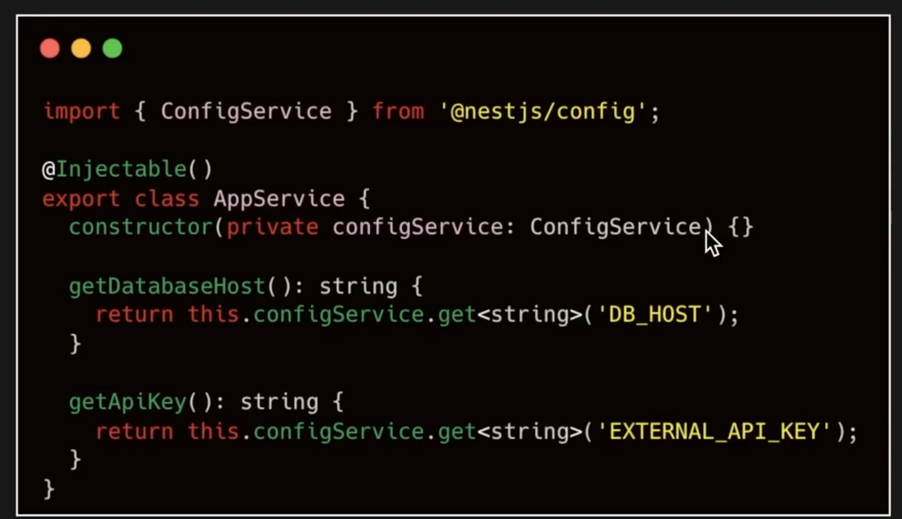

<a id="27deda9b0fe1817eb02bf4c4392a0142"></a>

## 환경변수

---

> 📖 
> 
> <a id="28feda9b0fe180cca4bfdeec97b69c87"></a>
> 
> 프로그램이 동작하는 환경에서 <strong><u>설정값이나 비밀 정보를 저장하고 사용하는 변수</u></strong>이다&#46;

> ✏️ 
> 
> <a id="28feda9b0fe18013b1f2e9f4764817f3"></a>
> 
> <strong>환경변수 중요성</strong>
> 
> - <code>보안</code>&#58; API 키, DB 계정정보 등 민감한 정보를 환경변수로 처리
> 
> - <code>유연성</code>&#58; 앱을 다양한 환경(개발, 테스트, 운영)에서 쉽게 설정 및 실행 가능
> 
> - <code>유지보수성</code>&#58; 설정 변경 시 코드 수정없이 환경변수 파일을 통해 간단하게 업데이트 가능
> 
> - <code>통일성</code>&#58; 동일한 앱을 여러 환경에서 일관된 방식으로 베포 및 운영 가능하다&#46; 

<a id="28feda9b0fe180bd81d3d32d91d35b6c"></a>

### 1&#46; env 파일  정의

<a id="293eda9b0fe18057a3f4d3ff0e44bea1"></a>

```typescript
DB_HOST=localhost
DB_PORT=5432
EXTERNAL_API_KEY={api-key}
PORT=3000
NODE_ENV=dev
SMTP_HOST=smtp.mailtrap.io
LOG_LEVEL=debug
```

<a id="28feda9b0fe1802ba8fcc85e1535428a"></a>

### 2&#46; 루트 모듈에서 <code>ConfigModule</code> 초기화

<a id="293eda9b0fe180599b95c6f2f2c6f050"></a>

```typescript
import { ConfigModule } from '@nestjs/config';

@Module({
	imports: [
		ConfigModule.forRoot({
			isGlobal: true,
		}),
	],
})
export class AppModule {}
```

- 위와 같이 ConfigModule을 import 하면 자동으로 env 정보를 가져온다&#46; 

- global로 등록 시 전역으로 접근 가능하기 때문에 어느 모듈에서든 사용 가능하다&#46;

<a id="28feda9b0fe1800ea839de54c96c5cd3"></a>

### 3&#46; 환경변수 사용 

<a id="290eda9b0fe180d4991de2919f839095"></a>

```typescript
import { ConfigService } from '@nestjs/config';

@Injectable()
export class AppService {
		constructor(private configService: ConfigService) {}
		
		getDatabaseHost(): string {
				return this.configService.get<string>('DB_HOST');
		}
		
		getApiKey(): string {
				return this.configService.get<string>('EXTERNAL_API_KEY');
		}
}
```

<details>
<summary>이미지</summary>



</details>

<a id="28feda9b0fe1804f91a5ff5773bd81b3"></a>

위와 같이 ConfigSerivce를 주입 받아 <code>&#46;get</code>(getter)을 통해 사용 가능하다&#46;

- 루트 모듈(<code>AppModule</code>)에서 <code>ConfigModule</code> 초기화 시, <code>ConfigSerivce</code>를 다른 provider 계층에서 불러와 환경경변수를 가져올 수 있다&#46;
