> 
> 
> <a id="27deda9b0fe18171b85af820450c91d1"></a>
> 
> <strong>목차</strong>
> 
> - [Transaction](#27deda9b0fe18180b80ffd58ba9cd100)
> - [트랜잭션 4가지 성질 - ACID](#28beda9b0fe1806e8a6fd060376a84bb)
> - [Transaction 요소 - Begin, Commit, Rollback](#28beda9b0fe180108579f2d5d268cd0b)
> - [트랜잭션 문제점 - 4가지 유형 ](#28beda9b0fe180bb98cbff540dfa79cb)
> - [ 트랜잭션 문제점 유형 4가지](#28beda9b0fe180f2abd2f791a6d98f8c)
> - [1. Lost Update (갱신 분실)](#28beda9b0fe180b5bf31e467983b1c14)
> - [2. Dirty Read (오손 읽기)](#28beda9b0fe180e49aaef9ea59250629)
> - [3. None-Repeatable Read (반복 불가능 읽기)](#28beda9b0fe18008aa31dc27e608c332)
> - [4. Phantom Read (유령 데이터)](#28beda9b0fe1809f9b24ea9e60a6dd8c)
> - [트랜잭션 - 격리 수준( Isolation Level )](#28beda9b0fe1809da561fe66b07cfe94)
> - [Transaction 문법](#27deda9b0fe18159ab8fc8f382e8da67)

> ✏️ 
> 
> <a id="27deda9b0fe18105a8cff0de897d756f"></a>
> 
> 이전 정리 내용 
> 
> - <a href="#/post/14beda9b-0fe1-80ec-b12a-dc2df0b2a35f">페이지</a> 
> 
> - <a href="#/post/136eda9b-0fe1-80bd-929f-df3c6d2a949e">페이지</a> 

<a id="27deda9b0fe18180b80ffd58ba9cd100"></a>

## Transaction

---

> 📖 
> 
> <a id="27deda9b0fe181448e67e03a663e0dab"></a>
> 
> <code>Transaction</code>은 데이터베이스의 상태를 변환시키는 <strong><u>한 개 이상의 오퍼레이션</u></strong>(<code>SELECT</code>, <code>INSERT</code>, <code>UPDATE</code>, <code>DELETE</code> 등)을 <strong><u>하나의 논리적 작업 단위로 묶어서 실행</u></strong>하는 것을 의미한다<br> 이 논리적 작업 단위는<strong> </strong><strong><u>모두 성공하거나 모두 실패</u></strong>해야 하며, 중간에 일부만 수행된 상태는 허용되지 않는다&#46;

<a id="28beda9b0fe1806e8a6fd060376a84bb"></a>

### <strong>트랜잭션 4가지 성질 &#45; </strong><strong><code>ACID</code></strong>

> ✏️ 
> 
> <a id="28beda9b0fe18037b27fdb0a99bee91b"></a>
> 
> <strong><code>ACID</code></strong>
> 
> ---
> 
> - <strong><code>원자성</code></strong><code> (</code><strong><code>A</code></strong><code>tomicity)</code>&#58; 
>     - <strong><u>트랜잭션 내</u></strong> 모든 작업은 <strong><u>전부 성공하거나 실패(롤백</u></strong><u>)</u>해야한다&#46; 
> 
> - <strong><code>일관성</code></strong><code> (</code><strong><code>C</code></strong><code>onsistency)</code>&#58; 
>     - <strong><u>트랜잭션 실행 전후</u></strong>로 <strong><u>DB는 항상 일관된 상태</u></strong><strong><u>를 유지</u></strong>해야한다&#46;
> 
> - <strong><code>고립성</code></strong><code> (</code><strong><code>I</code></strong><code>solation)</code>&#58; 
>     - <strong><u>동시에 실행</u></strong>되는 <strong><u>트랜잭션</u></strong>이 <strong><u>서로에게 간섭하지 않</u></strong>는다&#46; 
> 
> - <strong><code>지속성</code></strong><code> (</code><strong><code>D</code></strong><code>urabillity)</code>&#58; 
>     - <strong><u>성공적으로 종료된 트랜잭션의 결과</u></strong>는 <strong><u>시스템 장애에도 영구적으로 보</u></strong>존된다&#46; 

<a id="28beda9b0fe180108579f2d5d268cd0b"></a>

### Transaction 요소 &#45; <code>Begin</code>, <code>Commit</code>, <code>Rollback</code>

<details>
<summary>ex) 은행 거래</summary>

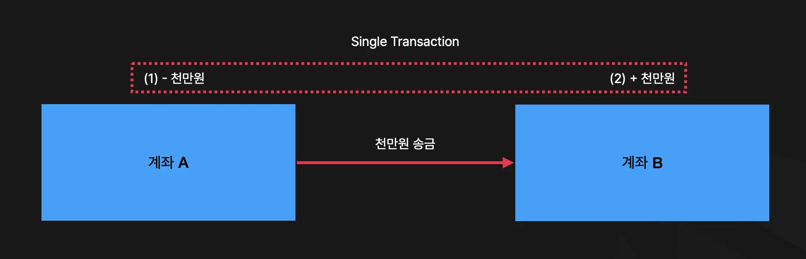

</details>

> ✏️ 
> 
> - <code>Begin</code>&#58; 트랜잭션 시작점
> 
> - <code>Commit</code>&#58; 트랜잭션 내 변경사항 DB 반영
> 
> - <code>Rollback</code>&#58; 트랜잭션 내 변경사항 되돌리기(롤백)

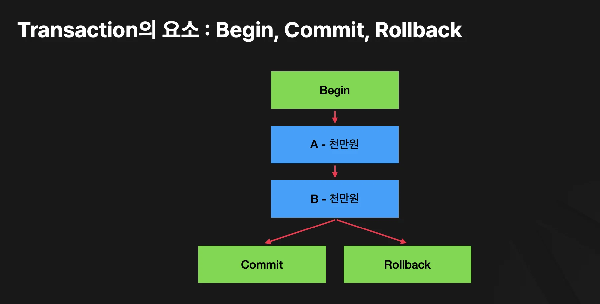

<a id="28beda9b0fe180bb98cbff540dfa79cb"></a>

### <strong>트랜잭션 문제점 &#45; 4가지 유형 </strong>

> ❗ 
> 
> <a id="28beda9b0fe1802f8088d5498c8cf125"></a>
> 
> <strong>트랜잭션에 데이터 접근 제어를 하지 않으면 발생되는 문제점</strong>
> 
> ---
> 
> <a id="28beda9b0fe180879372ccc68883f790"></a>
> 
> 트랜잭션은 하나 이상의 논리적으로 묶은 일관성 있는 실행단위다&#46; 
> 
> <a id="28beda9b0fe180eca6cdfd58480f8d8a"></a>
> 
> 따라서<em> </em><strong>여러 사용자가 동시에 데이터에 접근</strong>할 경우, 트랜잭션들이 <strong><u>인가되지 않은 상태의 데이터를 읽</u></strong>거나, <u>같은 데이터를 중복 갱신</u>해 <u>데이터 일관성을 해칠 위험</u>이 있다&#46; 

> ✏️ 
> 
> <a id="28beda9b0fe180788066e33aadc78915"></a>
> 
> <code>동시성 제어</code>란 트랜잭션이 동시에 수행될 때, <u>일관성을 해치지 않</u>도록 <strong>트랙잭션의 데이터</strong> 접근을 제어하는 DBMS의 기능이다&#46;

<a id="28beda9b0fe180f2abd2f791a6d98f8c"></a>

### <strong> 트랜잭션 문제점 유형 4가지</strong>

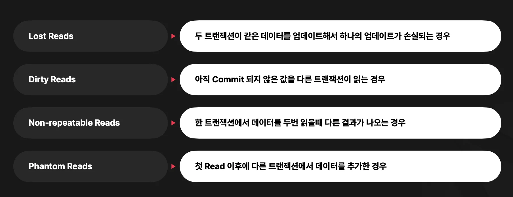

<a id="28beda9b0fe180b5bf31e467983b1c14"></a>

### <strong>1&#46; </strong><strong><code>Lost Update (갱신 분실)</code></strong>

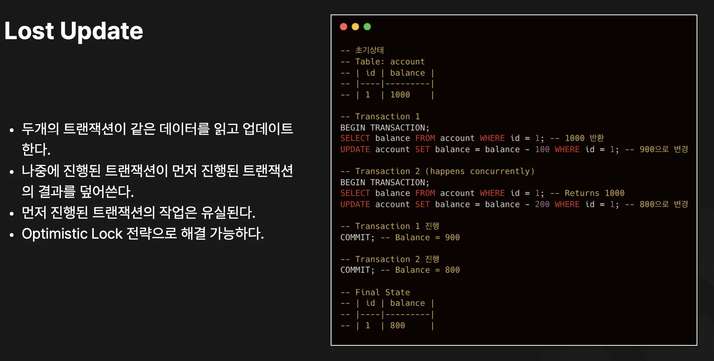

<a id="28beda9b0fe180f4a3fcc3146179b8ff"></a>

두 개의 트랜잭션이 한 개의 데이터에 동시에 접근하여 갱신할 경우 발생된다&#46;

<a id="28beda9b0fe180768893c7fee441f9e3"></a>

<strong><u>처음 업데이트되는 데이터가 이후 업데이트 데이터에 덮어씌워져 소실되는 경우</u></strong>를 말하며, <code>락</code>을 사용하여 <strong><u>순차적으로 접근하도록 제어</u></strong>해 해결할 수 있다&#46; 

- <code>데드락(deadlock)</code> 발생될 수 있음

<a id="28beda9b0fe180e49aaef9ea59250629"></a>

### <strong>2&#46; </strong><strong><code>Dirty Read (오손 읽기)</code></strong>

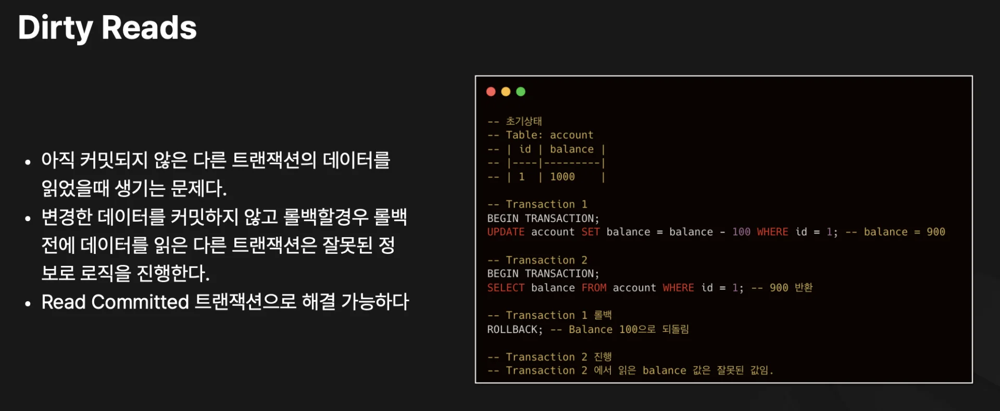

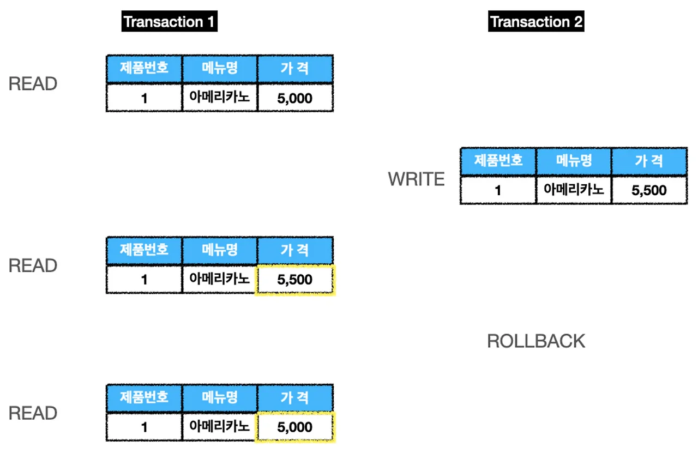

<a id="28beda9b0fe180e9a678c037f2a930d2"></a>

<strong><u>읽기 작업</u></strong>을 하는 <code>트랜잭션1</code>에서 <strong><u>쓰기 작업</u></strong>을 하는 <code>트랜잭션2</code>의 데이터를 중간에 읽어 발생되는 경우를 의미한다&#46; 

<a id="28beda9b0fe1809e9d2dcd6699c7a11f"></a>

위 그림과 같이 ROLLBACK이 발생되는 경우, <code>트랜잭션1</code>에서 <strong>ROLLBACK 전 데이터를 읽</strong>어와 잘못된 결과가 도출될 수 있다&#46;

<a id="28beda9b0fe18008aa31dc27e608c332"></a>

### <strong>3&#46; </strong><strong><code>None&#45;Repeatable Read (반복 불가능 읽기)</code></strong>

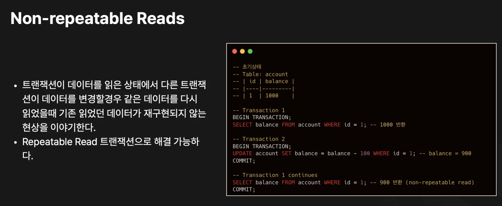

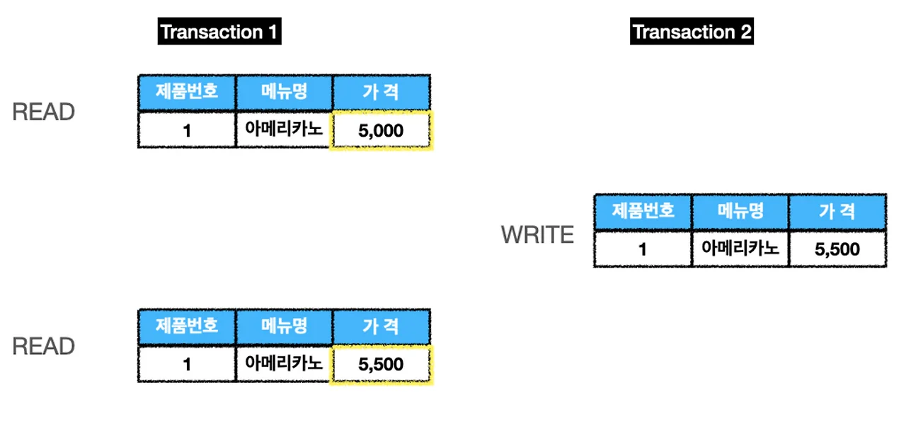

<a id="28beda9b0fe18074bfb5e924f85d7b89"></a>

트랜잭션 1이 데이터를 읽고 트랜잭션 2가 데이터를 쓰는 경우, <br>트랜잭션 1이 다시 데이터를 읽을 때 이전의 결과를 반복하지 않는 경우를 말한다&#46; 

<a id="28beda9b0fe1809f9b24ea9e60a6dd8c"></a>

### <strong>4&#46; </strong><strong><code>Phantom Read (유령 데이터)</code></strong>

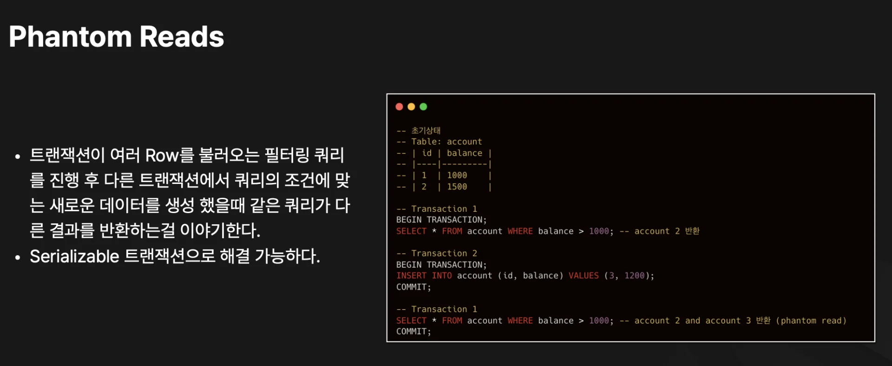

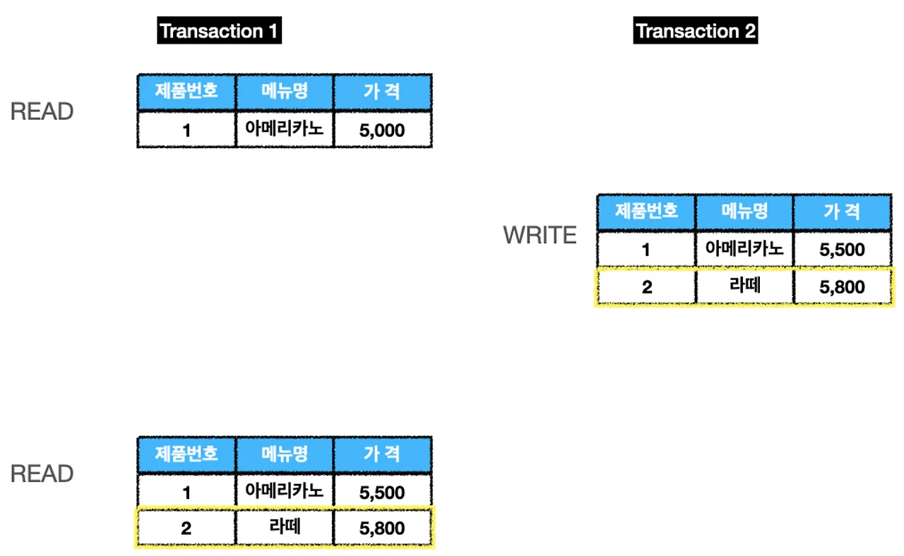

<a id="28beda9b0fe180e5b856dba0c6863ad7"></a>

<code>트랜잭션1</code>에서 데이터를 읽고 <code>트랜잭션2</code>가 데이터를 쓰는 경우, 

<a id="28beda9b0fe180999ba0dcb5e5399c53"></a>

그림과 같이 다시 <code>트랜잭션1</code>에서데이터를 읽을 때, 이전에 없던 데이터가 나타는 경우를 말한다&#46; 

<a id="28beda9b0fe18080b8c9d8a885297a67"></a>

동시성 제어는 이러한 위험 요소를 막아 여러 트랜잭션이 동시에 실행되더라도 데이터 일관성과 무결성을 지키도록 관리한다&#46; 

<a id="28beda9b0fe1809da561fe66b07cfe94"></a>

### <strong>트랜잭션 &#45; </strong><strong><code>격리 수준</code></strong><strong>( I</strong>solation Level )

> ✏️ 
> 
> <a id="27deda9b0fe181efba57c8edee1675a4"></a>
> 
> <strong><u>ANSI/ISO SQL 표준</u></strong>에서는 보통 <code>READ UNCOMMITTED</code>, <code>READ COMMITTED</code>, <code>REPEATABLE READ</code>, <code>SERIALIZABLE</code> 네 등급을 정의하며, 실제 DBMS에 따라 약간의 잠금 정책이나 동작 방식 차이가 있다&#46;
> 
> 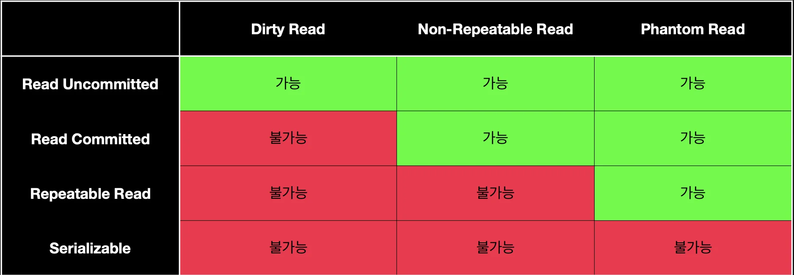
> 
> - <strong><code>LEVER 0</code></strong> &#45; <strong><code>READ UNCOMMITTED</code></strong>
> 
> - <strong><code>LEVER 1</code></strong> &#45; <strong><code>READ COMMITTED</code></strong>
> 
> - <strong><code>LEVER 2</code></strong> &#45; <strong><code>REPEATABLE READ</code></strong><strong> </strong>
> 
> - <strong><code>LEVER 3</code></strong> &#45; <strong><code>SERIALIZABLE</code></strong>

> ❗ 
> 
> <a id="28beda9b0fe180e1b52bf8d87ee65478"></a>
> 
> <code>동시성/성능 트레이드오프</code>
> 
> <a id="28beda9b0fe180a9af03c2bf5b22edbb"></a>
> 
>  높은 격리수준일수록 동시성이 떨어지고, 최하 수준일수록 성능은 좋으나 데이터 정합성 문제가 발생할 수 있다&#46;

| <strong>격리 수준</strong> | <strong>설명</strong> | <strong>조회 시</strong> | 발생되는 문제 | <strong>DBMS 기본</strong> |
| --- | --- | --- | --- | --- |
| <strong><code>Read<br>Uncommitted</code></strong><strong> (level 0)</strong> | &#45; 트랜잭션이 커밋되지 않은 데이터도 다른 트랜잭션에서 읽기 허용 | • 공유 LOCK 없음<br>• UPDATE시 배타락 | • <code>Dirty Read</code><br>• <code>Non&#45;Repeatable Read</code> <br>• <code>Phantom Read</code> | MongoDB |
| <strong><code>Read <br>Committed<br></code></strong><strong>(level 1)</strong> | &#45; 트랜잭션이 커밋된 데이터만 다른 트랜잭션에서 읽기 허용 | • 공유 LOCK 설정 후 완료 시 해제<br>• UPDATE시 배타락 | • <code>Non&#45;Repeatable Read</code> <br>• <code>Phantom Read</code> | Oracle |
| <strong><code>Repeatable<br>Read</code></strong><strong><br>(level 2)</strong> | &#45; 트랜잭션이 시작할 때 읽은 데이터를 트랜잭션 동안 일관되게 유지<br>&#45; 같은 트랜잭션 내에서 같은 데이터를 반복 조회해도 값이 변하지 않음 | • 공유 Lock 설정 후 트랜잭션 끝까지 유지<br>• UPDATE시 배타락, 트랜잭션 종료 시까지 유지 | • <code>Phantom Read</code> | Mysql<br>MariaDB |
| <strong><code>Serializable</code></strong><strong><br>(level 3)</strong> | &#45; 트랜잭션을 직렬화하여 실행<br>&#45; 완벽한 격리 수준을 보장 | • 공유 Lock 설정 후 트랜잭션 끝까지 유지<br>• UPDATE시 배타락, 데이터 접근 강제 직렬화 | 없음 |  |

<details>
<summary>격리 수준별 공통점</summary>

<a id="28beda9b0fe18027860dddd7ef99ca1a"></a>

<code>LEVEL 0(READ UNCOMMITTED)</code> &#126; <code>LEVEL 3(SERIALIZABLE)</code>까지 UPDATE 시에는 <strong>배타락(X&#45;lock, exclusive lock)</strong>을 사용하여 갱신 손실 문제(lost update)를 방지한다&#46;

</details>

<details>
<summary>격리 수준별 차이점</summary>

- LEVEL 0 (READ UNCOMMITTED)
    - Dirty Read가 발생하므로, 한 트랜잭션에서 Commit되지 않은 데이터를 다른 트랜잭션이 읽을 수 있다&#46;

    - SELECT에서 shared lock(공유락)을 사용하지 않아 동시성은 최대지만, 데이터 일관성은 최악이다&#46;

- LEVEL 1 (READ COMMITTED)
    - 데이터 “읽기 순간”에만 shared lock을 걸고 즉시 해제되므로, Non&#45;repeatable read(반복 불가능 읽기)가 발생할 수 있다&#46;

    - 배타락은 갱신 시점에만 활용된다&#46;

- LEVEL 2 (REPEATABLE READ)
    - 읽은 데이터는 트랜잭션 종료 직전까지 공유락 또는 잠금이 유지되어 Non&#45;repeatable read 방지&#46;

    - 그러나 인덱스 혹은 범위 기반으로 새로운 행 삽입(팬텀)까지는 막지 못한다&#46;

- LEVEL 3 (SERIALIZABLE)
    - 가장 강한 격리, 모든 SELECT/UPDATE가 트랜잭션 종료까지 해제되지 않으므로 팬텀 리드도 차단&#46;

    - 실제 데이터베이스 구현에서는 범위 잠금(Range Lock, Predicate Lock) 등 추가 메커니즘 도입&#46;

    - 동시성은 가장 낮지만 데이터 정합성은 최상이다&#46;

</details>

<a id="27deda9b0fe18159ab8fc8f382e8da67"></a>

### Transaction 문법

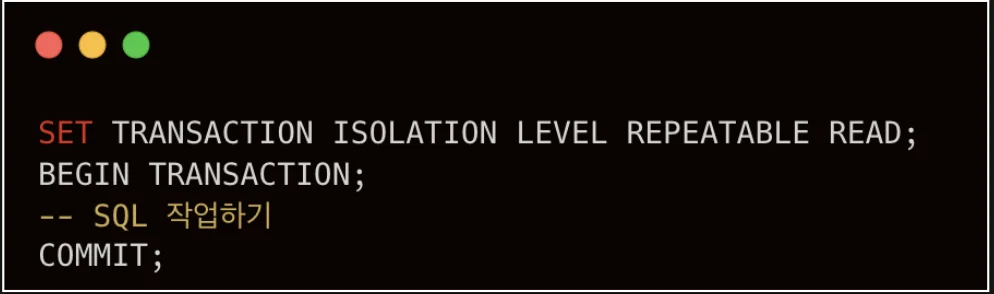

<a id="28beda9b0fe180c2ae3ce7adabc38296"></a>

```sql
SET TRANSACTION ISOLATION LEVEL REPEATABLE READ; # LEVEL 2
BEGIN TRANSACTION;
-- SQL 작업
COMMIT;
```
