> 
> 
> <a id="27deda9b0fe181da80a3d51ca070633b"></a>
> 
> <strong>목차</strong>
> 
> - [DB Migration ](#27deda9b0fe1815a85f8ca1c092f6167)
> - [Configuration ( ormconfig.json )](#28beda9b0fe18056a9aee059f64be03f)
> - [테이블 생성](#28beda9b0fe180f8845dc9dbd1d7d4b8)
> - [칼럼 추가](#28beda9b0fe180e2b42efe3de1f1e358)
> - [칼럼 이름 변경](#28beda9b0fe1801db739e8d07f1f3efe)
> - [칼럼 타입 변경](#28beda9b0fe1801386b8dbbd613cb4e0)
> - [Relationship 작업](#28beda9b0fe1800c9031e9b4013378e7)
> - [Migration CLI 커맨드](#28beda9b0fe1801ba55de827cadebd03)

<a id="27deda9b0fe1815a85f8ca1c092f6167"></a>

## DB Migration 

---

> 📖 
> 
> <a id="28beda9b0fe180e99c0cdf587e6337ea"></a>
> 
> Migration은 데이터베이스 변경사항을 스크립트로 작성해서 반영한다&#46;<br>통제된 상황에서 데이터베이스 스키마 변경 및 복구를 진행할 수 있다&#46; 
> 
> > 베포 환경에서 다룬다&#46; ( 개발 환경에서는 불필요 )
> 
> - 개발 환경에서는 <code>sync</code> 옵션만으로 충분하지만, 프로덕션 환경에서는 데이터들이 매우 중요하기 때문에 마이그레이션 파일을 만들어 해당 파일을 통해 마이그레이션을 진행한다&#46; 

> ✏️ 
> 
> <a id="27deda9b0fe1817e95b3e150bea0d35d"></a>
> 
> <strong>Migration이 필요한 이유 ( 왜 sync 옵션으론 부족한가? )</strong>
> 
> 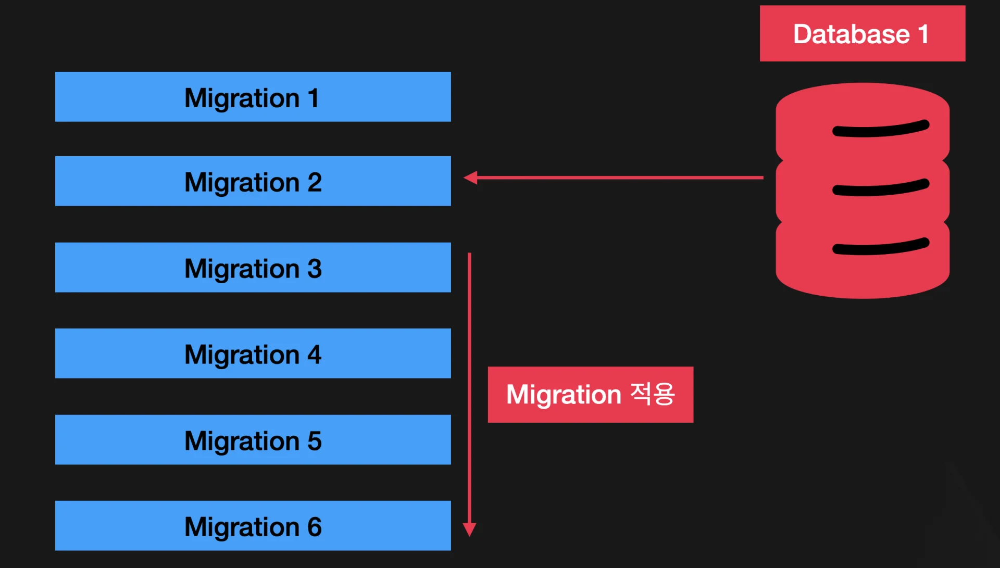
> 
> 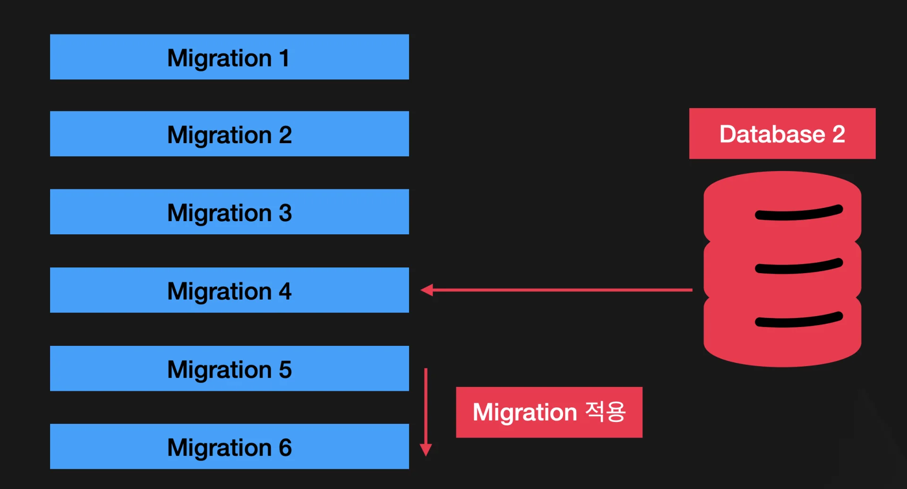
> 
> - <strong><code>Controlled Changes</code></strong>
>     - 원하는 상황에 원하는 형태로 마이그레이션을 자유롭게 실행 가능하다&#46;
> 
> - <strong><code>Reversible</code></strong>
>     - 진행한 마이그레이션을 쉽게 되돌릴 수 있다&#46;
> 
> - <strong><code>Versioning</code></strong>
>     - 마이그레이션은 스키마 변경에 대한 히스토리를 담고 있다&#46; 
> 
>     - 디버깅에 매우 유용하다&#46;
> 
> - <strong><code>Consistency</code></strong>
>     - 다양한 환경(개발, 스테이징, 프로덕션)에서 데이터베이스 스키마가 같게 유지되도록 할 수 있다&#46;
> 
> - <strong><code>Complex Changes</code></strong>
>     - 복잡한 데이터베이스의 변화를 직접 컨트롤 할 수 있다&#46;

<a id="28beda9b0fe18056a9aee059f64be03f"></a>

### Configuration ( <code>ormconfig&#46;json</code> )

> ✏️ 
> 
> <a id="28beda9b0fe180eaada0fa1d20e95488"></a>
> 
> 해당 속성(<code>migrations</code>)을 typeorm 모듈에다가 추가하고
> 
> <a id="28beda9b0fe180b7906ce3dd18364936"></a>
> 
> value 값으로 파일들의 위치만 지정하면된다&#46; 

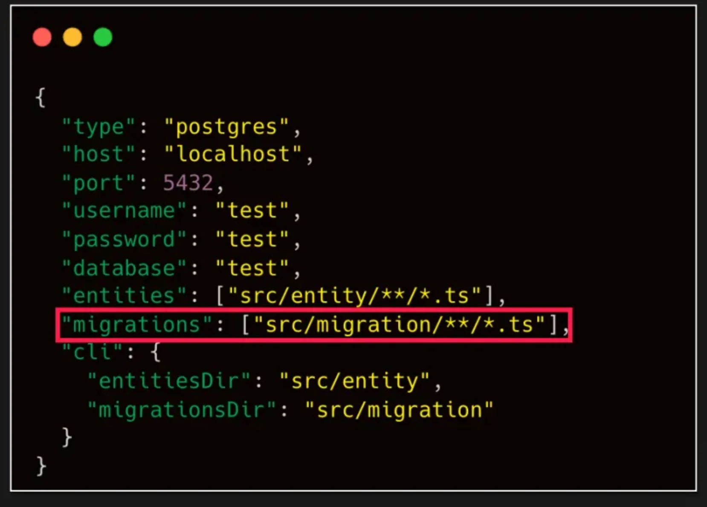

<details>
<summary><strong>ormconfig&#46;json</strong></summary>

<a id="28beda9b0fe180f9b930dc3b0e988add"></a>

```json
{
		"type": "postgres",
		"host": "localhost",
		"port": 5432
		"username": "test",
		"password": "test",
		"database": "test",
		"entities": ["src/entity/**/*.ts"],
		"migrations": ["src/migration/**/*.ts"],
		"cli": {
				"entitiesDir": "src/entity",
				"migrationsDir": "src/migration"
		}
}
```

</details>

<a id="28beda9b0fe180f8845dc9dbd1d7d4b8"></a>

### 테이블 생성

> ✏️ 
> 
> - <code>up()</code>&#58; 마이그레이션을 <strong><u>진행</u></strong>할 때, 실행하는 메서드
> 
> - <code>down()</code>&#58; 마이그레이션을 <strong><u>롤백</u></strong>할 때, 실행하는 메서드

<details>
<summary><strong>RAW SQL</strong></summary>

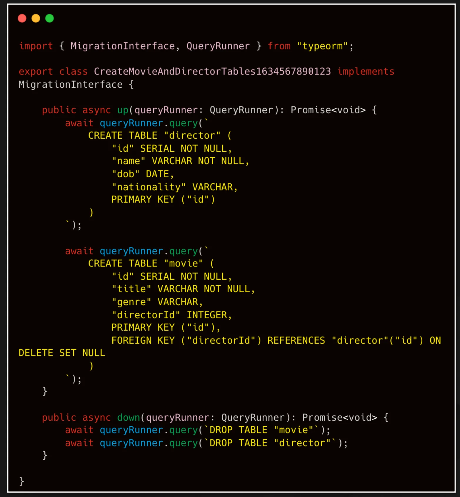

<details>
<summary>&#91; 코드 &#93; Raw SQL</summary>

<a id="28beda9b0fe18018bd48e29ebdb8b613"></a>

```typescript
import { MigrationInterface, QueryRunner } from "typeorm";

export class CreateMovieAndDirectorTables1634567890123 implements MigrationInterface {
		public async up(queryRunner: QueryRunner): Promise<void> {
				await queryRunner.query(`
						CREATE TABLE "director" (
								"id" SERIAL NOT NULL,
								"name" VARCHAR NOT NULL,
								"dob" DATE,
								"nationality" VARCHAR,
								PRIMARY KET ("id")
						)
				`);
				
				await queryRunner.query(`
						CREATE TABLE "movie" (
								"id" SERIAL NOT NULL,
								"title" VARCHAR NOT NULL,
								"genre" VARCHAR,
								"directorId" INTEGER,
								PRIMARY KET ("id")
								FOREIGN KEY ("directorId") REFERENCES "director"("id") ON DELETE SET NULL
						)
				`);
		}
		
		public async down(queryRunner: QueryRunner): Promise<void> {
				await queryRunner.query(`DROP TABLE "movie"`);
				await queryRunner.query(`DROP TABLE "director"`);				
		}
}
```

</details>

</details>

<details>
<summary><strong>Migration API</strong></summary>

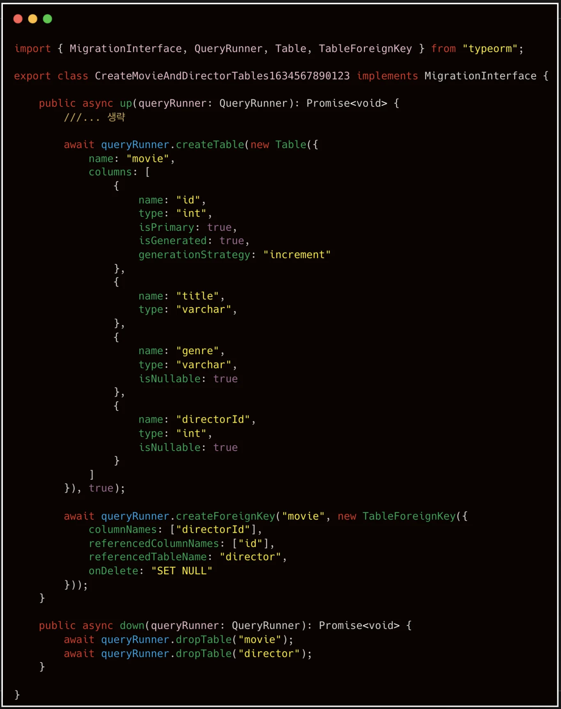

<details>
<summary>&#91; 코드 &#93; <strong>Migration API</strong></summary>

<a id="28beda9b0fe18050b602ed2fc5281123"></a>

```typescript
import { MigrationInterface, QueryRunner } from "typeorm";

export class CreateMovieAndDirectorTables1634567890123 implements MigrationInterface {
		public async up(queryRunner: QueryRunner): Promise<void> {
				await queryRunner.createTable(new Table({
						name: "movie",
						columns: [
								{
										name: "id",
										type: "int",
										isPrimary: true,
										isGenerated: true,
										generationStrategy: "increment"
								},
								{
										name: "title",
										type: "varcher",
								},
								{
										name: "genre",
										type: "varchar",
										isNullable: true
								},
								{
										name: "directorid",
										type: "int",
										isNullable: true
								}
						]
				}), true);
				
				await queryRunner.createForeignKey("movie", new TableForeignKey({
						columnNames: ["directorId"],
						referencedColumnNames: ["id"],
						referencedTableName: "director",
						onDelete: "SET NULL"
				}));
		}
		
		public async down(queryRunner: QueryRunner): Promise<void> {
				await queryRunner.dropTable("movie");
				await queryRunner.dropTable("director");				
		}
}
```

</details>

</details>

<a id="28beda9b0fe180e2b42efe3de1f1e358"></a>

### 칼럼 추가

> ✏️ 
> 
> - <code>up()</code>&#58; 마이그레이션을 <strong><u>진행</u></strong>할 때, 실행하는 메서드
> 
> - <code>down()</code>&#58; 마이그레이션을 <strong><u>롤백</u></strong>할 때, 실행하는 메서드

<details>
<summary><strong>RAW SQL</strong></summary>

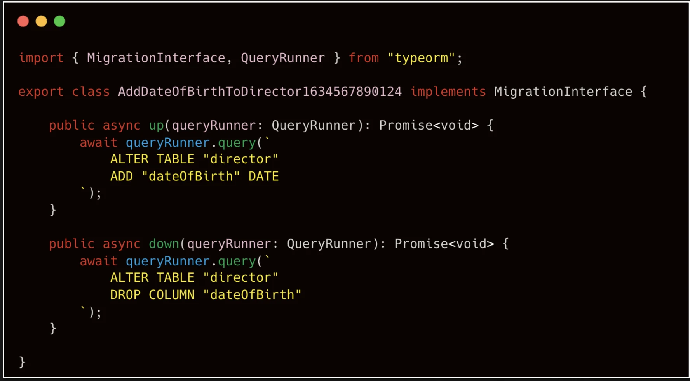

<details>
<summary>&#91; 코드 &#93; Raw SQL</summary>

<a id="28beda9b0fe180749657c10cd62d8401"></a>

```typescript
import { MigrationInterface, QueryRunner } from "typeorm";

export class AddDateOfBirthTODirector1634567890124 implements MigrationInterface {
		public async up(queryRunner: QueryRunner): Promise<void> {
				await queryRunner.query(`
						ALTER TABLE "director"
						ADD "dateOfBirth" DATE
				`);
		}
		
		public async down(queryRunner: QueryRunner): Promise<void> {
				await queryRunner.query(`
						ALTER TABLE "director"
						DROP COLUMN "dateOfBirth"
				`);			
		}
}
```

</details>

</details>

<details>
<summary><strong>Migration API</strong></summary>

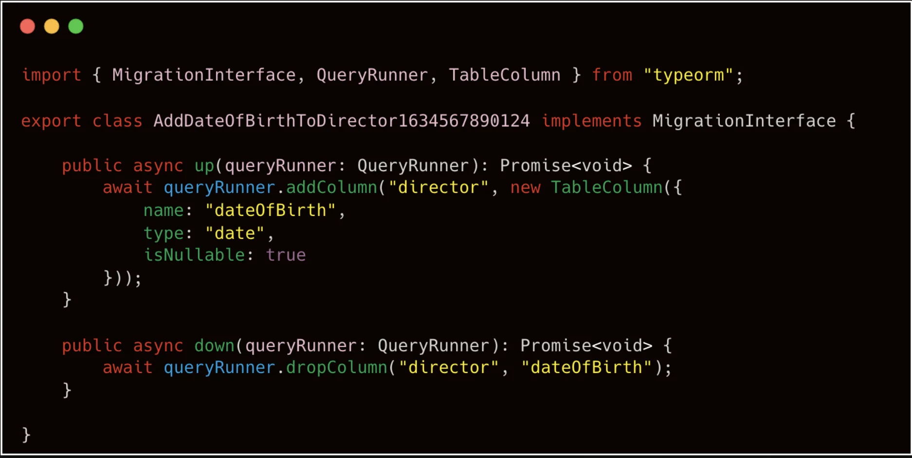

<details>
<summary>&#91; 코드 &#93; <strong>Migration API</strong></summary>

<a id="28beda9b0fe18054a3a0e9491b1c9bd6"></a>

```typescript
import { MigrationInterface, QueryRunner } from "typeorm";

export class AddDateOfBirthTODirector1634567890124 implements MigrationInterface {
		public async up(queryRunner: QueryRunner): Promise<void> {
				await queryRunner.addColumn("director", new TableColumn({
						name: "dateOfBirth",
						type: "date",
						isNullable: true
				}));
		}
		
		public async down(queryRunner: QueryRunner): Promise<void> {
				await queryRunner.dropColumn("director", "dateOfBirth");
		}
}
```

</details>

</details>

<a id="28beda9b0fe1801db739e8d07f1f3efe"></a>

### 칼럼 이름 변경

> ✏️ 
> 
> - <code>up()</code>&#58; 마이그레이션을 <strong><u>진행</u></strong>할 때, 실행하는 메서드
> 
> - <code>down()</code>&#58; 마이그레이션을 <strong><u>롤백</u></strong>할 때, 실행하는 메서드

<details>
<summary><strong>RAW SQL</strong></summary>

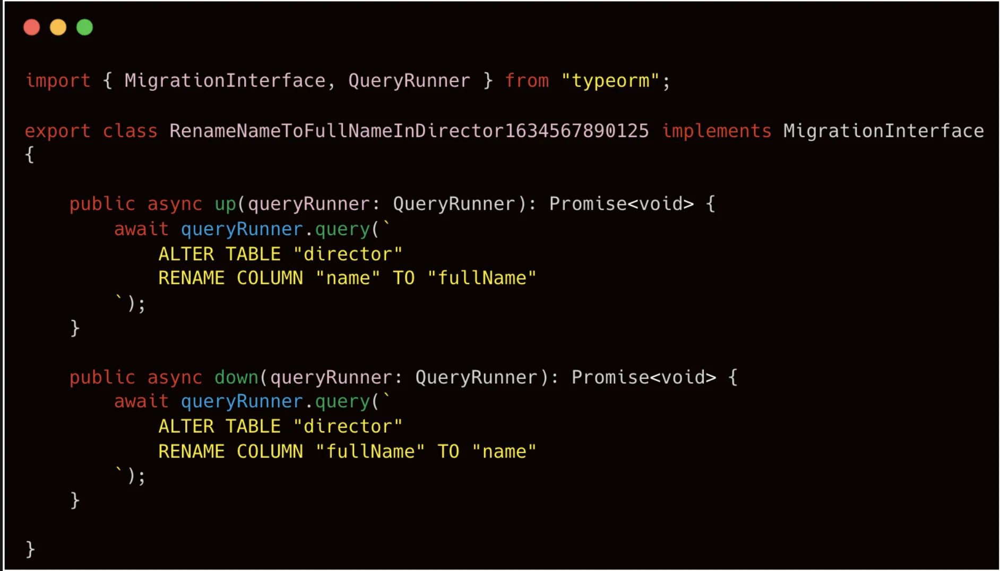

<details>
<summary>&#91; 코드 &#93; Raw SQL</summary>

<a id="28beda9b0fe180f98d28c5b614c7d736"></a>

```typescript
import { MigrationInterface, QueryRunner } from "typeorm";

export class RenameNameToFullNameInDirector1634567890125 implements MigrationInterface {
		public async up(queryRunner: QueryRunner): Promise<void> {
				await queryRunner.query(`
						ALTER TABLE "director"
						RENAME COLUMN "name" TO "fullName"
				`);
		}
		
		public async down(queryRunner: QueryRunner): Promise<void> {
				await queryRunner.query(`
						ALTER TABLE "director"
						RENAME COLUMN "fullName" TO "name"
				`);			
		}
}
```

</details>

</details>

<details>
<summary><strong>Migration API</strong></summary>

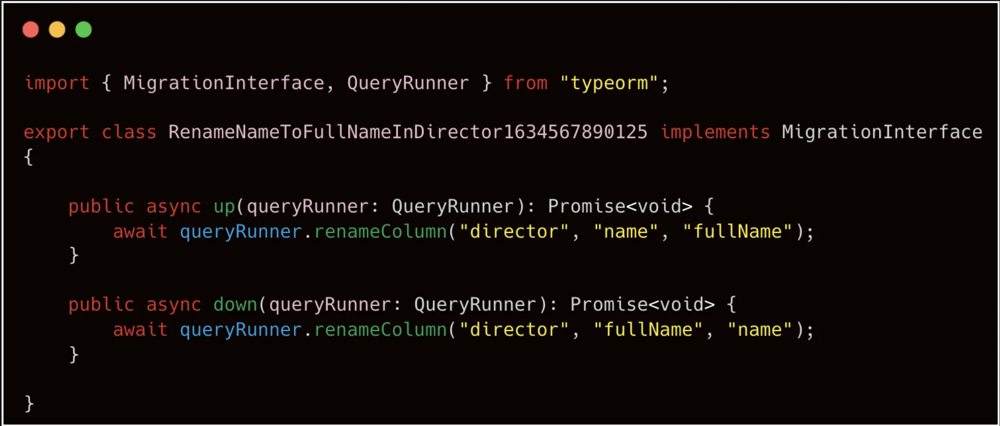

<details>
<summary>&#91; 코드 &#93; <strong>Migration API</strong></summary>

<a id="28beda9b0fe1802b8d2bfede17d169cf"></a>

```typescript
import { MigrationInterface, QueryRunner } from "typeorm";

export class AddDateOfBirthTODirector1634567890125 implements MigrationInterface {
		public async up(queryRunner: QueryRunner): Promise<void> {
				await queryRunner.renameColumn("director", "name", "fullName");
		}
		
		public async down(queryRunner: QueryRunner): Promise<void> {
				await queryRunner.renameColumn("director", "fullName", "name");
		}
}
```

</details>

</details>

<a id="28beda9b0fe1801386b8dbbd613cb4e0"></a>

### 칼럼 타입 변경

> ✏️ 
> 
> - <code>up()</code>&#58; 마이그레이션을 <strong><u>진행</u></strong>할 때, 실행하는 메서드
> 
> - <code>down()</code>&#58; 마이그레이션을 <strong><u>롤백</u></strong>할 때, 실행하는 메서드

<details>
<summary><strong>RAW SQL</strong></summary>

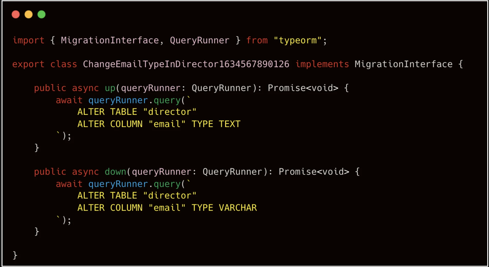

<details>
<summary>&#91; 코드 &#93; Raw SQL</summary>

<a id="28beda9b0fe1800780a2e3c6804dfb8d"></a>

```typescript
import { MigrationInterface, QueryRunner } from "typeorm";

export class ChangeEmailTypeInDirector1634567890126 implements MigrationInterface {
		public async up(queryRunner: QueryRunner): Promise<void> {
				await queryRunner.query(`
						ALTER TABLE "director"
						ALTER COLUMN "email" TYPE TEXT
				`);
		}
		
		public async down(queryRunner: QueryRunner): Promise<void> {
				await queryRunner.query(`
						ALTER TABLE "director"
						ALTER COLUMN "email" TYPE VARCHAR
				`);			
		}
}
```

</details>

</details>

<details>
<summary><strong>Migration API</strong></summary>

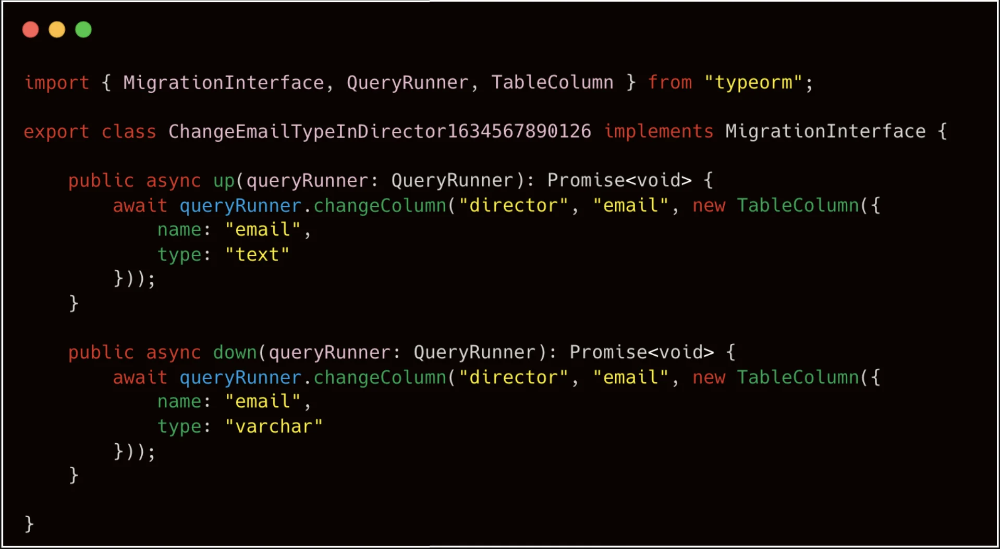

<details>
<summary>&#91; 코드 &#93; <strong>Migration API</strong></summary>

<a id="28beda9b0fe180a29033ed0419d04e2f"></a>

```typescript
import { MigrationInterface, QueryRunner } from "typeorm";

export class ChangeEmailTypeInDirector1634567890126 implements MigrationInterface {

		public async up(queryRunner: QueryRunner): Promise<void> {
				await queryRunner.changeColumn("director", "email", new TableColumn({
						name: "email",
						type: "text"
				}));
		}
		
		public async down(queryRunner: QueryRunner): Promise<void> {
				await queryRunner.changeColumn("director", "email", new TableColumn({
						name: "email",
						type: "varchar"
				}));	
		}
}
```

</details>

</details>

<a id="28beda9b0fe1800c9031e9b4013378e7"></a>

### Relationship 작업

> ✏️ 
> 
> - <code>up()</code>&#58; 마이그레이션을 <strong><u>진행</u></strong>할 때, 실행하는 메서드
> 
> - <code>down()</code>&#58; 마이그레이션을 <strong><u>롤백</u></strong>할 때, 실행하는 메서드

<details>
<summary><strong>RAW SQL</strong></summary>

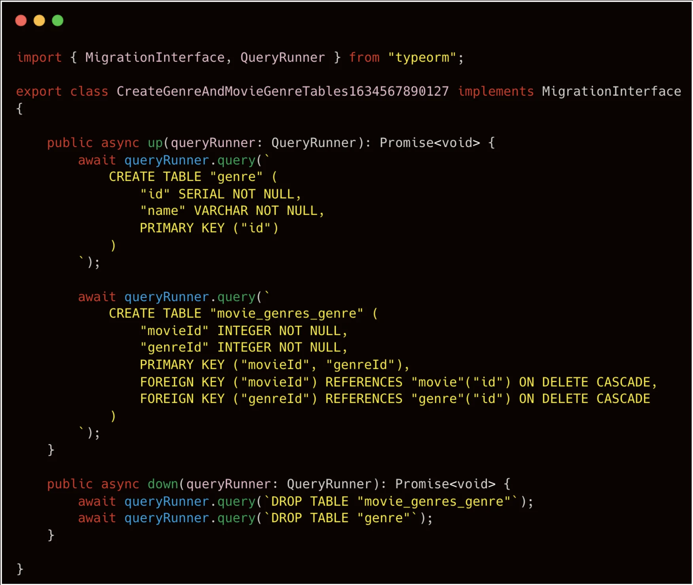

<details>
<summary>&#91; 코드 &#93; Raw SQL</summary>

<a id="28beda9b0fe180f8bb3eeb38a68eef4a"></a>

```typescript
import { MigrationInterface, QueryRunner } from "typeorm";

export class CreateGenreAndMovieGenreTables1634567890127 implements MigrationInterface {
		public async up(queryRunner: QueryRunner): Promise<void> {
				await queryRunner.query(`
						CREATE TABLE "genre" (
								"id" SERIAL NOT NULL,
								"name" VARCHAR NOT NULL,
								PRIMARY KEY ("id")
						)
				`);
				
				await queryRunner.query(`
						CREATE TABLE "movie_genres_genre" (
								"movieId" INTEGER NOT NULL,
								"genreId" INTEGER NOT NULL,
								PRIMARY KEY ("movieId", "genreId"),
								FOREIGN KEY ("movieId") REFERENCES "movie"("id") ON DELETE CASCADE,
								FOREIGN KEY ("genreId") REFERENCES "genre"("id") ON DELETE CASCADE
						)
				`);
		}
		
		public async down(queryRunner: QueryRunner): Promise<void> {
				await queryRunner.query(`DROP TABLE "movie_genres_genre"`);			
				await queryRunner.query(`DROP TABLE "genre"`);			
		}
}
```

</details>

</details>

<details>
<summary><strong>Migration API</strong></summary>

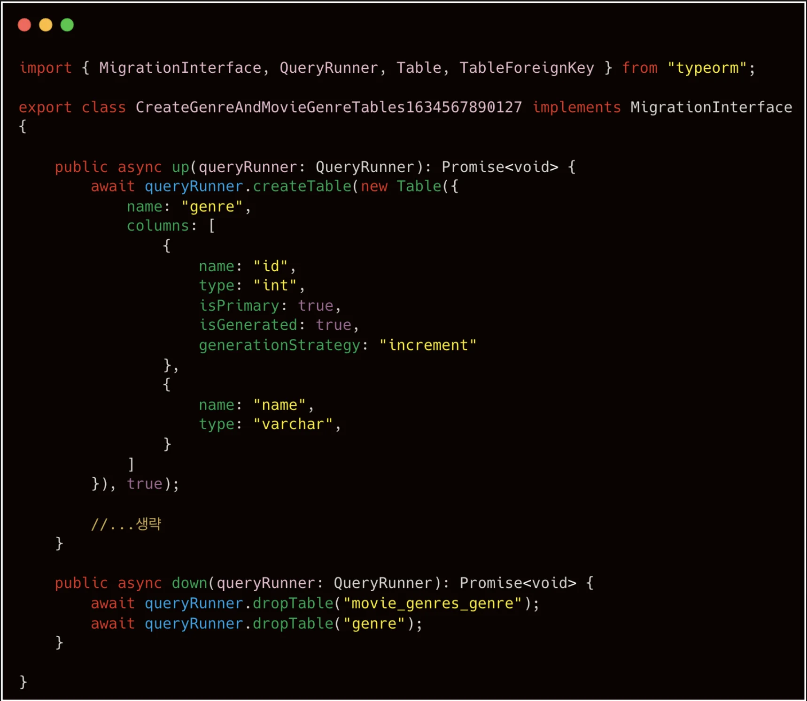

<details>
<summary>&#91; 코드 &#93; <strong>Migration API</strong></summary>

<a id="28beda9b0fe180338a39e67027d4d44c"></a>

```typescript
import { MigrationInterface, QueryRunner } from "typeorm";

export class CreateGenreAndMovieGenreTables1634567890127 implements MigrationInterface {

		public async up(queryRunner: QueryRunner): Promise<void> {
				await queryRunner.createTable(new Table({
						name: "genre",
						columns: [
								{
										name: "id",
										type: "int",
										isPrimary: true,
										isGenerated: true,
										generationStrategy: "increment"
								},
								{
										name: "name",
										type: "varchar",
								}
						]
				}), true);
						
				// ... 셍략
		}
		
		public async down(queryRunner: QueryRunner): Promise<void> {
				await queryRunner.dropTable("movie_genres_genre");
				await queryRunner.dropTable("genre");
		}
}
```

</details>

</details>

<a id="28beda9b0fe1801ba55de827cadebd03"></a>

### Migration CLI 커맨드

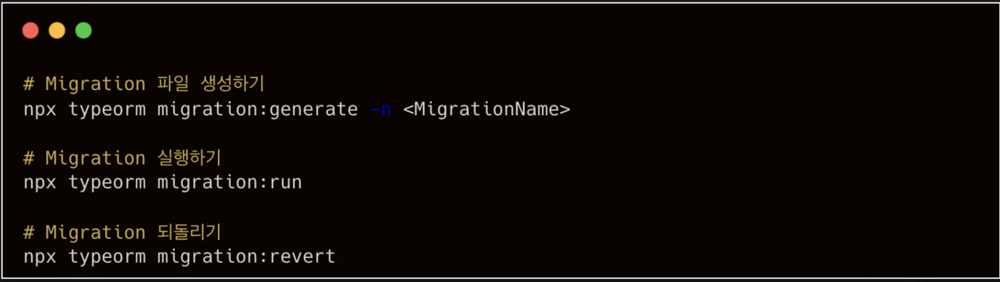

<a id="28beda9b0fe18017b69bca101d9e5fc9"></a>

```bash
# Migration 파일 생성
npx typeorm migration:generate -n <MigrationName>

# Migration 실행
npx typeorm migration:run  # 정의된 모든 마이그레이션 파일의 up()가 실행된다.  ( 이미 실행된 경우 무시 )

# Migration 되돌리기
npx typeorm migration:revert # 동일하게 down()가 실행되어 롤백된다. 
```
