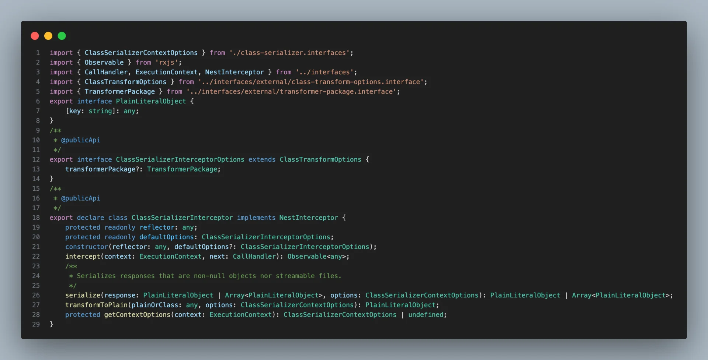

[Documentation &#124; NestJS &#45; A progressive Node&#46;js framework]()

> ✏️ 
> 
> > 프론트에 보여줄 필요가 없는 데이터를 필터링할 때 사용
> 
> - <code>&#64;Exclude()</code>&#58; <strong>response 에서 제외</strong>
> 
> - <code>&#64;Expose()</code> &#43; <code>groups&#58;</code> <strong>권한/상황별 노출 제어</strong> 
> 
> - <code>ClassSerializerInterceptor</code>&#58; 응답을 중간에 가로채 <code>&#64;Exclue()</code>, <code>&#64;Expose()</code> 메타데이터를 읽어 필드를 숨기거나 노출함

<a id="281eda9b0fe180738729d83f0676b00b"></a>

### 1&#46; <code>ClassSerializerInterceptor</code>  및 동작 과정

> ✏️ 
> 
> <a id="281eda9b0fe180f5b741d9552d2f7466"></a>
> 
> <strong>동작 과정</strong>
> 
> <a id="281eda9b0fe180469802c0413b9ad8ee"></a>
> 
> ```typescript
> Controller return: User(class instance)
>            │
>            ▼
> ClassSerializerInterceptor
>            │
>            │  uses class-transformer (+ @Exclude/@Expose metadata)
>            │
>            ▼
>  instanceToPlain(User)  →  { id, email, ... } (password 제거)
>            │
>            ▼
>  HTTP Response (JSON)
> ```
> 
> 1. 컨트롤러 핸들러 반환
>     - 컨트롤러 메서드가 비지니스 로직을 거친 응답 데이터(엔티티)를 반환
> 
> 1. 인터셉터가 가로챔
>     - <code>ClassSerializerInterceptor</code>가 <code>next&#46;handle()</code>의 스트림을 구독하면서 최종 응답 값을 변환
> 
> 1. <code>class&#45;transformer</code>로 직렬화
>     - 인터셉터는 <code>class&#45;transformer</code>의 <code>instanceToPlain</code>(구버전 classToPlain) 같은 API를 호출한다&#46; 이때 클래스에 달린 <code>&#64;Exclude()</code>/<code>&#64;Expose()</code> 등의 <strong>메타데이터를 반영</strong>해서 plain object로 바꾼다&#46;
>         - 실제 구현(&#46;js) 쪽에서 ClassSerializerInterceptor가 class&#45;transformer를 통해 변환을 수행함
> 
>         - <code>&#64;Exclude()</code> 붙은 필드를 출력에서 제거함
> 
> 1. 응답 전송
>     - 변환된 plain object가 최종 JSON 응답값이 됨



<details>
<summary>&#91; 코드 &#93; ClassSerializerInterceptor</summary>

<a id="281eda9b0fe18051a61cd28a35e483c2"></a>

```typescript
import { ClassSerializerContextOptions } from './class-serializer.interfaces';
import { Observable } from 'rxjs';
import { CallHandler, ExecutionContext, NestInterceptor } from '../interfaces';
import { ClassTransformOptions } from '../interfaces/external/class-transform-options.interface';
import { TransformerPackage } from '../interfaces/external/transformer-package.interface';
export interface PlainLiteralObject {
    [key: string]: any;
}
/**
 * @publicApi
 */
export interface ClassSerializerInterceptorOptions extends ClassTransformOptions {
    transformerPackage?: TransformerPackage;
}
/**
 * @publicApi
 */
export declare class ClassSerializerInterceptor implements NestInterceptor {
    protected readonly reflector: any;
    protected readonly defaultOptions: ClassSerializerInterceptorOptions;
    constructor(reflector: any, defaultOptions?: ClassSerializerInterceptorOptions);
    intercept(context: ExecutionContext, next: CallHandler): Observable<any>;
    /**
     * Serializes responses that are non-null objects nor streamable files.
     */
    serialize(response: PlainLiteralObject | Array<PlainLiteralObject>, options: ClassSerializerContextOptions): PlainLiteralObject | Array<PlainLiteralObject>;
    transformToPlain(plainOrClass: any, options: ClassSerializerContextOptions): PlainLiteralObject;
    protected getContextOptions(context: ExecutionContext): ClassSerializerContextOptions | undefined;
}

```

</details>

> 🧐 
> 
> <a id="281eda9b0fe1802c87edc01f5232cc09"></a>
> 
> <code>declare</code>
> 
> <a id="281eda9b0fe180b6b447cc4d0ada9541"></a>
> 
> <code>declare</code> 가 붙은 로직은 선언(<code>d&#46;ts</code>) 파일이라 타입 정보(인터페이스/시그니처)만 제공한다&#46; 
> 
> - <code>메서드/파라미터/리턴 타입</code>만을 나타낸다&#46; 
> 
> <a id="281eda9b0fe1808b8b4de375dbebe384"></a>
> 
> 실제 동작 로직은 Nest가 빌드해서 베포하 <code>&#46;js</code> 구현에 존재한다&#46; 

<a id="27deda9b0fe18017b7a3e81aa63d6404"></a>

### 2&#46; 엔티티 필드에 필터링(<code>&#64;Excluede</code>)  적용

<a id="27deda9b0fe18058a21aff8becff604e"></a>

```typescript

export class BaseTable {
		@CreateDateColumn()
		@Exclude()
		createdAt: Date;
		
		@UpdateDateColumn()
		@Exclude()
		updatedAt: Date;
		
		@VersionColumn()
		@Exclude()
		version: number;
}
```

- 해당하는 컬럼(필드)에 <code>&#64;Exclude</code> 데코레이터를 적용해 필터링한다&#46;
    - 버전, 업데이트 날짜, 생성날짜와 같은 경우 프론트에게 전달할 필요가 없는 데이터이다&#46;

<a id="281eda9b0fe18076b61dddd47271d65e"></a>

### 3&#46; &#91;Controller Interceptor&#93; &#45; Controller에 <code>ClassSerializerInterceptor</code> 적용

<a id="27deda9b0fe1808c96d8f5e3cf8c8b21"></a>

```typescript

@Controller('auth')
@UseInterceptors(ClassSerializerInterceptor)
export class AuthController {
  constructor(private readonly authService: AuthService) {}
  
  @Public()
  @Post('register/user')
  registerUser(@Headers('authorization') token: string) {
    return this.authService.register(token, false);  // 응답 데이터에 Exclude 필터링 적용
  }
	
	. . .
```

- 해당되는 Request의 Response에 Exclude 필터를 적용하려면 해당 Controller에 <code>&#64;UseInterceptors(ClassSerializerInterceptor)</code>를  명시해야 한다 

<a id="281eda9b0fe1809da992ef5eadf8db93"></a>

### 4&#46; &#91;Global Interceptor&#93; &#45;  글로벌로 <code>ClassSerializerInterceptor</code> 적용

- 인터셉터 바인딩 &#45; 글로벌
    <a id="281eda9b0fe180ae92cef9250ce54698"></a>

    ```typescript
    // main.ts
    import { NestFactory, Reflector } from '@nestjs/core';
    import { ClassSerializerInterceptor } from '@nestjs/common';

    async function bootstrap() {
      const app = await NestFactory.create(AppModule);
      app.useGlobalInterceptors(new ClassSerializerInterceptor(app.get(Reflector)));
      await app.listen(3000);
    }
    bootstrap();
    ```

- 옵션 추가 예시
    <a id="281eda9b0fe180bda00ad8695f4ad0bb"></a>

    ```typescript
    // main.ts - 옵션 추가
    app.useGlobalInterceptors(
      new ClassSerializerInterceptor(app.get(Reflector), {
        // DTO에서 @Expose() 붙은 것만 내보내는 화이트리스트 전략
        excludeExtraneousValues: true,
      }),
    );
    ```
