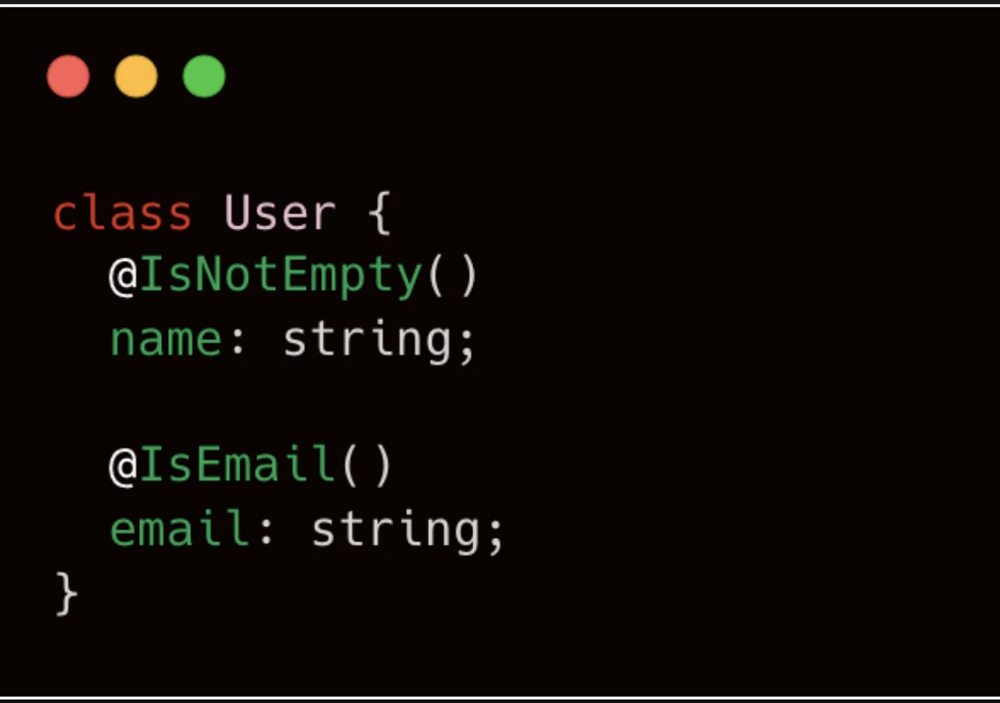
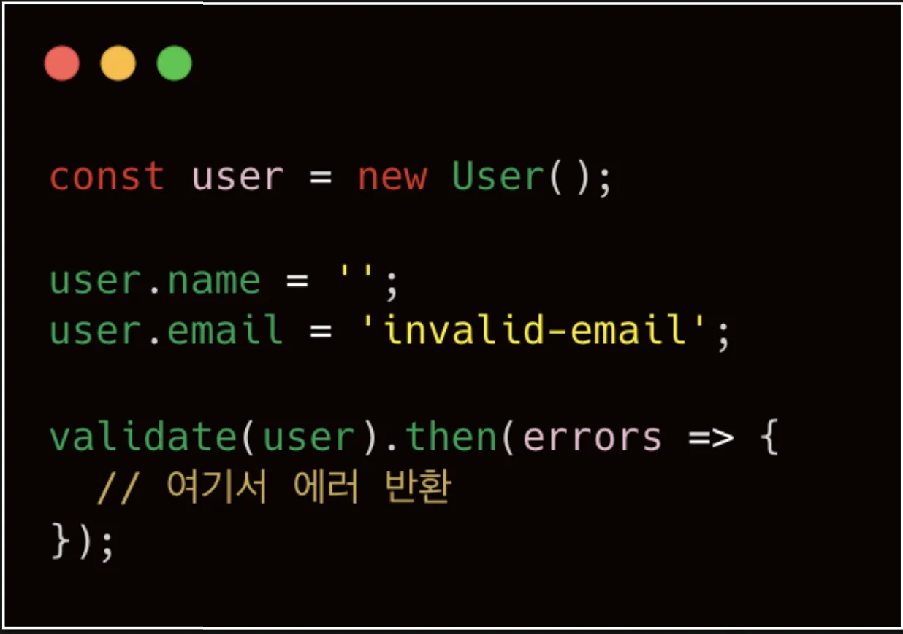
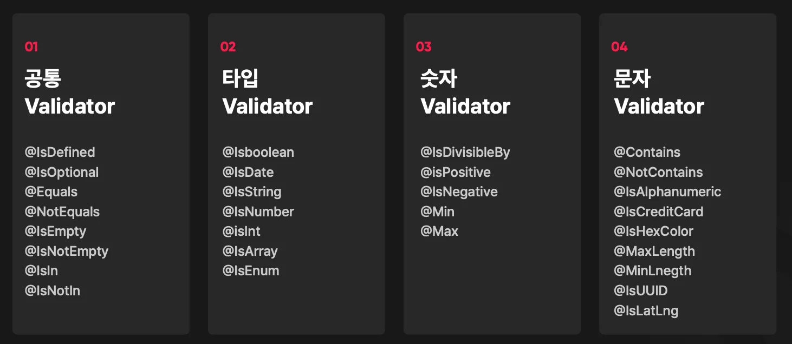
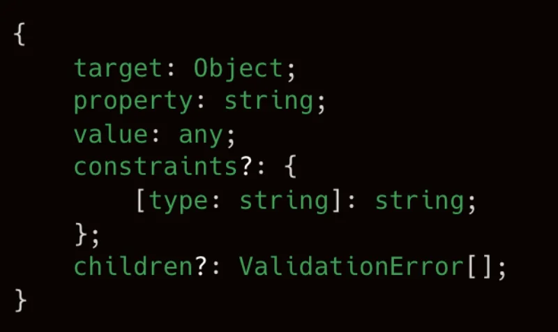
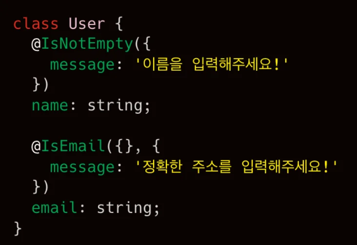

> 
> 
> 
> 
> <strong>목차</strong>
> 
> - [유효성 검사 ( Class Validator )](#27deda9b0fe181209854d35e9278cc98)
> - [ Class Validator 예제](#27deda9b0fe18170bbd1f6db59954a10)
> - [기본 제공 Class Validator](#27deda9b0fe181b48cf0cb519377e32c)
> - [ 반환 에러 구조](#28ceda9b0fe18033a353eb2c3f879d29)
> - [ 커스텀 에러 메세지](#28ceda9b0fe1807a9c79c82c25960f2e)

> ✏️ 
> 
> 
> 
> 이전 정리 내용 
> 
> - <a href="#/post/22deda9b-0fe1-8094-ba57-ea4fa43986cf">페이지</a> 

## 유효성 검사 ( Class Validator )

---

> 📖 
> 
> 
> 
> NestJS의 <code>class&#45;validator</code>는 DTO(Data Transfer Object) 클래스의 속성에 <strong><u>데코레이터를 사용한 유효성 검증</u></strong>을 선언적으로 정의 가능케하는 라이브러리이다&#46; 
> 
> - <code>&#64;IsString()</code>·<code>&#64;IsInt()</code>·<code>&#64;IsNotEmpty()</code> 등 제공하는 다양한 데코레이터를 활용하여 <strong><u>요청 데이터가 예상한 타입 및 조건을 충족</u></strong>하는지 파이브라인에서 자동으로 검증한다&#46; 
> 
> - class&#45;transformer 와 함께 사용돼 

> ✏️ 
> 
> 
> 
> Class Validator 특성
> 
> - TS Decorator를 사용해 클래스를 검증한다&#46; 
> 
> - 동기(Synchronous), 비동기(Asynchronous) 방식 모두 지원
> 
> - Class Validator 자체적으로 제공하는 Validator 사용 가능
> 
> - 커스텀 Validator 생성 가능
> 
> - 커스텀 에러 메세지 반환 

###  Class Validator 예제

Class Validator에서 제공하는 데코레이터를 프로퍼티 위에 선언하여 타입 및 조건등을 검증한다&#46; 

<code>validate()</code> 함수로 객체 검증 시, Class Validator에 부합하지 않는 값이 입력됐다면 해당되는 에러가 반환된다&#46;

### 기본 제공 Class Validator

> ✏️ 
> 
> 

> 
공통 Validator 

> 
> - <code>&#64;IsDefined</code>&#58; 값이 반드시 정의되어 있는지 확인
> 
> - <code>&#64;IsOptional</code>&#58; 값이 없어도 검증 에러를 발생시키지 않음
> 
> - <code>&#64;Equals</code>&#58; 값이 특정 값과 동일한지 확인
> 
> - <code>&#64;NotEquals</code>&#58; 값이 특정 값과 다름을 확인
> 
> - <code>&#64;IsEmpty</code>&#58; 값이 비어있거나 null/undefined인지 확인
> 
> - <code>&#64;IsNotEmpty</code>&#58; 값이 비어있지 않은지 확인
> 
> - <code>&#64;IsIn</code>&#58; 값이 주어진 배열에 포함되는지 확인
> 
> - <code>&#64;IsNotIn</code>&#58; 값이 주어진 배열에 포함되지 않는지 확인
> 
> 

> 
> 

> 
타입 Validator 

> 
> - <code>&#64;IsBoolean</code>&#58; 값이 boolean 타입인지 확인
> 
> - <code>&#64;IsDate</code>&#58; 값이 Date 객체인지 확인
> 
> - <code>&#64;IsString</code>&#58; 값이 문자열인지 확인
> 
> - <code>&#64;IsNumber</code>&#58; 값이 숫자 타입인지 확인
> 
> - <code>&#64;IsInt</code>&#58; 값이 정수인지 확인
> 
> - <code>&#64;IsArray</code>&#58; 값이 배열인지 확인
> 
> - <code>&#64;IsEnum</code>&#58; 값이 열거형(enum)에 속하는지 확인
> 
> 

> 
> 

> 
숫자 Validator

> 
> - <code>&#64;IsDivisibleBy</code>&#58; 값이 주어진 수로 나누어 떨어지는지 확인
> 
> - <code>&#64;IsPositive</code>&#58; 값이 양수인지 확인
> 
> - <code>&#64;IsNegative</code>&#58; 값이 음수인지 확인
> 
> - <code>&#64;Min</code>&#58; 값이 최소값 이상인지 확인
> 
> - <code>&#64;Max</code>&#58; 값이 최대값 이하인지 확인
> 
> 

> 
> 

> 
문자 Validator

> 
> - <code>&#64;Contains</code>&#58; 문자열에 특정 값이 포함되어 있는지 확인
> 
> - <code>&#64;NotContains</code>&#58; 문자열에 특정 값이 미포함인지 확인
> 
> - <code>&#64;IsAlphanumeric</code>&#58; 문자열이 숫자와 영문 알파벳으로만 이루어졌는지 확인
> 
> - <code>&#64;IsCreditCard</code>&#58; 문자열이 신용카드 번호 형식인지 확인
> 
> - <code>&#64;IsHexColor</code>&#58; 문자열이 16진수 색상 코드인지 확인
> 
> - <code>&#64;MaxLength</code>&#58; 문자열이 최대 길이 이하인지 확인
> 
> - <code>&#64;MinLength</code>&#58; 문자열이 최대 길이 이상인지 확인
> 
> - <code>&#64;IsUUID</code>&#58; 문자열이 UUID 형식인지 확인
> 
> - <code>&#64;IsLatLng</code>&#58; 문자열이 위도·경도 좌표 형식인지 확인
> 
> 

###  반환 에러 구조

> ✏️ 
> 
> - <code>target</code>&#58; 검증한 객체
> 
> - <code>property</code>&#58; 검증에 실패한 프로퍼티
> 
> - <code>value</code>&#58; 검증 실패한 값
> 
> - <code>constraints</code>&#58; 검증 실패한 제약조건
> 
> - <code>children</code>&#58; 프로퍼티의 모든 검증 실패 제약조건

###  커스텀 에러 메세지

> ✏️ 
> 
> 
> 
> <code>Validator Decorator</code> 내부 <code>message</code> 프로퍼티를 통해 <strong><u>검증 실패 시의 커스텀 에러 메세지를 설정</u></strong>할 수 있다&#46;
