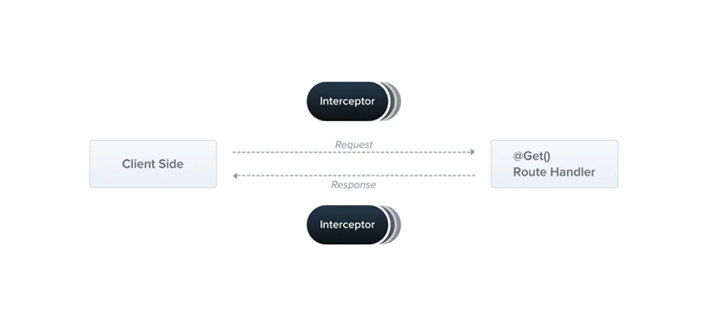
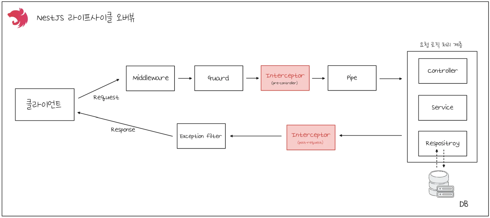
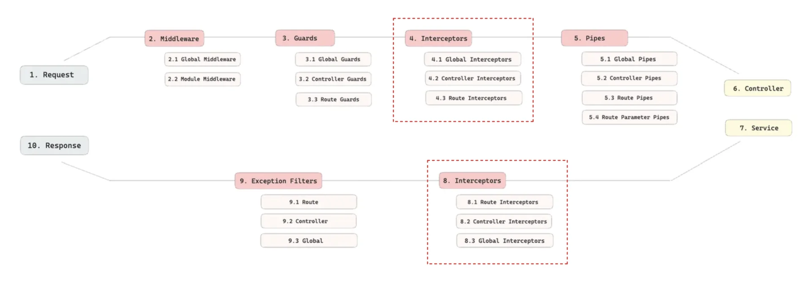
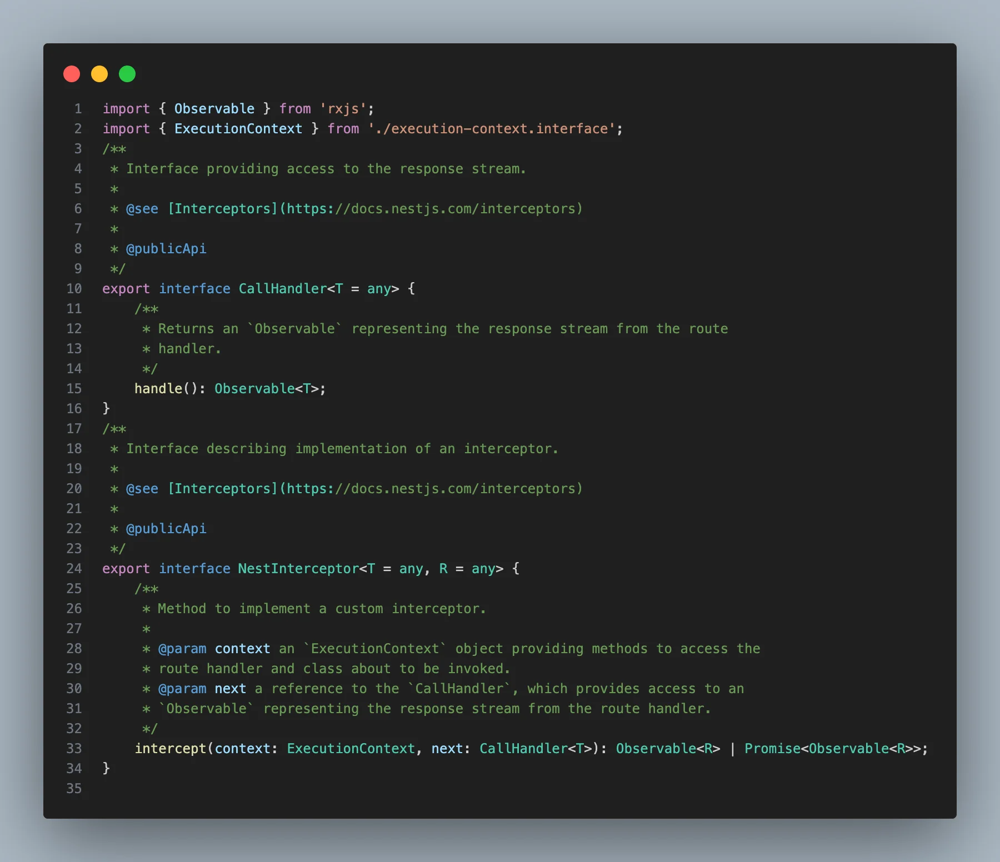
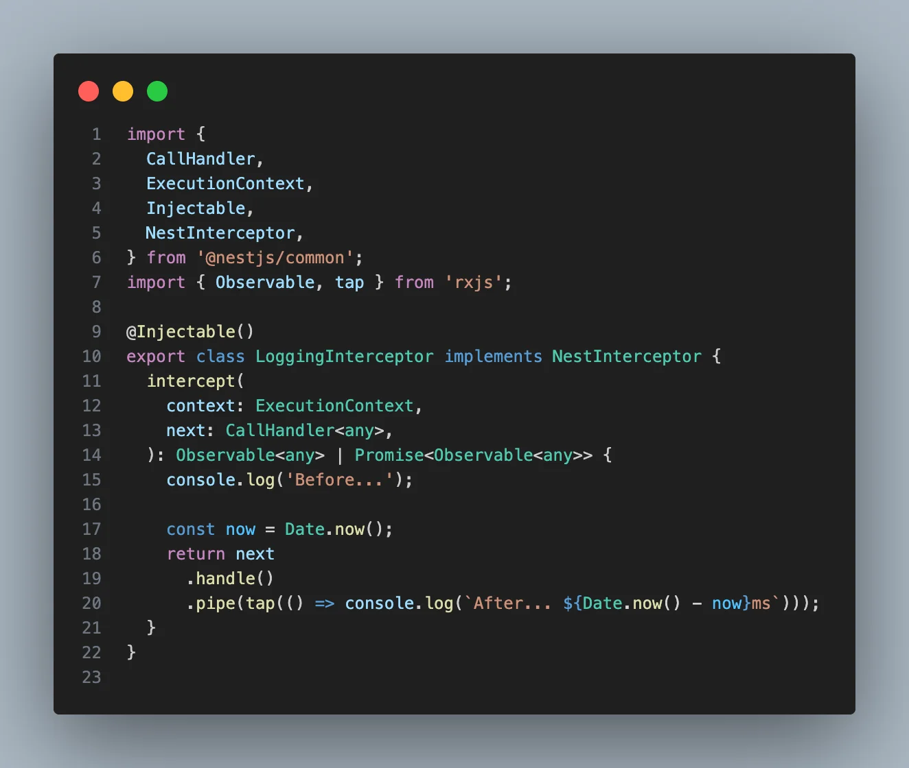

> 
> 
> <a id="27deda9b0fe181e4bb1ef6cecaa007bd"></a>
> 
> <strong>목차</strong>
> 
> - [Interceptor](#27deda9b0fe181df997ac8ff80645046)
> - [ Interceptor 정의](#27deda9b0fe18176bc15f5928c40f245)
> - [ Interceptor 등록 - 전역(Global), 컨트롤러(Controller), 라우트(Route) ](#27deda9b0fe181c6a76af5b2de730b69)

> ✏️ 
> 
> <a id="27deda9b0fe181758be7d4385faff88d"></a>
> 
> 이전 정리 내용 
> 
> - <a href="#/post/22beda9b-0fe1-8090-8ddd-d81c73a5ba0b">페이지</a> 

[Documentation &#124; NestJS &#45; A progressive Node&#46;js framework]()

[RxJS]()

<a id="27deda9b0fe181df997ac8ff80645046"></a>

## Interceptor

---

> 📖 
> 
> <a id="282eda9b0fe180308409d8794d900da4"></a>
> 
> <code>Interceptor</code>는 NestJS에서 유일하게 요청이 들어올 때 그리고 응답이 나갈때 모두 로직을 실행할 수 있는 미들웨어다&#46;
> 
> - Interceptor의 Response 핸들링은 기본적으로 RxJS를 사용한다&#46; 
> 
> 
> 
> > Interceptor는 아래의 기능들을 수행할 수 있다&#46;
> 
> - 함수 실행 전/후 추가 로직 바인딩
> 
> - 함수에서 반환된 값 변환
> 
> - 함수의 기본 기능에 추가 기능 연장
> 
> - 조건에 따라 함수 기능 override





> 🗣 
> 
> <a id="27deda9b0fe181caababc7fa90f4dc68"></a>
> 
> NestJS의 Interceptor는 미들웨어 중 가장 확장성과 범용성이 높다&#46;
> 
> - 복잡한 요구사항의 대부분이 Interceptor를 사용해 구현한다&#46; 

<a id="27deda9b0fe18176bc15f5928c40f245"></a>

###  Interceptor 정의

> ✏️ 
> 
> <a id="282eda9b0fe180d5b20cfc9b38b2ad77"></a>
> 
> Nest에서 제공하는 <code>NestInterceptor</code> 인터페이스를 implements하여 <code>intercept()</code> 메서드를 정의한다&#46; 
> 
> - 인자로 받는 <code>ExecutionContext</code>와  <code>next</code>를 통해 요청의 컨텍스트 정보를 가져오고 다음 동작으로 이동 가능하다&#46;



<details>
<summary>&#91; 코드 &#93;  NestInterceptor</summary>

<a id="282eda9b0fe180afa983dc839586dd54"></a>

```typescript
import { Observable } from 'rxjs';
import { ExecutionContext } from './execution-context.interface';
/**
 * Interface providing access to the response stream.
 *
 * @see [Interceptors](https://docs.nestjs.com/interceptors)
 *
 * @publicApi
 */
export interface CallHandler<T = any> {
    /**
     * Returns an `Observable` representing the response stream from the route
     * handler.
     */
    handle(): Observable<T>;
}
/**
 * Interface describing implementation of an interceptor.
 *
 * @see [Interceptors](https://docs.nestjs.com/interceptors)
 *
 * @publicApi
 */
export interface NestInterceptor<T = any, R = any> {
    /**
     * Method to implement a custom interceptor.
     *
     * @param context an `ExecutionContext` object providing methods to access the
     * route handler and class about to be invoked.
     * @param next a reference to the `CallHandler`, which provides access to an
     * `Observable` representing the response stream from the route handler.
     */
    intercept(context: ExecutionContext, next: CallHandler<T>): Observable<R> | Promise<Observable<R>>;
}

```

</details>



<details>
<summary>&#91; 코드 &#93; LoggingInterceptor</summary>

<a id="27deda9b0fe18187a381fe0ce40bef0e"></a>

```typescript
import {
  CallHandler,
  ExecutionContext,
  Injectable,
  NestInterceptor,
} from '@nestjs/common';
import { Observable, tap } from 'rxjs';

@Injectable()
export class LoggingInterceptor implements NestInterceptor {
  intercept(
    context: ExecutionContext,
    next: CallHandler<any>,
  ): Observable<any> | Promise<Observable<any>> {
    console.log('Before...');
    
    const now = Date.now();
    return next
      .handle()
      .pipe(tap(() => console.log(`After... ${Date.now() - now}ms`)));
  }
}
```

</details>

<a id="27deda9b0fe181c6a76af5b2de730b69"></a>

###  Interceptor 등록 &#45; <code>전역(Global)</code>, <code>컨트롤러(Controller),</code> <code>라우트(Route)</code> 

<details>
<summary><strong>전역( Global ) 단위 등록</strong></summary>

<a id="282eda9b0fe180bb88f3fe8502f43a4e"></a>

```typescript
// main.ts
async function bootstrap() {
  const app = await NestFactory.create(AppModule);
  app.useGlobalInterceptors(new LoggingInterceptor());
  await app.listen(3000);
}
```

<a id="282eda9b0fe18068b82ff34f082d3aa9"></a>

```typescript
// app.module.ts ( 전역 모듈 )
import { Module } from '@nestjs/common';
import { APP_INTERCEPTOR } from '@nestjs/core';
import { LoggingInterceptor } from './common/interceptors/logging.interceptor';

@Module({
  providers: [
    {
      provide: APP_INTERCEPTOR,
      useClass: LoggingInterceptor, // DI 지원되는 전역 인터셉터
    },
  ],
})
export class AppModule {}
```

</details>

<details>
<summary><strong>컨트롤러(Controller) 단위 등록</strong></summary>

<a id="282eda9b0fe1801899cccbeb8f4c8e00"></a>

```typescript
import { Controller, Get, UseInterceptors } from '@nestjs/common';

@Controller('users')
@UseInterceptors(LoggingInterceptor)
export class UsersController {
  @Get()
  findAll() {
    return ['user1', 'user2'];
  }

  @Get(':id')
  findOne() {
    return { id: 1, name: 'user1' };
  }
}
```

</details>

<details>
<summary><strong>라우트(Route/메소드) 단위 등록</strong></summary>

<a id="282eda9b0fe180a5b996d0e52b2cef77"></a>

```typescript
import { Controller, Get, UseInterceptors } from '@nestjs/common';

@Controller('users')
export class UsersController {
  @Get()
  findAll() {
    return ['user1', 'user2'];
  }

  @Get(':id')
  @UseInterceptors(LoggingInterceptor)
  findOne() {
    return { id: 1, name: 'user1' };
  }
}
```

</details>
