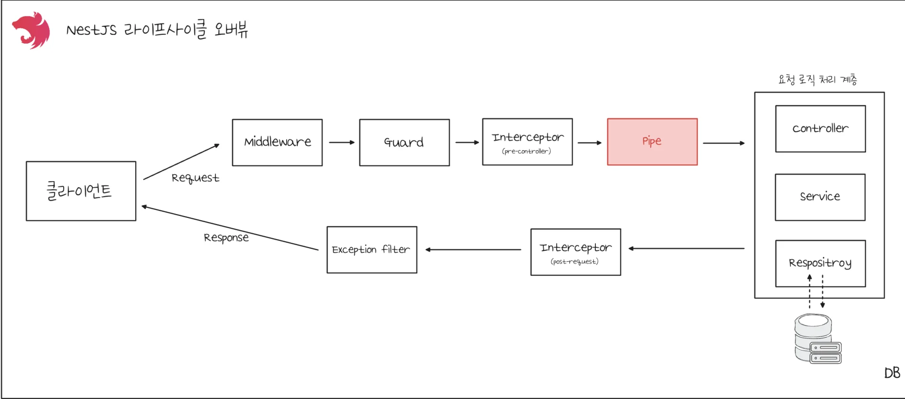
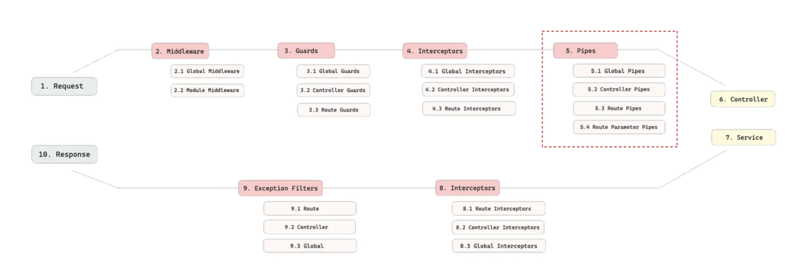
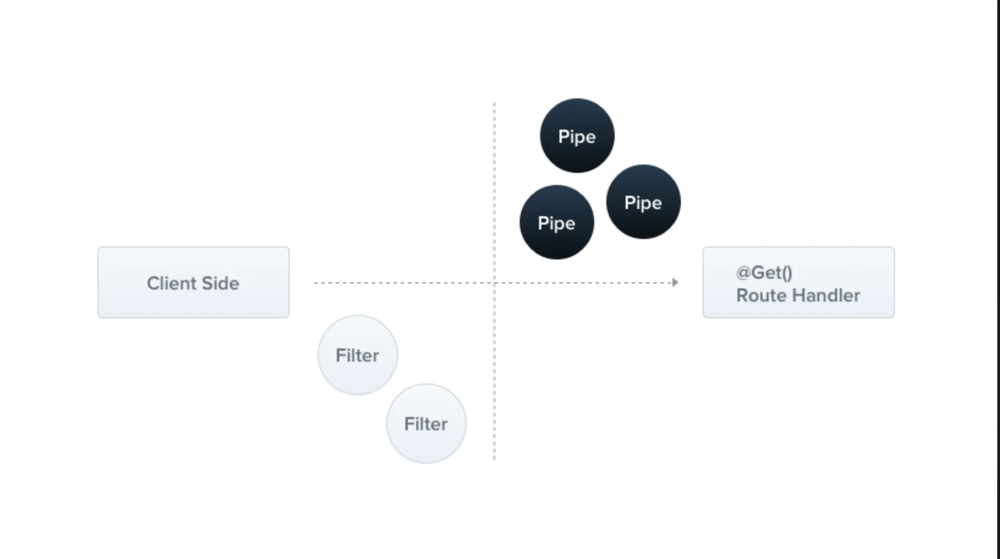
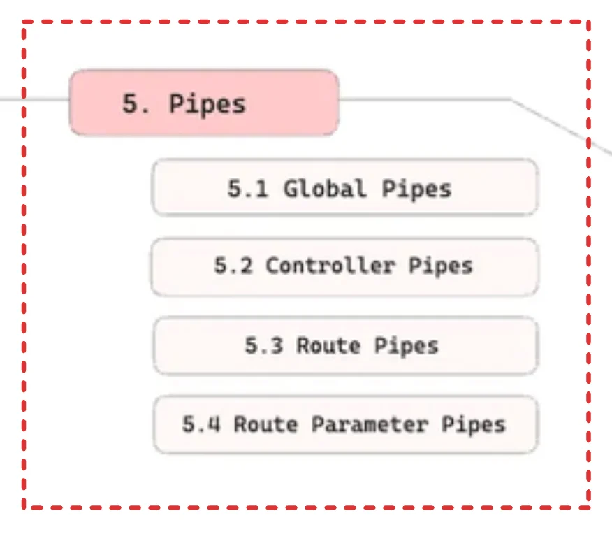

> 
> 
> <a id="27deda9b0fe181dc9814e559d411378a"></a>
> 
> <strong>목차</strong>
> 
> - [Pipe](#27deda9b0fe1812dbf34e55ac672f59e)
> - [ 주요 내장 Pipe](#27deda9b0fe181a89c03dda16b90b138)
> - [ 커스텀 Pipe](#27deda9b0fe1815baf68d283579329d2)
> - [ 파이프 등록 ( 사용 )](#290eda9b0fe18069a7f3c9e19d79facd)

> ✏️ 
> 
> <a id="27deda9b0fe18188ad96d1e898b86aec"></a>
> 
> 이전 정리 내용 
> 
> - 





<a id="27deda9b0fe1812dbf34e55ac672f59e"></a>

## Pipe

---

> 📖 
> 
> 
> 
> <a id="27deda9b0fe181eeb9f8e2e60627cda0"></a>
> 
> Piple는 <strong>Controller의 메서드가 </strong><strong><u>실행되기 직전</u></strong>에 <strong>요청받은 argument 데이터를 변환하거나 검증</strong>하는 컴포넌트이다&#46; 

> ✏️ 
> 
> <a id="27deda9b0fe18162803bdf51ccb2db09"></a>
> 
> Pipe의 2가지 주요 역할
> 
> - <code>변환(Transformation)</code>&#58; 요청 데이터 <strong><u>타입 변환</u></strong>
>     - ex) <strong><code>ParseIntPipe</code></strong>&#58; string → number 
> 
> - <code>검증(Validation)</code>&#58; 요청 데이터 <strong><u>유효성 검사</u></strong>
>     - 조건을 통과하지 못하면 <code>400 BadRequestException</code>과 같은 예외를 발생 시킴
> 
>     - ex) <strong><code>ValidationPipe</code></strong><strong> </strong>와<strong>  </strong><strong><code>class&#45;validator</code></strong>
>         - 자세한 내용은 <a href="#/post/27deda9b-0fe1-8071-8d19-d2363d6d91d0">페이지</a> 참조

> ❗ 
> 
> <a id="290eda9b0fe180538335e0afd1b113ce"></a>
> 
> <strong><code>ValidationPipe</code></strong> 전역 등록 필요
> 
> - 해당 Pipe를 <strong><u>글로벌로 등록</u></strong>해야 DTO에 선언한 <code>class&#45;validator</code>의 <code>Validation Annotaion</code>을 확인하고 검증을 진행한다&#46; 
> 
> - controller, route 등록도 가능하지만 모든 controller, route에 선언을 해야하기 떄문에 글로벌 등록이 권장된다&#46; 

<a id="27deda9b0fe181a89c03dda16b90b138"></a>

###  주요 내장 Pipe

> ✏️ 
> 
> - <strong><u><code>Validation</code></u></strong><code>Pipe</code>&#58; DTO 기반 검증 수행 
> 
> ---
> 
> - <code>Parse</code><strong><u><code>Int</code></u></strong><code>Pipe</code> &#58; &#91;문자열 → 정수&#93; 변환 및 검증
> 
> - <code>Parse</code><strong><u><code>Float</code></u></strong><code>Pipe</code>&#58; &#91;문자열 → 실수&#93; 변환 및 검증
> 
> - <code>Parse</code><strong><u><code>Bool</code></u></strong><code>Pipe</code> &#58; &#91;문자열 → 불리언&#93; 변환 및 검증
> 
> - <code>Parse</code><strong><u><code>Array</code></u></strong><code>Pipe</code> &#58; 배열 형식 데이터 변환 및 검증
> 
> ---
> 
> - <code>Parse</code><strong><u><code>UUID</code></u></strong><code>Pipe</code>&#58; UUID 형식 변환 및 검증
> 
> - <code>Parse</code><strong><u><code>Enum</code></u></strong><code>Pipe</code>&#58; Enum 값 변환 및 검증
> 
> - <strong><u><code>DefaultValue</code></u></strong><code>Pipe</code>&#58; 기본값 설정
> 
> - <code>Parse</code><strong><u><code>File</code></u></strong><code>Pipe</code>&#58; 파일 업로드 검증

<details>
<summary>사용 예시 &#45;  <code>ParseIntPipe</code></summary>

<a id="290eda9b0fe18036a4b7ff03db32f8e6"></a>

<strong>&#91; 코드 &#93; MovieController</strong>

<a id="27deda9b0fe18176a0acffd134a07231"></a>

```typescript
// movice.controller.ts
export class MoviceController {
	@Get(':id')
	getMovie(@Param('id', new ParseIntPipe()) id: number) {
			return this.movieService.getMovie(id);
	}
	
...
```

</details>

<details>
<summary>커스텀 예외 메세지 설정</summary>

<a id="290eda9b0fe18087a10ee3ab97348e78"></a>

```typescript
@Controller('movie')
export class MovieController {
		constructor(private readonly movieService: MovieService) {}
		
		@Get(':id')
		getMovie(@Param('id', new ParseIntPipe({
		  exceptionFactory(error) {
				throw new BadRequestException('숫자를 입력해주세요!');
		  }
		})) id: number,) {
				reutrn this.movieService.findOne(id);
		}
}
```

- new 로 해당 Pipe 생성 및 exceptionFactory 설정을 통해 커스텀 예외 메세지 설정이 가능하다&#46; 

</details>

<a id="27deda9b0fe1815baf68d283579329d2"></a>

###  커스텀 Pipe

> ✏️ 
> 
> <a id="27deda9b0fe1817b9eb5f8e8de353c4d"></a>
> 
> 사용자 정의 Pipe는 <code>PipeTranform</code> 인터페이스의 <code>transform()</code> 메서드를 구현해 정의한다&#46;

<details>
<summary>1&#46; 커스텀 파이프 정의 &#45; <code>ParseUppercasePipe</code></summary>

<a id="290eda9b0fe180adb7ffdd97240fb8c1"></a>

&#91; 코드 &#93; ParseUppercasePipe

<a id="27deda9b0fe1814f859ffee97f6a4b0e"></a>

```typescript
import { PipeTransform, Injectable, ArgumentMetadata, BadRequestException } from '@nestjs/common';

@Injectable()
export class ParseUppercasePipe implements PipeTransform {
  transform(value: any, metadata: ArgumentMetadata) {
    if (typeof value !== 'string') {
      throw new BadRequestException('문자열만 허용됩니다.');
    }
    return value.toUpperCase();
  }
}
```

</details>

<details>
<summary>1&#46;2&#46; 커스텀 파이프 정의 &#45; <code>ParseIntPipe</code></summary>

<a id="290eda9b0fe180598c08e6e41d717050"></a>

&#91; 코드 &#93; ParseIntPipe

<a id="290eda9b0fe1801bb660f4225e09b030"></a>

```typescript
import { PipeTransform, Injectable, ArgumentMetadata, BadRequestException } from '@nestjs/common';

@Injectable()
export class ParseIntPipe implements PipeTransform<string, number> {
  transform(value: string, metadata: ArgumentMetadata): number {
		const val  = parseInt(value, 10);
    if (isNaN(val)) {
	    throw new BadRequestException(
	      'Validation failed. "${value}" is not a valid number.'
      );
    }
    return val;
  }
}
```

</details>

<details>
<summary>2&#46; 커스텀 파이프 사용 ( <strong>Route Parameter Pipe</strong> )</summary>

<a id="290eda9b0fe180f8a65deb0289f37ad0"></a>

```typescript
// example.controller.ts
export class ExampleController {

	@Get(':name')
	getName(@Param('name', new ParseUppercasePipe()) name: string) {
	  return name;
	}
	
	...
```

-  <code>/user/john</code> 이 들어올 때, Controller는 <code>name</code> 인자를  <code>JOHN</code>으로 받는다&#46;

</details>

<a id="290eda9b0fe18069a7f3c9e19d79facd"></a>

###  파이프 등록 ( 사용 )



> 
> 
> 1. <code>Global Pipes</code> <br>( 전역 단위 등록 )
> 
> 1. <code>Controller Pipes</code><br>( 컨트롤러 단위 등록 )
> 
> 1. <code>Route Pipes</code><br>( 라우트 단위 등록 )
> 
> 1. <code>Route Parmeter Pipes</code>
>     <a id="290eda9b0fe1801b9deef79eb5e9c86e"></a>
> 
>     ( 인자 단위 등록 )

<details>
<summary>1&#46; <code>Global Pipes</code> ( 전역 단위 등록 )</summary>

<a id="290eda9b0fe18014877cd78c95f90926"></a>

```typescript
import { ValidationPipe } from '@nestjs/common';
import { NestFactory } from '@nestjs/core';
import { AppModule } from './app.module';

async function bootstrap() {
		const app = await NestFactory.create(AppModule);
		app.useGlobalPipes(new ValidationPipe());
		await app.listen(3000);
}
bootstrap();
```

</details>

<details>
<summary>2&#46; <code>Controller Pipes</code> ( 컨트롤러 단위 등록 )</summary>

<a id="290eda9b0fe180dba1fcee84ced864bc"></a>

```typescript
@Controller('movie')
@UsePipes(new ValidationPipe())
export class MovieController {
		constructor(private readonly movieService: MovieService) {}
		
		@Patch(':id')
		patchMovie(@Param('id') id: number, @Body() body: UpdateMovieDto) {
				reutrn this.movieService.update(id, body);
		}
}
```

</details>

<details>
<summary>3&#46; <code>Route Pipes</code> ( 라우트 단위 등록 )</summary>

<a id="290eda9b0fe180cba9dceb61af92990d"></a>

```typescript
@Controller('movie')
export class MovieController {
		constructor(private readonly movieService: MovieService) {}
		
		@Patch(':id')
		@UsePipes(new ValidationPipe())
		patchMovie(@Param('id') id: number, @Body() body: UpdateMovieDto) {
				reutrn this.movieService.update(id, body);
		}
}
```

</details>

<details>
<summary>4&#46; <code>Route Parmeter Pipes</code>( 인자 단위 등록 )</summary>

<a id="290eda9b0fe1802faac4d5f963abfba5"></a>

```typescript
@Controller('movie')
export class MovieController {
		constructor(private readonly movieService: MovieService) {}
		
		@Patch(':id')
		patchMovie(@Param('id', ParseIntPipe) id: number,
							 @Body() body: UpdateMovieDto) {
				reutrn this.movieService.update(id, body);
		}
}
```

</details>
