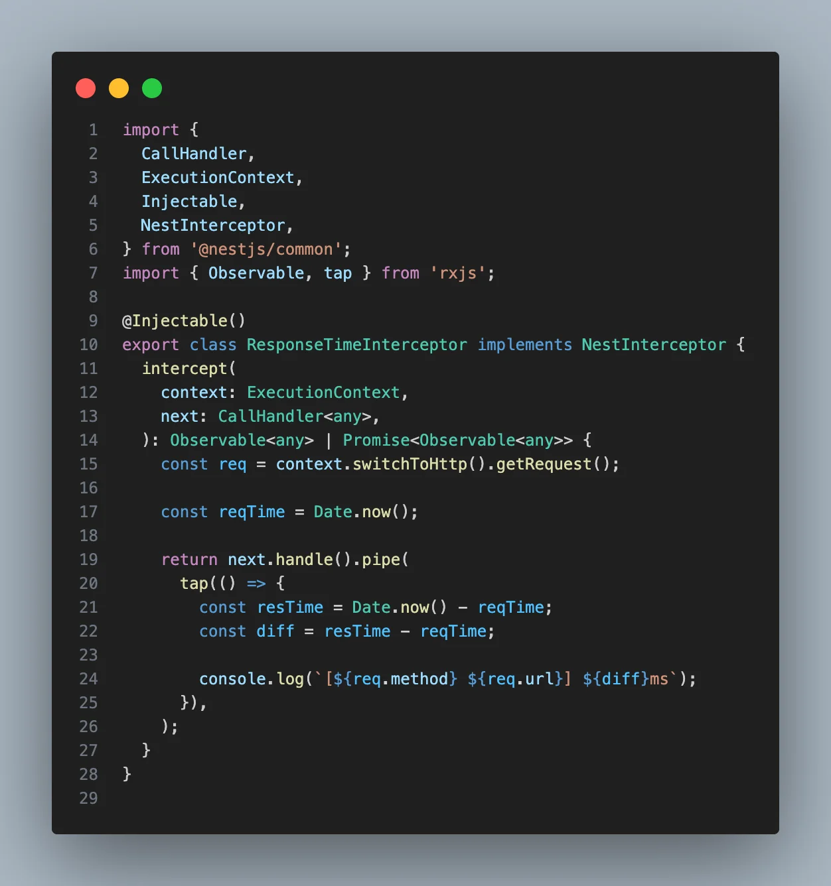
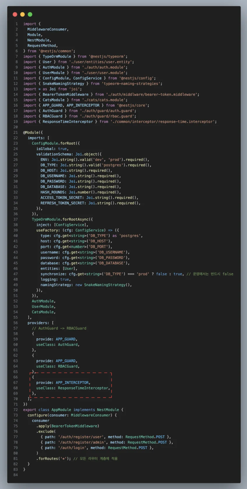
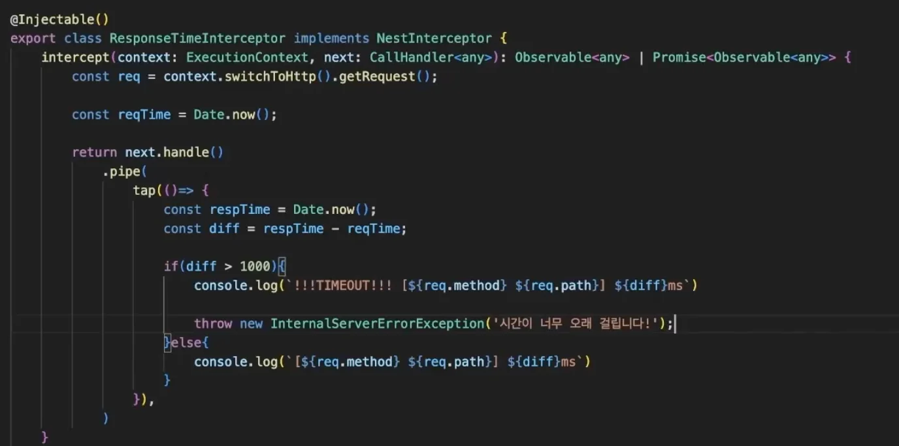
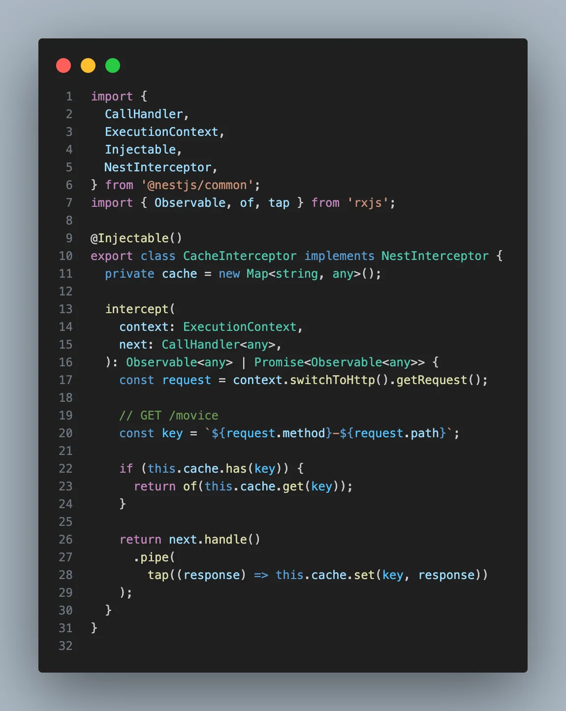
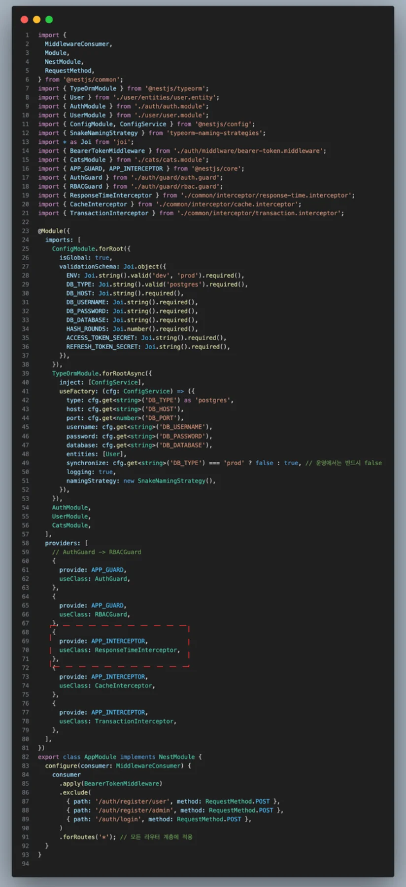
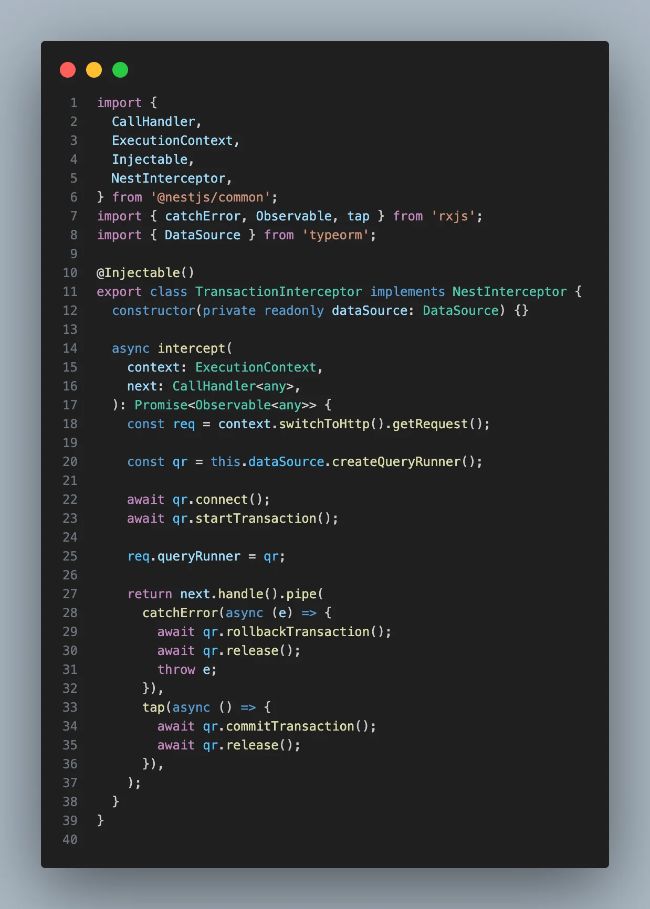

> 
> 
> <a id="27deda9b0fe181228d60d406cb5be2ef"></a>
> 
> <strong>목차</strong>
> 
> - [Interceptor 사용 예제](#27deda9b0fe181559da3d1994a042d9a)
> - [1.  Response Time Interceptor](#282eda9b0fe18078b0b9cb66ff0ce559)
> - [2.  Cache Interceptor](#282eda9b0fe180328ffffe991d0c4ea2)
> - [3. Transaction Interceptor](#282eda9b0fe180b9bbf7f9ed6a21c9cb)

<a id="27deda9b0fe181559da3d1994a042d9a"></a>

## Interceptor 사용 예제

---

<a id="282eda9b0fe18078b0b9cb66ff0ce559"></a>

### 1&#46;  Response Time Interceptor



<details>
<summary><strong>&#91; 코드 &#93; ResponseTimeInterceptor</strong></summary>

<a id="27deda9b0fe181cfb942d23a01142b9e"></a>

```typescript
@Injectable()
export class ResponseTimeInterceptor implements NestInterceptor {
		intercept(context: ExecutionContext, next: CallHandler<ant>): Observable<any> | Promise<Observable<any>> {
				// Request Interceptor
				const req = context.switchToHttp().getRequest();
				
				const reqTime = Date.now();
				
				// Response Interceptor
				return next.handle()
						.pipe(
								const resTime = Date.now();
								const diff = resTime - reqTime;
								
								console.log(`[${req.method} ${req.path}] ${diff}ms`);
						)
		}
}
```

</details>

<a id="282eda9b0fe180d4abf5f6ccacf89127"></a>

<strong>해당 Interceptor 전역 등록</strong>



<details>
<summary><strong>&#91; 코드 &#93; AppModule </strong></summary>

<a id="27deda9b0fe18093bac4e24c1bb2dd53"></a>

```typescript

. . .
 
providers: [
	{ 
		provide: APP_GUARD,
		useClass: AuthGuard,
	},
	{ 
		provide: APP_GUARD,
		useClass: AuthGuard,
	},
	{ 
		provide: APP_INTERCEPTOR,
		useClass: ResponseTimeInterceptor,
	},
]
```

</details>

<a id="27deda9b0fe180d9bcabf982e7c4ec1a"></a>

<strong>추가 예외처리</strong>



<a id="27deda9b0fe180dfbc86fc2d680329a7"></a>

시간이 너무 오래 걸리는 경우, 위와 같이 예외처리를 할 수 있다&#46; 

- 해당 응답이 왜 오래걸리는지 모니터링 및 디버깅 작업 등 후속 작업 가능

<a id="282eda9b0fe180328ffffe991d0c4ea2"></a>

### 2&#46;  Cache Interceptor



<details>
<summary><strong>&#91; 코드 &#93; </strong>CacheInterceptor</summary>

<a id="27deda9b0fe181e38f2cfebfe8015b52"></a>

```typescript
import {
  CallHandler,
  ExecutionContext,
  Injectable,
  NestInterceptor,
} from '@nestjs/common';
import { Observable, of, tap } from 'rxjs';

@Injectable()
export class CacheInterceptor implements NestInterceptor {
  private cache = new Map<string, any>();

  intercept(
    context: ExecutionContext,
    next: CallHandler<any>,
  ): Observable<any> | Promise<Observable<any>> {
    const request = context.switchToHttp().getRequest();

    // GET /movice
    const key = `${request.method}-${request.path}`;

    if (this.cache.has(key)) {
      return of(this.cache.get(key));
    }

    return next.handle()
      .pipe(
        tap((response) => this.cache.set(key, response))
    );
  }
}

```

</details>

<a id="282eda9b0fe180ae9786dd2d3fc33bfb"></a>

<strong>해당 Interceptor 전역 등록</strong>



<details>
<summary><strong>&#91; 코드 &#93; AppModule </strong></summary>

<a id="282eda9b0fe180b3bfd9c1e3fd0821b0"></a>

```typescript

. . .
 
providers: [
	{ 
		provide: APP_GUARD,
		useClass: AuthGuard,
	},
	{ 
		provide: APP_GUARD,
		useClass: AuthGuard,
	},
	{
		provide: APP_INTERCEPTOR,
		useClass: ResponseTimeInterceptor,
	},
	{ 
		provide: APP_INTERCEPTOR,
		useClass: CacheInterceptor,
	},
]
```

</details>

<a id="282eda9b0fe180b9bbf7f9ed6a21c9cb"></a>

### 3&#46; Transaction Interceptor

<details>
<summary>1&#46; Interceptor 정의</summary>



<details>
<summary><strong>&#91; 코드 &#93; </strong>TransactionInterceptor</summary>

<a id="27deda9b0fe180158817cef798449cd9"></a>

```typescript
import {
  CallHandler,
  ExecutionContext,
  Injectable,
  NestInterceptor,
} from '@nestjs/common';
import { catchError, Observable, tap } from 'rxjs';
import { DataSource } from 'typeorm';

@Injectable()
export class TransactionInterceptor implements NestInterceptor {
  constructor(private readonly dataSource: DataSource) {}

  async intercept(
    context: ExecutionContext,
    next: CallHandler<any>,
  ): Promise<Observable<any>> {
    const req = context.switchToHttp().getRequest();

    const qr = this.dataSource.createQueryRunner();

    await qr.connect();
    await qr.startTransaction();

    req.queryRunner = qr;

    return next.handle().pipe(
      catchError(async (e) => {
        await qr.rollbackTransaction();
        await qr.release();
        throw e;
      }),
      tap(async () => {
        await qr.commitTransaction();
        await qr.release();
      }),
    );
  }
}

```

</details>

</details>

<details>
<summary>2&#46;  <strong>해당 Interceptor 전역 등록</strong></summary>

<details>
<summary><strong>&#91; 코드 &#93; AppModule </strong></summary>

<a id="282eda9b0fe180f8addcd119d28732eb"></a>

```typescript

. . .
 
providers: [
	{ 
		provide: APP_GUARD,
		useClass: AuthGuard,
	},
	{ 
		provide: APP_GUARD,
		useClass: AuthGuard,
	},
	{
		provide: APP_INTERCEPTOR,
		useClass: ResponseTimeInterceptor,
	},
	{
		provide: APP_INTERCEPTOR,
		useClass: CacheInterceptor,
	},
	{ 
		provide: APP_INTERCEPTOR,
		useClass: TransactionInterceptor,
	},
]
```

</details>

</details>

<details>
<summary>3&#46;  사용</summary>

<details>
<summary><strong>&#91; 코드 &#93; MovieController</strong></summary>

> ✏️ 
> 
> <a id="294eda9b0fe18079a34df5806d34c83d"></a>
> 
> <code>&#64;UseInterceptors</code>를 사용해  <code>TransactionInterceptor</code>를 적용해야 Request 객체에 QueryRunner 객체가 담기고 이를 커스텀한 데코레이터인 <code>&#64;QueryRunner()</code>로 QueryRunner 객체를 가져올 수 있다&#46; 

<a id="294eda9b0fe180ef9cb3c10d3e12d2ab"></a>

```typescript
@Controller('movie')
@UseInterceptors(CI)
export class MovieController {
  constructor(private readonly movieService: MovieService) {}
  
	@Post()
  @RBAC(Role.admin)
  @UseInterceptors(TransactionInterceptor)
  postMovie(
    @User() user: any,
    @QueryRunner() qr: QR,
    @Body() body: CreateMovieDto,
  ) {
    return this.movieService.create(user, qr, body);
  }
  
  ...
```

</details>

<details>
<summary><strong>&#91; 코드 &#93; MovieService</strong></summary>

<a id="294eda9b0fe1801498ceccb11977bcd4"></a>

```typescript
@Injectable()
export class MovieService {
  constructor(
		 ...
  ) {}
  
	async create(creator: User, qr: QueryRunner, createMovieDto: CreateMovieDto) {
    // 1. Director 검증
    const director = await qr.manager
      .getRepository(Director)
      .createQueryBuilder('director')
      .where('director.id = :id', { id: createMovieDto.directorId })
      .getOne();

    if (!director) {
      throw new NotFoundException('존재하지 않는 Director 입니다.');
    }

    // 2. Genres 검증

    const genres = await this.validateGenres(createMovieDto.genreIds);

    // 3. MovieDetail 생성
    const movieDetail = qr.manager.getRepository(MovieDetail).create({
      detail: createMovieDto.detail,
    });
    const savedDetail = await qr.manager
      .getRepository(MovieDetail)
      .save(movieDetail);

    // 4. Movie 생성
    const movie = qr.manager.getRepository(Movie).create({
      title: createMovieDto.title,
      director,
      detail: savedDetail,
      genres,
      creator,
    });

    const savedMovie = await qr.manager.getRepository(Movie).save(movie);

    // 4. 한 번의 save로 Movie + MovieDetail + ManyToMany genres 연결

    return qr.manager
      .getRepository(Movie)
      .createQueryBuilder('movie')
      .leftJoinAndSelect('movie.detail', 'detail')
      .leftJoinAndSelect('movie.director', 'director')
      .leftJoinAndSelect('movie.genres', 'genres')
      .leftJoinAndSelect('movie.creator', 'creator')
      .where('movie.id = :id', { id: savedMovie.id })
      .getOne();
  }
```

</details>

</details>
