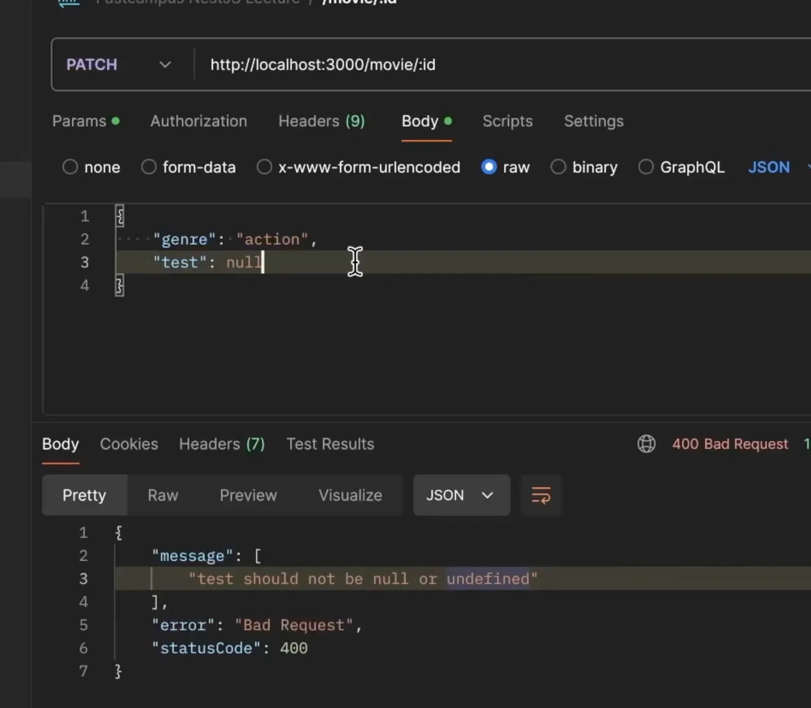
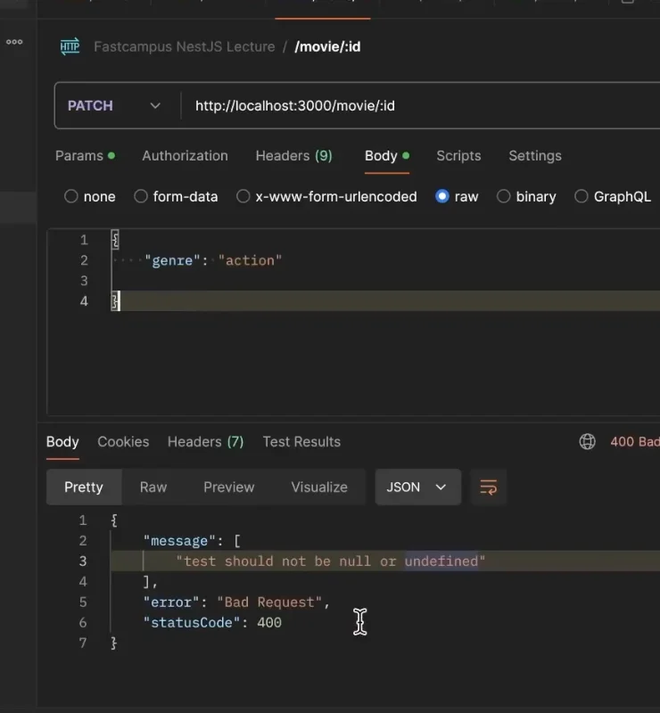
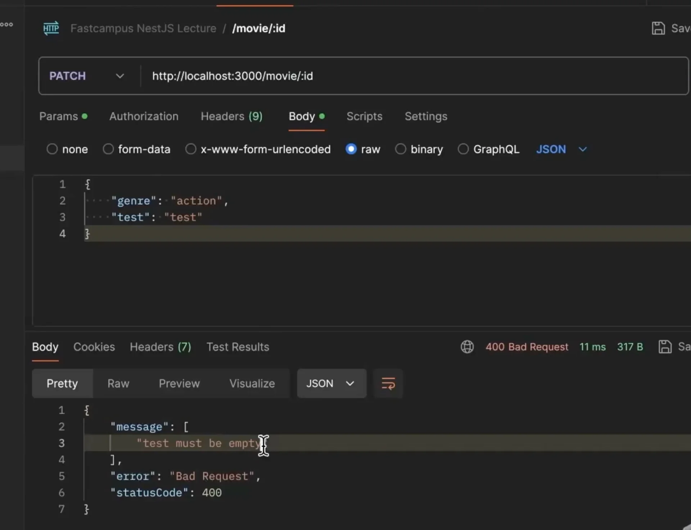
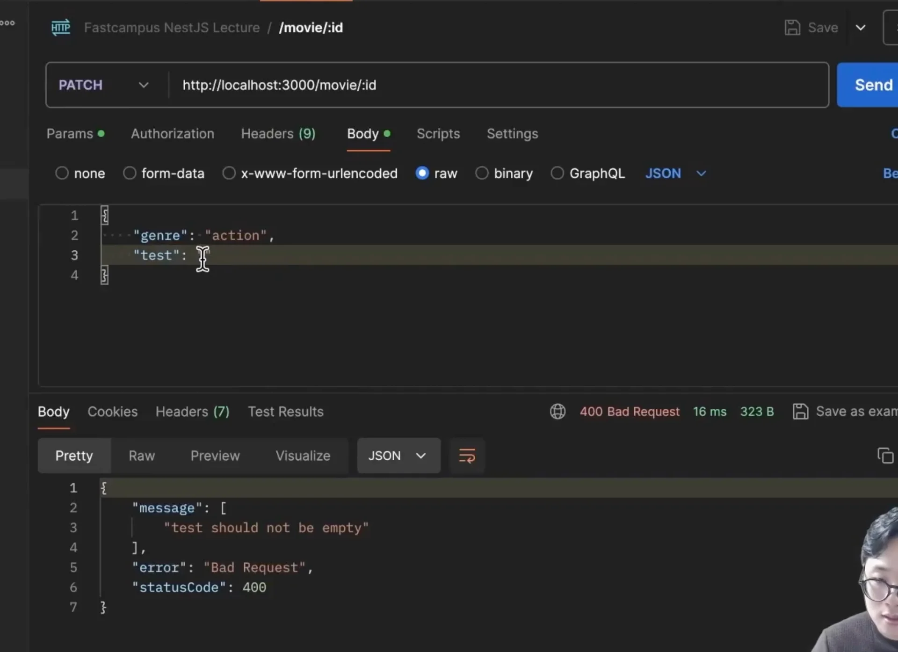
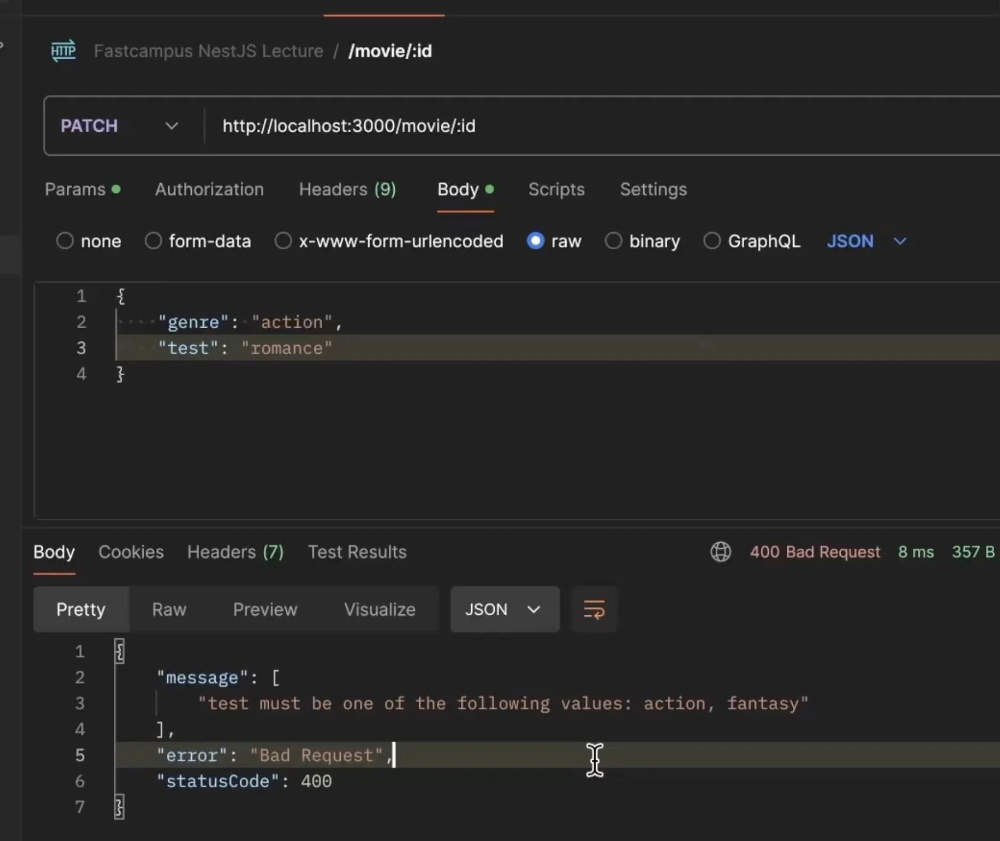
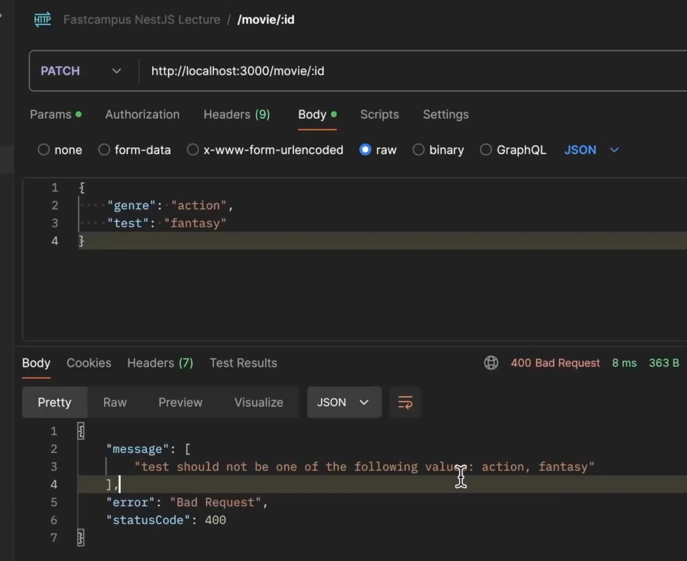

> 
> 
> <a id="27deda9b0fe1813dabcec81cba684fa3"></a>
> 
> <strong>목차</strong>
> 
> - [유효성 검사 ( Validator )](#27deda9b0fe1814a8e02ea71e35ea00e)
> - [1.  기본 Validator](#27deda9b0fe181cca289cd26f176c4fe)
> - [2. 타입 Validator  ](#27deda9b0fe181d787f1c9ff5b5e56c0)
> - [3. 숫자 Validator  ](#28feda9b0fe1806d86a0d502ebaa888d)
> - [4. 문자 Validator  ](#28feda9b0fe1806a9eeae5247a31f95e)

<a id="27deda9b0fe1814a8e02ea71e35ea00e"></a>

## 유효성 검사 ( Validator )

---

<a id="27deda9b0fe181cca289cd26f176c4fe"></a>

### 1&#46;  기본 Validator

- null  또는 undefind
    <details>
    <summary><code>&#64;IsDefined()</code></summary>

    > ✏️ 
    > 
    > <a id="28feda9b0fe180cebcd1c74bfbabd27f"></a>
    > 
    > 해당 필드 값이 <code>null</code>이거나 <code>undefined</code> 인 경우 오류가 발생된다&#46;
    > 
    > - http status&#58; <code>400 Bad Request</code> 
    > 
    > - message&#58; <code>“field should not be null or undefined”</code> 

    <a id="28feda9b0fe180469d3cf33b39727710"></a>

    ```typescript
    export class TestDto {
    		@IsDefined()
    		test string;
    }
    ```

    

    

    - test 필드가 null 이거나 정의가 되지 않는 경우(undefined)  위와 같은 오류가 발생된다&#46;

    </details>

    <details>
    <summary><code>&#64;IsOptional()</code></summary>

    > ✏️ 
    > 
    > <a id="28feda9b0fe180779c53ce7197e7fc1b"></a>
    > 
    > 필드의 값을 선택적으로 받을 때 사용 즉, 값 ‘없음’을 허용한다&#46; 
    > 
    > - 해당 필드가 <code>undefined</code> 또는 <code>null</code>일 때, 유효성 검사 데코레이터(&#64;IsString, &#64;IsNumber … )의 검증을 건너뛴다&#46;

    <a id="28feda9b0fe18059ba33e019c9a6961c"></a>

    ```typescript
    export class TestDto {
    		@IsOptional()
    	  @IsString()
    	  nickname?: string; // nickname이 없거나(undefined), 문자열일 때만 통과
    }
    ```

    </details>

    <details>
    <summary><code>&#64;Equals()</code> , <code>&#64;NotEquals()</code></summary>

    > ✏️ 
    > 
    > - <code>&#64;Equals()</code>&#58; 설정한 값과 동일한 경우만 허용
    > 
    > - <code>&#64;NotEquals()</code>&#58; 설정한 값과 동일하지 않는 경우만 허용

    <a id="28feda9b0fe1807f8140f86abb2fe505"></a>

    ```typescript
    export class TestDto {
    		@Equals('cat')
    	  animal: string; // animal이 'cat'이 경우만 허용
    }
    ```

    <a id="28feda9b0fe180dc96ecd326591063b6"></a>

    ```typescript
    export class TestDto {
    		@NotEquals('cat')
    	  animal: string; // animal이 'cat'이 아닌 경우만 허용
    }
    ```

    </details>

- null, undefined, <code>“”</code>
    <details>
    <summary><code>&#64;IsEmpty()</code></summary>

    > ✏️ 
    > 
    > - <code>&#64;IsEmpty()</code>&#58; 빈 값인 경우만 허용

    <a id="28feda9b0fe18068b067ca0684b659ec"></a>

    ```typescript
    export class TestDto {
    		@IsEmpty()
    	  test: string; // test가 빈 값인 경우만 허용
    }
    ```

    

    </details>

    <details>
    <summary><code>&#64;IsNotEmpty()</code> </summary>

    > ✏️ 
    > 
    > - <code>&#64;IsNotEmpty()</code>&#58; 빈 값이 아닌 경우만 허용

    <a id="28feda9b0fe180c48dd0fb87f429fd49"></a>

    ```typescript
    export class TestDto {
    		@IsNotEmpty()
    	  test: string; // test가 빈 값이 아닌 경우만 허용
    }
    ```

    

    </details>

- 배열(Array) 검증
    <details>
    <summary><code>&#64;IsIn()</code> </summary>

    > ✏️ 
    > 
    > <a id="28feda9b0fe18007ac5ade14312ad950"></a>
    > 
    > 설정한 값들을 중 하나라도 포함하는 경우만 허용

    <a id="28feda9b0fe18002adddc917f7f9132d"></a>

    ```typescript
    export class TestDto {
    		
    		@IsIn(['action', 'fantasy']) // 'action', 'fantasy'의 값이 들어있는 경우만 허용
    		test string;
    }
    ```

    

    </details>

    <details>
    <summary><code>&#64;IsNotIn()</code></summary>

    > ✏️ 
    > 
    > <a id="28feda9b0fe180788d99dddd9e5ead4b"></a>
    > 
    > 설정한 값들을 포함하지 않는 경우만 허용

    <a id="28feda9b0fe18096adfcf7d6f4ee226a"></a>

    ```typescript
    export class TestDto {
    		
    		@IsNotIn(['action', 'fantasy'])
    		test string;
    }
    ```

    

    </details>

<a id="27deda9b0fe181d787f1c9ff5b5e56c0"></a>

### 2&#46; 타입 Validator  

<details>
<summary><code>&#64;IsBoolean()</code> </summary>

> ✏️ 
> 
> <a id="28feda9b0fe1807a907dc45f3815d0a0"></a>
> 
> Boolean(true, false) 타입만 허용

<a id="28feda9b0fe18092a6c0f4b51cdcad78"></a>

```typescript
export class TestDto {
		@IsBoolean()
		test: boolean;  // true, false 만 가능
}
```

</details>

<details>
<summary><code>&#64;IsString()</code> </summary>

> ✏️ 
> 
> <a id="28feda9b0fe180d09241febcbc7c615c"></a>
> 
> string 타입만 허용

<a id="28feda9b0fe18089a229e3ccf2e7396f"></a>

```typescript
export class TestDto {
		@IsString()
		test string;  // "test"
}
```

</details>

<details>
<summary><code>&#64;IsNumber()</code>, <code>&#64;IsInt()</code></summary>

> ✏️ 
> 
> - <code>&#64;IsNumber()</code>&#58;  숫자만 허용
> 
> - <code>&#64;IsInt()</code>&#58;  정수만 허용 ( 소수점 불가 )

<a id="28feda9b0fe180e7a0f0ce40ea9981fc"></a>

```typescript
export class TestDto {
		@IsNumber()
		test: number // 숫자만 가능. 1. 2. -3, -2.45 ...
}
```

<a id="28feda9b0fe180389c2df91512cd05bf"></a>

```typescript
export class TestDto {
		@IsInt()
		test: number; // 정수만 허용, '1.01' 불가
}
```

</details>

<details>
<summary><code>&#64;IsArray()</code></summary>

> ✏️ 
> 
> <a id="28feda9b0fe180f5a830e9a3565727cc"></a>
> 
> Array 인 경우만 허용
> 
> - 내부 요소의 타입 확인은 이뤄지지 않음

<a id="28feda9b0fe180c8921add232c63e6be"></a>

```typescript
export class TestDto {
		
		@IsArray()
		test string[];  // 배열인 경우만 확인, 가능: [2, 3], ["2", "3"]
}
```

</details>

<details>
<summary><code>&#64;IsDateString()</code></summary>

> ✏️ 
> 
> <a id="28feda9b0fe1803bb82dc998ec1ba727"></a>
> 
> Date 형식인 경우만 허용
> 
> - 기본&#58; <code>&#34;2025&#45;10&#45;17T12&#58;00&#58;00&#34;</code>
> 
> - 밀리초 가능&#58; <code>&#34;2025&#45;10&#45;17T12&#58;00&#58;00&#46;000&#34;</code>
> 
> - UTC 타임 가능&#58;<code> &#34;2025&#45;10&#45;17T12&#58;00&#58;00&#46;000Z&#34;</code>

<a id="28feda9b0fe18002ab97ec064ed7f1a0"></a>

```typescript
export class TestDto {
		
		@IsDateString()
		test string;  // 배열인 경우만 확인, test: [2, 3] 가능 
}
```

<a id="28feda9b0fe1804f86cfe5642539415d"></a>

```typescript
{
		"test": "2025-10-17T12:00:00"  
				// 밀리초 가능: "2025-10-17T12:00:00.000" 
				// UTC 타임 가능: "2025-10-17T12:00:00.000Z"
}

```

</details>

<a id="28feda9b0fe1806d86a0d502ebaa888d"></a>

### 3&#46; 숫자 Validator  

<details>
<summary><code>&#64;IsDivisibleBy()</code> </summary>

> ✏️ 
> 
> <a id="28feda9b0fe1802eb9dfc8279e733aaf"></a>
> 
> 설정한 값으로 나눠 떨어지는 경우 허용

<a id="28feda9b0fe1801b9247e8f913a10b91"></a>

```typescript
export class TestDto {
		@IsDivisibleBy(5)
		test: number;  // 5, 10, 200 ... 등 5로 나눠 떨어지는 경우 허용
}
```

</details>

<details>
<summary><code>&#64;IsNegative()</code></summary>

> ✏️ 
> 
> <a id="28feda9b0fe18059946af58e76d22a31"></a>
> 
> 음수 값만 허용

<a id="28feda9b0fe1804c88b5f1887380ef49"></a>

```typescript
export class TestDto {
		@IsNegative()
		test: number;  // -1, -2 ... 등만 허용
}
```


</details>

<details>
<summary><code>&#64;Max()</code>, <code>&#64;Min()</code></summary>

> ✏️ 
> 
> - <code>&#64;Max()</code>
>     - 설정한 값 이하로만 허용
> 
>     - <code>x ≤ value</code>
> 
> - <code>&#64;Min()</code>
>     - 설정한 값 이상으로만 허용
> 
>     - <code>x ≥  value</code>

<a id="28feda9b0fe18024b3dfe4afe1fe3d47"></a>

```typescript
export class TestDto {
		@Max(100)
		@Min(50)
		test: number;  // 50 <= x <= 100 
}
```


</details>

<a id="28feda9b0fe1806a9eeae5247a31f95e"></a>

### 4&#46; 문자 Validator  

<details>
<summary><code>&#64;Contains()</code>, <code>&#64;NotContains()</code>  </summary>

> ✏️ 
> 
> - <code>&#64;Contains()</code>&#58; 설정한 값을 포함하는 경우 허용
> 
> - <code>&#64;NotContains()</code>&#58; 설정한 값을 포함하지 않는 경우 허용
> 
> <a id="28feda9b0fe180aba4f7cc80b4c92230"></a>
> 
> 해당 키워드가 정확히 일치하는 경우만 true, false로 판단한다&#46;

<a id="28feda9b0fe1803d8afbf36f07b97799"></a>

```typescript
export class TestDto {
		@Contains("test")
		test: string;  // test를 포함하는 문자열만 허용
}
```

<a id="28feda9b0fe18001a212c97e29eebb42"></a>

```typescript
export class TestDto {
		@NotContains("test")
		test: string;  // test를 포함하지 않는 문자열만 허용
}
```

</details>

<details>
<summary><code>&#64;IsAlphanumeric()</code></summary>

> ✏️ 
> 
> <a id="28feda9b0fe180ff81a8fc7499ca5a77"></a>
> 
> 알파벳과 숫자의 경우만 허용한다&#46; 

<a id="28feda9b0fe18071853ad302919e4f75"></a>

```typescript
export class TestDto {
		@IsAlphanumeric()
		test: string;  
}
```

<a id="28feda9b0fe180c0bfedc45bc7d930be"></a>

```typescript
// O, 가능
{
	"test": "test123"  
}
```

<a id="28feda9b0fe1802e9821f956068b675a"></a>

```typescript
// X, 불가능
{
	"test": "test123한글" // 알파벳과 숫자 이외에 한글이 포함되어 불가능  
}
```

</details>

<details>
<summary><code>&#64;IsCreditCard()</code> </summary>

> ✏️ 
> 
> <a id="28feda9b0fe180058daae47f0539e92f"></a>
> 
> 카드의 숫자 패턴만 검증한다&#46; ( 실제 사용 가능한 카드인지는 모름 )
> 
> - 검증&#58; <code>4자리 &#45; 4자리 &#45; 4자리 &#45; 4자리</code>  ( 맨앞 4자리 패턴 있음 )

<a id="28feda9b0fe18041a01dc65d0182b856"></a>

```typescript
export class TestDto {
		@IsCreditCard()
		test: string;
}
```

<a id="28feda9b0fe180329162e6a0b4b79b13"></a>

```typescript
{
		// 전형적인 패턴만 검증, 실제 사용 가능한 카드인지는 따로 검증이 필요함
		"test": "5312-1234-1234-1234"  
}
```

</details>

<details>
<summary><code>&#64;IsHexColor()</code> </summary>

> ✏️ 
> 
> <a id="28feda9b0fe18084b80aeb70cd954397"></a>
> 
> 컴퓨터에서 색깔 표현을 16진수, 6글자로 표현한다&#46; 
> 
> <a id="28feda9b0fe180e4bef9d4be9405d6e7"></a>
> 
> 이에 대한 패턴을 검증한다&#46; 

<a id="28feda9b0fe1808aa693db056a68c74d"></a>

```typescript
export class TestDto {
		@IsHexColor()
		test: string;
}
```

<a id="28feda9b0fe180649d38f7449099ce65"></a>

```typescript
{
		"test": "FEFE6E"
}
```

</details>

<details>
<summary><code>&#64;MaxLength()</code>, <code>&#64;MinLength()</code></summary>

> ✏️ 
> 
> - <code>&#64;MaxLength()</code>&#58; 최대 길이 제한
> 
> - <code>&#64;MinLength()</code>&#58; 최소 길이 제한

<a id="28feda9b0fe180739b47c33f7c75eb73"></a>

```typescript
export class TestDto {
		@MaxLength(16)
		@MinLength(4)
		test: string;  // 4 ~ 16 자 사이의 글자만 허용
}
```

<a id="28feda9b0fe180708a45fda024ce08a8"></a>

```typescript
// O, 가능
{
	"test": "test123"    // 7 글자 
}
```

<a id="28feda9b0fe180c1935edd5fcb697257"></a>

```typescript
// X, 불가능
{
	"test": "tes" // 3 글자  
}

{
	"test": "123456789011121314" // 19 글자  

```

</details>

<details>
<summary><code>&#64;IsUUID()</code> </summary>

> ✏️ 
> 
> <a id="28feda9b0fe180bea8ebc8a973cc282a"></a>
> 
> <code>UUID</code>인 경우만 허용
> 
> - <code>UUID</code>&#58;  글자와 숫자를 포함한 랜덤한 5개의 글자 섹션으로 구성 
>     - <code>&#45;</code>로 구분 
> 
> - ex) <code>23fea253&#45;0723&#45;49ec&#45;aa9a&#45;c8faejl123fe</code>

<a id="28feda9b0fe1807c8dd6ec4c893782ed"></a>

```typescript
export class TestDto {
		@IsUUID()
		test: string;
}
```

<a id="28feda9b0fe1807288a9d821487abba5"></a>

```typescript
{
		"test": "23fea253-0723-49ec-aa9a-c8faejl123fe"
}
```

</details>

<details>
<summary><code>&#64;IsLatLong()</code> </summary>

> ✏️ 
> 
> <a id="28feda9b0fe18014b5d8dcbbbe8611ab"></a>
> 
> <code>위도(Latitude)</code>, <code>경도(Longtitude)</code>패턴을 가지는지 검증

<a id="28feda9b0fe180f4baeecdcf3c643237"></a>

```typescript
export class TestDto {
		@IsLatLong()
		test: string;
}
```

<a id="28feda9b0fe1805b830eda34fdffcde5"></a>

```typescript
{
		"test": "40.7127, -74.0060"
}
```

</details>
