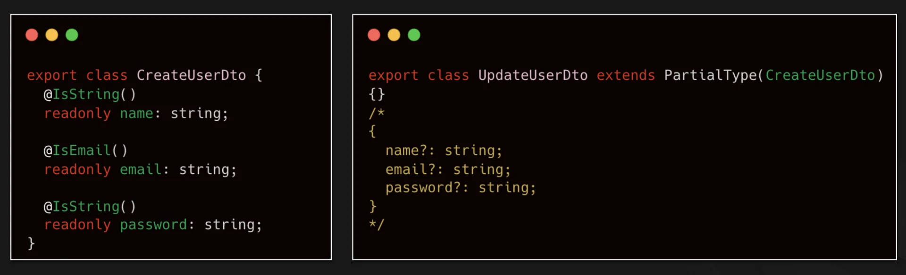
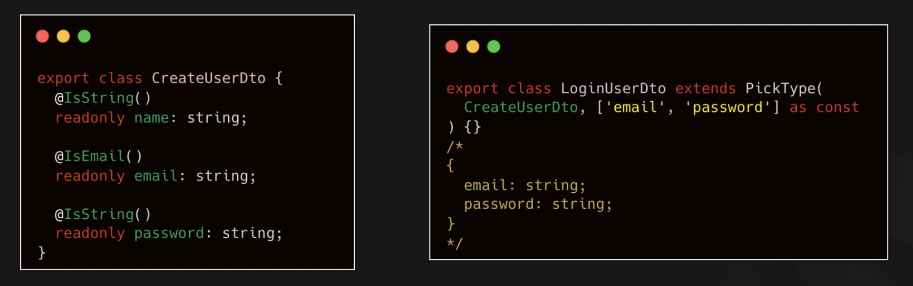
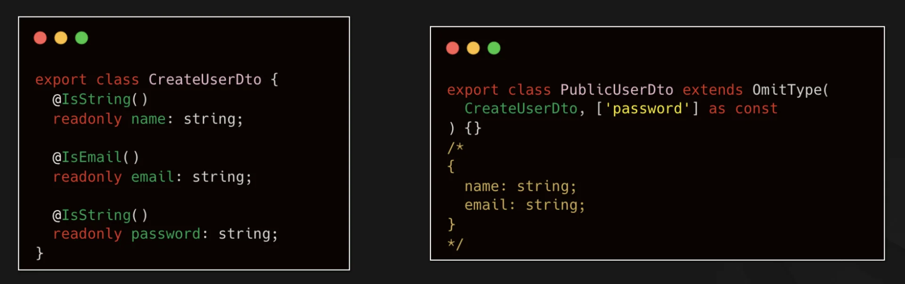
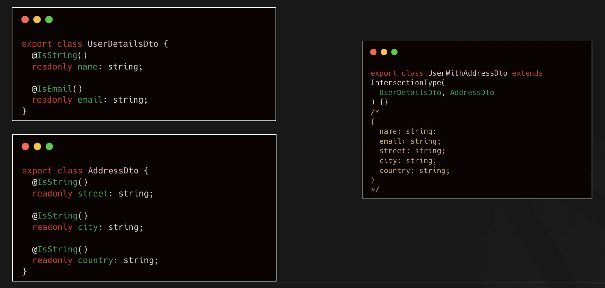
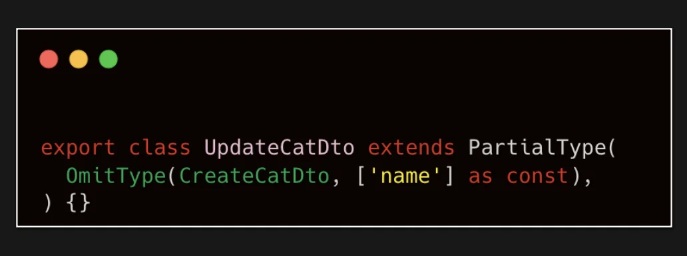

> 
> 
> 
> 
> <strong>목차</strong>
> 
> - [Mapped Type](#27deda9b0fe1816bbe31e269a61a5ccf)
> - [ 종류](#27deda9b0fe181ab8d65d089aeff0d70)
> - [1. Partial](#27deda9b0fe1818f921bf53bbb58ac36)
> - [2. Pick](#27deda9b0fe180fcb6b1ee66e4a54529)
> - [3. Omit](#27deda9b0fe180688e8cdbff3ae375ff)
> - [4. Intersection](#27deda9b0fe18079a4f4c4137aef235f)
> - [5. Composition](#27deda9b0fe180a687a8ce1355c4e683)

## Mapped Type

---

> 📖 
> 
> 
> 
> NestJS의 <code>Mapped Type</code>은 기존 <strong><u>DTO(Class)</u></strong>에서 <strong><u>특정 속성만 변경</u></strong>하거나 <strong><u>선택적으로 만</u></strong>들어 새로운 타입을 쉽게 생성해주는 유틸리티 기능이다&#46;
> 
> 
> 
> 이를 활용하면 CRUD 기능 구현 시 <strong><u>불필요한 반복 코드를 줄</u></strong>이고, <strong><u>효율적으로 타입을 변형</u></strong>할 수 있다&#46;

> ❗ 
> 
> 
> 
> 필수는 아니다&#46; 서로의 의존성이 많이 생기는 경우, 나중에 복잡도가 증가할 수 있다&#46;
> 
> 
> 
> 따라서 Create, Update 같이 종속적인 경우 사용하는 것이 좋다&#46; 

###  종류

> ✏️ 
> 
> - <code>Partial</code>&#58; 
>     - 모든 속성을 옵셔널(optional)로 변경
> 
>     - 주로 Update DTO를 만들 때 많이 사용
> 
> - <code>Pick</code>&#58;
>     - 지정한 속성만 골라 새로운 타입 생성 ( Omit 반대 )
> 
> - <code>Omit</code>&#58;
>     -  특정 속성만 제거하여 새로운 타입 생성
> 
> - <code>Intersection</code>&#58;
>     -  여러 DTO를 합쳐 하나의 타입으로 생성
> 
>     - 복수 엔티티의 정보를 함께 사용할 경우 적합
> 
> - <code>Composition</code>&#58;
>     - Mapped Types를 다양하게 조합해서 중첩 적용 가능

### 1&#46; <code>Partial</code>

- PartialType() 메서드 인자로 <code>CreateUserDto</code> 클래스를 넘겨 상속하면  <code>CreateUserDto</code> 내 모든 프로퍼티가 Optional로 <code>UpdateUserDto</code> 클래스 내에 생성된다&#46;

### 2&#46; <code>Pick</code>

- <code>PickType()</code> 메서드 내 해당 클래스의 <strong><u>프로퍼티를 골라 상속</u></strong> 처리

### 3&#46; <code>Omit</code>

- <code>OmitType()</code> 메서드 인자로 해당 클래스의 <strong><u>제외하려는 프로퍼티를 넘겨 상속</u></strong>처리

### 4&#46; <code>Intersection</code>

- <code>IntersectionType()</code>  메서드 인자로 해당되는 클래스들을 넘겨 상속 처리

### 5&#46; <code>Composition</code>

- 위와 같이 중첩해서 적용 가능하다&#46; ( 구성 )
