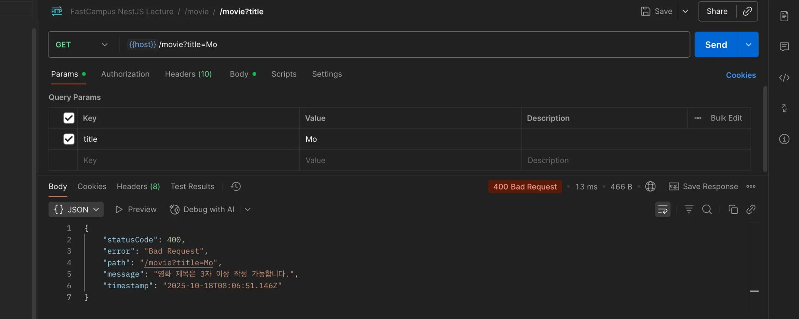

> 
> 
> <a id="27deda9b0fe18106b3dada86193422a1"></a>
> 
> <strong>목차</strong>
> 
> - [Pipe](#27deda9b0fe18126bf14f95099d98858)
> - [1.  Controller 레이어의 모든 id 값 ParseIntPipe로 타입 변환](#27deda9b0fe18121ae84d2c298bc3b0e)
> - [2.  커스텀 파이프 - MovieTitleValidationPipe](#290eda9b0fe1808ba060f74775a2a9d6)

<a id="27deda9b0fe18126bf14f95099d98858"></a>

## Pipe

---

<a id="27deda9b0fe18121ae84d2c298bc3b0e"></a>

### 1&#46;  Controller 레이어의 모든 id 값 <code>ParseIntPipe</code>로 타입 변환

> ✏️ 
> 
> <a id="290eda9b0fe180bb9a10c418969ac379"></a>
> 
> path variable을 통해 url 로 받아오는 id 값은 string 형태로만 넘어올 수 있다&#46; 
> 
> <a id="290eda9b0fe180759978fc0fa99b30c8"></a>
> 
> 따라서 실제 사용 시, 숫자 타입으로 변환이 필요하다&#46; 
> 
> <a id="290eda9b0fe180e1b407d036be5801c5"></a>
> 
> 이를 <code>PaseIntPipe</code>를 통해  컨트롤러의 라우터에서 사용하기 직전에 &#91; 문자열 → 숫자&#93; 로 타입 변환을 해 처리한다

<details>
<summary><strong>&#91; 코드 &#93; UserController</strong></summary>

<a id="27deda9b0fe18176b653dbb364b4d9d4"></a>

```typescript
import { ...  ParseIntPipe } from '@nestjs/common';

@Controller('user')
@UseInterceptors(ClassSerializerInterceptor)
@UseInterceptors(LoggingInterceptor)
export class UserController {
  constructor(private readonly userService: UserService) {}

	. . .

  @Get(':id')
  findOne(@Param('id', ParseIntPipe) id: number) {
    return this.userService.findOne(+id);
  }

  @Patch(':id')
  update(
    @Param('id', ParseIntPipe) id: number,
    @Body() updateUserDto: UpdateUserDto,
  ) {
    return this.userService.update(+id, updateUserDto);
  }

  @Delete(':id')
  remove(@Param('id', ParseIntPipe) id: number) {
    return this.userService.remove(+id);
  }
}
```

</details>

<details>
<summary><strong>&#91; 코드 &#93; MovieController</strong></summary>

<a id="290eda9b0fe180b3bad2e52f83eb2ad0"></a>

```typescript
import { ...  ParseIntPipe } from '@nestjs/common';

@Controller('movie')
@UseInterceptors(CI)
export class MovieController {
  constructor(private readonly movieService: MovieService) {}
		...

  @Get(':id')
  @Public()
  getMovie(@Param('id', ParseIntPipe) id: number) {
    return this.movieService.findOne(+id);
  }

  @Patch(':id')
  @RBAC(Role.admin)
  patchMovie(
    @Param('id', ParseIntPipe) id: number,
    @Body() body: UpdateMovieDto,
  ) {
    return this.movieService.update(+id, body);
  }

  @Delete(':id')
  @RBAC(Role.admin)
  deleteMovie(@Param('id', ParseIntPipe) id: number) {
    return this.movieService.remove(+id);
  }
}
```

</details>

<details>
<summary><strong>&#91; 코드 &#93; GenreController</strong></summary>

<a id="290eda9b0fe1800bb4b0e763f9b9f494"></a>

```typescript
import { ...  ParseIntPipe } from '@nestjs/common';

@Controller('genre')
export class GenreController {
  constructor(private readonly genreService: GenreService) {}
		...

  @Get(':id')
  @RBAC(Role.user)
  findOne(@Param('id', ParseIntPipe) id: number) {
    return this.genreService.findOne(id);
  }

  @Patch(':id')
  @RBAC(Role.admin)
  update(
    @Param('id', ParseIntPipe) id: number,
    @Body() updateGenreDto: UpdateGenreDto,
  ) {
    return this.genreService.update(id, updateGenreDto);
  }

  @Delete(':id')
  @RBAC(Role.admin)
  remove(@Param('id', ParseIntPipe) id: number) {
    return this.genreService.remove(id);
  }
}
```

</details>

<details>
<summary><strong>&#91; 코드 &#93; DirectorController</strong></summary>

<a id="290eda9b0fe18038960fde9bb0d914be"></a>

```typescript
import { ...  ParseIntPipe } from '@nestjs/common';

@Controller('director')
@UseInterceptors(ClassSerializerInterceptor)
export class DirectorController {
  constructor(private readonly directorService: DirectorService) {}

	. . .

  @Get(':id')
  findOne(@Param('id', ParseIntPipe) id: number) {
    return this.directorService.findOne(id);
  }

  @Patch(':id')
  update(
    @Param('id', ParseIntPipe) id: number,
    @Body() updateDirectorDto: UpdateDirectorDto,
  ) {
    return this.directorService.update(id, updateDirectorDto);
  }

  @Delete(':id')
  remove(@Param('id', ParseIntPipe) id: number) {
    return this.directorService.remove(id);
  }
}
```

</details>

<a id="290eda9b0fe1808ba060f74775a2a9d6"></a>

### 2&#46;  커스텀 파이프 &#45; MovieTitleValidationPipe

<details>
<summary>1&#46; 커스텀 파이프 정의 </summary>

<a id="290eda9b0fe1804da0cafe5e35f95fe8"></a>

<strong>&#91; 코드 &#93; MovieTitleValidationPipe</strong>

<a id="290eda9b0fe1805da7d0e752f2909860"></a>

```typescript
import {
  ArgumentMetadata,
  BadRequestException,
  Injectable,
  PipeTransform,
} from '@nestjs/common';

@Injectable()
export class MovieTitleValidationPipe 
		implements PipeTransform<string, string> {  // input, output 제네릭 설정
  transform(value: string, metadata: ArgumentMetadata): string {
    if (!value) {
      return value;
    }

    if (value.length <= 2) {
      throw new BadRequestException('영화 제목은 3자 이상 작성 가능합니다.');
    }

    return value;
  }
}

```

</details>

<details>
<summary>2&#46; Route Parameter Pipes로 적용</summary>

<a id="290eda9b0fe180bcab42f262f4a5fe4a"></a>

```typescript
@Controller('movie')
@UseInterceptors(CI)
export class MovieController {
  constructor(private readonly movieService: MovieService) {}

  @Get()
  @Public()
  getMovices(@Query('title', MovieTitleValidationPipe) title?: string) {
    return this.movieService.findAll(title);
  }

```

</details>

<details>
<summary>3&#46; 포스트맨 확인</summary>



- 위와 같이 3자 이내의 값으로 조회하는 경우 화면과 같이 정의한 오류 메세지가 응답되는 것을 확인할 수 있다&#46; 

</details>
