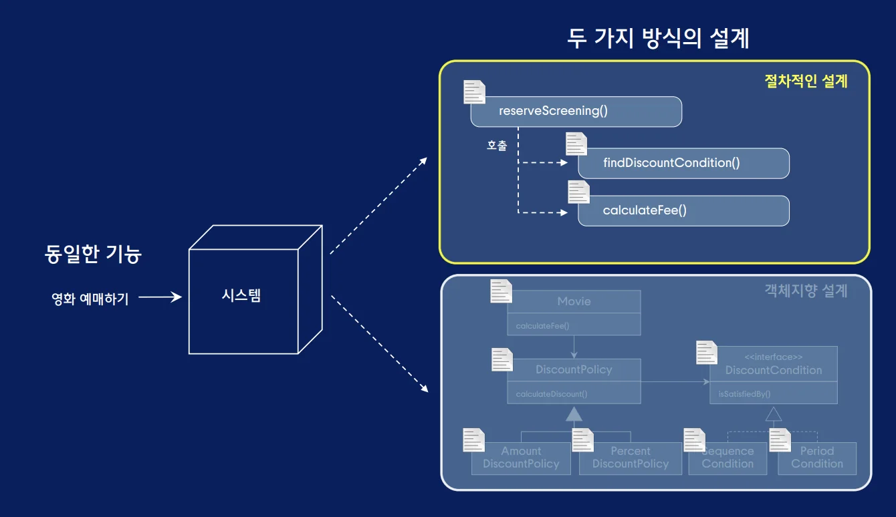
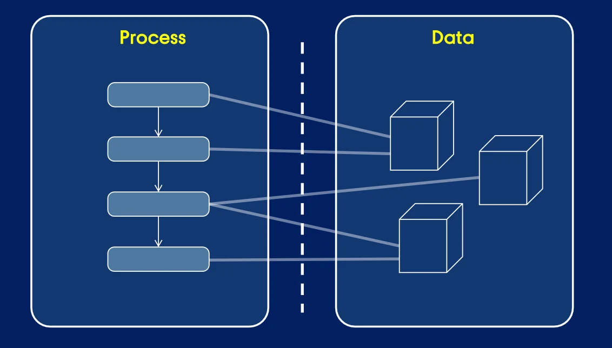
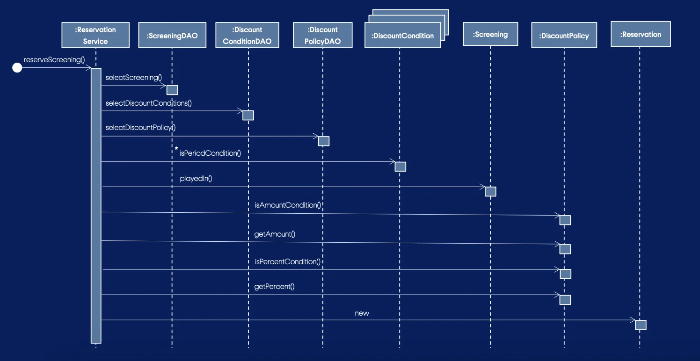

> 
> 
> 
> 
> <strong>목차</strong>
> 
> - [영화 예매 시스템  - 절차적 방식 구현](#282eda9b0fe18154804bdf74a154418e)
> - [절차적 방식](#285eda9b0fe18065a551f71df4e485fb)
> - [데이터 접근 객체 ( DAO, Data Access Object )](#285eda9b0fe180579b61f4ea36b45e0a)
> - [중앙 집중식 ( Centralized ) 제어 스타일](#285eda9b0fe1804fa935f11ee6d0d4a0)

> 

> 📖 

## 영화 예매 시스템  &#45; 절차적 방식 구현

---

### 절차적 방식

> ✏️ 

일반적으로 프로그램을 <strong><u>데이터</u></strong>와 <strong><u>해당 데이터를 사용하는 알고리즘 또는 프로세스</u></strong>의 조합으로 정의한다&#46;

<code>절차적인 방식</code>은 프로그램을 구성하는 <strong><u>데이터와 프로세스를 개별적인 모듈로 분류해 구현</u></strong>하는 방식을 의미한다&#46; 

데이터와 프로세스를 분류해서 구현 하려면 데이터를 먼저 구현할지 아니면 프로세스를 먼저 구현할 지 순서를 정해야하는데 이때, <code>절차적인 방식</code>으로 코드를 작성할 때는 <strong><u>데이터를 먼저 정의하고 데이터를 사용하는 프로세스를 나중에 설계</u></strong>한다&#46; 

대부분의 시스템은 데이터를 관계형 데이터베이스에 저장하기 때문에 테이블, 컬럼, 테이

### 데이터 접근 객체 ( DAO, Data Access Object )

### 중앙 집중식 ( Centralized ) 제어 스타일

> ❗ 
> 
> 
> 
> 절차적인 방식의 경우 <strong><u>프로세스를 구현한 객체 안으로 클래스의 제어가 집중</u></strong>된다는 특징이 있다&#46;
> 
> 
> 
> 이를 <code>중앙 집중식 제어 스타일</code>이라고 한다&#46;
> 
> 
> 
> 이렇게 <strong><u>제어가 한 곳에 집중</u></strong>되면 <strong><u><code>응집도</code></u></strong><strong><u>와 </u></strong><strong><u><code>결합도</code></u></strong><strong><u> 측면에서 코드를 수정할 때 많은 문제가 발생</u></strong>된다&#46; 

