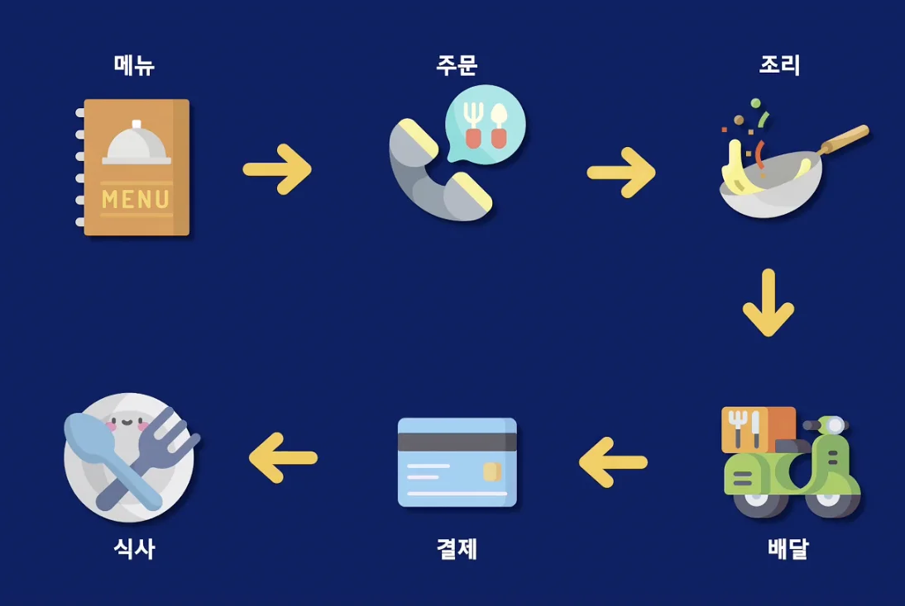
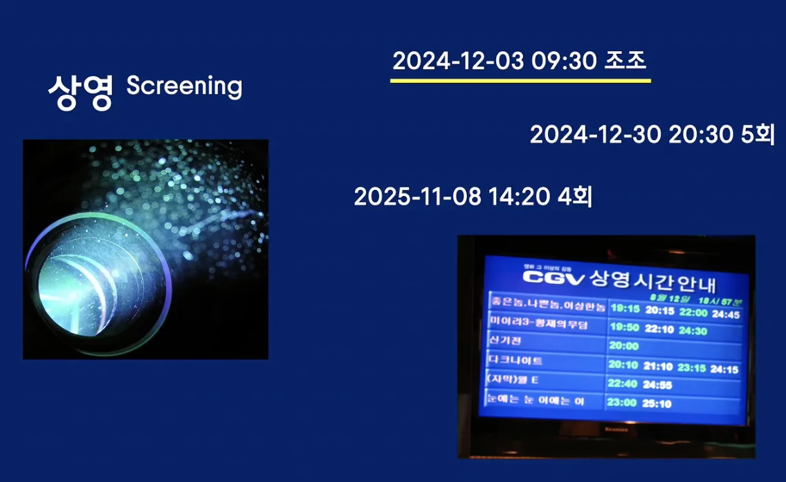
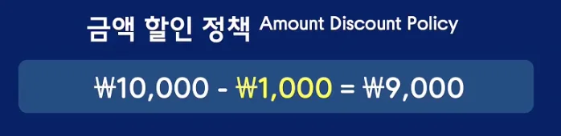
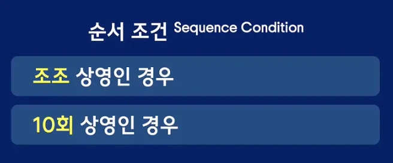
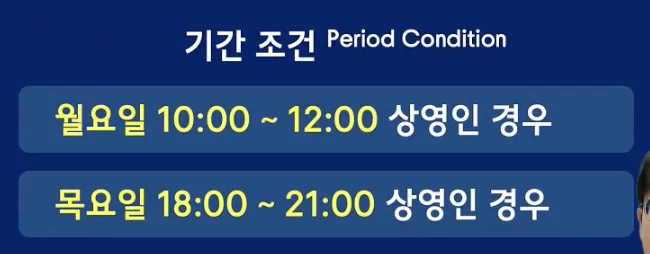
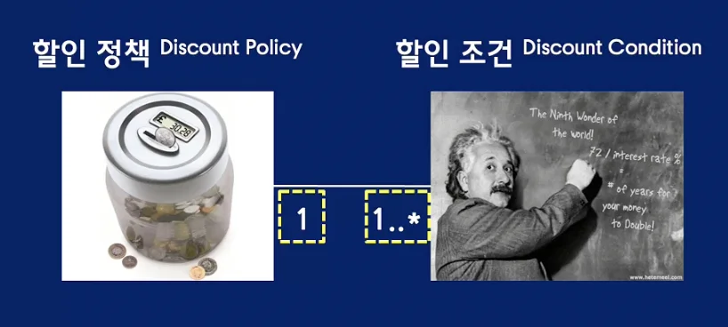
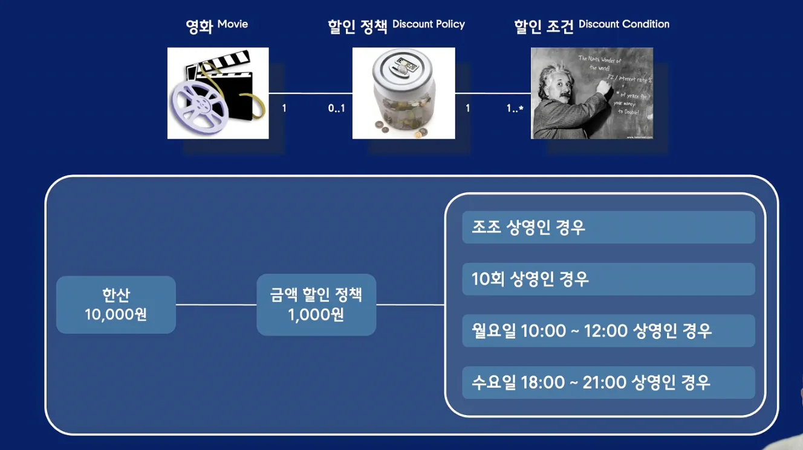
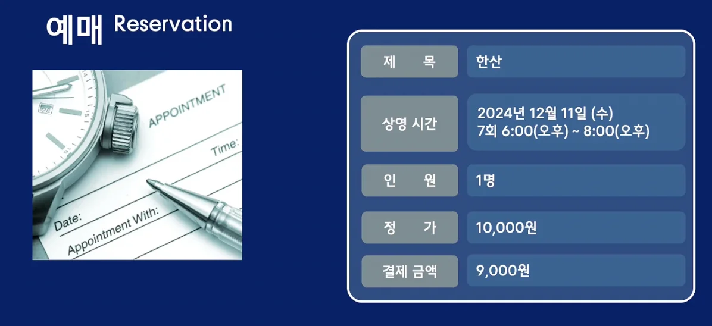
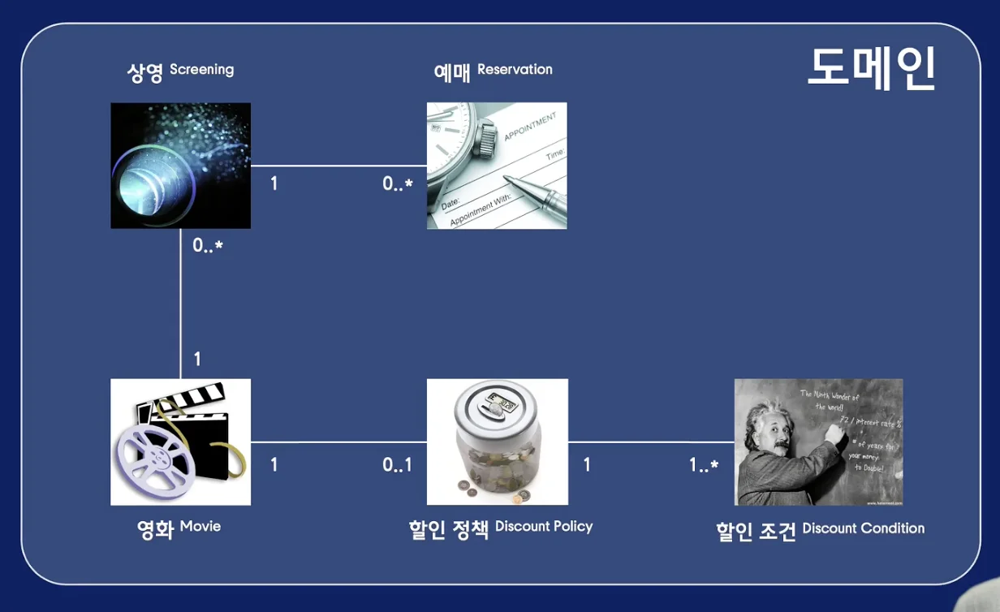

> 
> 
> 
> 
> <strong>목차</strong>
> 
> - [1. 도메인](#282eda9b0fe181db8735c9445e8a19e2)
> - [예시) 음식 배달](#282eda9b0fe1803485e2d9f9461da591)
> - [2. 요구사항 분석](#282eda9b0fe1808c9d54e5891d1635c3)
> - [예시) 영화 예매](#282eda9b0fe180f7863cc06bc96a1d3f)
> - [3. 관계](#282eda9b0fe180ef866ec133858fa667)
> - [4. 정리 - 영화 예매 시스템](#282eda9b0fe180e28cead8f5b2bdfa73)

## 1&#46; 도메인

> ✏️ 
> 
> 
> 
> <strong><code>도메인</code></strong><strong> </strong>
> 
> 
> 
> 사용자가 프로그램을 사용하는 <strong><u>주제 영역</u></strong>  또는  사용자가 프로그램을 사용해서 <strong><u>해결하고 싶은 문제들의 집합</u></strong>
> 
> 
> 
> 쉽게 말해 <strong><u>소프트웨어로 구현해야 하는 요구사항의 범위</u></strong>이다&#46;

소프트웨어를 구현할 떄 모든 요구사항을 코드로 옮기는 것은 현실적으로 불가능하다 &#46;

일정이나 인력의 제약이 있으며, 우선순위가 낮을 수도 있다&#46; 또한 어떤 문제는 소프트웨어로 해결하기에 적합하지 않을 수도 있다&#46; 

따라서 어떤 요구사항을 코드로 구현하고 어떤 요구사항은 제외시킬지 정해야 하는데, 이렇게 정해진 요구사항의 범위를 도메인이라 정의한다&#46;

### 예시) 음식 배달

> <strong>도메인 분석</strong>

사용자가 위와 같은 과정을 통해 전화로 배달 주문을하여 식사를 한다고 가정한다&#46; 

- 지금은 앱을 통해 간단하게 주문이 가능하지만, 과거에 사용자가 배달을 하기위해서는 우선 식당의 전화번호와 메뉴를 알아야 했다&#46; 

이렇게 전화로 음식을 주문하는 경우, 아래와 같은 문제점이 발생될 수 있다&#46; 

- 주문한 메뉴와 다른 음식이 배달됨

- 다른 주소자로 잘못 배달됨

- 주문 누락

이러한 문제점을 해결하기위해 배달앱을 만든다고 가정하면 요구사항 중 소프트웨어로 구현해야 하는 범위를 결정해야한다&#46; 

위 주문 과정 중에 음식을 <strong><u>조리, 배달, 식사</u></strong>를 하는 단계를 애플리케이션 안에 구현하기 어렵다&#46; 

따라서 해당 단계들을 구현 범위에서 제외시키고 소프트웨어로 구현 가능한  <strong><u>메뉴, 주문, 주문된 음식 결제</u></strong> 단계만 포함시킨다&#46;

이렇게 <strong><u>구현하기로 결정한 요구사항의 범위</u></strong>가 음식배달 시스템의 <code>도메인</code>이 된다&#46; 

## <strong>2&#46; 요구사항 분석</strong>

> ✏️ 
> 
> 
> 
> 소프트웨어 안에 포함시킬 요구사항의 범위(도메인)을 정했다면 다음으로 요구사항을 분석해야 한다&#46; 
> 
> 
> 
> 이 과정에서 도메인 안에 존재하는 중요한 개념들을 이용해 요구사항을 분석하고 이 개념들을 기반으로 시스템을 구현하는데 필요한 객체들을 식별할 수 있다&#46; 

### 예시) 영화 예매

> <strong>도메인 &#45; 영화</strong>

영화 예매 도메인에서 가장 중요한 개념은 당연히 영화이다&#46;

<code>영화</code>는 제목, 러닝타임, 감독, 배우 등 일반적으로 영화에서 떠올리는 다양한 정보들을 포함한다&#46; 

- 제목

- 러닝타임

- 감독

- 배우

- 예매 정가

- 예매 시 기본 금액 …

> <strong>도메인 &#45; 상영</strong>

영화는 사용자가 예매하고 싶은 영화가 무엇인지 서술하지만 <strong><u>실제로 사용자들이 예매한 대상</u></strong>은 <code>상영</code>이다&#46; 

상영은 사용자들이 관람할 수 있도록 특정한 시간에 영화를 공개하는 활동을 의미한다&#46; 

<code>상영</code>에는 <strong><u>상영날짜, 시간, 상영회차</u></strong>가 포함된다&#46;

> <strong>도메인 &#45; 영화 예매</strong>

<strong><u>사용자가 상영을 예매</u></strong>하면 <strong><u>시스템은 예매 요금을 계산</u></strong>해 사용자에게 청구한다&#46; 

- 사용자가 특정 조건을 만족하는 하는 경우 예매요금 할인이 가능하다&#46;

따라서 <code>할인</code>은 <strong><u>할인 정책, 할인 조건</u></strong>의 조합으로 구성된다&#46; 

- <code>할인 정책</code>&#58; 사용자의 예매요금에서 차감할 할인 금액 계산
    1. 금액 할인 정책 &#45; 항상 동일한 금액 할인
        

    1. 비율 할인 정책 &#45; 정가에서 일정 비율 할인
        

- <code>할인 조건</code>&#58; 요금을 할인 받기위해 만족해야 하는 조건
    1. 순서 조건 &#45; 상영 회차 기준으로 할인 여부 판단
        

    1. 기간 조건 &#45; 상영 시작 시간을 기준으로 할인 부여 
        

## 3&#46; 관계

사용자가 상영을 예매할 때마다 시스템은 할인 금액을 계산하기 위해 할인정책과 할인조건을 조합한다&#46;

- 할인 조건에 설정된 기준에 따라 할인을 적용할지 판단하고 만약 할인 가능하다면 할인 정책을 기반으로 할인 금액을 계산한다&#46; 

이때 영화, 할인정책, 할인 조건 사이에는 연결될 수 있는 개념의 수를 제약하는 특정한 규칙이 존재하며 이를 <code>다중성</code>이라 칭한다&#46;

> ✏️ 
> 
> 
> 
> <code>다중성</code>
> 
> 
> 
> 
> 
> 도메인 개념들 사이에 연결 가능한 숫자의 범위를 다중성이라 부르고  도메인 개념들을 연결한 선 아래의 숫자로 표기한다&#46; 

> 연관관계&#58; 영화 ↔ 할인 정책

연관관계를 통해 영화와 연결될 수 있는 할인 정책의 개수 

- <code>영화</code>&#58; <code>할인정책</code> = <code> 1</code>&#58;<code>0&#46;&#46;1</code>
    - 하나의 영화에 대해 할인 정책이 <strong><u>아예 없거나, 있다면 최대 한 개</u></strong>까지만 존재할 수 있다&#46; 

    - 할인 정책이 존재할 경우 영화는 항상 1개가 존재해야 한다,

    - 할인 정책은 최대 1개까지 가능하기 때문에, 금액 할인 정책과 비율 할인 정책 둘 중 하나만 연결할 수 있다&#46;

> 연관관계&#58; 할인 정책 ↔ 할인 조건

- <code>할인 정책</code>&#58;<code>할인 조건</code> = <code>1</code>&#58;<code>1&#46;&#46;&#42;</code>
    - 하나의 할인 정책에 대해 할인 조건은 반드시 <strong><u>최소 1개 이상</u></strong> 존재 가능하다&#46; 

> 연관관계&#58; 영화 ↔ 할인 정책 ↔ 할인 조건

- 예시)
    

    사용자 상영정보&#58; 24년 12월 11일 수요일 18&#58;00 &#126; 20&#58;00 ( 7회차 )

> 도메인 &#45; 예메

## 4&#46; 정리 &#45; 영화 예매 시스템

1. 영화
    - 영화의 기본 정보를 담고 있는 가장 중심이 되는 개념

    - 영화에 할인 정책이 있다면 사용자에게 할인 제공 가능

1. 할인 정책
    - 할인 금액을 계산하는 규칙
        1. 금액 할인 정책&#58; 고정 금액 할인

        1. 비율 할인 정책&#58; 비율 금액 할인

    - 영화에는 할인 정책이 없을 수도 있고 있다면 하나만 설정 가능하다&#46; 

1. 할인 조건
    - 할인 여부를 판단하는 규칙 의미
        1. 순서 조건
            1. 상영 회차를 기준으로 할인 여부 판단

        1. 기간 조건
            1. 상영 시작 시간을 기준으로 할인 여부 판단

    - 하나의 할인 정책에는 할인 조건이 최소 한개는 존재해야 하고 여러 개의 할인 조건을 연결하는 것도 가능하다&#46; 

1. 상영
    - 사용자가 실제로 예매하는 대상

    - 여러 시간에 걸쳐 반복적으로 상영 가능 → 하나의 영화에 대해 여러 개의 상영 생성 가능

1. 예매 
    - 사용자가 상영을 구매하면 생성되는 도메인 개념

    - 여러명의 사용자가 동시간대에 상영되는 영화를 함께 관람 가능 → 하나의 상영에 대해 여러 개의 예매 생성 가능
