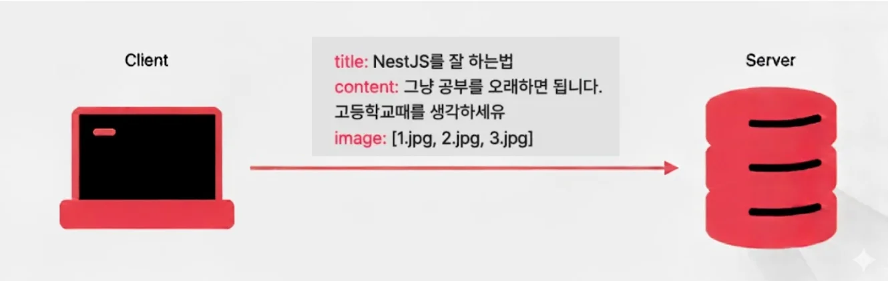
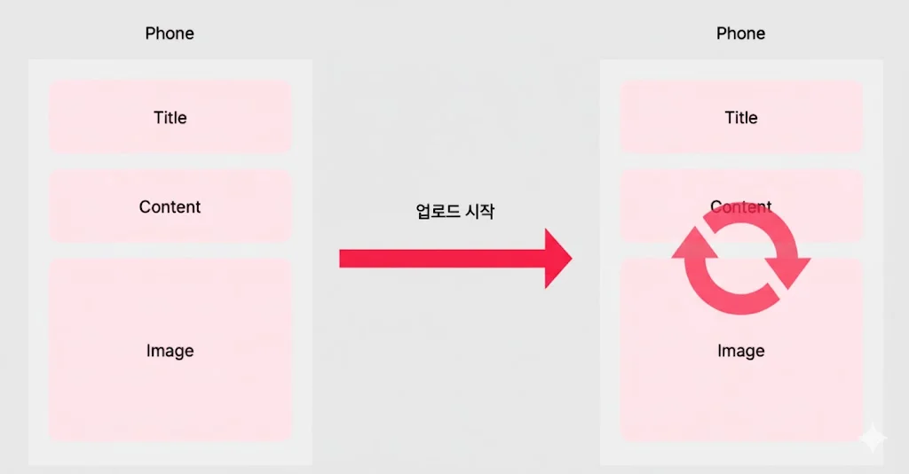
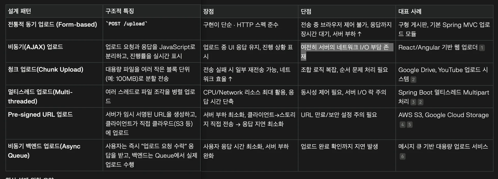
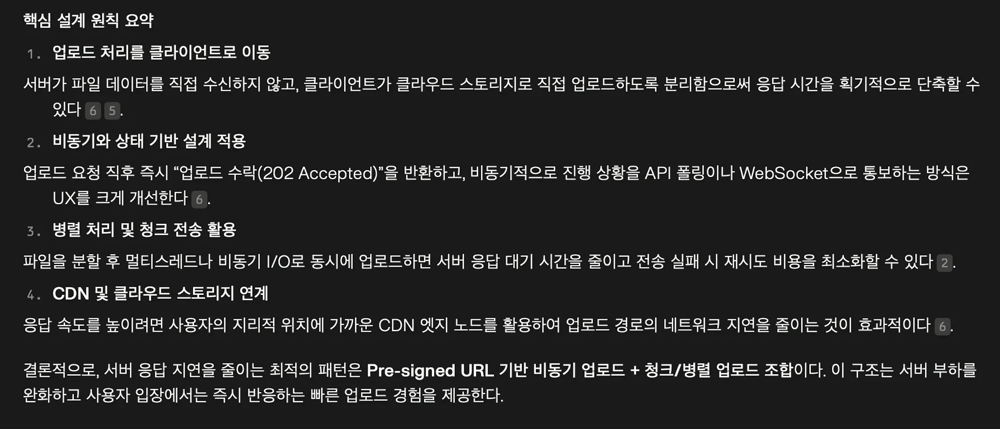
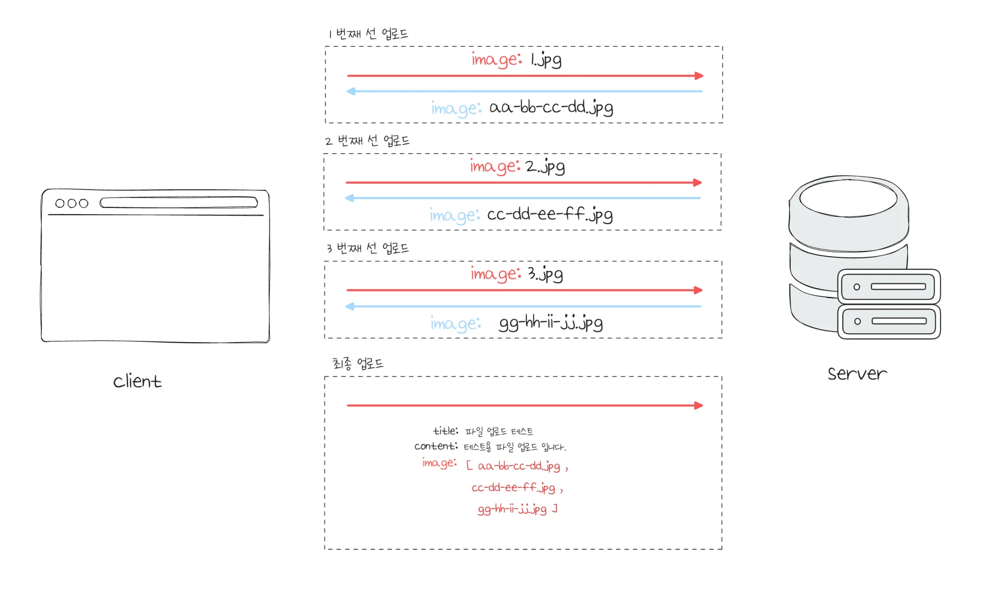
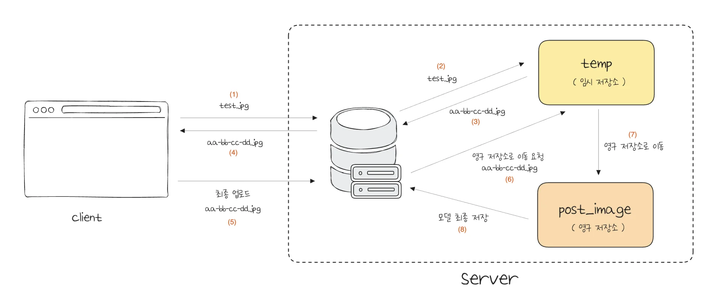
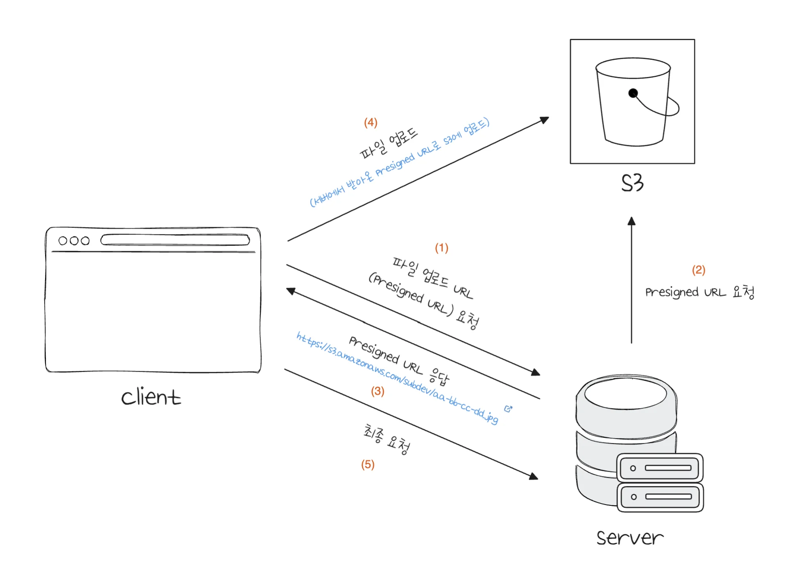

> 
> 
> 
> 
> <strong>목차</strong>
> 
> - [파일 업로드 ( File Upload )](#282eda9b0fe181f59551ca533e5d023f)
> - [ 1. 전통적인 파일 업로드 방식](#282eda9b0fe18154ad16c66520a724e2)
> - [ 2. 선 업로드 방식 (Pre-Uploading)  ](#282eda9b0fe1811f8978de183beb004e)
> - [ 2. Pre-Signed URL](#293eda9b0fe180d59b13cdc0aae37ffd)

## 파일 업로드 ( File Upload )

---

> 📖 
> 
> 
> 
> 파일 업로드(File Upload)는 <strong>사용자</strong>가 자신의 <strong><u>로컬 디바이스에서 선택한 파일</u></strong>을 <strong><u>웹 서버 또는 클라우드 환경으로 전송</u></strong>하여 저장 및 처리하기 위한 기능을 말한다&#46; 

> ❗ 
> 
> 
> 
> <strong>파일 업로드 보안 문제</strong>
> 
> 
> 
> 파일 업로드는 강력한 기능이지만 동시에 <strong><u>가장 위험한 웹 보안 취약점 중 하나</u></strong>로 꼽힌다&#46; 공격자는 악성 스크립트나 실행 가능한 파일(ex&#46; PHP, JSP 웹 쉘)을 업로드해 서버 제어 권한을 탈취할 수 있다&#46; 
> 
> > 대표적인 공격 기법
> 
> - <code>이중 확장자 사용</code>&#58; <code>file&#46;png&#46;php</code> 와 같이 허용된 확장자를 위장
> 
> - <code>대소문자 치환</code>&#58; <code>file&#46;PHp</code>, <code>file&#46;jSp</code> 등을 변형으로 필터 우회

> ✏️ 
> 
> 
> 
> 안정한 파일 업로드 구현
> 
> - <code>디렉토리 탐색 공격</code>&#58; 업로드 경로를 조작, <code>&#46;&#46;/&#46;&#46;/etc/passwd</code>와 같은 민감 경로 접근
> 
> 
> 
> 위와 같은 보안 취약점을 검증하기 위해 아래와 같은 방법을 사용한다&#46; 
> 
> 1. <code>화이트리스트  기반 확장자 검증</code>&#58; 허용된 확장가만 통과
> 
> 1. <code>MIME 타입 및 파일 시그니처 검증</code>&#58; 파일 내용과 실제 형식이 일치하는지 검사
> 
> 1. <code>저장 경로 권한 제한</code>&#58; 업로드 디렉토리에 실행 권한을 제거해 스크립트 실행 차단
> 
> 1. <code>랜덤 파일명 지정</code>&#58; 원래 이름을 그대로 저장하지 않고 무작위 UUID 등으로 변경
> 
> 1. <code>파일 크기•개수 제한</code>&#58; DoS(서비스 거부) 공격 방지

###  1&#46; 전통적인 파일 업로드 방식

> ✏️ 
> 
> 
> 
> 전통적인 파일 업로드 방식은 <code>&#60;form enctype=”multipart/form&#45;data”&#62;</code>를 이용한 <strong><u>동기적 파일 업로드</u></strong> 방식을 사용한다&#46;
> 
> 
> 
> 해당 방식은 브라우저가 <strong><u>사용자가 선택한 모든 파일</u></strong>을 <strong>한번의 HTTP POST 요청으로 서버에 전송</strong>하고,<strong> 서버는 전송이 완료</strong>된 후에야 <strong><u>파일 저장•검사를 한 뒤 사용자에게 응답을 반환</u></strong><strong>한다&#46; </strong>

강의 설명

전통적인 파일 업로드 방식은 한번에 <strong><u>사용자가 업로드한 파일들</u></strong>을 위 그림과 같이 <strong><u>한번에 보낸다</u></strong><strong>&#46; </strong>

사용자가 업로드한 파일들이 정상 업로드 되었는지 다시 응답을 내려줘야 한다&#46; 

즉, <code>&#91; 사용자 → 서버 &#93; 파일 전송</code> → <code>서버 파일 저장</code> → <code>&#91; 서버 → 사용자 &#93; 파일 전송</code> 과정을 거친다&#46; 

실제 서버와 사용자 간의 물리적인 거리가 멀수록 데이터를 전송하는 시간이 더 오래 걸린다&#46; ( 레이턴시 ↑ )

따라서 <strong>사용자가 실제 업로드한 파일들을 확인까지 굉장히 오랜 시간을 기다려야한다&#46; </strong> 사용자 경험 관점에서 좋지 못한 매커니즘을 가진다&#46; 

동작 흐름

1. <code>&#91;사용자 → 서버&#93;</code> 파일을 한 번에 업로드 요청

1. 서버가 파일을 모두 수신한 뒤 저장

1. <code>&#91;서버 → 사용자&#93;</code> 업로드 결과(성공/실패)를 응답

문제점

> ✏️ 
> 
> 
> 
> <strong> 네트워크 지연(latency)의 영향</strong>
> 
> 
> 
> 업로드 과정은 <code>네트워크 대역폭</code>, <code>지연 시간(latency)</code>의 영향을 크게 받는다&#46; 
> 
> 
> 
> 레이턴시는 클라이언트와 서버 간의 물리적 거리, 라우팅 과정, 네트워크 혼잡도 등에 따라 증가하며, 물리적 거리가 멀수록 응답 지연이 커진다&#46; 
> 
> 
> 
> 예를 들어, 1 Mbps 회선에서 10MB 파일을 업로드하는 경우 전체 전송에 10초가 걸리지만, 동일 파일을 100Mbps 회선에서 업로드하는 경우 0&#46;1초만에 전송 가능하다&#46; 
> 
> 
> 
> 즉, 지연시간(latency)이 커질수록 업로드 완료 후 응답 도달까지 추가적인 대기 시간이 발생한다&#46; 

전통적인 파일 업로드 방식은 완전한 요청&#45;응답 단위로 작동하기 때문에, 업로드 중에는 사용자에게 별다른 피드백이 없고, 전체 파일 전송이 끝나야만 결과를 알 수 있다&#46;

이러한 구조는 아래와 같은 사용자 경험상의 문제점을 유발한다&#46; 

> ❗ 
> 
> 
> 
> 사용자 경험(UX) 관점의 문제점
> 
> - 업로드 진행 상태를 시각적으로 확인할 수 없음 → 사용자 무한 대기
> 
> - 대용량 파일 혹은 다중 파일 업로드 시, 사용자가 “응답 없음” 상태처럼 느낄 수 있음
> 
> - 서버와의 네트워크 거리가 멀거나 네트워크 품질이 낮은 경우, 정상 업로드 결과를 확인하기까지 수 초&#126;수십 초가 걸려 UX가 급격히 저하됨

이 때문에 최근에는 <code>비동기 업로드(AJAX)</code>, <code>Background Uploading</code>, <code>Pre&#45;uploading</code>, 또는 <code>Presigned URL 방식(S3 등)</code>이 일반화되고 있다&#46; 

레이턴시를 속이는 방법

- 클라이언트에서 <u>Optimistic Response</u>를 적용한다&#46;  ( 프론트엔드 )

- 업로드 시간이 오래걸리는 파일들은 <strong><u>선 업로드</u></strong>를 진행한다&#46; ( 백엔드 )

업로드 응답 시간을 줄이는 설계 패턴 비교

###  2&#46; 선 업로드 방식 (Pre&#45;Uploading)  

> ✏️ 
> 
> 
> 
> <strong><code>Pre&#45;Uploading</code></strong><code>(선 업로드)</code>은 <strong>사용자가 이미지를 선택하자마자 서버에 파일을 미리 업로드</strong>해두고,업로드 완료 후 <strong><u>반환된 파일 URL 또는 해시명을 클라이언트가 기억</u></strong>해두었다가 최종적으로 <strong><u>게시글(또는 데이터)과 함께 서버로 전송</u></strong>하는 방식이다&#46;

1. 이미지를 선택하자마자 선 업로드를 시작 → 임시 저장소에서 파일 저장 후 생성된 임시 파일명을 클라이언트로 보냄

1. 서버로부터 받은 임시 파일명(uuid)을 클라이언트에서 보관

1. 최종 업로드 시, 사용자가 작성한 title, content들과 파일명들을 요청에 담아 서버로 보냄

1. 서버에서는 임시 저장소에 보관하고 있던 파일들을 영구 저장소로 보내 파일들을 저장함

1. 만약 사용자가 작성을 중단(롤백) 된다면, 임시 저장소에 저장하고 있던 파일들을 삭제처리함

###  2&#46; Pre&#45;Signed URL

> ✏️ 
> 
> 
> 
> <strong><code>Presigned URL</code></strong>은 <strong><u>서버(백엔드)가 S3 객체에 접근할 수 있는 </u></strong><strong><u>임시 서명 URL</u></strong><strong><u>을 생성</u></strong>해 <strong>클라이언트가 직접 S3에 파일을 업로드하거나 다운로드</strong>할 수 있게 해주는 방식이다&#46;

1. <strong><code>&#91; 클라이언트 → 서버 &#93;</code></strong><strong> </strong>파일 업로드 URL(Presigned URL) 요청

1. <strong><code>&#91; 서버 → S3 &#93;</code></strong> Presigned URL 요청

1. <strong><code>&#91; 서버 → 클라이언트 &#93;</code></strong>  Presigned URL(S3) 응답

1. <strong><code>&#91; 클라이언트 → S3 &#93;</code></strong><strong> </strong> Presigned URL을 통해 S3에 직접 파일 업로드 및 다운

1. <strong><code>&#91; 클라이언트 → 서버 &#93;</code></strong> 최종 요청
