> 
> 
> <a id="282eda9b0fe181f7af75d3cf066b9946"></a>
> 
> <strong>목차</strong>
> 
> - [전통적인 파일 업로드 방식](#282eda9b0fe1815fa629de50718ab7b9)
> - [방법 1. 단일 파일 업로드 - FileInterceptor, @UploadedFile](#282eda9b0fe1817b827fddcdf1b5acb5)
> - [코드](#29deda9b0fe1805db363d8879eae7414)
> - [Notes](#29deda9b0fe18021809ee8955f9866ac)
> - [방법 2. 복수 파일 업로드  - FilesInterceptor, @UploadedFiles](#282eda9b0fe1814a8fe4edd099ff004b)
> - [코드](#29eeda9b0fe180b3bd12cee68a71d2b6)
> - [Notes](#29eeda9b0fe180f88d70c99094c72e54)
> - [방법 3. 복수 필드 파일 업로드 - FileFieldsInterceptor](#29eeda9b0fe1806b8de8cdc115116548)
> - [파라미터 1. MulterField[]](#29eeda9b0fe1806da9d1d699923392eb)
> - [코드](#29eeda9b0fe1805abb21d2d8e90c28d0)
> - [Notes](#29eeda9b0fe1803b8470da0bc00b70aa)
> - [파라미터 2. MulterOptions](#29eeda9b0fe180b5ab63c9a4405f5db9)
> - [Notes](#29eeda9b0fe180678593f6f028b082f6)
> - [업로드된 파일 형식 변경](#29eeda9b0fe1809180c8c5ab303265e8)
> - [방법 1 - MulterModule에 filename 옵션 설정](#29feda9b0fe1805f8782f2e9a1465b05)
> - [방법 2 - @UploadedFile(), @UploadedFiles() 에 커스텀 Pipe 설정](#29feda9b0fe180119e7eed5edae44523)
> - [엔티티에 파일 path 반영](#29feda9b0fe1800aba30cc3d227b2842)
> - [코드 ](#29feda9b0fe1802f9d37e0359ebc18e2)
> - [테스트](#29feda9b0fe18046a349d1dbbbe739a9)
> - [스태틱 파일 서빙](#29eeda9b0fe180198b10dbda3c4acff5)

<a id="282eda9b0fe1815fa629de50718ab7b9"></a>

# 전통적인 파일 업로드 방식

---

> 📖 
> 
> <a id="293eda9b0fe18070aa0be38f6e4e052b"></a>
> 
> nodeJS에서 파일 다운로드에 있어 가장 많이 사용하는 라이브러리가 <code>Multer</code>이다&#46; 그리고 NestJS에서는 <code>Multer</code> 라이브러리를 기본으로 제공한다&#46; 
> 
> <details>
> <summary><code>Typescript</code> 사용 시 type 패키지 추가 설치 필요</summary>
> 
> <a id="293eda9b0fe18074b5c2ee2c3f144374"></a>
> 
> ```bash
> # npm
> npm i @types/multer
> 
> #pnpm
> pnpm i @types/multer
> ```
> 
> </details>

<a id="282eda9b0fe1817b827fddcdf1b5acb5"></a>

## 방법 1&#46; 단일 파일 업로드 &#45; <code>FileInterceptor</code>, <code>&#64;UploadedFile</code>

> ✏️ 
> 
> <a id="29feda9b0fe18067b868c0773cf6e994"></a>
> 
> 단일 파일을 업로드하는 경우 사용한다&#46; 
> 
> <details>
> <summary>&#91; 코드 &#93; FileInterceptor</summary>
> 
> 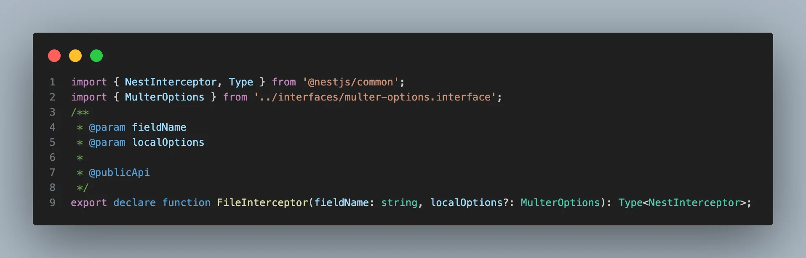
> 
> - MulterOptions를 통해 더 세부적인 제약사항 부여가 가능하다&#46; 
>     - 자세한 내용은 아래 <code>방법 2&#46; 복수 필드 파일 업로드 &#45; FileFieldsInterceptor</code> 확인
> 
> </details>

<a id="29deda9b0fe1805db363d8879eae7414"></a>

### 코드

> 
> 
> <a id="29eeda9b0fe1809d9e44dc2bed5fdfaf"></a>
> 
> ‣
> 
> <a id="29eeda9b0fe180978912c11d61658ef7"></a>
> 
> ‣

<details>
<summary>&#91; 코드 &#93; MovieModule</summary>

<a id="294eda9b0fe18045968ef4b86b0f4984"></a>

```typescript
import { Module } from '@nestjs/common';
import { MovieService } from './movie.service';
import { MovieController } from './movie.controller';
import { TypeOrmModule } from '@nestjs/typeorm';
import { Movie } from './entities/movie.entity';
import { MovieDetail } from './entities/movie-datail.entity';
import { Director } from 'src/director/entities/director.entity';
import { Genre } from 'src/genre/entities/genre.entity';
import { User } from 'src/user/entities/user.entity';
import { CommonModule } from 'src/common/common.module';
import { MulterModule } from '@nestjs/platform-express';
import { diskStorage } from 'multer';
import { join } from 'path';

@Module({
  imports: [
    TypeOrmModule.forFeature([Movie, MovieDetail, Director, Genre, User]),
    CommonModule,
    // MulterModule Init
    MulterModule.register({
	    // 업로드 되는 파일 저장 경로 설정
      storage: diskStorage({
        destination: join(process.cwd(), 'public', 'movie'),
      }),
    }),
  ],
  controllers: [MovieController],
  providers: [MovieService],
})
export class MovieModule {}

```

</details>

<details>
<summary>&#91; 코드 &#93; MovieController</summary>

<a id="29ceda9b0fe1800196d0ffe959c3e0d8"></a>

```typescript
import {
  Controller,
  Get,
  Post,
  Body,
  Patch,
  Param,
  Delete,
  Query,
  UseInterceptors,
  ClassSerializerInterceptor as CI,
  Req,
  ParseIntPipe,
  UploadedFile,
} from '@nestjs/common';
import { MovieService } from './movie.service';
import { CreateMovieDto } from './dto/create-movie.dto';
import { UpdateMovieDto } from './dto/update-movie.dto';
import { Role, User as U } from 'src/user/entities/user.entity';
import { RBAC } from 'src/auth/decorator/rbac.decorator';
import { Public } from 'src/auth/decorator/public.decorator';
import { GetMoviesReqDto } from './dto/get-movies.dto';
import { TransactionInterceptor } from 'src/common/interceptor/transaction.interceptor';
import { User } from 'src/common/decorator/user.decorator';
import { QueryRunner } from 'src/common/decorator/query-runner.decorator';
import { QueryRunner as QR } from 'typeorm';
import { FileInterceptor } from '@nestjs/platform-express';

@Controller('movie')
@UseInterceptors(CI)
export class MovieController {
  constructor(private readonly movieService: MovieService) {}
  
  ...

 @Post()
  @RBAC(Role.admin)
  @UseInterceptors(TransactionInterceptor)
  @UseInterceptors(FileInterceptor('movie'))
  postMovie(
    @User() user: U,
    @QueryRunner() qr: QR,
    @Body() body: CreateMovieDto,
    @UploadedFile() file: Express.Multer.File,
  ) {
    return this.movieService.create(user, qr, body);
  }
```

</details>

<a id="29deda9b0fe18021809ee8955f9866ac"></a>

### Notes

<details>
<summary><strong>문자열 합성 시, </strong><strong><code>join()</code></strong><strong>을 사용하는 이유</strong></summary>

> ❗ 
> 
> <a id="293eda9b0fe1808a96fce9943513e37b"></a>
> 
> <u>OS 마다 표현 방식이 다르다</u><strong>&#46;</strong> 따라서 직접 <code>join()</code>를 사용하는 것을 권장한다&#46;
> 
> - macOS&#58;  <code>…/public/movie</code> , <code>/</code>를 기준으로 디렉토리 구분
> 
> - 윈도우&#58; <code>…&#92;public&#92;movie</code>, <code>&#92;</code>를 기준으로 디렉토리 구분

<details>
<summary>예제</summary>

<a id="29ceda9b0fe180f3ba42e951225fddd4"></a>

```groovy
MulterModule.register({
  // 업로드 되는 파일 저장 경로 설정
  storage: diskStorage({
    destination: join(process.cwd(), 'public', 'movie'),
  }),
}),
```

- <code>process&#46;swd()</code>&#58; 프로젝트의 루트 경로

</details>

<a id="29deda9b0fe1808fac61d4d13431c026"></a>

a

</details>

<details>
<summary><code>form&#45;data</code>로 배열 값 할당 방법</summary>

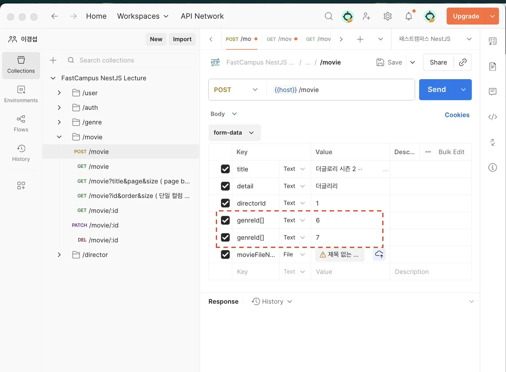

- form&#45;data로 배열 값을 받을 시, 아래와 같이 key에 <code>field&#91;&#93;</code>형태로 작성 후, 값들을 설정한다&#46;

</details>

<details>
<summary>파일 객체 확인</summary>

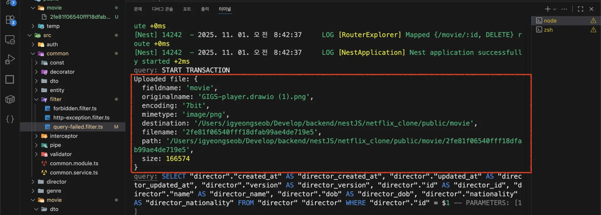

- file 정보
    - <code>fieldname</code>&#58; 필드 이름

    - <code>originalname</code>&#58; 원본 파일 이름

    - <code>encoding</code>&#58; 인코딩 유형

    - <code>mimetype</code>&#58; 파일 유형

    - <code>destination</code>&#58; 저장되는 목적지 경로

    - <code>filename</code>&#58; 저정된 파일 이름

    - <code>path</code>&#58; 파일 경로

    - <code>size</code>&#58;  파일 크기

</details>

<a id="282eda9b0fe1814a8fe4edd099ff004b"></a>

## 방법 2&#46; 복수 파일 업로드  &#45; <code>File</code><u><code>s</code></u><code>Interceptor</code>, <code>&#64;UploadedFile</code><u><code>s</code></u>

> ✏️ 
> 
> <a id="29feda9b0fe180fcbcfdf1f290e7e12f"></a>
> 
> 복수의 파일을 업로드하는 경우 사용한다&#46; 
> 
> <details>
> <summary>&#91; 코드 &#93; FilesInterceptor</summary>
> 
> 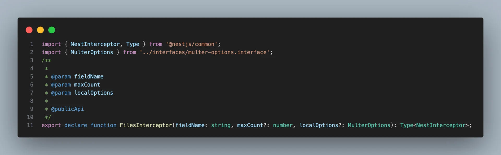
> 
> - <code>maxCount</code>를 통해 업로드 파일 개수 제한이 가능하다&#46; 
> 
> - <code>MulterOptions</code>를 통해 더 세부적인 제약사항 부여가 가능하다&#46; 
>     - 자세한 내용은 아래 <code>방법 2&#46; 복수 필드 파일 업로드 &#45; FileFieldsInterceptor</code> 확인
> 
> </details>

<a id="29eeda9b0fe180b3bd12cee68a71d2b6"></a>

### 코드

<details>
<summary>&#91; 코드 &#93; MovieController</summary>

<a id="29ceda9b0fe180a78695c869148df03c"></a>

```typescript
import {
  Controller,
  Get,
  Post,
  Body,
  Patch,
  Param,
  Delete,
  Query,
  UseInterceptors,
  ClassSerializerInterceptor as CI,
  Req,
  ParseIntPipe,
  UploadedFiles
} from '@nestjs/common';
import { MovieService } from './movie.service';
import { CreateMovieDto } from './dto/create-movie.dto';
import { UpdateMovieDto } from './dto/update-movie.dto';
import { Role, User as U } from 'src/user/entities/user.entity';
import { RBAC } from 'src/auth/decorator/rbac.decorator';
import { Public } from 'src/auth/decorator/public.decorator';
import { GetMoviesReqDto } from './dto/get-movies.dto';
import { TransactionInterceptor } from 'src/common/interceptor/transaction.interceptor';
import { User } from 'src/common/decorator/user.decorator';
import { QueryRunner } from 'src/common/decorator/query-runner.decorator';
import { QueryRunner as QR } from 'typeorm';
import { FilesInterceptor } from '@nestjs/platform-express';

@Controller('movie')
@UseInterceptors(CI)
export class MovieController {
  constructor(private readonly movieService: MovieService) {}
  
  ...

 @Post()
  @RBAC(Role.admin)
  @UseInterceptors(TransactionInterceptor)
  @UseInterceptors(FilesInterceptor('movies'))
  postMovie(
    @User() user: U,
    @QueryRunner() qr: QR,
    @Body() body: CreateMovieDto,
    @UploadedFiles() files: Express.Multer.File[],
  ) {
    return this.movieService.create(user, qr, body, files);
  }
  
  ...
```

</details>

<a id="29eeda9b0fe180f88d70c99094c72e54"></a>

### Notes

<details>
<summary>&#91; 테스트 &#93; 파일 객체 console 출력</summary>

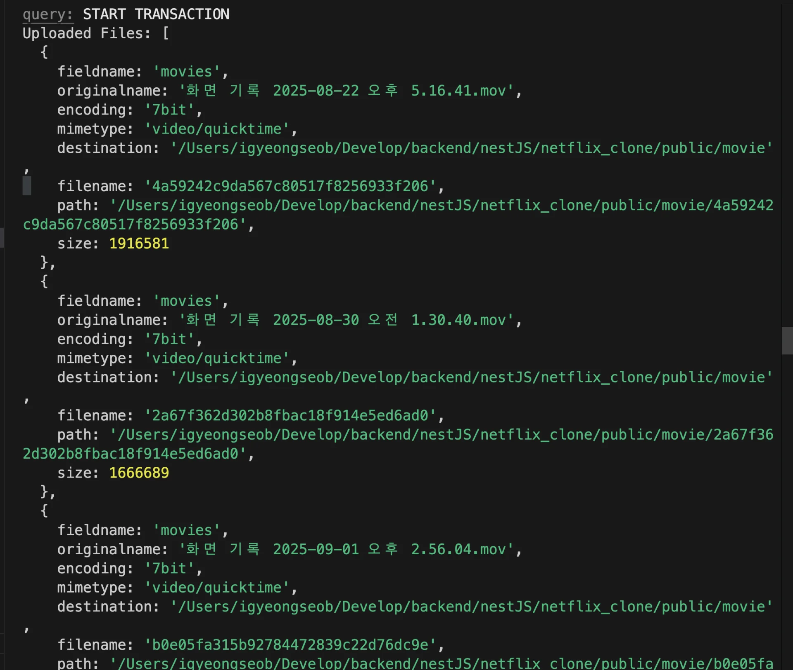

- 콘솔 출력 시, 위와 같이 여러 개의 파일들을 받아오는 것을 확인할 수 있다&#46;

</details>

<details>
<summary>&#91; 오류&#93; Execution Context DI 불가</summary>

[ExecutionContext  DI 불가한 이유](#/post/282eda9b-0fe1-81d9-906d-e12f0a947a6f)

</details>

<details>
<summary>&#91; 추가 &#93; 선택된 모든 파일들의 경로를 지정하는 경우</summary>

1. MovieFile 엔티티 추가 후, 연관관계 설정(<code>1&#58;N</code>)
    <a id="29eeda9b0fe18057a7c1c954d8dd3263"></a>

    ```typescript
    @Entity()
    export class MovieFile {
      @PrimaryGeneratedColumn()
      id: number;

      @Column()
      path: string;

      @ManyToOne(() => Movie, (movie) => movie.files)
      movie: Movie;
    }
    ```

    <a id="29eeda9b0fe18071b594cab27882fc3f"></a>

    ```typescript
    @Entity()
    export class Movie {
      @PrimaryGeneratedColumn()
      id: number;

      @OneToMany(() => MovieFile, (file) => file.movie, { cascade: true })
      files: MovieFile[];
    }
    ```

1. 서비스 로직
    <a id="29eeda9b0fe180a1b48cfcf43e32c819"></a>

    ```typescript
    ...

    const movieFiles = files?.map(f => movieFileRepo.create({ path: `/movie/${f.filename}`})) ?? [];

    const movie = movieRepo.create({
      title: dto.title,
      director,
      detail: savedDetail,
      genres,
      creator,
      files: movieFiles,
    });

    await movieRepo.save(movie);

    ... 
    ```

</details>

<a id="29eeda9b0fe1806b8de8cdc115116548"></a>

## 방법 3&#46; 복수 필드 파일 업로드 &#45; <code>FileFieldsInterceptor</code>

> ✏️ 
> 
> <a id="29eeda9b0fe180b49604de98a9024fc5"></a>
> 
> 복수의 필드들로  파일을 받는 경우 사용한다&#46;
> 
> <details>
> <summary><strong>&#91; 코드 &#93; FileFieldsInterceptor</strong></summary>
> 
> 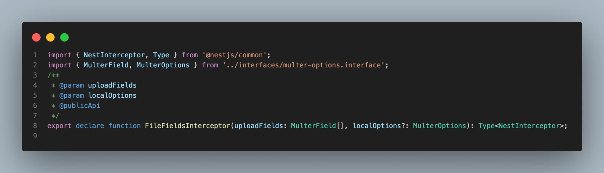
> 
> </details>

<a id="29eeda9b0fe1806da9d1d699923392eb"></a>

### 파라미터 1&#46; <code>MulterField&#91;&#93;</code>

> ✏️ 
> 
> <a id="29eeda9b0fe1801f8545f5bdb35c6ac6"></a>
> 
> <strong><code>MulterField&#91;&#93;</code></strong>
> 
> > <code>FileFieldsInterceptor</code>에 1번째 파라미터로 <code>MulterField&#91;&#93;</code>를 넘겨 복수의 필드 형태로 파일을 받아올 수 있다&#46; 
> 
> - 설정한 maxCount 이상의로 파일을 업로드하는 경우 오류가 발생된다&#46; 
> 
> ---
> 
> <details>
> <summary>&#91; 코드 &#93; <strong>MulterField&#91;&#93;</strong></summary>
> 
> 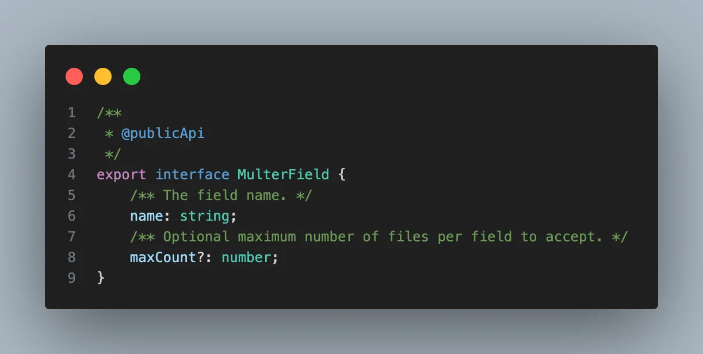
> 
> </details>

<a id="29eeda9b0fe1805abb21d2d8e90c28d0"></a>

### 코드

<details>
<summary>&#91; 코드 &#93; MovieController</summary>

<a id="29eeda9b0fe1806d8110f3dbdc6d28aa"></a>

```typescript
import {
  Controller,
  Get,
  Post,
  Body,
  Patch,
  Param,
  Delete,
  Query,
  UseInterceptors,
  ClassSerializerInterceptor as CI,
  Req,
  ParseIntPipe,
  UploadedFiles
} from '@nestjs/common';
import { MovieService } from './movie.service';
import { CreateMovieDto } from './dto/create-movie.dto';
import { UpdateMovieDto } from './dto/update-movie.dto';
import { Role, User as U } from 'src/user/entities/user.entity';
import { RBAC } from 'src/auth/decorator/rbac.decorator';
import { Public } from 'src/auth/decorator/public.decorator';
import { GetMoviesReqDto } from './dto/get-movies.dto';
import { TransactionInterceptor } from 'src/common/interceptor/transaction.interceptor';
import { User } from 'src/common/decorator/user.decorator';
import { QueryRunner } from 'src/common/decorator/query-runner.decorator';
import { QueryRunner as QR } from 'typeorm';
import { FilesInterceptor } from '@nestjs/platform-express';

@Controller('movie')
@UseInterceptors(CI)
export class MovieController {
  constructor(private readonly movieService: MovieService) {}
  
  ...

 @Post()
  @RBAC(Role.admin)
  @UseInterceptors(TransactionInterceptor)
  @UseInterceptors(
    FileFieldsInterceptor(
      // MulterField[]
	    [
        { name: 'movie', maxCount: 1 },  // 필드 1 
        { name: 'poster', maxCount: 2 }, // 필드 2
      ]
    ),
  )
  postMovie(
    @User() user: U,
    @QueryRunner() qr: QR,
    @Body() body: CreateMovieDto,
    @UploadedFiles()
    files?: {
      movie?: Express.Multer.File[];
      poster?: Express.Multer.File[];
    },
  ) {
    return this.movieService.create(user, qr, body, files);
  }
  
  ...
```

</details>

<a id="29eeda9b0fe1803b8470da0bc00b70aa"></a>

### Notes

<details>
<summary>&#91; 테스트 &#93; 포스트맨 API 홏</summary>

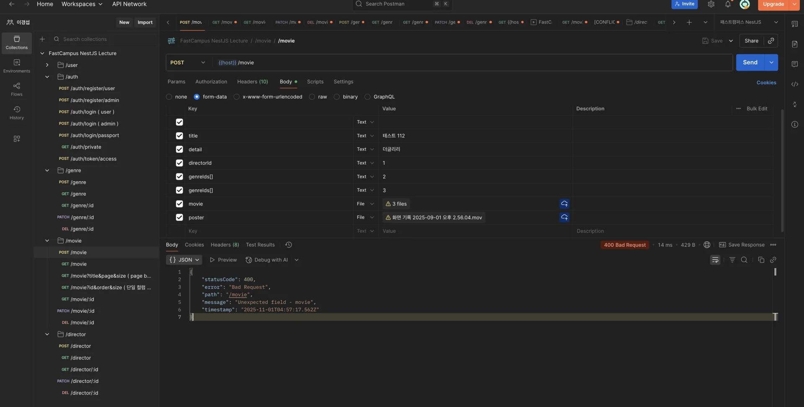

- FileFieldsInterceptor의 옵션으로 정의한 MulterField &#45; <code>name</code>, <code>maxCount</code>에 맞춰서 요청을 한다&#46; 

- 설정한 maxCount를 초과 시 오류가 발생된다&#46;

</details>

<a id="29eeda9b0fe180b5ab63c9a4405f5db9"></a>

### 파라미터 2&#46; <strong><code>MulterOptions</code></strong>

> ✏️ 
> 
> <a id="29eeda9b0fe1806aa6a4ebc5f3c83c7c"></a>
> 
> <strong><code>MulterOptions</code></strong>
> 
> > <code>FileFieldsInterceptor</code>에 2번째 파라미터로 <code>MulterOptions</code>을 넘겨 <strong><u>더 세부적인 업로드 요구사항을 제어</u></strong>할 수 있다&#46;
> 
> - <code>limit</code>&#58; 업로드되는 파일 크기 제한
> 
> <details>
> <summary><code>FileFilter</code>&#58; 특정 파일 유형만 강제 가능</summary>
> 
> > 3번째 인자인 callback을 통해 성공/실패 케이스를 정의한다&#46; 
> 
> - 성공&#58; <code>callback(null, true)</code>
> 
> - 실패&#58; <code>callback({예외 발생 요구사항}, false)</code>
> 
> </details>
> 
> ---
> 
> <details>
> <summary>&#91; 코드 &#93; <strong>MulterOptions</strong></summary>
> 
> 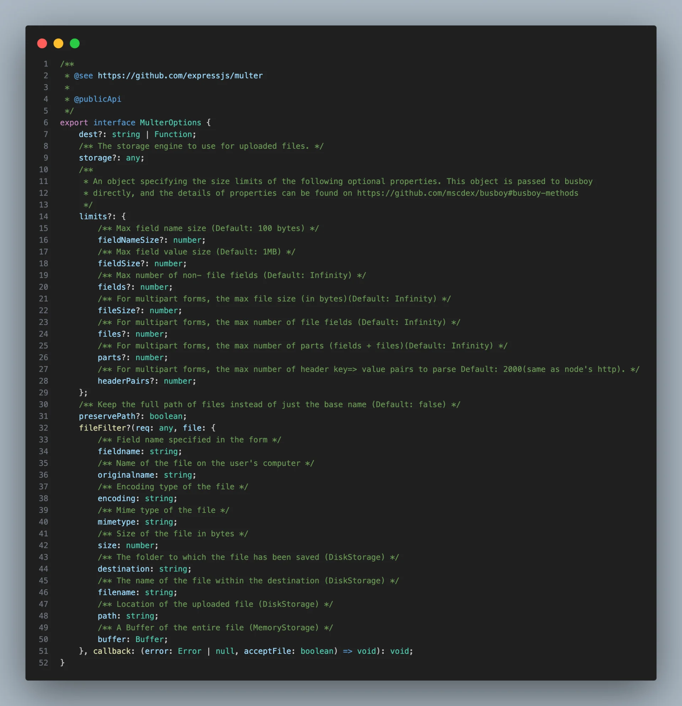
> 
> </details>

<details>
<summary>&#91; 코드 &#93; MovieController</summary>

<a id="29eeda9b0fe18079ac3bfd9711affeb6"></a>

```typescript
import {
  Controller,
  Get,
  Post,
  Body,
  Patch,
  Param,
  Delete,
  Query,
  UseInterceptors,
  ClassSerializerInterceptor as CI,
  Req,
  ParseIntPipe,
  UploadedFiles
} from '@nestjs/common';
import { MovieService } from './movie.service';
import { CreateMovieDto } from './dto/create-movie.dto';
import { UpdateMovieDto } from './dto/update-movie.dto';
import { Role, User as U } from 'src/user/entities/user.entity';
import { RBAC } from 'src/auth/decorator/rbac.decorator';
import { Public } from 'src/auth/decorator/public.decorator';
import { GetMoviesReqDto } from './dto/get-movies.dto';
import { TransactionInterceptor } from 'src/common/interceptor/transaction.interceptor';
import { User } from 'src/common/decorator/user.decorator';
import { QueryRunner } from 'src/common/decorator/query-runner.decorator';
import { QueryRunner as QR } from 'typeorm';
import { FilesInterceptor } from '@nestjs/platform-express';

@Controller('movie')
@UseInterceptors(CI)
export class MovieController {
  constructor(private readonly movieService: MovieService) {}
  
  ...

 @Post()
  @RBAC(Role.admin)
  @UseInterceptors(TransactionInterceptor)
  @UseInterceptors(
    FileFieldsInterceptor(
	    // MulterField[]
      [
        { name: 'movie', maxCount: 1 },
        { name: 'poster', maxCount: 2 },
      ],
      // MulterOptions
      {
	      // 파일 크기 제한
        limits: {
          fileSize: 20000000, // 20MB
        },
        // 파일 유형 제한
        fileFilter: (req, file, callback) => {
          if (file.mimetype === 'video/mp4') {
            return callback(
              new BadRequestException('MP4 타입만 업로드 가능합니다.'),
              false,
            );
          }
          return callback(null, true);
        },
      },
    ),
  )
  postMovie(
    @User() user: U,
    @QueryRunner() qr: QR,
    @Body() body: CreateMovieDto,
    @UploadedFiles()
    files?: {
      movie?: Express.Multer.File[];
      poster?: Express.Multer.File[];
    },
  ) {
    return this.movieService.create(user, qr, body, files);
  }
  
  ...
```

</details>

<a id="29eeda9b0fe180678593f6f028b082f6"></a>

### Notes

<details>
<summary>&#91; 테스트 &#93; 포스트맨 API 호출</summary>

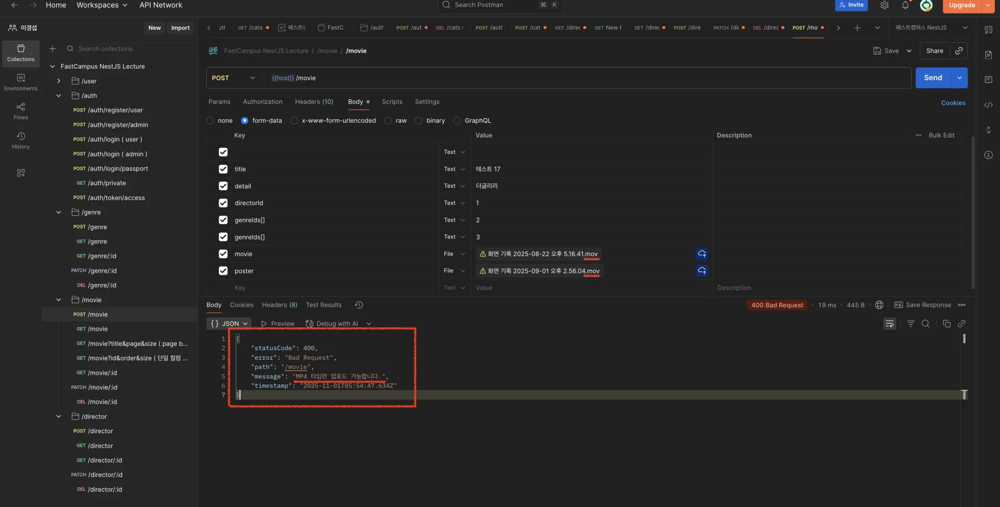

- fileFilter에서 정의한 세부 요구사항이 정상적으로 동작하는 것을 확인할 수 있다&#46; 
    <a id="29eeda9b0fe1802f9d40d41bfd2f36e7"></a>

    ```typescript
    fileFilter: (req, file, callback) => {
        if (file.mimetype === 'video/mp4') {
          return callback(
            new BadRequestException('MP4 타입만 업로드 가능합니다.'),
            false,
          );
        }
        return callback(null, true);
      },
    },
    ```

</details>

<a id="29eeda9b0fe1809180c8c5ab303265e8"></a>

## 업로드된 파일 형식 변경

> ❗ 
> 
> <a id="29feda9b0fe1802cb2a4d63b934fd4e5"></a>
> 
> 문제점
> 
> 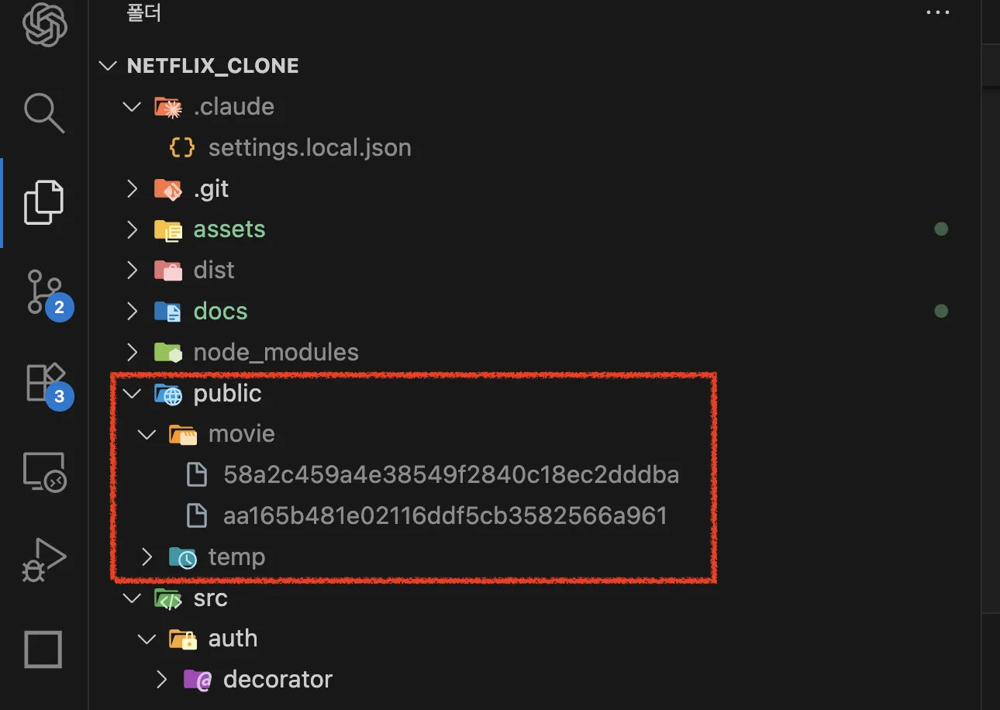
> 
> <a id="29feda9b0fe180308b42d0ff6e7c1d56"></a>
> 
> 위 그림과 같이 파일업로드 시, 랜덤한 string 형태로 형식없이 파일이 생성된다&#46; 
> 
> <a id="29feda9b0fe18018abc8c691176866f4"></a>
> 
> 이를 filename 옵션 및 파이프를 통해 필터링 및 특정 형식 부여가 가능하다&#46; 

> ✏️ 
> 
> <a id="29feda9b0fe1808bab39d1a657170cc3"></a>
> 
> <strong>UUID 패키지 설치</strong>
> 
> <a id="29feda9b0fe180b58c67f0e8dcdfa604"></a>
> 
> ```typescript
> pnpm i uuid
> ```
> 
> - title 생성 시 uuid를 사용하기 때문에 uuid 패키지 설치가 필요하다

<a id="29feda9b0fe1805f8782f2e9a1465b05"></a>

### 방법 1 &#45; <code>MulterModule</code>에 <code>filename</code> 옵션 설정

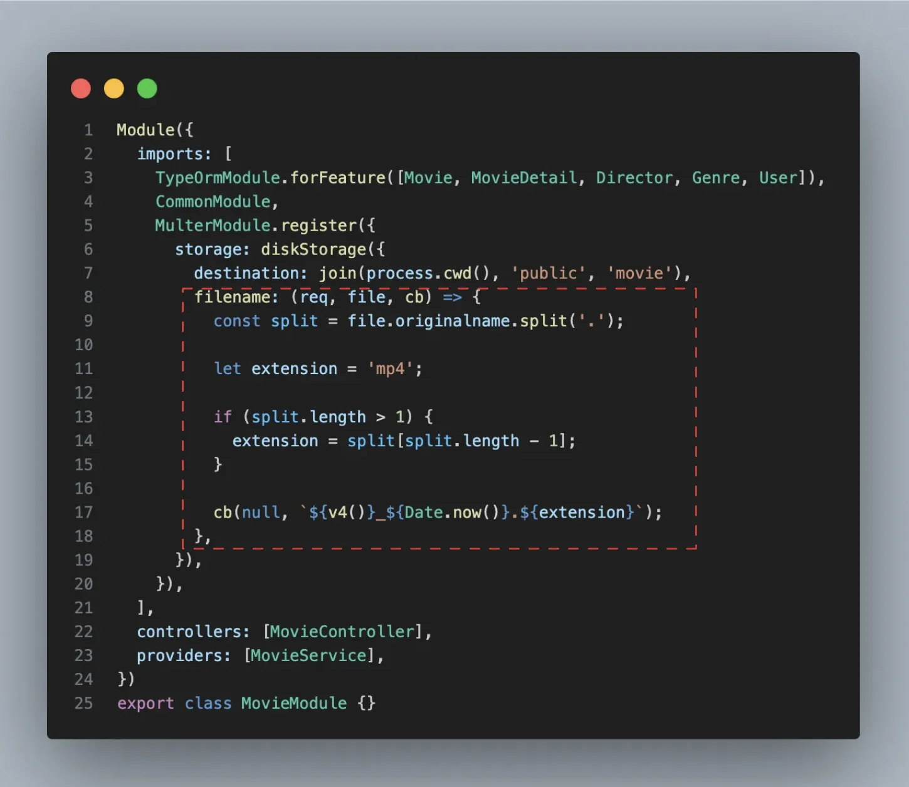

<details>
<summary>&#91; 코드 &#93; MovieModule</summary>

<a id="29feda9b0fe18092b361e73632bd8253"></a>

```typescript
import { Module } from '@nestjs/common';
import { MovieService } from './movie.service';
import { MovieController } from './movie.controller';
import { TypeOrmModule } from '@nestjs/typeorm';
import { Movie } from './entities/movie.entity';
import { MovieDetail } from './entities/movie-datail.entity';
import { Director } from 'src/director/entities/director.entity';
import { Genre } from 'src/genre/entities/genre.entity';
import { User } from 'src/user/entities/user.entity';
import { CommonModule } from 'src/common/common.module';
import { MulterModule } from '@nestjs/platform-express';
import { diskStorage } from 'multer';
import { join } from 'path';
import { v4 } from 'uuid';

@Module({
  imports: [
    TypeOrmModule.forFeature([Movie, MovieDetail, Director, Genre, User]),
    CommonModule,
    MulterModule.register({
      storage: diskStorage({
        destination: join(process.cwd(), 'public', 'movie'),
        filename: (req, file, cb) => {
	        let extension = 'mp4';
	        
          const split = file.originalname.split('.');
          
          if (split.length > 1) {
            extension = split[split.length - 1];
          }

          cb(null, `${v4()}_${Date.now()}.${extension}`);
        },
      }),
    }),
  ],
  controllers: [MovieController],
  providers: [MovieService],
})
export class MovieModule {}

```

</details>

<a id="29feda9b0fe180119e7eed5edae44523"></a>

### 방법 2 &#45; <code>&#64;UploadedFile()</code>, <code>&#64;UploadedFiles()</code> 에 커스텀 Pipe 설정

> ✏️ 
> 
> <a id="29feda9b0fe1806e9487ce4f66bce796"></a>
> 
> <code>&#64;UploadedFile()</code>, <code>&#64;UploadedFiles()</code>의 코드 스펙 확인 시, pipe 인자를 받을 수 있는 것을 확인할 수 있다&#46;  
> 
> <a id="29feda9b0fe18061936eced8db0b9daf"></a>
> 
> 즉, <strong>업로드 되는 파일에 대한 </strong><strong><u>유효성검사 및 타입 변환</u></strong><strong>을 </strong><strong><u>커스텀 파이프</u></strong><strong>를 정의</strong><strong>하여 설정</strong>할 수 있다&#46;
> 
> <details>
> <summary>&#91; 코드 &#93; <code>UploadedFile()</code></summary>
> 
> 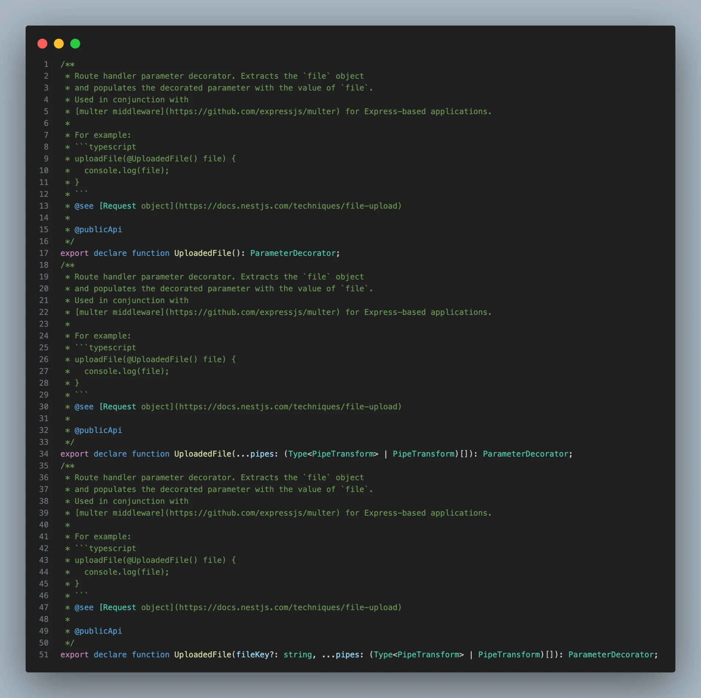
> 
> </details>
> 
> <details>
> <summary>&#91; 코드 &#93; <code>UploadedFiles()</code></summary>
> 
> 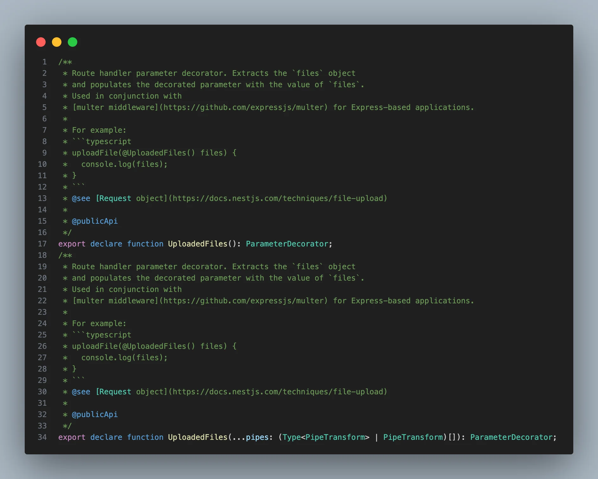
> 
> </details>

<details>
<summary> 커스텀 파이프&#58; <code>MovieFilePipe </code></summary>

<a id="29feda9b0fe18025914ec7ab8b3ef130"></a>

<strong>&#91; 코드 &#93; MovieFilePipe</strong>

<a id="29feda9b0fe180999439e6f87a996afb"></a>

```typescript
import {
  ArgumentMetadata,
  BadRequestException,
  Injectable,
  PipeTransform,
} from '@nestjs/common';
import { join } from 'path';
import { v4 } from 'uuid';
import { rename } from 'fs/promises';

@Injectable()
export class MovieFilePipe
  implements PipeTransform<Express.Multer.File, Promise<Express.Multer.File>>
{
  constructor(
    private readonly options: {
      maxSize: number;
      mimetypes: string; // MB 단위
    },
  ) {}

  async transform(
    value: Express.Multer.File,
    metadata: ArgumentMetadata,
  ): Promise<Express.Multer.File> {
    if (!value) {
      throw new BadRequestException('movie 필드는 필수입니다.');
    }

    const byteSize = this.options.maxSize * 1000 * 1000;

    if (value.size > byteSize) {
      throw new BadRequestException(
        `파일 크기는 ${this.options.maxSize}MB 이내로 업로드 가능합니다.`,
      );
    }

    if (value.mimetype !== this.options.mimetypes) {
      throw new BadRequestException(
        `${this.options.mimetypes} 타입의 파일만 업로드 가능합니다.`,
      );
    }

    const split = value.originalname.split('.');

    let extension = 'mp4';

    if (split.length > 1) {
      extension = split[split.length - 1];
    }
    
    // uuid_Date.mp4
    const filename = `${v4()}_${Date.now()}.`;
    const newPath = join(value.destination, filename);

    await rename(value.path, newPath);

    return {
      ...value,
      filename,
      path: newPath,
    };
  }
}

```

</details>

<details>
<summary>헨들러 적용</summary>

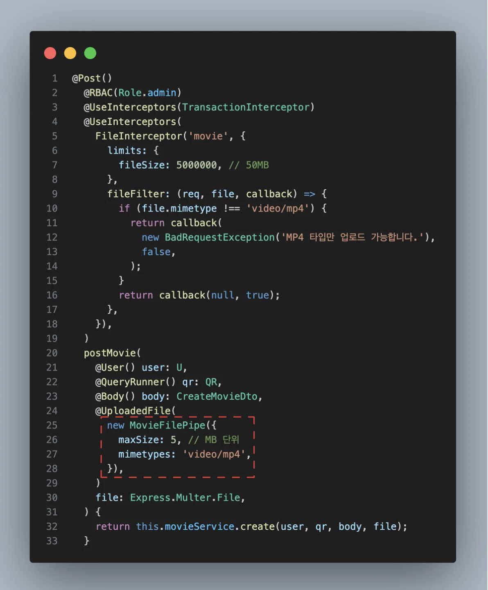

<details>
<summary>&#91; 코드 &#93; MovieController</summary>

<a id="29feda9b0fe1802eb87af8166f7a9be9"></a>

```typescript
@Controller('movie')
@UseInterceptors(CI)
export class MovieController {
  constructor(private readonly movieService: MovieService) {}
	
	...
	
	@Post()
  @RBAC(Role.admin)
  @UseInterceptors(TransactionInterceptor)
  @UseInterceptors(
    FileInterceptor('movie', {
      limits: {
        fileSize: 5000000, // 50MB
      },
      fileFilter: (req, file, callback) => {
        if (file.mimetype !== 'video/mp4') {
          return callback(
            new BadRequestException('MP4 타입만 업로드 가능합니다.'),
            false,
          );
        }
        return callback(null, true);
      },
    }),
  )
  postMovie(
    @User() user: U,
    @QueryRunner() qr: QR,
    @Body() body: CreateMovieDto,
    @UploadedFile(
      new MovieFilePipe({
        maxSize: 5, // MB 단위
        mimetypes: 'video/mp4',
      }),
    )
    file: Express.Multer.File,
  ) {
    return this.movieService.create(user, qr, body, file);
  }
  
  ...
```

</details>

</details>

> ⚠️ 
> 
> <a id="29feda9b0fe180f48fd3cfcaf16d9000"></a>
> 
> <strong>파이프 사용 시 주의점 </strong>
> 
> <a id="29feda9b0fe180bcb92ec44e31e1576b"></a>
> 
> 해당 예제는 interceptor와 pipe의 <strong><u>필터링 조건</u></strong>이 동일하지만, <strong><u>다른 경우 파일이 업로드 된 상태에서 오류가 발생</u></strong>될 수 있다&#46; 
> 
> - 미들웨어 적용 순서에 의해 파일이 업로드된 이후 오류가 발생된다&#46; 
>     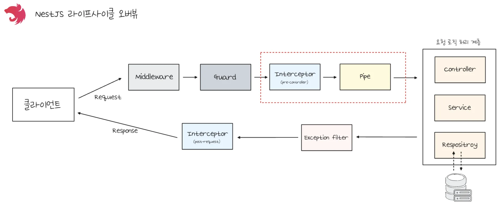

<details>
<summary>ex) 오류 케이스</summary>

<a id="29feda9b0fe180448faddd675d614e11"></a>

```typescript
@Post()
@RBAC(Role.admin)
@UseInterceptors(TransactionInterceptor)
@UseInterceptors(
  FileInterceptor('movie', {
    limits: {
      fileSize: 5000000, // 50MB
    },
    fileFilter: (req, file, callback) => {
      if (file.mimetype !== 'video/mp4') {
        return callback(
          new BadRequestException('MP4 타입만 업로드 가능합니다.'),
          false,
        );
      }
      return callback(null, true);
    },
  }),
)
postMovie(
  @User() user: U,
  @QueryRunner() qr: QR,
  @Body() body: CreateMovieDto,
  @UploadedFile(
    new MovieFilePipe({
      maxSize: 5, // 5MB
      mimetypes: 'video/mp4',
    }),
  )
  file: Express.Multer.File,
) {
  return this.movieService.create(user, qr, body, file);
}
```

<a id="29feda9b0fe1804d901ad613486f11b9"></a>

위와 같이 설정된 경우, Interceptor에서는 50MB의 파일 크기 제한을 가지지만, Pipe에서는 5MB의 크기 제한을 가진다&#46; 

<a id="29feda9b0fe180629887f571700a4038"></a>

따라서 <code>50MB</code>에서 <code>5MB</code> 사이의 파일을 업로드하는 경우, interceptor를 통과하지만 pipe에서 오류가 발생된다&#46; 따라서 <strong>파일은 서버에 업로드 되지만, exception이 발생</strong>된다&#46;

<a id="29feda9b0fe1808d8a27ce6491185e4d"></a>

따라서 변수값으로 관리해서 한번에 적용하는 것을 권장한다&#46;

</details>

<a id="29feda9b0fe1800aba30cc3d227b2842"></a>

### 엔티티에 파일 path 반영

<a id="29feda9b0fe1802f9d37e0359ebc18e2"></a>

### 코드 

<details>
<summary>&#91; 코드 &#93; MovieController</summary>

<a id="29feda9b0fe180e88559f7f6ca2fa77f"></a>

```typescript
postMovie(
  @User() user: U,
  @QueryRunner() qr: QR,
  @Body() body: CreateMovieDto,
  @UploadedFile(
    new MovieFilePipe({
      maxSize: 50, // MB 단위
      mimetypes: 'video/mp4',
    }),
  )
  movie: Express.Multer.File,
) {
  return this.movieService.create(user, qr, body, movie.filename);
}
```

</details>

<details>
<summary>&#91; 코드 &#93; MovieService</summary>

<a id="29feda9b0fe1802ca11ac15d23d25fa8"></a>

```typescript
async create(
    creator: User,
    qr: QueryRunner,
    dto: CreateMovieDto,
    movieFileName: string,
  ) {
    // 1. Director 검증
    const director = await qr.manager
      .getRepository(Director)
      .createQueryBuilder('director')
      .where('director.id = :id', { id: dto.directorId })
      .getOne();

    if (!director) {
      throw new NotFoundException('존재하지 않는 Director 입니다.');
    }

    // 2. Genres 검증
    const genres = await this.validateGenres(qr, dto.genreIds);

    // 3. MovieDetail 생성
    const movieDetail = qr.manager.getRepository(MovieDetail).create({
      detail: dto.detail,
    });

    const savedDetail = await qr.manager
      .getRepository(MovieDetail)
      .save(movieDetail);

    // 4. Movie 생성
    const movieRepo = qr.manager.getRepository(Movie);

    const movieFolder = join('public', 'movie');

    const movie = await movieRepo.create({
      title: dto.title,
      director,
      detail: savedDetail,
      genres,
      creator,
      movieFilePath: join(movieFolder, movieFileName),
    });

    const savedMovie = await movieRepo.save(movie);

    // 4. 한 번의 save로 Movie + MovieDetail + ManyToMany genres 연결
    return qr.manager
      .getRepository(Movie)
      .createQueryBuilder('movie')
      .leftJoinAndSelect('movie.detail', 'detail')
      .leftJoinAndSelect('movie.director', 'director')
      .leftJoinAndSelect('movie.genres', 'genres')
      .leftJoinAndSelect('movie.creator', 'creator')
      .where('movie.id = :id', { id: savedMovie.id })
      .getOne();
  }
```

</details>

<a id="29feda9b0fe18046a349d1dbbbe739a9"></a>

### 테스트

<details>
<summary>&#91; 테스트 &#93; postman  movie 조회</summary>

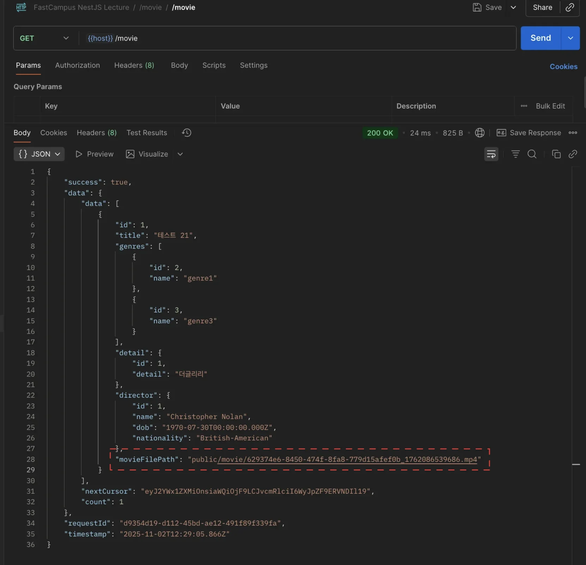

- movieFilePath에 업로드된 파일 path가 정상적으로 출력되는 것을 확인할 수 있다&#46; 


</details>

<a id="29eeda9b0fe180198b10dbda3c4acff5"></a>

## 스태틱 파일 서빙

> ✏️ 
> 
> <a id="29feda9b0fe180c2a44cf56339a3cb8f"></a>
> 
> 업로드하여 서버에 저장된 파일들을 프론트에서 다운로드(스트리밍)하기 위해서는  파일에 접근할 수 있는 권한을 허용해줘야 한다&#46; 
> 
> <a id="2a0eda9b0fe180fc9321c70d6302f3d4"></a>
> 
> <code>nestjs</code>에서는 이를 <code>&#64;nestjs/serve&#45;static</code> 패키지로 지원한다&#46;
> 
> <details>
> <summary><code>&#64;nestjs/serve&#45;static</code> 패키지 설치</summary>
> 
> <a id="29feda9b0fe18098b575e596e7fa7956"></a>
> 
> ```bash
> pnpm i @nestjs/serve-static
> ```
> 
> </details>

<details>
<summary>서빙할 폴더 지정&#58; </summary>


</details>

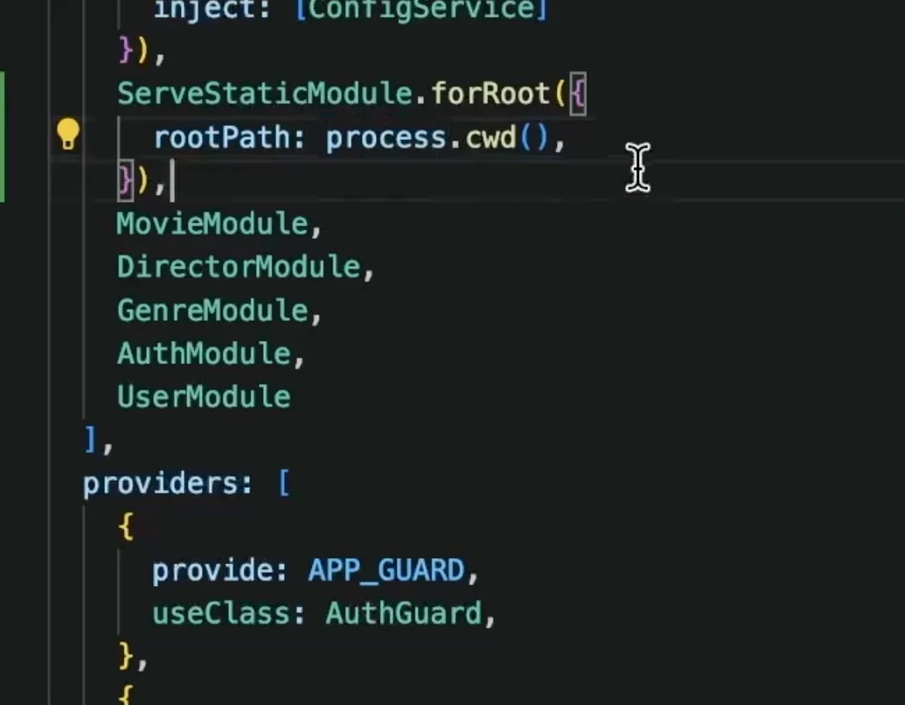


<a id="29eeda9b0fe180708222cea8eef2452c"></a>

DB 에는 String 데이터를 저장하지 바이너리 데이터를 저장하지 않는다&#46; <br>즉, 해당 파일의 경로를 저장 후 불러온다&#46; 

<a id="29eeda9b0fe180c9ac0bd611a3d14963"></a>

테이블에 메타데이터를 저장하고 해당 메타데이터를 기반으로 파일을 불러온다&#46;
