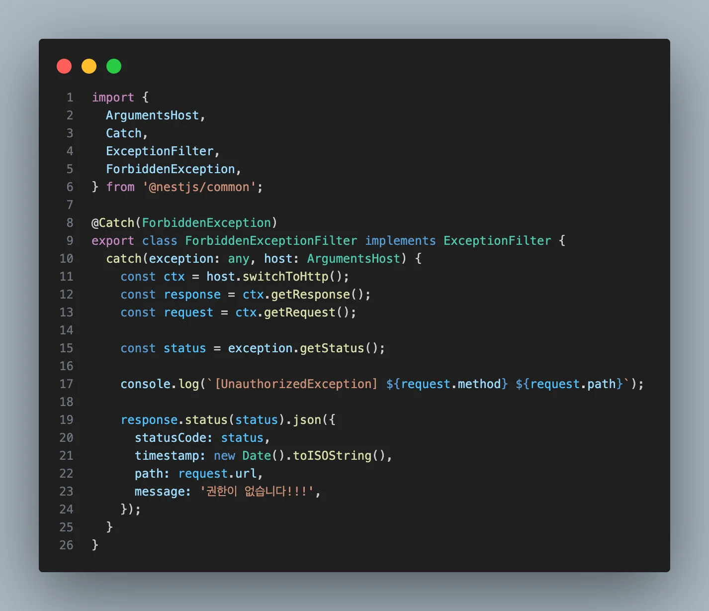
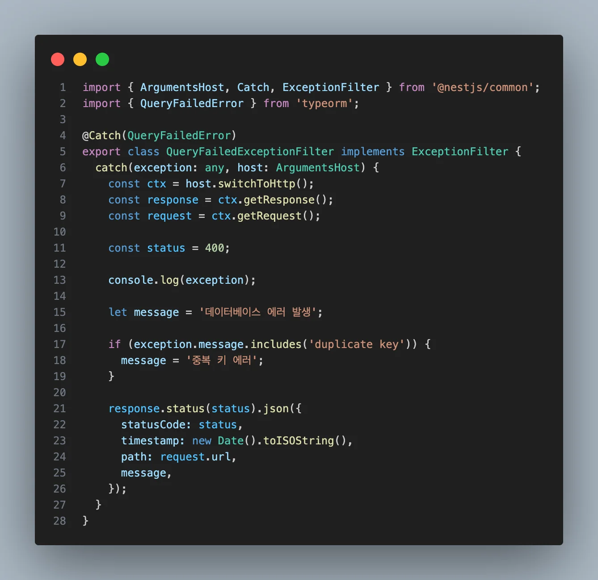

> 
> 
> <a id="282eda9b0fe18150ad74d3c7af79c6fe"></a>
> 
> <strong>목차</strong>
> 
> - [Exception Filter 사용 예제](#282eda9b0fe181b6a320e44828ab2de4)
> - [1. ForbiddenExceptionFilter](#282eda9b0fe1815fafacd594be110cf9)
> - [2. QueryFailedExceptionFilter](#282eda9b0fe180fab5ace3dc284b842e)

<a id="282eda9b0fe181b6a320e44828ab2de4"></a>

## Exception Filter 사용 예제

---

<a id="282eda9b0fe1815fafacd594be110cf9"></a>

### 1&#46; ForbiddenExceptionFilter



<details>
<summary><strong>&#91; 코드 &#93;  </strong>ForbiddenExceptionFilter</summary>

<a id="282eda9b0fe181b29fdcc4b523a82fc0"></a>

```typescript
import {
  ArgumentsHost,
  Catch,
  ExceptionFilter,
  ForbiddenException,
} from '@nestjs/common';

@Catch(ForbiddenException)
export class ForbiddenExceptionFilter implements ExceptionFilter {
  catch(exception: any, host: ArgumentsHost) {
    const ctx = host.switchToHttp();
    const response = ctx.getResponse();
    const request = ctx.getRequest();

    const status = exception.getStatus();

    console.log(`[UnauthorizedException] ${request.method} ${request.path}`);

    response.status(status).json({
      statusCode: status,
      timestamp: new Date().toISOString(),
      path: request.url,
      message: '권한이 없습니다!!!',
    });
  }
}
```

</details>

<a id="282eda9b0fe180b1bc6bc8360fb1e5c7"></a>

<strong>필터 등록에 관해서는 아래 참조</strong>

<a id="282eda9b0fe180e984e8eca0422a9b77"></a>

<a href="#/post/282eda9b-0fe1-81c4-9ae6-c7918e0a9666">페이지</a> 

<a id="282eda9b0fe180fab5ace3dc284b842e"></a>

### 2&#46; QueryFailedExceptionFilter



<details>
<summary><strong>&#91; 코드 &#93;  </strong>QueryFailedExceptionFilter</summary>

<a id="282eda9b0fe181c5ac52dc7546a9aca9"></a>

```typescript
import { ArgumentsHost, Catch, ExceptionFilter } from '@nestjs/common';
import { QueryFailedError } from 'typeorm';

@Catch(QueryFailedError)
export class QueryFailedExceptionFilter implements ExceptionFilter {
  catch(exception: any, host: ArgumentsHost) {
    const ctx = host.switchToHttp();
    const response = ctx.getResponse();
    const request = ctx.getRequest();

    const status = 400;

    console.log(exception);

    let message = '데이터베이스 에러 발생';

    if (exception.message.includes('duplicate key')) {
      message = '중복 키 에러';
    }

    response.status(status).json({
      statusCode: status,
      timestamp: new Date().toISOString(),
      path: request.url,
      message,
    });
  }
}
```

</details>

<a id="282eda9b0fe1802fabf1f5b2ccb7f091"></a>

<strong>필터 등록에 관해서는 아래 참조</strong>

<a id="282eda9b0fe180c394e3d887fff0da75"></a>

<a href="#/post/282eda9b-0fe1-81c4-9ae6-c7918e0a9666">페이지</a>
