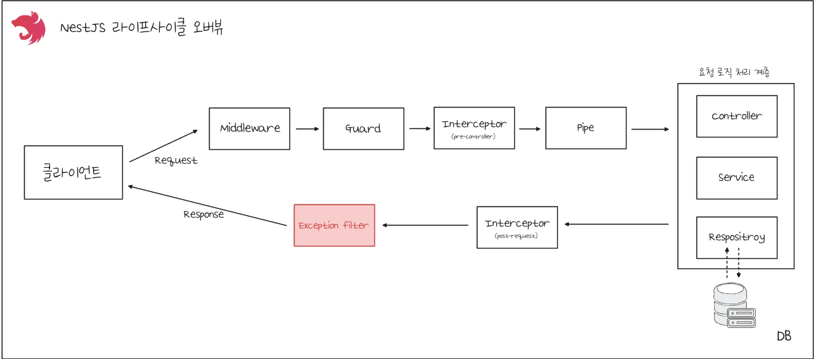
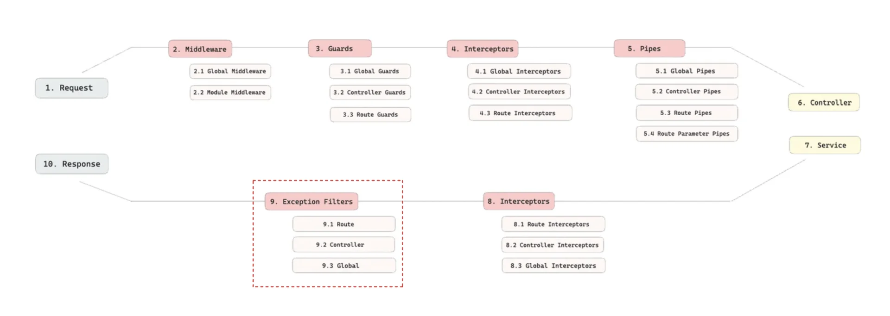
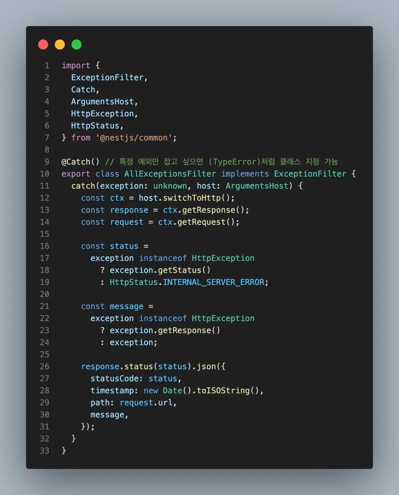
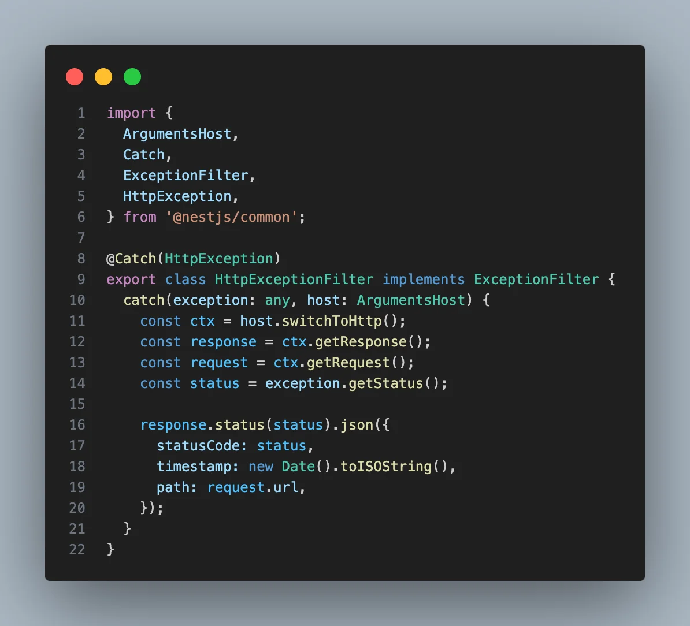

> 
> 
> <a id="282eda9b0fe1811db88dfbfe828cae4e"></a>
> 
> <strong>목차</strong>
> 
> - [Exception Filter](#282eda9b0fe1813baf20eecfd57f87ac)
> - [ Exception Filter 정의](#282eda9b0fe1815bb953f37881ee2220)
> - [ Exception Filter 등록](#282eda9b0fe181c79dfde91e43fda3a5)

<a id="282eda9b0fe1813baf20eecfd57f87ac"></a>

## Exception Filter

---

> 📖 
> 
> <a id="282eda9b0fe1813c8c84f37c2ab544d2"></a>
> 
> NestJS에서는 자체적으로 exception 계층을 관리한다&#46; 
> 
> <a id="282eda9b0fe180a39c5eecbfd9b93c59"></a>
> 
> 서버에서 발생한 예외를 따로 핸들링 되지 않으면, NestJS 예외 레이어에서 에러를 사용자 친화적으로 변환해서 응답 할 수 있다&#46;

> ✏️ 
> 
> <a id="282eda9b0fe1803da31acabf60ac5212"></a>
> 
> 실무 사용
> 
> - 전역 필터를  하나 두고, 공통 응답 포맷(에러 코드, 메세지, timestamp)을 정의한다&#46; 
> 
> - 커스텀 예외 클래스(<code>BusinessException</code>, <code>CustomHttpException</code>)를 만들어 <code>&#64;Catch</code>에 등록하면 더 상세한 exception 헨들링 처리가 가능하다&#46;
> 
> - gRPC, GraphQL, Websocket 같은 다른 transport는 ArgumentsHost에서 <code>switchToRpc()</code>, <code>switchToWs()</code>로 컨텍스트 접근하여 처리한다&#46; 





<a id="282eda9b0fe1815bb953f37881ee2220"></a>

###  Exception Filter 정의

> ✏️ 
> 
> <a id="282eda9b0fe18000abaec6c1ee3df3d6"></a>
> 
> NestJS에서 제공되는 <code>ExceptionFilter</code> 인터페이스를 implements 하여 <code>catch()</code> 메서드 내 exception response를 정의한다&#46;



<details>
<summary>&#91; 코드 &#93; AllExceptionsFilter</summary>

<a id="282eda9b0fe180828f84d29327665875"></a>

```typescript
import {
  ExceptionFilter,
  Catch,
  ArgumentsHost,
  HttpException,
  HttpStatus,
} from '@nestjs/common';

@Catch() // 특정 예외만 잡고 싶으면 (TypeError)처럼 클래스 지정 가능
export class AllExceptionsFilter implements ExceptionFilter {
  catch(exception: unknown, host: ArgumentsHost) {
    const ctx = host.switchToHttp();
    const response = ctx.getResponse();
    const request = ctx.getRequest();
		
		// 중복 제거
    const [status, message] =
      exception instanceof HttpException
        ? [exception.getStatus(), exception.getResponse()]
        : [HttpStatus.INTERNAL_SERVER_ERROR, exception];

    response.status(status).json({
      statusCode: status,
      timestamp: new Date().toISOString(),
      path: request.url,
      message,
    });
  }
}

```

</details>

<details>
<summary>예시) HttpExceptionFilter</summary>



<details>
<summary>&#91; 코드 &#93; HttpExceptionFilter</summary>

<a id="282eda9b0fe1811eb1a1e43b6198a660"></a>

```typescript
import {
  ArgumentsHost,
  Catch,
  ExceptionFilter,
  HttpException,
} from '@nestjs/common';

@Catch(HttpException)
export class HttpExceptionFilter implements ExceptionFilter {
  catch(exception: any, host: ArgumentsHost) {
    const ctx = host.switchToHttp();
    const response = ctx.getResponse();
    const request = ctx.getRequest();
    const status = exception.getStatus();

    response.status(status).json({
      statusCode: status,
      timestamp: new Date().toISOString(),
      path: request.url,
    });
  }
}
```

</details>

</details>

<a id="282eda9b0fe181c79dfde91e43fda3a5"></a>

###  Exception Filter 등록

> ✏️ 
> 
> - <code>APP&#95;FILTER</code>
> 
> - <code>&#64;UseFilters()</code>

<details>
<summary><strong>전역 ( Global ) 등록</strong></summary>

> 기본 에러 응답을 통일하고 싶은 경우 ( 보통 JSON 형태) 사용한다&#46; 

- <code>main&#46;ts</code> 에서 등록
    <a id="282eda9b0fe1809cb037e99e96af4e01"></a>

    ```typescript
    // main.ts
    async function bootstrap() {
      const app = await NestFactory.create(AppModule);

      // new를 직접
      app.useGlobalFilters(new AllExceptionsFilter());

      await app.listen(3000);
    }
    ```

- 모듈 단위 등록 ( DI 방식 )
    <a id="282eda9b0fe1804db9f2d3a885d609d3"></a>

    ```typescript
    // app.module.ts
    import { Module } from '@nestjs/common';
    import { APP_FILTER } from '@nestjs/core';
    import { AllExceptionsFilter } from './common/filters/all-exceptions.filter';

    @Module({
      providers: [
        {
          provide: APP_FILTER,
          useClass: AllExceptionsFilter,
        },
      ],
    })
    export class AppModule {}
    ```

</details>

<details>
<summary><strong>컨트롤러 단위 등록</strong></summary>

> 특정 도메인(API 그룹)에 특화된 에러 포맷을 정의하는 경우

<a id="282eda9b0fe18025a258ce0c8271faa6"></a>

```typescript
import { Controller, Get, UseFilters } from '@nestjs/common';

@Controller('users')
@UseFilters(AllExceptionsFilter)
export class UsersController {
  @Get()
  findAll() {
    throw new Error('Something broke');
  }
}

```

</details>

<details>
<summary>라우트 단위 등록</summary>

> 특정 요청에서만 별로 핸들링이 필요한 경우

<a id="282eda9b0fe180e580b3e134f6d64463"></a>

```typescript
@Controller('users')
export class UsersController {
  @Get()
  @UseFilters(AllExceptionsFilter)
  findAll() {
    throw new Error('Broken route');
  }
}
```

</details>
