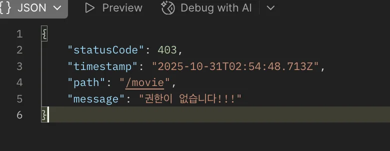

> 
> 
> <a id="29deda9b0fe1806caaefc119183ba9af"></a>
> 
> <strong>목차</strong>
> 
> - [문제점](#29deda9b0fe180d6bf0bf05b12124193)
> - [원인 ](#29deda9b0fe18047953af2d2743523a8)
> - [의문점 - 생성자 주입(DI) 와 메서드의 파라미터로 받는 것과 어떤 차이점이 있나?](#29deda9b0fe180ed98d6f750838d1119)
> - [해결 ](#29deda9b0fe1806cbfbfcbdebe488861)

<a id="29deda9b0fe180d6bf0bf05b12124193"></a>

## 문제점

> ✏️ 
> 
> <a id="29deda9b0fe180a18e70e6618eb6ddb6"></a>
> 
> RBAC( Role Based Access Control ) 구현 과정 중 권한 예외 필터(<code>ForbidenExceptionFilter</code>)를  추가 확장하여 exception response를 정의했다&#46; 
> 
> <details>
> <summary>응답 형태</summary>
> 
> 
> 
> </details>
> 
> ---
> 
> <a id="29deda9b0fe180bab1c9e3a61e14dadf"></a>
> 
> 여기에 오류 응답에 대한 더 명확안 메세지 설정을 위해 role 값까지 출력되도록 확장했다&#46; 
> 
> <a id="29deda9b0fe1804db88fdbb7aee11a37"></a>
> 
> 이에따른 ExecutionContext를 DI 받아 Role 데코레이터를 읽어 매핑되는 Role을 가져오려고 했더니 아래와 같은 오류가 발생되었다&#46; 

<details>
<summary>오류 메세지</summary>

<a id="29deda9b0fe1804e87a4ea703c4202e2"></a>

```typescript
[Nest] 13482  - 2025. 10. 31. 오후 12:08:22   ERROR [ExceptionHandler] UnknownDependenciesException [Error]: Nest can't resolve dependencies of the ForbiddenExceptionFilter (Reflector, ?). Please make sure that the argument Object at index [1] is available in the AppModule context.

Potential solutions:
- Is AppModule a valid NestJS module?
- If Object is a provider, is it part of the current AppModule?
- If Object is exported from a separate @Module, is that module imported within AppModule?
  @Module({
    imports: [ /* the Module containing Object */ ]
  })

    at Injector.lookupComponentInParentModules (/Users/igyeongseob/Develop/backend/nestJS/netflix_clone/node_modules/.pnpm/@nestjs+core@11.1.6_@nestjs+common@11.1.6_class-transformer@0.5.1_class-validator@0.14._6b43ae8343efe3323bb5fcd8a3d61ef5/node_modules/@nestjs/core/injector/injector.js:286:19)
    at async resolveParam (/Users/igyeongseob/Develop/backend/nestJS/netflix_clone/node_modules/.pnpm/@nestjs+core@11.1.6_@nestjs+common@11.1.6_class-transformer@0.5.1_class-validator@0.14._6b43ae8343efe3323bb5fcd8a3d61ef5/node_modules/@nestjs/core/injector/injector.js:141:38)
    at async Promise.all (index 1)
    at async Injector.resolveConstructorParams (/Users/igyeongseob/Develop/backend/nestJS/netflix_clone/node_modules/.pnpm/@nestjs+core@11.1.6_@nestjs+common@11.1.6_class-transformer@0.5.1_class-validator@0.14._6b43ae8343efe3323bb5fcd8a3d61ef5/node_modules/@nestjs/core/injector/injector.js:169:27)
    at async Injector.loadInstance (/Users/igyeongseob/Develop/backend/nestJS/netflix_clone/node_modules/.pnpm/@nestjs+core@11.1.6_@nestjs+common@11.1.6_class-transformer@0.5.1_class-validator@0.14._6b43ae8343efe3323bb5fcd8a3d61ef5/node_modules/@nestjs/core/injector/injector.js:75:13)
    at async Injector.loadProvider (/Users/igyeongseob/Develop/backend/nestJS/netflix_clone/node_modules/.pnpm/@nestjs+core@11.1.6_@nestjs+common@11.1.6_class-transformer@0.5.1_class-validator@0.14._6b43ae8343efe3323bb5fcd8a3d61ef5/node_modules/@nestjs/core/injector/injector.js:103:9)
    at async /Users/igyeongseob/Develop/backend/nestJS/netflix_clone/node_modules/.pnpm/@nestjs+core@11.1.6_@nestjs+common@11.1.6_class-transformer@0.5.1_class-validator@0.14._6b43ae8343efe3323bb5fcd8a3d61ef5/node_modules/@nestjs/core/injector/instance-loader.js:56:13
    at async Promise.all (index 9)
    at async InstanceLoader.createInstancesOfProviders (/Users/igyeongseob/Develop/backend/nestJS/netflix_clone/node_modules/.pnpm/@nestjs+core@11.1.6_@nestjs+common@11.1.6_class-transformer@0.5.1_class-validator@0.14._6b43ae8343efe3323bb5fcd8a3d61ef5/node_modules/@nestjs/core/injector/instance-loader.js:55:9)
    at async /Users/igyeongseob/Develop/backend/nestJS/netflix_clone/node_modules/.pnpm/@nestjs+core@11.1.6_@nestjs+common@11.1.6_class-transformer@0.5.1_class-validator@0.14._6b43ae8343efe3323bb5fcd8a3d61ef5/node_modules/@nestjs/core/injector/instance-loader.js:40:13 {
  type: 'ForbiddenExceptionFilter',
  context: {
    index: 1,
    dependencies: [
      [class Reflector],
      [Function: Object]
    ],
    name: [Function: Object]
  },
  metadata: {
    id: 'e3d2e2c338df10383fd91'
  },
  moduleRef: {
    id: 'f3e2ff3cc567e581f6d9a'
  }
}

```

</details>

<details>
<summary>문제 발생 코드</summary>

<a id="29deda9b0fe1801aa33df76b790308af"></a>

```typescript
import {
  ArgumentsHost,
  Catch,
  ExceptionFilter,
  ExecutionContext,
  ForbiddenException,
} from '@nestjs/common';
import { Reflector } from '@nestjs/core';
import { RBAC } from 'src/auth/decorator/rbac.decorator';
import { Role } from 'src/user/entities/user.entity';

@Catch(ForbiddenException)
export class ForbiddenExceptionFilter implements ExceptionFilter {
  constructor(
    private readonly reflector: Reflector,
    private readonly context: ExecutionContext,
  ) {}

  catch(exception: any, host: ArgumentsHost) {
    const ctx = host.switchToHttp();
    const response = ctx.getResponse();
    const request = ctx.getRequest();

    // user
    const currentUserRole = request.user.role;

    // activate RBAC role
    const requiredRole = this.reflector.get<Role>(
      RBAC,
      this.context.getHandler(),
    );

    console.log('currentUserRole:', currentUserRole);
    console.log('requiredRole:', requiredRole);

    const status = exception.getStatus();

    console.log(`[UnauthorizedException] ${request.method} ${request.path}`);

    response.status(status).json({
      statusCode: status,
      timestamp: new Date().toISOString(),
      path: request.url,
      message: `권한이 없습니다 - currentUserRole: ${currentUserRole}, requiredRole: ${requiredRole}`,
    });
  }
}

```

</details>

<a id="29deda9b0fe18047953af2d2743523a8"></a>

## 원인 

> ❗ 
> 
> <a id="29deda9b0fe180e69b0aca000f73820f"></a>
> 
> <code>ExecutionContext</code>는 런타임에서 HTTP(or RPC, WebSocket) 요청마다 즉석에서 생성되는 ‘스코프 객체’이다 따라서 생성자 주입이 불가능하다&#46;
> 
> <a id="29deda9b0fe1804e84e2d27adf4878e2"></a>
> 
> NestJS의 의존성 주입(Dependency Injection, DI) 컨테이너는 주입 범위가 명확한 객체만 다를 수 있으며, 요청 컨텍스트(ExecutionContext)는 해당 범주에 속하지 않는다&#46; 
> 
> <a id="29deda9b0fe1806baaccf46a850b3fef"></a>
> 
> 만약 <strong><u>생성자</u></strong>에  <strong><u>ExecutionContext 타입</u></strong><strong><u>을 정의</u></strong>하면 Nest가 이를 provider token으로 잘못 해석해 <strong><code>UnknownDependenciesException</code></strong>이 발생된다&#46; 

<a id="29deda9b0fe180ed98d6f750838d1119"></a>

### 의문점 &#45; 생성자 주입(DI) 와 메서드의 파라미터로 받는 것과 어떤 차이점이 있나?

> 
> 
> <a id="29deda9b0fe1809889d8d7de76460f45"></a>
> 
> <strong>ExecutionContext</strong>
> 
> <a id="29deda9b0fe18077bd69d4b2047b2901"></a>
> 
> <code>ExecutionContext</code>는 <strong><u>핸들러 실행 ‘직전’ 프레임워크가 매 요청마다 동적으로 생성</u></strong>해 필터, 가드, 인터셉터의 <code>canActivate</code>, <code>catch</code>, <code>intercept</code> 등의 메서드 첫번째 인자로 전달된다&#46;
> 
> - Nest 내부에서 ExecutionContext는 <strong><u>런타임 매개변수(Parameter)로 취급</u></strong>되며 DI 시스템에 provider로 등록되지 않는다&#46; 

<a id="29deda9b0fe1806cbfbfcbdebe488861"></a>

## 해결 

<a id="29deda9b0fe180599ed6c2d8ab55713f"></a>

필터, 가드, 인터셉터 내부에서는 항상 ArgumentsHost 인스턴스 → getHandler()/getClass() 메서드를 통해 현재의 route handler(메서드)/controller(클래스) 레퍼런스를 얻어야 합니다&#46;<br>•	Reflector 유틸리티의 <code>getAllAndOverride</code> (혹은 <code>get</code>)을 사용해 커스텀 데코레이터(예&#58; &#64;Roles())로 부착된 메타데이터를 안전하게 조회할 수 있습니다&#46;<br>•	이 과정 어디서도 ExecutionContext를 “생성자 주입”하지 않으며, 항상 (메서드 내) 인자로 받아 활용합니다&#46;

<a id="29deda9b0fe18009b9dad772f87bdf01"></a>

```typescript
constructor(private reflector: Reflector) {}

canActivate(context: ExecutionContext): boolean {
  const roles = this.reflector.getAllAndOverride<string[]>('roles', [
    context.getHandler(),
    context.getClass(),
  ]);
  // ... RBAC 권한 검사 로직
}

```

- <code>Reflector</code>는 생성자 주입 대상이지만, <code>ExecutionContext</code>는 아닙니다&#46;

- 이 원칙은 필터, 인터셉터 등 NestJS 주요 미들웨어 추상화 전부에 일관 적용됩니다&#46;

<a id="29deda9b0fe18012acdae6426e361ad7"></a>

<br>ExecutionContext 생성자 주입이 불가능한 이유<br>•	ExecutionContext는 핸들러 실행 ‘직전’ 프레임워크가 매 요청마다 조립해서, 필터/가드/인터셉터 등에 <code>canActivate</code>, <code>catch</code>, <code>intercept</code> 등의 메서드 첫 번째 인자로 전달됩니다&#46;<br>•	생성자 주입은 싱글턴 혹은 주입 스코프별 인스턴스의 불변성을 전제로 하므로, 동적으로 바뀌는 ExecutionContext에는 부적합합니다&#46;<br>•	Nest 내부에서 ExecutionContext는 런타임 매개변수(Parameter)로 취급되며 DI 시스템에 provider로 등록되지 않습니다&#46;<br>필터 및 가드에서 메타데이터(RBAC 역할) 읽는 방법<br>•	필터, 가드, 인터셉터 내부에서는 항상 ArgumentsHost 인스턴스 → getHandler()/getClass() 메서드를 통해 현재의 route handler(메서드)/controller(클래스) 레퍼런스를 얻어야 합니다&#46;<br>•	Reflector 유틸리티의 <code>getAllAndOverride</code> (혹은 <code>get</code>)을 사용해 커스텀 데코레이터(예&#58; &#64;Roles())로 부착된 메타데이터를 안전하게 조회할 수 있습니다&#46;<br>•	이 과정 어디서도 ExecutionContext를 “생성자 주입”하지 않으며, 항상 (메서드 내) 인자로 받아 활용합니다&#46;

<a id="29deda9b0fe18024b30adf29e8b630fc"></a>

ExecutionContext를 메서드의 파라미터(예&#58; canActivate(context&#58; ExecutionContext))로는 쓸 수 있지만, 생성자 주입(DI)으로는 쓸 수 없는 근본적인 이유는 NestJS의 DI 동작 방식과 ExecutionContext의 생성 시점·스코프에 차이가 있기 때문입니다15&#46;

1. DI(의존성 주입)와 생성자 인스턴스의 관계<br>•	NestJS의 DI 컨테이너는 Provider를 클래스 단위(싱글턴, 요청 스코프 등)로 미리 등록하고, Application 부팅 시 한 번만 인스턴스를 생성하거나, 요청/트랜젝션 단위로 적절히 인스턴스를 조립합니다3&#46;<br>•	생성자에 주입하는 값들은 “애플리케이션 레벨의 불변 의존성”이어야 하며, 각 요청의 상태에 따라 다르게 바뀌지 않습니다&#46;

1. ExecutionContext의 생성 타이밍과 성격<br>•	ExecutionContext는 각 요청(request)이 들어올 때마다 Nest 프레임워크가 “즉석”에서 (러닝타임에) 만들어 넣어 주는 객체입니다&#46;<br>•	이 객체는 요청마다 달라지는 값을 포함하므로, 클래스를 미리 생성할 때(=DI 시점) 알 수 있는 값이 아닙니다1&#46;<br>•	NestJS는 미리 ExecutionContext를 준비하거나 저장하지 않고, 매 요청마다 각 핸들러나 미들웨어 체인에서만 필요에 따라 제공하게 설계되어 있습니다&#46;

1. 생성자 주입(DI)과 메서드 파라미터의 차이<br>•	생성자 인자로 DI되는 객체는 “전역적이거나 모듈 레벨에서 한 번 정의”되어 여러 요청 간에 재사용됩니다&#46; 이런 객체들(예&#58; Service, Repository, Reflector 등)은 어떤 요청이 들어와도 일관된 인스턴스입니다&#46;<br>•	ExecutionContext와 같이 “각 요청별 동적 객체”는 Nest가 자동으로 각 요청별로 새로운 인스턴스를 만들어 메서드 파라미터로만 주입할 수 있습니다&#46;<br>•	메서드 파라미터로 넘기는 값은 실행 순간마다 다를 수 있지만, DI로 주입하는 값은 클래스 생애주기 범위 내에서는 변하지 않는 것이어야 합니다1&#46;

1. 비유<br>•	“Singleton(Provider)” 객체가 DI로 들어가는 것은 학교에서 한 번 정한 담임선생님처럼 계속 같다&#46;<br>•	“ExecutionContext”는 매 교시마다 들어오는 과목별 선생님처럼, 그때그때 바뀌는 동적인 의사결정자라 볼 수 있습니다&#46;<br>결론<br>ExecutionContext는 요청(런타임)마다 바뀔 수 있으므로, NestJS의 DI 컨테이너가 관리/주입할 수 없습니다&#46; 따라서, 반드시 필요한 “핸들러 메서드의 첫 번째 인자”로만 받을 수 있습니다&#46; 이와 달리, Reflection 도구(Reflector), 서비스 등은 변하지 않기 때문에 생성자(DI)로 주입하는 것이 맞습니다15&#46;
