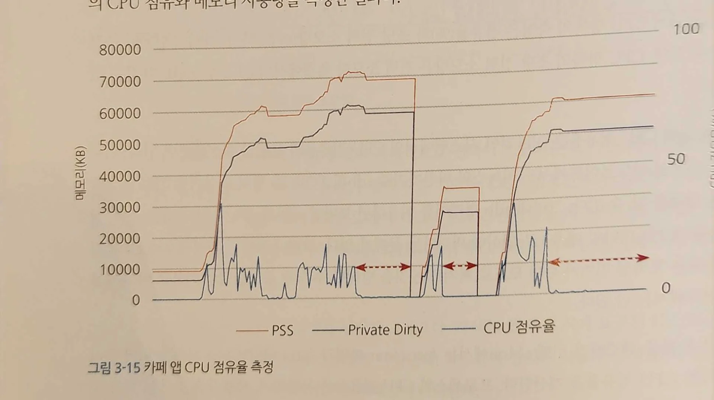
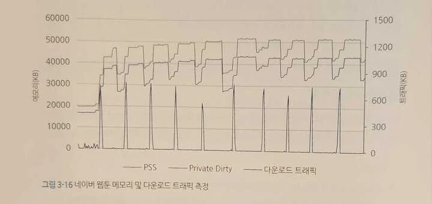

> 
> 
> 
> 
> 목차
> 
> - [rMon](#289eda9b0fe180618305c6e005dd177a)
> - [CPU 점유율](#289eda9b0fe180b98c53c475b1e958ee)
> - [메모리 사용량 측정](#289eda9b0fe1809e9aaccdedf56183ab)
> - [ PSS](#289eda9b0fe180d6b5e2d6d19ba9fa9f)
> - [ Private Dirty](#289eda9b0fe180de944bc2b96a6501ca)
> - [ Shared Dirty](#289eda9b0fe180159115f7774fdbc9c5)

### rMon

네이버 모바일 앱에서 사용한 모니터링 도구 이다&#46; ( 2015년 출간, 레거시한 버전일 가능성 높음 )

> <strong>CPU, LCDm Wi&#45;Fi, GPS 컴포넌트의 전략 소모량 측정 &#45;&#62; 소모 패턴 분석</strong>

측정값 보다는 <strong><u>비정상적이거나 불필요한 소모 패턴이 발생되는지 확인</u></strong>하는 것이 중요하다&#46;

- 측정 결과를 분석해 특이한 소모 패턴이 지속적으로 유지되지는 않는지,

- 지나치게 전력 소모가 높거나 의도하지 않은 소모 패턴이 보이지 않는지

확인해야 한다&#46;

## CPU 점유율

---

리눅스&#58; adb의 TOP, PS 명령어로 CPU 율 점유율과 상태를 알 수 있다&#46;

프로세스의 CPU 점유율은 운영체제, 사용자 프로세스, 대기 상태에서 소비된 총 시간에서 실제로 사용자 프로세스가 사용한 CPU 시간의 비율로 구할 수 있다&#46;

- 안드로이드 기준 전체 시간은 proc/stat 파일에서 jiffies 변수로 알아낼 수 있다&#46;
    - jiffies는 커널 내 전역 변수로, 시스템에서 주파수(Hz)의 값만큼 인터럽트가 발생되는 jiffies는 그 인터럽트가 발생될 때마다 1씩 증가하는 값을 저장한다&#46;

- ex)  프로세스가 사용한 CPU 시간
    - 해당 프로세스가 사용자 모드에서 실행된 시간과 커널 모드로 실행된 시간을 더해 알 수 있다&#46;
        - &#45;&#62;  프로세서 Hz 1000 &#43; jiffies 400 &#45;&#62; jiffies = 1400 &#58; 1초가 지남

    - 해당 값은 /poc/&#60;pid&#62;/stat 파일의 프로세스에서 
        - CPU를 점유한 시간을 나타내는 utime(사용자의 CPU 점유 시간), 

        - stime(시스템의 CPU 점유시간)의 jiffies 값

        

        을 통해 구한다&#46;

> ✏️ 
> 
> 
> 
> <strong>초당 프로세스의 CPU 점유율 </strong>
> 
> > <strong><code>100 &#42; ( utime &#43; stime &#43; cutime &#43; cstime ) / 총 시간</code></strong>
> 
> - <strong><code>utime</code></strong>&#58; user CPU time, 사용자 CPU 점유 시간&#46;
> 
> - <strong><code>stime</code></strong>&#58; system CPU time, 시스템 CPU 점유 시간&#46;
> 
> - <strong><code>cutime</code></strong> &#58; children’s user CPU time, 자식 프로세스의 사용자 CPU 점유 시간&#46;
> 
> - <strong><code>cstime</code></strong>&#58; children’s user CPU time, 자식 프로세스의 시스템 CPU 점유 시간&#46;

 즉, 전체 CPU 시간 중 프로세스가 점유한 시간 비율을 의미한다&#46; 

이 값을 ps 명령어로 얻을 수 있는 값과 같지만, TOP 명령어로 확인하는 값과는 계산 방법에서 차이가 있어 결과가 다를 수 있다&#46;

- abs로 PS나 TOP 로 측정한 것보다 더욱 정확한 1% 미만의 점유율까지 측정 가능하다&#46; 

- 모바일 환경에서는 abs 명령어 자체가 모바일 기기의 성능에 큰 부담을 주며, 점유율이 1% 미만인 경우 0%로 인식해 버리는 문제점이 있다&#46; 

- <strong><u>모바일 환경에서는 </u></strong><strong><u><code>0&#46;x%의 점유율</code></u></strong><strong><u>은 모바일 기기가 수면모드로 빠져드는 것을 방해할 수 있는 중요한 수치</u></strong>이므로 이를 해결하기위해 위의 방법을 사용한다&#46; 

- 위 그래프는 rMon 을 사용해 카폐 앱에서 스크롤, 더보기, 메뉴 이동 등의 테스트 동작을 수행했을 때의 CPU 점유와 메모리 사용량을 측정한 결과이다&#46;

사용자의 동작에 따라 메모리 사용량과 CPU 점유율이 상승했다&#46; 

- 빨간색 화살표로 표시한 부분을 보면 일정 대기 시간 동안 메모리 사용은 유지하면서 CPU 점유는 일어나지 않았다&#46; 

- 앱을 강제 종료하면 할당된 메모리를 해제하고, 다시 실행하면 메모리와 CPU의 수치가 올라간다&#46; 

위 그래프에서는 문제가 될 만한 특이사항이 없지만, 높은 CPU 점유가 지속적 또는 주기적인 패턴이 보이는 경우 문제 상황으로 인식하고 해결해야 한다&#46; 

## 메모리 사용량 측정

---

rMon 에서는 기본적으로 <code>PSS</code>(proportional set size),  <code>Private Dirty</code>, <code>Shared Dirty</code> 라는 3가지 메모리 사용량을 측정한다&#46; 

- 안드로이드 시스템에서 제공되는 메모리 정보는 PSS와 동일하다&#46; 

###  PSS

> <strong>Private Dirty &#43; ( Shared Dirty / 실행 프로세스 수 )</strong>

프로세스가 독립적으로 사용하는 Private Dirty 의 수치와 공유 메모리 중 하나의 프로세스가 차지하는 메모리를 합산한 값이다&#46; 

안드로이드 모바일 기기에서 사용자가 확인할 수 있는 메모리 사용량과 동일한 값이다&#46; 

테스트 관점에서 가장 주의 깊게 봐야하는 수치이다&#46; 

###  Private Dirty

측정 애플리케이션에서 사용하는 고유한 할당 메모리 수치다&#46; 

단일 프로세스에 할당되는 독자적인 측정 값이다&#46; 

###  Shared Dirty

여러 프로세스가 공유하는 메모리 수치다&#46; 

모바일 기기의 상태나 로딩된 애플리케이션에 따라 변동이 발생할 수 있다&#46; 

Shared Dirty는 측정에 사용되는 모바일 기기의 현재 구동 중인 애플리케이션과 프로세스 수에 따라 영향을 받는 항목이기 때문에 단일 애플리케이션의 메모리를 측정할 때는 크게 비중을 두지 않는다&#46; 

> ✏️ 
> 
> 
> 
> adb로도 메모리 상태 확인이 가능하다&#46; 
> 
> 
> 
> adb의 <code>dumpsys meminfo</code> 명령어를 사용하면 전체 앱 또는 각 앱에서 사용되는 메모리 상태를 확인할 수 있으며, 이렇게 얻은 값은 rMon으로 측정되는 값과 동일하다&#46;  
> 
> 
> 
> 다만 rMon 사용 시, <em><strong><u>메모리 외 다른 리소스 항목들을 함께 측정 </u></strong></em>할 수 있으며, <em><strong><u>의존성 및 패턴 분석이 가능 </u></strong></em>하다&#46; 

위 그래프는 네이버 웹툰의 메모리 사용량과 다운로드 트래픽을 측정한 사례다&#46; 

- 테스트 시나리오에 따라 특정 데이터를 다운로드 및 조회 반복

회차별 보기를 반복하는 동작으로 데이터가 요청되면서 다운로드 트래픽이 반복되며, 그에따라 메모리 상승 과 반환이 발생되었다&#46; 

이를 통해 트래픽 항목과 메모리 항목이 서로 영향을 준다는 것을 알 수 있다&#46; 

> ❗ 
> 
> 
> 
> 위 그래프에서 Shared Dirty 값이 생략되었다&#46; 
> 
> 
> 
> 일반적으로 Shared Dirty 값은 보고되지 않는데, 이는 측정에 사용되는 모바일 기기의 현재 구동 중인 애플리케이션 프로세스 수에 따라 영향받아 일관적이지 않기 떄문이다&#46;
