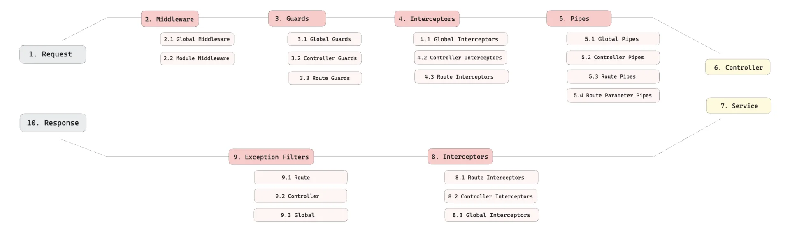

> /icons/tag_red.svg 
> 
> <a id="28aeda9b0fe18188ada9fdf5643ce088"></a>
> 
> &#91;인프런&#93; <strong> 한 번에 끝내는 NestJS 패키지 &#45; 기초부터 MSA까지</strong>
> 
> - 기간&#58; 25&#46;0&#46;0(일) &#126; 25&#46;0&#46;(일)
> 
> - 강의&#58; ‣
> 
> - reference&#58;
>     - <a href="https://beautiful-college-c84.notion.site/13422bf2cf2a80a79551ca55baa9c03d">페이지</a> 
> 
>     - ‣

<details>
<summary>Template</summary>

> 

> ✏️ 

> 📖 

> 
> 
> <a id="28aeda9b0fe181bfa2ffcafea061b6ec"></a>
> 
> <strong>목차</strong>
> 
> - [ Part. 2  - MSA](#28aeda9b0fe181d1a397e2aec94a9ab3)

<details>
<summary>&#91; 코드 &#93;</summary>

<a id="28aeda9b0fe1814786befc088092ee85"></a>

```typescript

```

</details>

[Template ( )](#/post/28aeda9b-0fe1-8164-a0fd-dd10399cc708)

[제목 없음](#/post/28aeda9b-0fe1-8184-9116-e12d5bef2c96)

[[ 실습 ]](#/post/28aeda9b-0fe1-81b5-82e4-ea33840fd8a8)

[[ 의문점 ]](#/post/28aeda9b-0fe1-8102-8062-cec86bce7ead)

</details>




<a id="28aeda9b0fe181d1a397e2aec94a9ab3"></a>

##  Part&#46; 2  &#45; MSA
