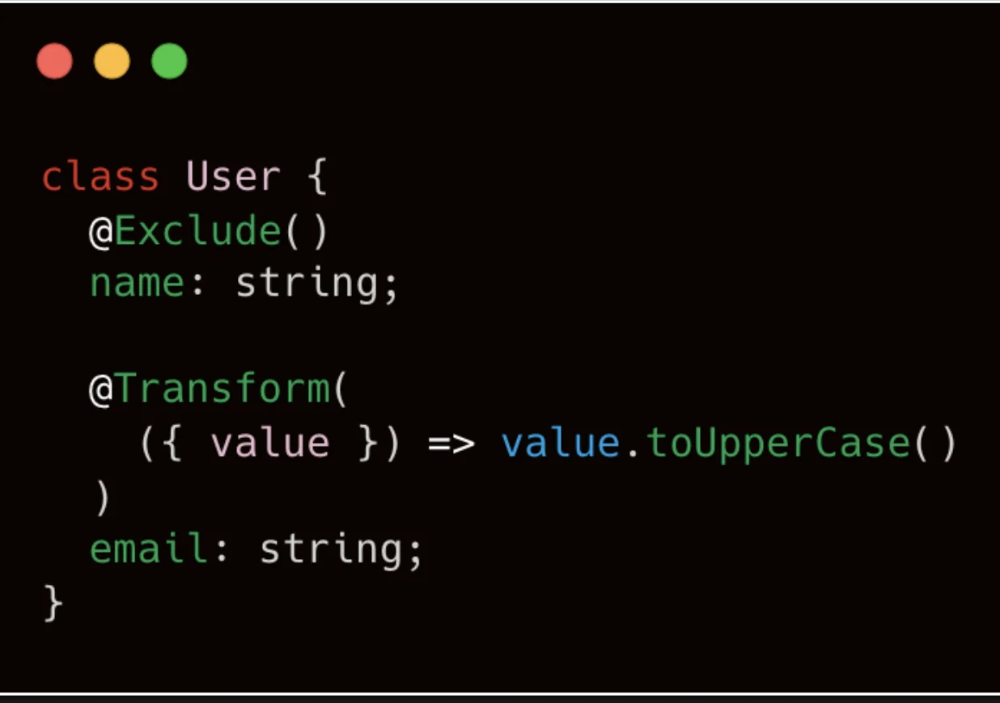
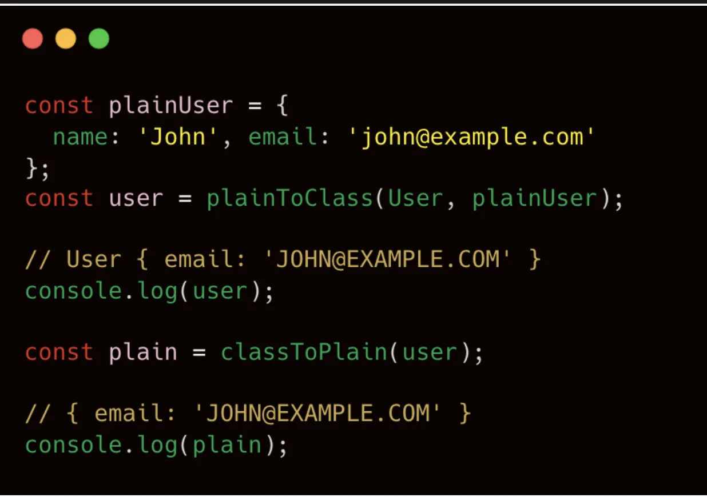

> 
> 
> <a id="28ceda9b0fe18044bbb8e16d2f3fae22"></a>
> 
> <strong>목차</strong>
> 
> - [변환 ( Class Transformer )](#28ceda9b0fe180588548c9e928b95f8f)
> - [ Class Transformer 예제](#28ceda9b0fe180668a12e3133be3324e)
> - [ 주요 데코레이터](#28ceda9b0fe18072a41fccb1321f6fdc)
> - [ 중첩 클래스 변환](#28ceda9b0fe18021b50bffa2b5a1fcb2)
> - [ Custom Transformer](#28ceda9b0fe180dab5a3d8b578224019)

<a id="28ceda9b0fe180588548c9e928b95f8f"></a>

## 변환 ( Class Transformer )

---

> 📖 
> 
> <a id="28ceda9b0fe1808d962af8be0a48435b"></a>
> 
> NestJs의 class&#45;transformer 는 요청, 응답 과정에서 객체를 지정된 클래스 직렬화 하거나, 역직렬화, 타입 변환 등 변환 작업을 담당하는 유틸리티 라이브러리이다&#46; 

> ❗ 
> 
> <a id="28ceda9b0fe18041a912eda94b61f3c4"></a>
> 
> Class Transformer 특성
> 
> - TS Decorator를 사용해 클래스를 변환한다&#46;  ( transformer → validate )
> 
> - 직렬화(Serialization), 역직렬화(Deserialization), 인스턴스 변환 담당
> 
> - 중첩된 ( Nested ) 객체에도 매우 쉽게 적용 가능
> 
> - 커스텀 Transformer로  제약 없이 변환 가능

<a id="28ceda9b0fe180668a12e3133be3324e"></a>

###  Class Transformer 예제

<details>
<summary>1&#46; 일반 객체 사용 예제</summary>



<a id="28ceda9b0fe1804a8b03fef82b2482a1"></a>

변환하고 싶은 프로퍼티에 데코레이터로 명시



<a id="28ceda9b0fe18031ae0def52617de5f7"></a>

<code>plainToClass()</code>, <code>classToPlain()</code> 메서드를 통해 Transformer로 명시한 변환 가능

</details>

<details>
<summary>2&#46; 요청 DTO 변환 및 검증</summary>

1. ValidationPipe 글로벌 스코프로 등록
    <a id="28ceda9b0fe1800a8fecdb5ce61239ba"></a>

    ```typescript
    // main.ts
    import { ValidationPipe } from '@nestjs/common';

    ...

    app.useGlobalPipes(new ValidationPipe({ transform: true }));
    ```

    - 이렇게 글로벌로 등록 시 <code>&#64;Query()</code>, <code>&#64;Body()</code>로 받은 JSON이 자동으로 DTO 클래스 형태로 변환된다&#46; 

1. 응답 변환 (Interceptor 기반)
    <a id="28ceda9b0fe1809e9d64e2fd2194b816"></a>

    ```typescript
    import { plainToInstance } from 'class-transformer';
    import { map } from 'rxjs';

    @Injectable()
    export class ResponseInterceptor<T> implements NestInterceptor<any, T> {
      constructor(private readonly dto: new () => T) {}
      intercept(ctx: ExecutionContext, next: CallHandler) {
        return next.handle().pipe(
          map((data) => plainToInstance(this.dto, data, { excludeExtraneousValues: true }))
        );
      }
    }
    ```

    - 응답 데이터에서 노출할 필드만 남기고 비밀번호 같은 민감한 데이터 제거에 유용하다&#46;

</details>

<a id="28ceda9b0fe18072a41fccb1321f6fdc"></a>

###  주요 데코레이터

> ✏️ 
> 
> - <code>&#64;Transform()</code>&#58; 변환 시 특정 로직(ex&#46; 문자열 → 숫자) 적용
> 
> - <code>&#64;Type(() ⇒ TargetClass)</code>&#58; 중첩 객체나 배열을 특정 클래스 타입으로 변환
> 
> - <code>&#64;Expose()</code>&#58; 변환 결과에 필드를 포함
> 
> - <strong><code>&#64;Exclude()</code></strong>&#58; 변환 결과에서 <strong><u>해당 필드를 제외  (필터링)</u></strong>

<details>
<summary>코드 예제</summary>

<a id="28ceda9b0fe1803daf5fc8a09db29903"></a>

```typescript
import { Expose, Exclude, Transform } from 'class-transformer';

class User {
  @Expose() id: number;

  @Exclude() password: string;

  @Transform(({ value }) => value.toUpperCase())
  nickname: string;
}

```

</details>

<a id="28ceda9b0fe18021b50bffa2b5a1fcb2"></a>

###  중첩 클래스 변환

<a id="28ceda9b0fe180aeb152e452b4076eac"></a>

```typescript
class Address {
		city: string;
		country: string;		
}

class User {
		@Exclude()
		name: string;
		
		@Type(() => Address)
		email: string;
}
```

- 중첩된 객체 타입을 Type 데코레이터에 제공

<a id="28ceda9b0fe18066ad7bcc37221c703f"></a>

```typescript
const plainUser = {
		name: 'John',
		address: {
				city: "New York",
				country: "USA",
		}
};

const user = plainToClass(
		User, plainUser
);

// User { address: Address { city: 'New York', country: 'USA' } }
console.log(user.email);
```

- plainToClass를 실행 시 중첩된 객체도 Type 데코레이터에 입력된 클래스의 인스턴스로 변환된다&#46; 

<a id="28ceda9b0fe180dab5a3d8b578224019"></a>

###  Custom Transformer

<a id="28ceda9b0fe1800a881fe97b0b8cd8c2"></a>

```typescript
class User {
		@Exclude()
		name: string;
		
		@Transform(
				({ value }) => value.toLowerCase(),
		)
		email: string;
}
```

- Transform 데코레이터는 적용된 프로퍼티의 값을 인자로 제공해, 변환하고 싶은 형태롤 값을 반환 처리한다&#46; 

<a id="28ceda9b0fe18025a3c5ea4f173e0a9a"></a>

```typescript
const plainUser = {
		name: 'John',
		email: 'JOHN@EXAMPLE.COM'
};

const user = plainToClass(
		User, plainUser
);

// john@example.com
console.log(user.email);
```

- plainToClass 실행 시 중첩된 객체도 Type 데코레이터에 입력된 클래스 인스턴스로 변환된다&#46;
