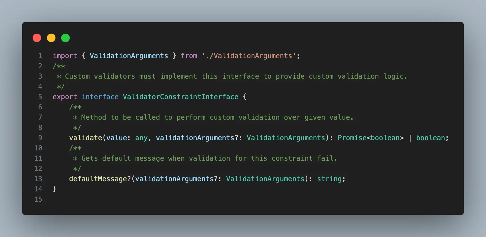
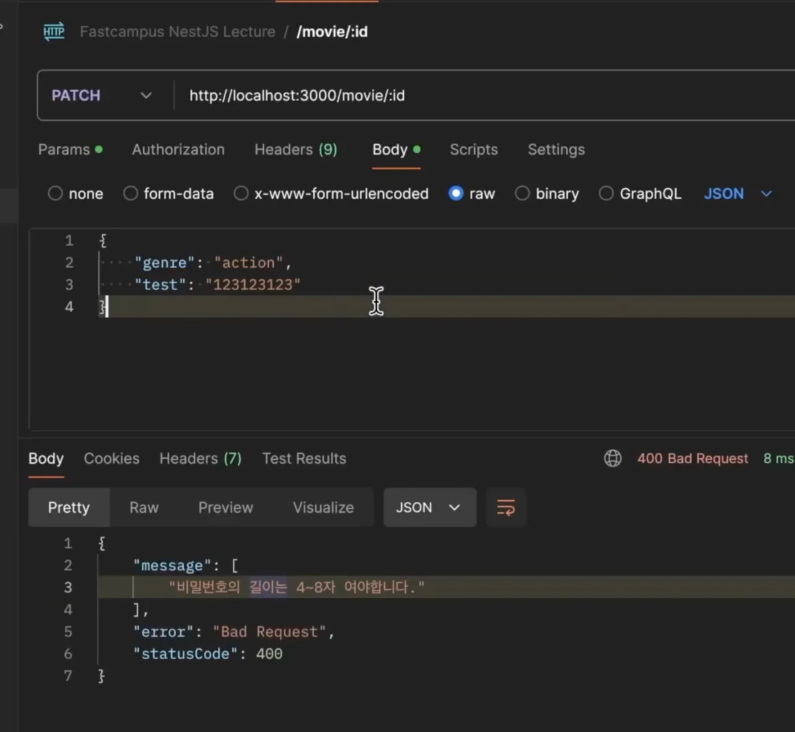
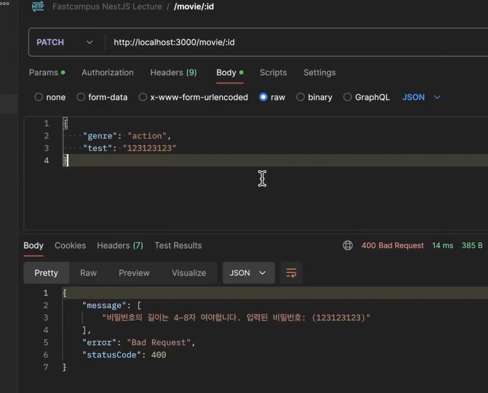
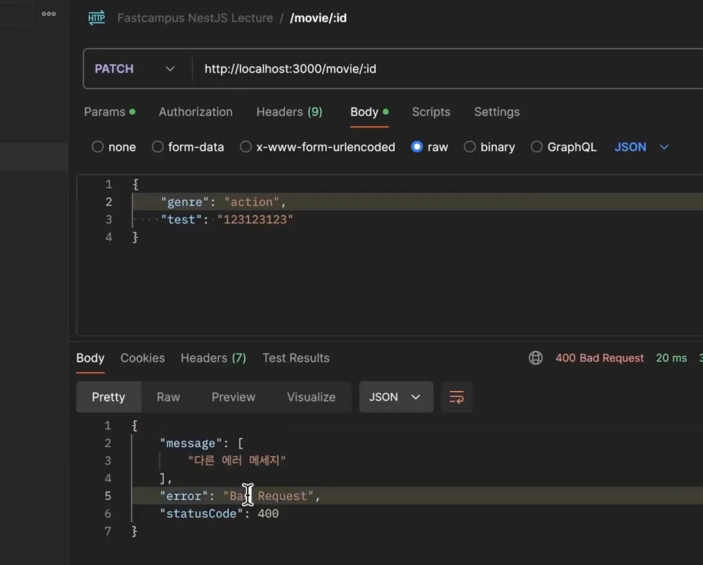

> 
> 
> <a id="28feda9b0fe1813fa8bffc5377eaa9eb"></a>
> 
> <strong>목차</strong>
> 
> - [Custom Validator ](#28feda9b0fe181e5b131d3d5152763e5)

<a id="28feda9b0fe181e5b131d3d5152763e5"></a>

## Custom Validator 

---

> 📖 
> 
> <a id="28feda9b0fe180fa85f3da9e343aa99d"></a>
> 
> 커스텀 Validator의 경우 class&#45;validator에서 제공하는 <strong><u><code>ValidatorConstraintInterface</code></u></strong><strong><u>를 implements</u></strong> 하여 정의한다&#46; 
> 
> <details>
> <summary><strong>&#91; 코드 &#93; ValidatorConstraintInterface</strong></summary>
> 
> > ✏️ 
> > 
> > - <code>validate()</code>&#58; 유효성 검사할 로직 정의
> > 
> > - <code>defaultMessage()</code>&#58; 예외 발생 시, 기본 메세지 정의
> 
> 
> 
> <details>
> <summary>&#91; 코드 &#93; ValidatorConstraintInterface</summary>
> 
> <a id="28feda9b0fe1805f9ac7ee2e7b9102f9"></a>
> 
> ```typescript
> import { ValidationArguments } from './ValidationArguments';
> /**
>  * Custom validators must implement this interface to provide custom validation logic.
>  */
> export interface ValidatorConstraintInterface {
>     /**
>      * Method to be called to perform custom validation over given value.
>      */
>     validate(value: any, validationArguments?: ValidationArguments): Promise<boolean> | boolean;
>     /**
>      * Gets default message when validation for this constraint fail.
>      */
>     defaultMessage?(validationArguments?: ValidationArguments): string;
> }
> 
> ```
> 
> </details>
> 
> </details>

<details>
<summary>1&#46; 커스텀 Validator 정의 &#45; <code>PasswordValidator</code></summary>

<a id="28feda9b0fe1807482d6cef978870e37"></a>

```typescript
import {
  ValidationArguments,
  ValidatorConstraint,
  ValidatorConstraintInterface,
} from 'class-validator';


@ValidatorConstrait()
export class PasswordValidator implements ValidatorConstraintInterface {
	
	// 유효성 검사: 비밀번호 길이: 4 - 8 사이
  validate(
    value: any,
    validationArguments?: ValidationArguments,
  ): Promise<boolean> | boolean {
    return value.length > 4 && value.length < 8;
  }
  
  // 예외 발생 시 기본 메세지 정의 
  defaultMessage?(validationArguments?: ValidationArguments): string {
    return '비밀번호의 길이는 4~7자 여야 합니다.';
  }
}
```

</details>

<details>
<summary>2&#46; DTO에 커스텀 Validator 적용</summary>

<a id="28feda9b0fe180b0b251dbf81dbe2383"></a>

```typescript
export class TestDto {
		
		. . .

		@Validate(PasswordValidator)
		password: string;  
}
```



</details>

<details>
<summary>2&#46;2 입력된 값 출력 가능 &#45; <code>&#36;value</code></summary>

> ✏️ 
> 
> <a id="28feda9b0fe180089bcaf6db57a35b84"></a>
> 
> <code>&#36;value</code> 사용 시 해당 필드의 value 값을 메세지에 출력 가능하다&#46; 

<a id="28feda9b0fe18002905af17286d025a8"></a>

```typescript
@ValidatorConstrait()
export class PasswordValidator implements ValidatorConstraintInterface {
	
	. . .
  
  // 예외 발생 시 기본 메세지 정의 
  defaultMessage?(validationArguments?: ValidationArguments): string {
    return '비밀번호의 길이는 4~7자 여야 합니다. 입력된 비밀번호: ($value)';
  }
}
```



</details>

<details>
<summary>2&#46;3 커스텀 에러 메세지 정의 &#45; <code>message</code> 인자 설정</summary>

<a id="28feda9b0fe180b9bcfec96ff7fedc39"></a>

```typescript
export class TestDto {
		
		. . .

		@Validate(PasswordValidator, {
				message: '다른 에러 메세지',		
		})
		password: string;  
}
```



- 응답값에 메세지 인자로 넘긴 string 값으로 오버라이딩되어서 출력되는 것을 확인할 수 있다&#46; 

</details>

<details>
<summary>3&#46; 커스텀 Validator 데코레이터로 등록 후 사용</summary>

- Validator 데코레이터로 래핑
    <a id="28feda9b0fe1808a8c4aea393a882d44"></a>

    ```typescript
    export function IsPasswordValid(validationOptions?: ValidationOptions) {
      return function (object: Object, propertyName: string) {
        registerDecorator({
          target: object.constructor,
          propertyName,
          options: validationOptions,
          validator: PasswordValidator,
        });
      };
    }
    ```

    <details>
    <summary>&#91; 전체 코드 &#93; PasswordValidator, IsPasswordValid</summary>

    <a id="28feda9b0fe180b39efff01822be14eb"></a>

    ```typescript
    import {
      registerDecorator,
      ValidationArguments,
      ValidatorConstraint,
      ValidatorConstraintInterface,
    } from 'class-validator';
    import { ValidationOptions } from 'joi';

    @ValidatorConstraint()
    class PasswordValidator implements ValidatorConstraintInterface {
      validate(
        value: any,
        validationArguments?: ValidationArguments,
      ): Promise<boolean> | boolean {
        // 비밀번호 길이: 4 - 8 사이
        return value.length > 4 && value.length < 8;
      }
      defaultMessage?(validationArguments?: ValidationArguments): string {
        return '비밀번호의 길이는 4~7자 여야 합니다.';
      }
    }

    export function IsPasswordValid(validationOptions?: ValidationOptions) {
      return function (object: Object, propertyName: string) {
        registerDecorator({
          target: object.constructor,
          propertyName,
          options: validationOptions,
          validator: PasswordValidator,
        });
      };
    }
    ```

    </details>

- 커스텀 Validator 데코레이터 사용
    <a id="28feda9b0fe18069951fc91d03767bdb"></a>

    ```typescript
    import { IsDefined, IsNotEmpty, IsString } from 'class-validator';
    import { IsPasswordValid } from 'src/common/validator/password.validator';

    export class TestDto {
      @IsPasswordValid()
      password: string;
    }

    ```

</details>

<details>
<summary>4&#46; 비동기 validator &#45; <code>async&#58; true</code> 옵션</summary>

> ✏️ 
> 
> <a id="28feda9b0fe180058cbafe38c4df53aa"></a>
> 
> async 옵션을 <code>true</code>로 설정 시, validator를 비동기(async)로 처리할 수 있다&#46;
> 
> - <strong>네트워크 요청, 데이터베이스 요청</strong> 등 <strong><u>I/O 작업 대기</u></strong>가 필요한 곳에 사용할 수 있다&#46;

<a id="28feda9b0fe180f8849ce80442c65bbd"></a>

```typescript
import {
  ValidationArguments,
  ValidatorConstraint,
  ValidatorConstraintInterface,
} from 'class-validator';


@ValidatorConstrait({
		async: true,
})
export class PasswordValidator implements ValidatorConstraintInterface {
	
	// 유효성 검사: 비밀번호 길이: 4 - 8 사이
  validate(
    value: any,
    validationArguments?: ValidationArguments,
  ): Promise<boolean> | boolean {
    ...
  }
  
  // 예외 발생 시 기본 메세지 정의 
  defaultMessage?(validationArguments?: ValidationArguments): string {
     ...
  }
}
```

</details>
