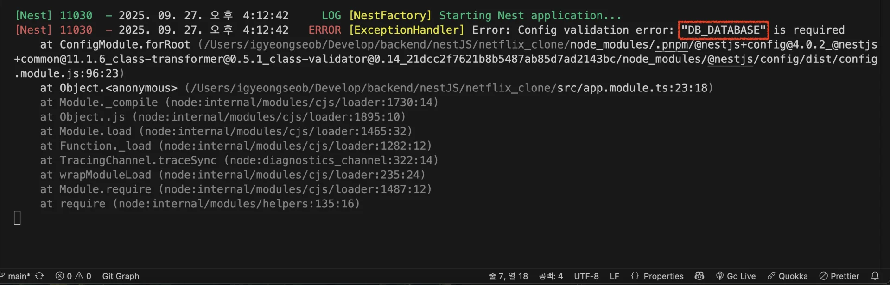
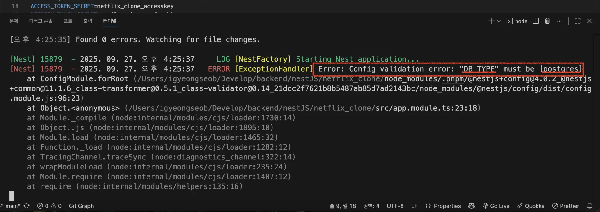

> 
> 
> <a id="28feda9b0fe1807aa359e525f5144133"></a>
> 
> <strong>목차</strong>
> 
> - [Class Transformer](#28feda9b0fe18016bb4de8659f815ea2)
> - [ 환경변수 유효성 검사](#28feda9b0fe18007bfe4e3da83414c60)

<a id="28feda9b0fe18016bb4de8659f815ea2"></a>

## Class Transformer

---

> ✏️ 
> 
> <a id="28feda9b0fe180c6a300f08315231fee"></a>
> 
> <a href="#/post/274eda9b-0fe1-8116-9c03-d04ab8497b74">페이지</a> &#45; <code>4&#46; 환경변수 유효성 검사</code> 참조

<a id="28feda9b0fe18007bfe4e3da83414c60"></a>

###  환경변수 유효성 검사

> 📖 
> 
> <a id="28feda9b0fe18064b46af14af3f1e439"></a>
> 
> 환경변수 값에 대해서<strong><u> 유효성검사(validation)</u></strong>을 진행하는 것은 매우 중요하다&#46; 
> 
> <a id="28feda9b0fe180b7bec1fb3171b13565"></a>
> 
> 이를 <code>Joi</code> 라이브러를 통해 진행한다&#46;
> 
> - 오류를 던지지 않는 환경변수 값들도 있기 때문에 디버깅이 매우 번거롭다&#46;

<details>
<summary><code>Joi</code>를 사용한 스키마 validation 처리</summary>

> ✏️ 
> 
> <a id="28feda9b0fe18038b21af2785eb36335"></a>
> 
> <code>ConfigModule</code>에 <code>isGlobal&#58; true</code> 설정 시 환경변수를 global 하게 선언하여 어떤 모듈에서든 가져와 사용할 수 있다&#46; 

<a id="28feda9b0fe180428347e247b48c3d44"></a>

```typescript
import { Module } from '@nestjs/common';
import { TypeOrmMoudle } from '@nestjs/typeorm';
import { ConfigModule } from '@nestjs/config';
import { MovieModule } from './movie/movie.module';
import * as Joi from 'joi';

@Module({
	imports: [
		ConfigModule.forRoot({
			isGlobal: true,
			validationSchema: Joi.object({
				ENV: Joi.string().required(),
				DB_TYPE: Joi.string().required(),
				DB_HOST: Joi.string().required(),
				DB_PORT: Joi.number().required(),
				DB_USERNAME: Joi.string().required(),
				DB_PASSWORD: Joi.string().required(),
				DB_DATABASE: Joi.string().required()
			}),
		}),
		TypeOrmModule.forRoot({
			type: process.env.DB_TYPE as "postgres",
			hosts: process.env.DB_HOST, 
			port: parseInt(process.env.DB_PORT),
			username: process.env.DB_USERNAME,
			password: process.env.DB_PASSWORD,
			database: process.env.DB_DATABASE,
			entities: [],
			synchronize: true,
		}),
		MoviceModule
	]
})
export class AppModule {}
```

</details>

<details>
<summary>실습1)  변수 검증</summary>

- 환경변수 설정 시 오타 발생
    <a id="28feda9b0fe180a7a591c536c565894b"></a>

    ```bash
    # 개발환경 { dev: 개발 환경, prod: 베포 환경 }
    ENV=dev

    # DB
    DB_TYPE=postgres
    DB_HOST=localhost
    DB_PORT=5555
    DB_USERNAME=postgres
    DB_PASSWORD=postgres
    DB_DATABAS=postgres # 변수 오타
    ```

- 아래와 같이 런타임 환경에서 오류 체크 가능하다&#46;
    

</details>

<details>
<summary>실습2)  값 검증 &#45; <code>&#46;valid(값)</code> </summary>

- Joi로 특정 값 검증
    <a id="28feda9b0fe1809da4dde19cdac5266d"></a>

    ```typescript
    import { Module } from '@nestjs/common';
    import { TypeOrmMoudle } from '@nestjs/typeorm';
    import { ConfigModule } from '@nestjs/config';
    import { MovieModule } from './movie/movie.module';
    import * as Joi from 'joi';

    @Module({
    	imports: [
    		ConfigModule.forRoot({
    			isGlobal: true,
    			validationSchema: Joi.object({
    				ENV: Joi.string().required(),
    				DB_TYPE: Joi.string().valid('postgress').required(),
    				DB_HOST: Joi.string().required(),
    				DB_PORT: Joi.number().required(),
    				DB_USERNAME: Joi.string().required(),
    				DB_PASSWORD: Joi.string().required(),
    				DB_DATABASE: Joi.string().required()
    			}),
    		}),
    			. . .
    	]
    })
    export class AppModule {}
    ```

- 환경변수 설정 시 다른 타입의 DB로 세팅
    <a id="28feda9b0fe1803f94ebc2af49c73aa0"></a>

    ```bash
    # 개발환경 { dev: 개발 환경, prod: 베포 환경 }
    ENV=dev

    # DB
    DB_TYPE=mysql # 다른 DB 타입으로 세팅
    DB_HOST=localhost
    DB_PORT=5555
    DB_USERNAME=postgres
    DB_PASSWORD=postgres
    DB_DATABASE=postgres
    ```

- 아래와 같이 런타임 환경에서 오류 체크 가능하다&#46;
    

</details>
