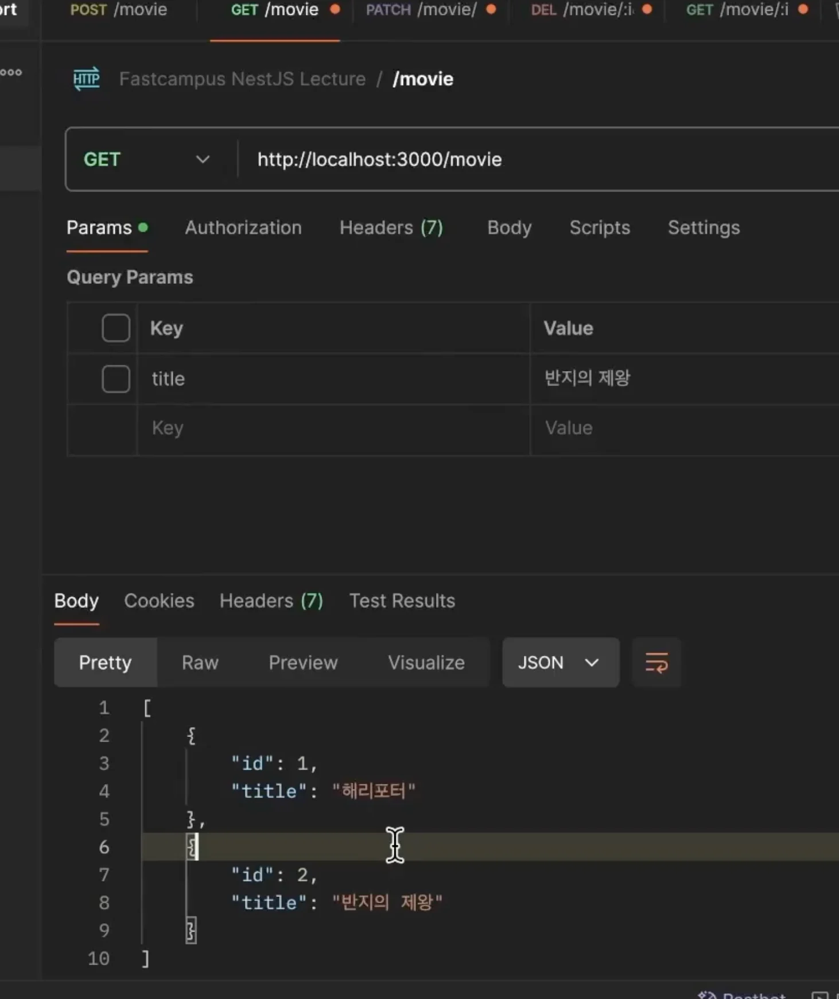
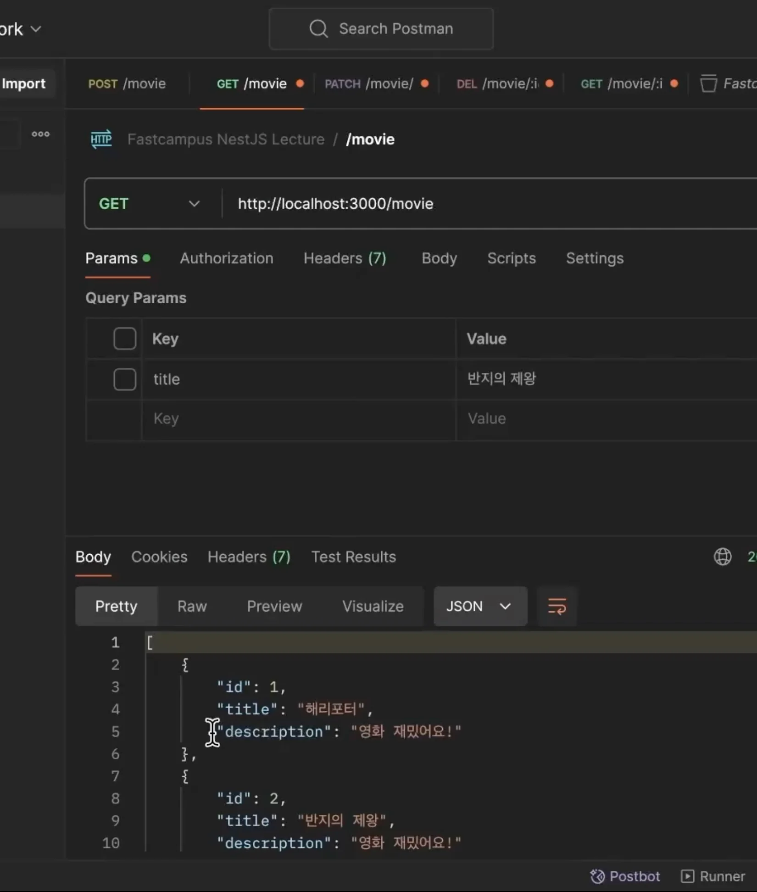
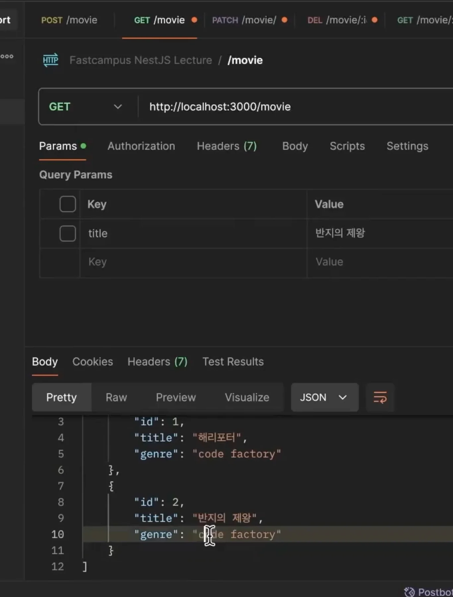
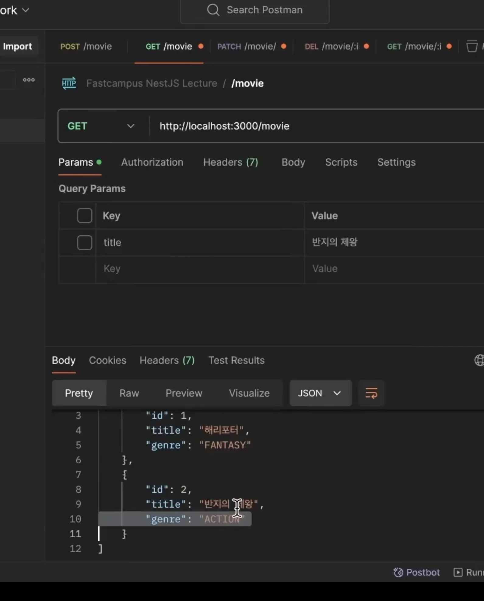

> 
> 
> <a id="28feda9b0fe1811989afdc21e570404c"></a>
> 
> <strong>목차</strong>
> 
> - [Class Transformer](#28feda9b0fe1815b93a6fcab8bbc5b4e)
> - [1.  @Expose(), @Exclude()](#28feda9b0fe1811badd7cccc96e6eb5e)
> - [2. Custom Transformer](#28feda9b0fe18118af0dcee815063be7)

<a id="28feda9b0fe1815b93a6fcab8bbc5b4e"></a>

## Class Transformer

---

<a id="28feda9b0fe1811badd7cccc96e6eb5e"></a>

### 1&#46;  <code>&#64;Expose()</code>, <code>&#64;Exclude()</code>

> 📖 
> 
> - <code>&#64;Expose()</code>&#58;  해당 필드(getter) 노출
> 
> - <code>&#64;Exclude()</code>&#58; <strong><u>해당 필드 제외(필터링)</u></strong>
>     - 보안상 <strong><u>민감한 데이터를 포함하는 필드를 응답값에서 제외</u></strong>하고 싶은 경우 사용한다&#46; 
> 
>     - ex) 비밀번호 …

<details>
<summary>Case 1&#46; <code>&#64;Exclude()</code></summary>

<details>
<summary>1&#46; entity에 <code>&#64;Exclude()</code> 적용</summary>

<a id="28feda9b0fe1807bade2eb23708710d4"></a>

```typescript
export class Movie {
		id: number;
		
		title: string;
		
		// @Expose()
		@Exclude()
		genre: string;
}
```

</details>

<details>
<summary>2&#46; Controller에 <code>ClassSerializerInterceptor</code> 적용</summary>

> 📖 
> 
> <a id="28feda9b0fe180d28f64de1a33949dbd"></a>
> 
> <code>&#64;Exclude()</code>, <code>&#64;Export()</code> 를 적용할 controller에 <code>ClassSerializerInterceptor</code> 인터셉터를 명시해야 <code>ClassSerializerInterceptor</code>가 <code>&#64;Exclude()</code>, <code>&#64;Export()</code>를 찾아 해당하는 필드를 필터링 및 노출한다&#46; 

<a id="28feda9b0fe180c29112db570f533dbc"></a>

```typescript
import {	...  ClassSerializerInterceptor as CI } from '@nestjs/common';

@Controller('movie')
@UseInterceptors(CI)
export class MovieController {
  constructor(private readonly movieService: MovieService) {}

  @Get()
  @Public()
  getMovices(@Query('title') title?: string) {
    return this.movieService.findAll(title);
  }

  @Get(':id')
  @Public()
  getMovie(@Param('id') id: string) {
    return this.movieService.findOne(+id);
  }
  
	. . .
}
```

</details>

</details>

<details>
<summary>Case 2&#46;  <code>&#64;Exclude()</code>, <code>&#64;Expose()</code></summary>

- entity에 <code>&#64;Exclude()</code> 적용 및 응답값으로 노출하려는 필드에 <code>&#64;Expose()</code> 명시
    <a id="28feda9b0fe180c7a066ea6e42af541f"></a>

    ```typescript
    @Exclude()
    export class Movie {
        @Expose() 
    		id: number;
    		
    		@Expose()
    		title: string;
    		
    		genre: string;
    }
    ```

- 응답값 확인
    

</details>

<details>
<summary>Case 2&#46;2&#46; <code>&#64;Expose()</code></summary>

- entity에 <code>&#64;Exclude()</code> 적용 및 응답값으로 노출하려는 필드에 <code>&#64;Expose()</code> 명시
    <a id="28feda9b0fe18011abe7fb9b38594828"></a>

    ```typescript
    @Exclude()
    export class Movie {
        @Expose() 
    		id: number;
    		
    		@Expose()
    		title: string;
    		
    		genre: string;
    		
    		@Expose()
    		get description()? {
    			return "영화 설명"
    		}
    }
    ```

- 응답값 확인
    

    - getter로 명시한 값이 응답값으로 포함되어 나오는 것을 확인 가능하다&#46;

> ✏️ 
> 
> <a id="28feda9b0fe180708b0efcc13e412502"></a>
> 
> 이를 통해 캡슐화와 유사하게 사용할 수 있다&#46;
> 
> <a id="28feda9b0fe1804aa574d75869b15c3d"></a>
> 
> 근데 굳이? 사용할 필요는 없을 듯 하다&#46; 기존 필드에 <code>&#64;Exclude</code> 처리하는 것과 동일함

</details>

<a id="28feda9b0fe18118af0dcee815063be7"></a>

### 2&#46; Custom Transformer

<details>
<summary>Case 1&#46; 해당하는 필드 모두 특정 값으로 변경</summary>

<a id="28feda9b0fe1814c9832cf0a4e7b2662"></a>

```typescript
export class Movie {
		id: number;
		title: string;
		@Transform(
				({value}) => 'code factory'
		)
		genre: string;
}
```



</details>

<details>
<summary>Case 2&#46;  해당하는 필드 <code>UpperCase</code>로 변환</summary>

<a id="28feda9b0fe180d8be32ff61cc163cae"></a>

```typescript
export class Movie {
		id: number;
		title: string;
		@Transform(
				({value}) => value.toString().toUpperCase(),
		)
		genre: string;
}
```



</details>
