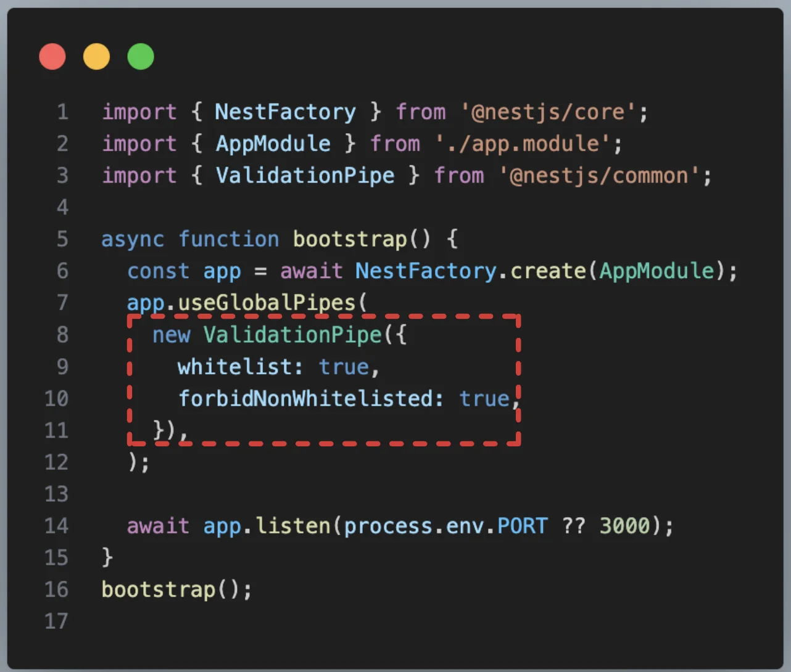
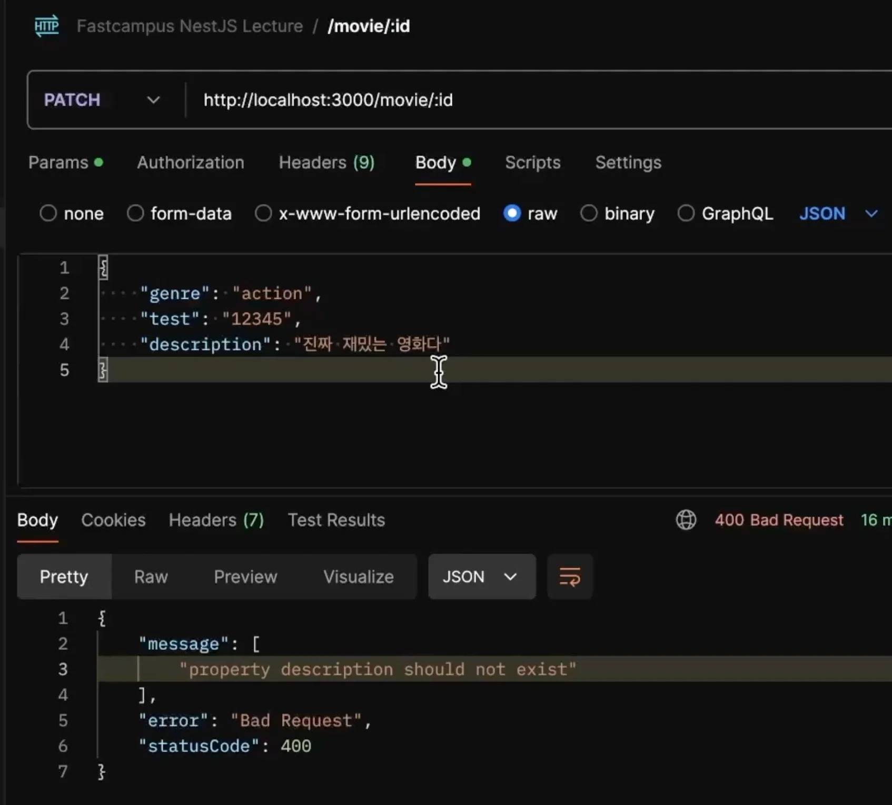

> 
> 
> 
> 
> <strong>목차</strong>
> 
> - [주요 옵션-whitelist, forbidNonwhitelisted](#28feda9b0fe180dbab13d182dc38993a)

## 주요 옵션&#45;<code>whitelist</code>, <code>forbidNonwhitelisted</code>

---

> 📖 
> 
> 
> 
> 자바스크립트는 존재하지 않는 속성 접근을 오류로 간주하지 않고, 단순히 <code>undefined</code>로 평가한다&#46; 
> 
> - 자바스크립트의 객체는 클래스 기반 언어의 “정적 타입 구조체(struct)”와 달리, <strong>런타임에 자유롭게 속성을 추가하거나 제거</strong>할 수 있는 <strong><u>해시맵 형태의 동적 자료구조</u></strong>이다
> 
> 
> 
> 즉, DTO 클래스에 정의되지 않은 속성(필드)가 요청에 담겨 전달될 경우 오류를 발생시키지 않고 해당 필드를 초기화하여 DB에 저장한다&#46; 
> 
> 
> 
> 이러한 굉장히 심각한 오류를 ValidationPipe의 <code>whitelist</code>, <code>forbidNonwhitelisted</code> 옵션들을 통해 방지할 수 있다&#46;

- <code>whitelist</code>
    > 정의하지 않는 필드 무시   ( 기본값&#58; <code>false</code> )

    

    자바스크립트에서는 강제 값 삽입이 가능하다&#46;

    

    따라서 실제 DTO에 정의하지 않은 필드를 넣어 요청을 보내면 해당하는 필드가 추가되어 인스턴스가 생성된다&#46; 

    

    이를 필터링을 통해 무시하도록 한다&#46;

- <code>forbidNonwhitelisted</code>
    > 정의하지 않은 필드가 요청에 담겨 오는 경우, <code>400 BadRequest</code> 오류를  발생시키다&#46;    ( 기본값&#58; <code>false</code> )

    
