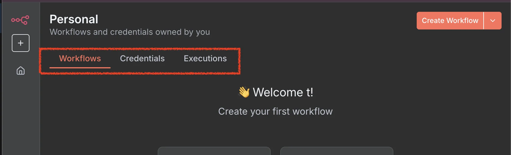
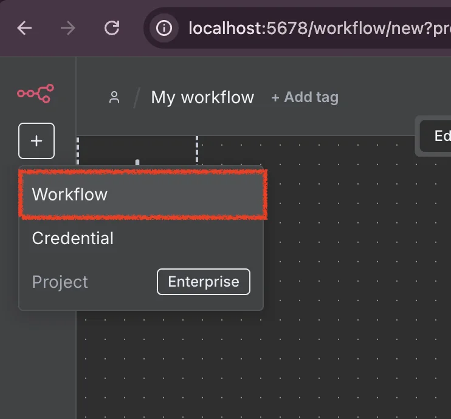
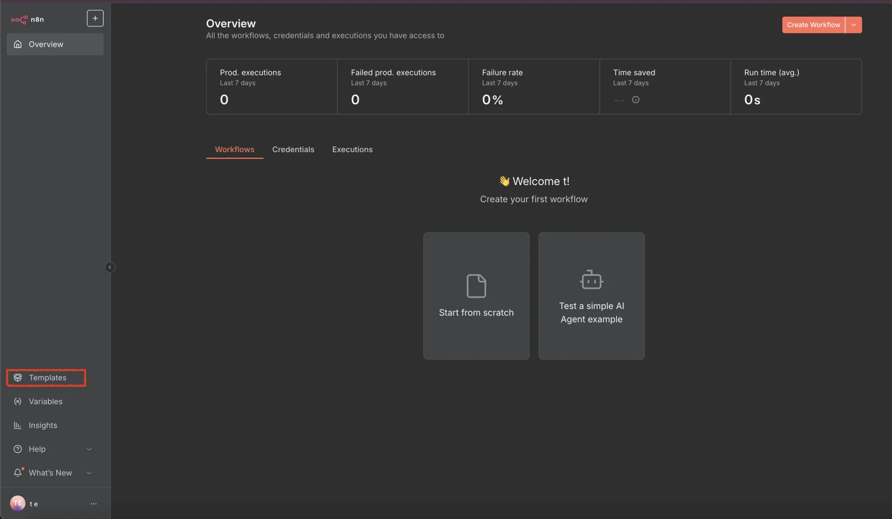

> 
> 
> 
> 
> <strong>목차</strong>
> 
> - [기본 화면](#28feda9b0fe180d38cf7f82902ba48de)
> - [Workflow](#28feda9b0fe1818b92a7d88c95586c5f)
> - [Community](#28feda9b0fe180dc9056c05dec9b8a51)
> - [Template](#28feda9b0fe180d0be1be589b301400f)

> 

> ✏️ 

### 기본 화면

- workflow
    - 실행할 작업 정의

- credentials
    - 각 노드들의 인증 정보 설정

- Executions
    - workflow 실행 로그를 확인할 수 있다&#46; 

### Workflow

> 📖 
> 
> 
> 
> workflow는 n8n 노드들을 설정해 실행 흐름을 정의하는 하나의 작업 흐름을 말한다&#46;

### Community

[n8n Community]()

- n8n 공식 사이트에서 커뮤티니 제공

- 여러 tip들 searching 가능

### Template

[Discover 6203 Automation Workflows from the n8n&#39;s Community]()

- 다양한 case의 template 제공
