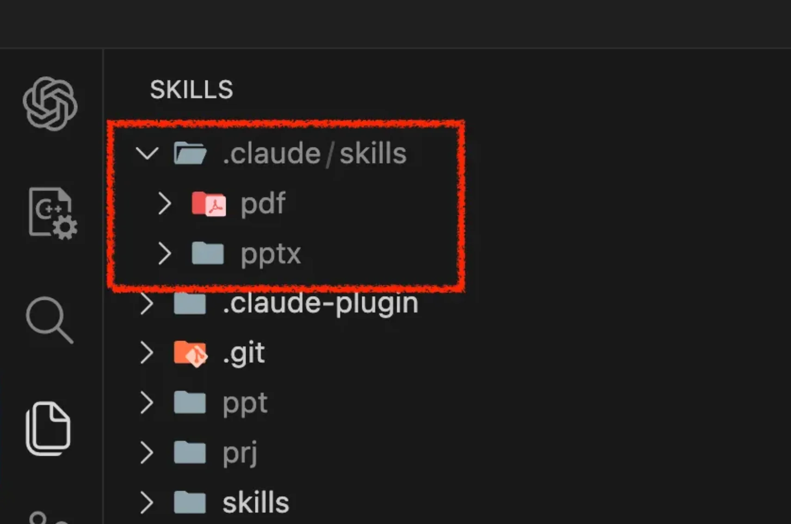
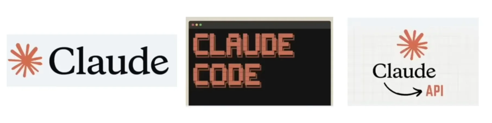
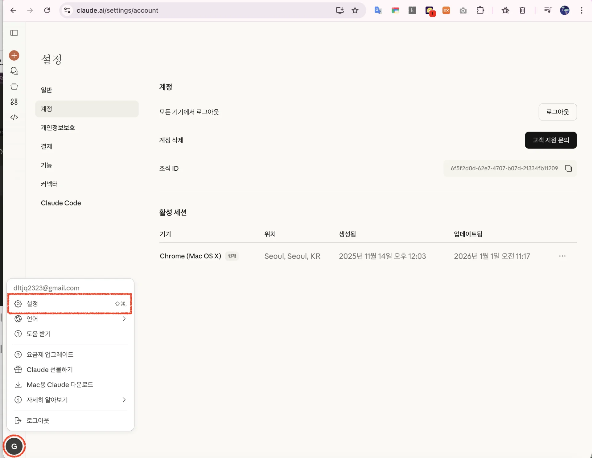
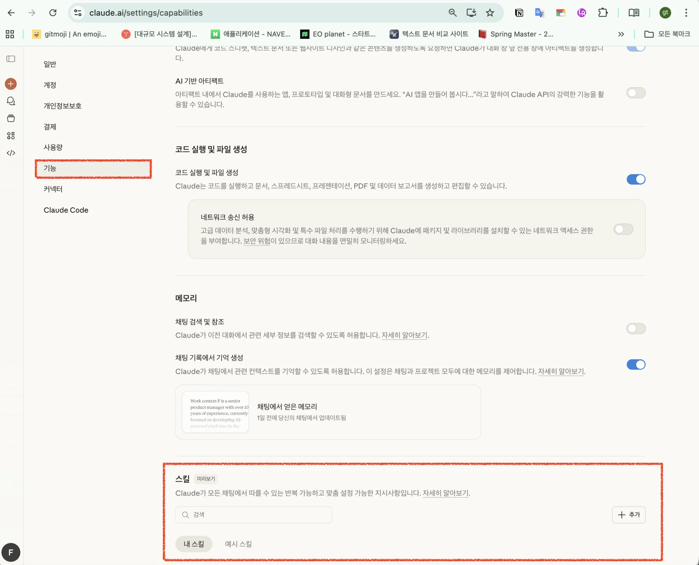
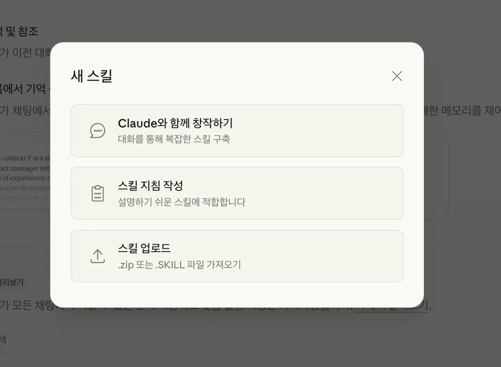
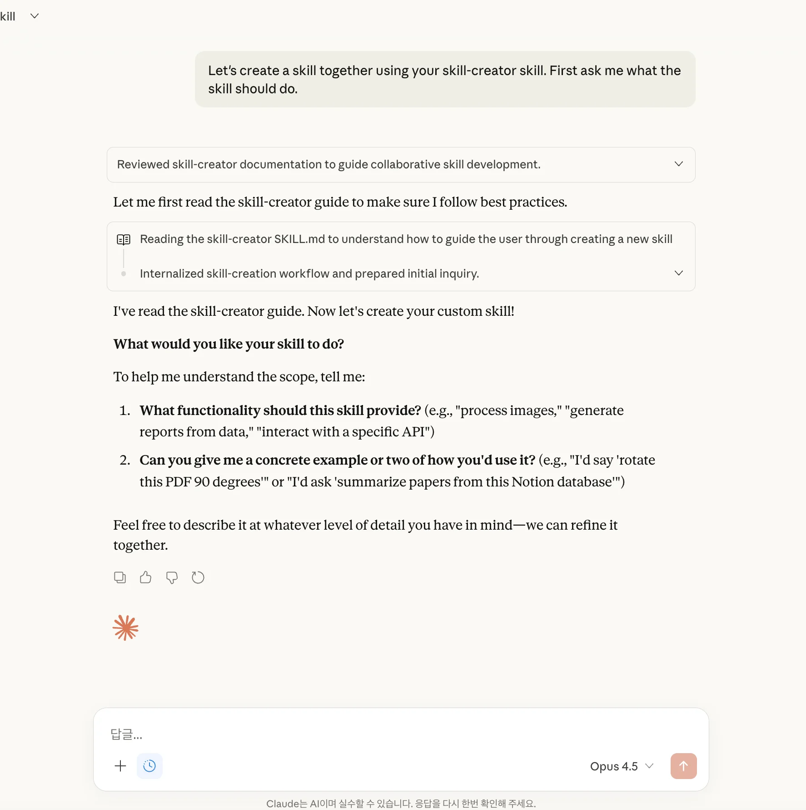
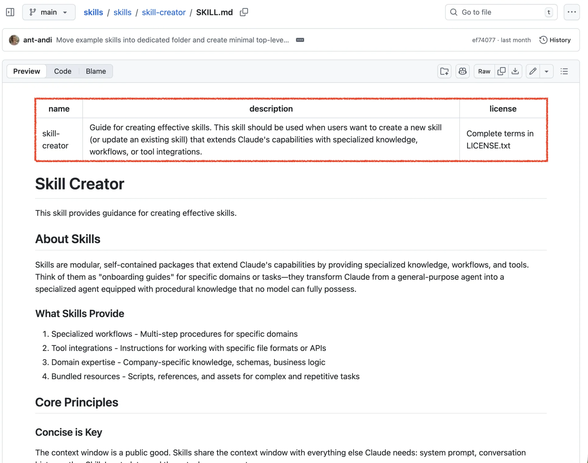
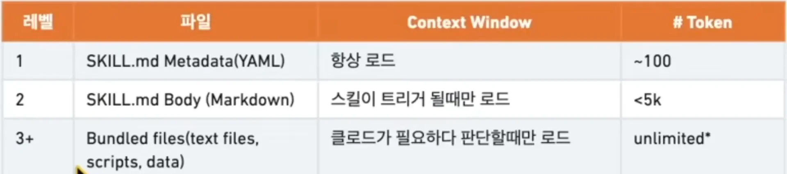

<details>
<summary>reference</summary>

- ‣

- ‣

- ‣

- ‣

- ‣

- ‣

- ‣

- ‣

</details>

> 
> 
> <a id="2dbeda9b0fe180f1aa59c7893d407789"></a>
> 
> <strong>목차</strong>
> 
> - [Skills](#2dbeda9b0fe18020a18ce7cce6c74465)
> - [1. Skills의 핵심 기능](#2dbeda9b0fe1806da2eae1acdf6a4b03)
> - [2. 기본 디렉토리 구조](#2dbeda9b0fe180d8a78be8cbd13339f8)
> - [3. SKILL.md 구성 ( 필수 )](#2bfeda9b0fe180ad8a5bc1d60b262158)
> - [4. 프로젝트에 적용 방법](#2dbeda9b0fe180e4b40df2d376edd0c1)
> - [5. 커스텀 스킬  생성](#2dbeda9b0fe18071a49dffc82d908fa1)
> - [스킬 생성 플로우](#2dbeda9b0fe180c7a228ef0ac6369e5f)
> - [ 예제](#2dbeda9b0fe180c693a3d1c119a80a52)
> - [6. 고급 패턴](#2dbeda9b0fe18042a284f340b5dc5863)
> - [부록](#2dbeda9b0fe18070aaa4e35ceb1e1f2c)

<a id="2dbeda9b0fe18020a18ce7cce6c74465"></a>

## Skills

---

> 📖 
> 
> <a id="2dbeda9b0fe180bf8edbc09b9354b4c4"></a>
> 
> <code>skills</code>는 Claude가 <strong><u>특정 작업을 더 효과적으로 수행</u></strong>할 수 있도록 가르치는 <strong><u>지식 패키지</u></strong> 이다&#46;
> 
> - 프롬프트의 상위 호환
> 
> - 폴더 안에 <code>지침</code>, <code>스크립트</code>, <code>리소스</code>를 담아 Claude에게 동적으로 로드한다&#46;

<a id="2dbeda9b0fe1806da2eae1acdf6a4b03"></a>

### <strong>1&#46; Skills의 핵심 기능</strong>

> 🤔 
> 
> <a id="2dbeda9b0fe18040a575fbf59ef70936"></a>
> 
> Claude는 <strong>특정 도메인이나, 회사 워크플로우에 대한 절차적 지식은 가지고 있지 않</strong>다&#46;  <br>이를 <strong>Skills를 통해 </strong><strong><u>특정 작업 특화 에이전트로 변환</u></strong> 가능하다&#46; 

1. <strong><code>전문 워크플로우</code></strong>
    - 특정 도메인을 위한 다단계 절차

1. <strong><code>도구 통합</code></strong>
    - 특정 파일 형식이나 API 작업 지침

1. <strong><code>도메인 전문성</code></strong>
    - 화사별 지식, 스키마, 비즈니스 로직

1. <code>번들 리소스</code>
    - 복잡하고 반복적인 작업을 위한 스크립트, 참조자료, 에셋

<a id="2dbeda9b0fe180d8a78be8cbd13339f8"></a>

### 2&#46; 기본 디렉토리 구조

<a id="2bfeda9b0fe180a38bb2ddf52c70573d"></a>

```python
skill-name/
├── SKILL.md          # (필수) 메타데이터 + 지침
├── scripts/          # (선택) 실행 가능한 코드 (Python/Bash 등)
├── references/       # (선택) 참조 문서
└── assets/           # (선택) 출력에 사용되는 파일 (템플릿, 이미지 등)
```

- <code>SKILL&#46;md</code>
    - 스킬 메타데이터, 지침 정의
        - 스킬 트리거로 사용할 메타데이터 정의

        - 트리거 시 동작할 지침 정의

- <code>scripts/</code>
    - 반복되는 코드 저장
        - 같은 코드를 매번 작성할 때

        - 결정론적 신뢰성이 필요할 때

- <code>references/</code>
    - 참조 문서 저장
        - Claude가 작업 중 참조해야 할 문서가 있을 때

- <code>assets/</code>
    - 출력 리소스 저장
        - 최종 출력물에 사용될 파일이 필요할 때

<a id="2bfeda9b0fe180ad8a5bc1d60b262158"></a>

### <strong>3&#46; </strong><strong><code>SKILL&#46;md</code></strong><strong> 구성 ( 필수 )</strong>

<a id="2dbeda9b0fe180939be5e843042a0df3"></a>

<strong>필수 메타데이터 필드</strong>

| <strong>필드</strong> | <strong>필수</strong> | <strong>설명</strong> |
| --- | --- | --- |
| <code>name</code> | <strong>O</strong> | 스킬의 고유 식별자 (소문자, 하이픈으로 단어 구분) |
| <code>description</code>  | <strong>O</strong> | 스킬의 기능과 트리거 조건을 설명 |

<a id="2dbeda9b0fe1802f90b4c802b52493c0"></a>

```python
# Metadata (YAML, 항상 로드)
---
name: my-skill-name     # 스킬 고유 식별자 (소문자, 하이픈 사용)
description: 이 스킬이 무엇을 하고 언제 사용해야 하는지 설명
---

# Body (Markdown, 스킬 트리거 시만 로드 )

# 스킬 제목
[Claude가 따를 지침 작성]

## 예시
- 사용 예시 1
- 사용 예시 2

## 가이드라인
- 가이드라인 1
- 가이드라인 2
```

<details>
<summary>ex) </summary>

- ‣

- ‣

</details>

<a id="2dbeda9b0fe180e4b40df2d376edd0c1"></a>

### 4&#46; <strong>프로젝트에 적용 방법</strong>

> ⚠️ 
> 
> <a id="2dbeda9b0fe18066a855f137334329ee"></a>
> 
> 정의한 skill이 프로젝트의 <code>&#46;claude/skiils/&#46;&#46;</code> 경로 내에 존재해야 skills로 인식된다&#46; <br>( 프로젝트 skills 기준 )
> 
> 

> 
> 
> 
> 
> - 클로드 데스크탑,  클로드코드,  클로드 API 모두 사용 가능하다&#46;

<details>
<summary><strong>방법 1)  Claude Code에서 플러그인으로 설치</strong></summary>

1. 플러그인 설치
    <a id="2dbeda9b0fe18058b29ac53be0d6ba9a"></a>

    ```python
    # 마켓플레이스 추가
    /plugin marketplace add anthropics/skills
    ```

1. 스킬 설치 
    <a id="2dbeda9b0fe1808da769d476b2143b43"></a>

    ```python
    # 스킬 설치
    /plugin install document-skills@anthropic-agent-skills
    /plugin install example-skills@anthropic-agent-skills
    ```

1. 스킬 자동 활성화
    <a id="2dbeda9b0fe180c0b274c2670d2bfac8"></a>

    ```python
    "PDF 스킬을 사용해서 form.pdf의 필드를 추출해줘"
    ```

    - 설치 후 스킬을 언급하면 자동으로 활성화 된다&#46;

</details>

<details>
<summary><strong>방법 2)  로컬 프로젝트에 직접 복사</strong></summary>

<a id="2dbeda9b0fe1803c9633c7f980544240"></a>

```python
# 원하는 스킬 폴더를 프로젝트에 복사
cp -r /path/to/skills/skills/pdf ~/my-project/.claude/skills/

# 또는 심볼릭 링크로 연결
ln -s /path/to/skills/skills/pdf ~/.claude/skills/pdf
```

- skill 을 정의한 프로젝트에서 복사해와 적용하고 싶은 프로젝트에 넣으면 된다&#46; 
    - <code>skills</code>는 프로젝트 루트 경로의 <code>&#46;claude/skills</code> 내, 정의가 되어야 정상 인식이 된다&#46; 

</details>

<details>
<summary><strong>방법 3) Claude&#46;ai 웹에서 업로드</strong></summary>

[Claude]()

1. Claude&#46;ai 설정에서 Skills 섹션으로 이동
    

    

1. 스킬 만들기 및 업로드 (zip 형식)
    

    1. claude와 함께 창작하기
        <details>
        <summary>입력 쿼리</summary>

        <a id="2dbeda9b0fe1808db313f9a4ef037a2c"></a>

        ```python
        Let's create a skill together using your skill-creator skill. First ask me what the skill should do.
        ```

        

        - 클로드 가이드를 통해 스킬 정의 가능

        </details>

    1. 스킬 지침 작성
        - 빠른 스킬 작성

    1. 스킬 업로드 
        - 스킬 폴더를 <code>&#46;skill</code> 파일로 패키징 (zip 형식)

</details>

<details>
<summary><strong>방법 4) Claude API를 통한 사용</strong></summary>

[Using Agent Skills with the API]()

- Claude API Skills Quickstart 참조

</details>

<a id="2dbeda9b0fe18071a49dffc82d908fa1"></a>

### 5&#46; <strong>커스텀 스킬  생성</strong>

[How to create custom Skills &#124; Claude Help Center]()

[skills/skills/skill&#45;creator at main · anthropics/skills]()

<a id="2dbeda9b0fe180c7a228ef0ac6369e5f"></a>

### 스킬 생성 플로우

<details>
<summary><strong>Step 1&#58; 구체적인 예시로 이해</strong></summary>

> ✏️ 
> 
> <a id="2dbeda9b0fe180d0a39ad4d911af78a0"></a>
> 
> 스킬이 <strong><u>어떻게 사용</u></strong>될지 명확히 파악한다&#46;

<a id="2dbeda9b0fe180f2a870c063bb64a032"></a>

<strong>스스로에게 물어볼 질문들&#58;</strong>

- <code>이 스킬이 어떤 기능을 지원해야 하는가?</code>

- <code>사용자가 어떻게 요청할 것 같은가?</code>

- <code>어떤 트리거 문구가 이 스킬을 활성화해야 하는가?</code>

<a id="2dbeda9b0fe18072837ee7dbb533f37f"></a>

<strong>예시&#58;</strong>

- 이미지 편집 스킬
    - &#34;이 이미지 적목 현상 제거해줘”

    - &#34;이미지 90도 회전해줘”

- PDF 스킬
    - &#34;이 PDF 페이지 합쳐줘&#34;

    - &#34;PDF에서 텍스트 추출해줘”

</details>

<details>
<summary><strong>Step 2&#58; 재사용 가능한 콘텐츠 계획</strong></summary>

> ✏️ 
> 
> <a id="2dbeda9b0fe1802cae93d44794a59eae"></a>
> 
> 각 예시를 분석하여 재사할 리소스를 파악한다&#46;

| <strong>상황</strong> | <strong>해결책</strong> |
| --- | --- |
| 같은 코드를 반복 작성 | <code>scripts/</code> 에 스크립트 저장 |
| 같은 보일러플레이트 필요 | <code>assets/</code> 에 템플릿 저장 |
| 스키마/문서 재발견 필요 | <code>references/</code> 에 문서 저장 |

<details>
<summary><strong>ex 1) PDF 회전 스킬 분석</strong></summary>

- 매번 같은 회전 코드 작성 
    <a id="2dbeda9b0fe1800c8bd1e2e524b1c2aa"></a>

    → <code>scripts/rotate&#95;pdf&#46;py</code> 생성

</details>

<details>
<summary><strong>ex 2) 프론트엔드 빌더 스킬 분석</strong></summary>

- 매번 같은 HTML/React 보일러플레이트
    <a id="2dbeda9b0fe180449406e2cbf0bcf801"></a>

    → <code>assets/template/</code> 생성

</details>

<details>
<summary><strong>ex 3) BigQuery 스킬 분석</strong></summary>

- 매번 테이블 스키마 재발견
    <a id="2dbeda9b0fe1807c8149dc7faa7e5e4b"></a>

    →  <code>references/schema&#46;md</code> 생성

</details>

</details>

<details>
<summary><strong>Step 3&#58; 스킬 초기화</strong></summary>

<a id="2dbeda9b0fe1809181c0dbeb18b2da3e"></a>

‣

<a id="2dbeda9b0fe180f48cb5cd0c35f5ac58"></a>

```python
# skill-creator 스킬의 init_skill.py 사용
python scripts/init_skill.py my-new-skill --path ./output
```

<a id="2dbeda9b0fe18057af90d21222c33b40"></a>

```python
my-new-skill/
├── SKILL.md          # TODO 플레이스홀더가 포함된 템플릿
├── scripts/          # 예시 스크립트
├── references/       # 예시 참조 문서
└── assets/           # 예시 에셋
```

</details>

<details>
<summary><strong>Step 4&#58; 스킬 편집</strong></summary>

<details>
<summary><strong>description 작성 (가장 중요&#33;)</strong></summary>

> ✏️ 
> 
> <a id="2dbeda9b0fe18091b08dc8d3abf01aed"></a>
> 
> <strong><code>description</code></strong>은 <strong><u>스킬 트리거</u></strong>의 <strong>핵심</strong>이다&#46;
> 
> <a id="2dbeda9b0fe180f59d98c6ab92c0da5e"></a>
> 
> <strong>“언제 사용할지” 를 명시</strong>해야 <strong><u>claude가 인식</u></strong>해서 <strong><u>적절한 작업에 할당</u></strong>할 수 있다&#46; 
> 
> - 본문(Body) 에 작성 ❌

<a id="2dbeda9b0fe1802e906de851abc1c11b"></a>

```python
---
name: my-skill
description: |
  [스킬이 하는 일]과 [언제 사용해야 하는지]를 모두 포함.

  예시 (PDF 스킬):
  "PDF 문서 처리 도구. Claude가 PDF 폼 작성, 병합,
  분할, 텍스트 추출이 필요할 때 사용."

  예시 (문서 스킬):
  "문서 생성, 편집, 분석 도구. 추적 변경, 주석,
  서식 보존, 텍스트 추출을 지원. .docx 파일 작업 시 사용."
---
```



</details>

<details>
<summary><strong>지침 작성 원칙</strong></summary>

1. <strong>간결하게 작성</strong>
    - Claude는 이미 똑똑합니다

    - Claude가 모르는 것만 알려주세요

    - &#34;이 단락이 토큰 비용을 정당화하는가?&#34; 자문하세요

1. <strong>자유도 조절</strong>
    - <strong>높은 자유도</strong>&#58; 여러 접근법이 유효할 때 (텍스트 지침)

    - <strong>중간 자유도</strong>&#58; 선호 패턴이 있지만 변형 가능할 때 (의사코드)

    - <strong>낮은 자유도</strong>&#58; 특정 순서가 필수일 때 (구체적 스크립트)

1. <strong>명령형 사용</strong>
    - &#34;&#126;합니다&#34; 대신 &#34;&#126;하세요&#34; 형태로 작성

</details>

<details>
<summary><strong>포함하지 말아야 할 것</strong></summary>

<a id="2dbeda9b0fe180c78c55c7b525015b18"></a>

```python
❌ README.md
❌ INSTALLATION_GUIDE.md
❌ QUICK_REFERENCE.md
❌ CHANGELOG.md
```

- 스킬은 AI 에이전트가 작업을 수행하는 데 필요한 정보만 포함해야 한다&#46;

</details>

</details>

<details>
<summary><strong>Step 5&#58; 패키징</strong></summary>

<a id="2dbeda9b0fe180f1a250c40fead7c03b"></a>

‣

<a id="2dbeda9b0fe18005a3d3e9400b74961b"></a>

```python
# 스킬 검증 및 패키징
python scripts/package_skill.py ./my-new-skill

# 특정 출력 디렉토리 지정
python scripts/package_skill.py ./my-new-skill ./dist
```

- 패키징 스크립트가 수행하는 작업
    1. YAML frontmatter 형식 검증

    1. 필수 필드 확인

    1. 디렉토리 구조 검증

    1. <code>skill</code> 파일 생성 (zip 형식)

</details>

<details>
<summary><strong>Step 6&#58; 반복 개선</strong></summary>

1.  실제 작업에 스킬 사용

1. 비효율적인 부분 발견

1. <code>SKILL&#46;md</code> 또는 <code>리소스</code> 업데이트

1. 다시 테스트

</details>

<a id="2dbeda9b0fe180c693a3d1c119a80a52"></a>

### <strong> 예제</strong>

<details>
<summary><strong>1&#46; 코드 리뷰 스킬</strong></summary>

1. 파일 정의
    <a id="2dbeda9b0fe180baa565dc4861e6a0ff"></a>

    ```python
    code-review/
    ├── SKILL.md
    └── references/
        └── checklist.md
    ```

1. <code>SKILL&#46;md</code> 정의
    <a id="2dbeda9b0fe18057a69dcf42270cfe44"></a>

    ```python
    ---
    name: code-review
    description: |
      코드 리뷰 지원 스킬. 코드 품질, 보안, 성능을 분석할 때 사용.
      Pull Request 리뷰나 코드 검토 요청 시 트리거됨.
    ---

    # 코드 리뷰 가이드

    ## 리뷰 프로세스

    1. 파일 구조 분석
    2. 보안 취약점 확인
    3. 성능 이슈 점검
    4. 코드 스타일 검토

    ## 체크리스트

    상세 체크리스트는 [checklist.md](references/checklist.md) 참조.

    ## 출력 형식

    ### 요약
    [전체 평가]

    ### 발견사항
    - 심각: [설명]
    - 주의: [설명]
    - 개선: [설명]

    ### 권장사항
    1. [구체적 조치]
    ```

</details>

<details>
<summary><strong>2&#46; 회사 브랜드 가이드라인 스킬</strong></summary>

1. 파일 정의
    <a id="2dbeda9b0fe180a0a83ddfc8a029e8b6"></a>

    ```python
    brand-guidelines/
    ├── SKILL.md
    ├── assets/
    │   ├── logo.png
    │   └── color-palette.json
    └── references/
        └── voice-tone.md
    ```

1. <code>SKILL&#46;md</code> 정의
    <a id="2dbeda9b0fe180b3b587edaa4af4a651"></a>

    ```python
    ---
    name: company-brand
    description: |
      회사 브랜드 가이드라인 준수 스킬. 마케팅 자료, 프레젠테이션,
      문서 작성 시 브랜드 일관성을 유지하기 위해 사용.
    ---

    # 브랜드 가이드라인

    ## 색상
    - 주색상: #1A73E8 (Blue)
    - 보조색상: #34A853 (Green)
    - 배경: #FFFFFF

    ## 로고 사용
    로고 파일: `assets/logo.png`
    - 최소 여백: 로고 높이의 50%
    - 배경 대비 확보 필수

    ## 톤 & 보이스
    상세 가이드: [voice-tone.md](references/voice-tone.md)
    ```

</details>

<details>
<summary><strong>3&#46; API 문서화 스킬</strong></summary>

1. 파일 정의
    <a id="2dbeda9b0fe1803ab751ec0c1c86fcb9"></a>

    ```python
    api-documenter/
    ├── SKILL.md
    ├── assets/
    │   └── template.md
    └── references/
        └── openapi-spec.md
    ```

1. <code>SKILL&#46;md</code> 정의
    <a id="2dbeda9b0fe180d2a3d8ff0d4425a0cb"></a>

    ```python
    ---
    name: api-documenter
    description: |
      API 문서 자동 생성 스킬. REST API 엔드포인트 문서화,
      OpenAPI 스펙 생성, API 레퍼런스 작성 시 사용.
    ---

    # API 문서화 가이드

    ## 워크플로우

    1. API 코드 분석
    2. 엔드포인트 추출
    3. 파라미터/응답 스키마 문서화
    4. 예시 요청/응답 생성

    ## 출력 템플릿

    `assets/template.md` 형식을 따라 문서 생성.

    ## OpenAPI 스펙

    OpenAPI 3.0 스펙 세부사항은 [openapi-spec.md](references/openapi-spec.md) 참조.
    ```

</details>

<a id="2dbeda9b0fe18042a284f340b5dc5863"></a>

### 6&#46; <strong>고급 패턴</strong>

<details>
<summary><strong>1&#46; Progressive Disclosure (점진적 공개)</strong></summary>

> ✏️ 
> 
> <a id="2dbeda9b0fe180099fb7dcf375a8c6a9"></a>
> 
> 스킬은 3단계로 컨텍스트를 관리한다&#46; 



- <code>레벨 1</code>&#58; 메타데이터 (name &#43; description) &#45; 항상 로드 (&#126;100 단어)

- <code>레벨 2</code>&#58; SKILL&#46;md 본문 &#45; 트리거 시 로드 (&#60;5k 단어)

- <code>레벨 3</code>&#58; 번들 리소스 &#45; 필요 시 로드 (무제한)

</details>

<details>
<summary><strong>2&#46; 참조 파일 분리 패턴</strong></summary>

- <strong>고수준 가이드 &#43; 참조</strong>
    <a id="2dbeda9b0fe180bc855bf2e5e6e309c4"></a>

    ```python
    # PDF 처리

    ## 빠른 시작

    pdfplumber로 텍스트 추출:
    [코드 예시]

    ## 고급 기능

    - **폼 작성**: [FORMS.md](FORMS.md) 참조
    - **API 레퍼런스**: [REFERENCE.md](REFERENCE.md) 참조
    - **예시**: [EXAMPLES.md](EXAMPLES.md) 참조
    ```

- <strong>도메인별 분리</strong>
    <a id="2dbeda9b0fe1806e8106e9fc138b5b02"></a>

    ```python
    bigquery-skill/
    ├── SKILL.md              # 개요 + 네비게이션
    └── references/
        ├── finance.md        # 재무 메트릭
        ├── sales.md          # 영업 파이프라인
        ├── product.md        # 제품 분석
        └── marketing.md      # 마케팅 어트리뷰션
    ```

    - 사용자가 &#34;영업 메트릭&#34;을 물으면 Claude는 <code>sales&#46;md</code>만 로드한다&#46;

- <strong> 프레임워크별 분리</strong>
    <a id="2dbeda9b0fe1804ba981cef77e2cc309"></a>

    ```python
    cloud-deploy/
    ├── SKILL.md              # 워크플로우 + 프로바이더 선택
    └── references/
        ├── aws.md            # AWS 배포 패턴
        ├── gcp.md            # GCP 배포 패턴
        └── azure.md          # Azure 배포 패턴
    ```

</details>

<details>
<summary><strong>3&#46; 워크플로우 패턴</strong></summary>

- <strong>순차 워크플로우</strong>
    <a id="2dbeda9b0fe180f89c0fdba810ee9d5c"></a>

    ```python
    PDF 폼 작성은 다음 단계를 따릅니다:

    1. 폼 분석 (analyze_form.py 실행)
    2. 필드 매핑 생성 (fields.json 편집)
    3. 매핑 검증 (validate_fields.py 실행)
    4. 폼 작성 (fill_form.py 실행)
    5. 출력 검증 (verify_output.py 실행)
    ```

    - 위 예시와 같이 워크플로우를 정의하여 다음 작업들을 명시

- <strong>조건부 워크플로우</strong>
    <a id="2dbeda9b0fe18023a04ed53bba03c683"></a>

    ```python
    ## 작업 유형 결정

    1. 수정 유형 파악:
       **새로 생성?** → "생성 워크플로우" 섹션으로
       **기존 편집?** → "편집 워크플로우" 섹션으로

    ## 생성 워크플로우
    [단계들...]

    ## 편집 워크플로우
    [단계들...]
    ```

    - 조건문 과 유사하게 유형을 정의하여 트리거 가능하다

</details>

<details>
<summary><strong>4&#46; 출력 패턴</strong></summary>

- template 패턴
    <a id="2dbeda9b0fe1804d99b4cac1bafdbf86"></a>

    ```python
    ## 보고서 구조

    다음 템플릿 구조를 정확히 사용:

    # [분석 제목]

    ## 요약
    [핵심 발견사항 한 문단 개요]

    ## 주요 발견사항
    - 발견사항 1과 근거 데이터
    - 발견사항 2와 근거 데이터

    ## 권장사항
    1. 구체적인 조치 사항
    2. 구체적인 조치 사항
    ```

- 예시(few shot) 패턴
    <a id="2dbeda9b0fe1808d8011d797bbcd633e"></a>

    ```python
    ## 커밋 메시지 형식

    다음 예시를 따라 생성:

    **예시 1:**
    입력: JWT 토큰을 사용한 사용자 인증 추가
    출력:
    feat(auth): JWT 기반 인증 구현

    로그인 엔드포인트와 토큰 검증 미들웨어 추가

    **예시 2:**
    입력: 보고서에서 날짜가 잘못 표시되는 버그 수정
    출력:
    fix(reports): 타임존 변환 시 날짜 포맷 수정

    보고서 생성 전반에 UTC 타임스탬프 일관 적용
    ```

</details>

<a id="2dbeda9b0fe18070aaa4e35ceb1e1f2c"></a>

### 부록

<details>
<summary>체크 리스트 </summary>

> 🗒️ 
> 
> <a id="2dbeda9b0fe1800a95c7d43ecced2692"></a>
> 
> <strong>체크리스트</strong>
> 
> <a id="2dbeda9b0fe180acac11f844c6cf7e25"></a>
> 
> <strong>스킬 생성 전 확인</strong>
> 
> - [ ] 구체적인 사용 예시 3개 이상 정의했는가?
> 
> - [ ] 재사용할 스크립트/참조/에셋 목록을 작성했는가?
> 
> - [ ] description에 트리거 조건을 명시했는가?
> 
> <a id="2dbeda9b0fe180748109de52de0c7519"></a>
> 
> <strong>스킬 작성 시 확인</strong>
> 
> - [ ] SKILL&#46;md가 500줄 이하인가?
> 
> - [ ] 명령형으로 작성했는가?
> 
> - [ ] 불필요한 설명을 제거했는가?
> 
> - [ ] 참조 파일을 명확히 링크했는가?
> 
> <a id="2dbeda9b0fe180cfbafae583170ac4d2"></a>
> 
> <strong>스킬 완성 후 확인</strong>
> 
> - [ ] 불필요한 README&#46;md, CHANGELOG&#46;md 등이 없는가?
> 
> - [ ] 스크립트가 테스트되었는가?
> 
> - [ ] 패키징 검증을 통과했는가?
> 
> - [ ] 실제 작업에서 테스트했는가?

</details>

<details>
<summary>빠른 시작 템플릿 </summary>

<a id="2dbeda9b0fe18051bb13c4e47e997704"></a>

```python
---
name: my-skill-name
description: |
  [스킬이 하는 일]. [언제 사용해야 하는지].
  트리거 예시: "[사용자가 말할 수 있는 문구]"
---

# [스킬 이름]

## 개요

[스킬의 목적 한 줄 설명]

## 워크플로우

1. [첫 번째 단계]
2. [두 번째 단계]
3. [세 번째 단계]

## 참조

- 상세 가이드: [guide.md](references/guide.md)

## 출력 형식

[출력 템플릿 또는 예시]
```

</details>
