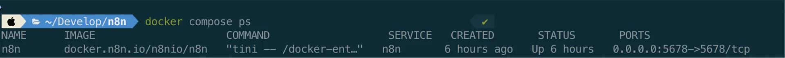
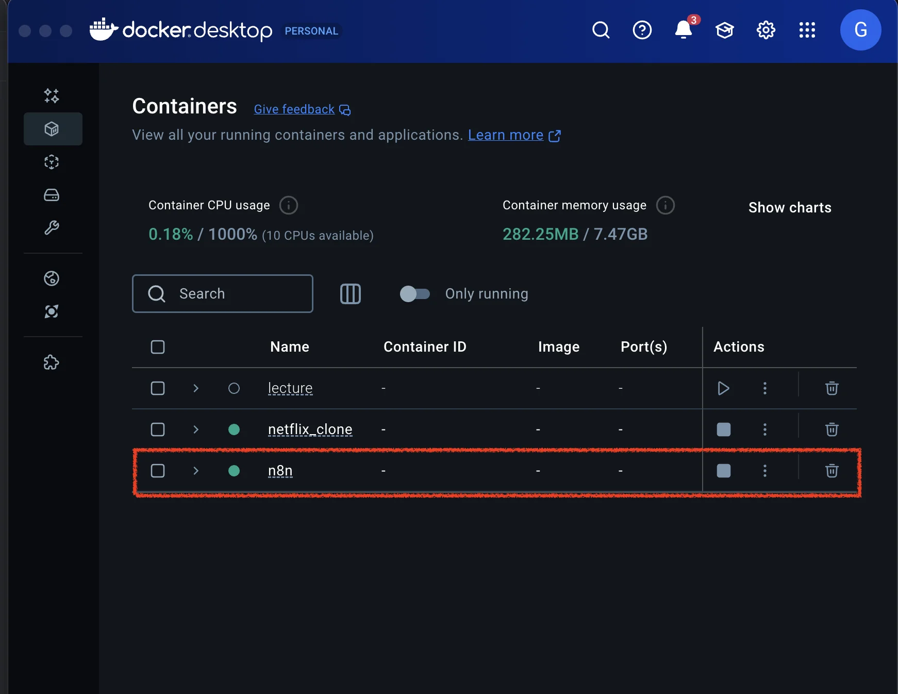

<a id="2a0eda9b0fe18049ad56c32b45a919f0"></a>

### 도커 이미지 기반 로컬 환경 빌드

- <code>compose&#46;yml</code> 파일 생성
    <a id="2a0eda9b0fe180c1bd3eda1f80fce1b4"></a>

    ```bash
    services:
      n8n:
        image: docker.n8n.io/n8nio/n8n
        container_name: n8n
        ports:
          - "5678:5678"
        volumes:
          - n8n_data:/home/node/.n8n
        restart: unless-stopped

    volumes:
      n8n_data:

    ```

- docker compose 실행
    <a id="2a0eda9b0fe180cd9a20ef70d69f25df"></a>

    ```bash
    docker compose up -d
    ```

- n8n 이미지 실행 확인
    - docker cli 확인
        <a id="2a0eda9b0fe18078953acf4dd3adcff6"></a>

        ```bash
        docker compsoe ps
        ```

        

    - docker desktop 확인
        
