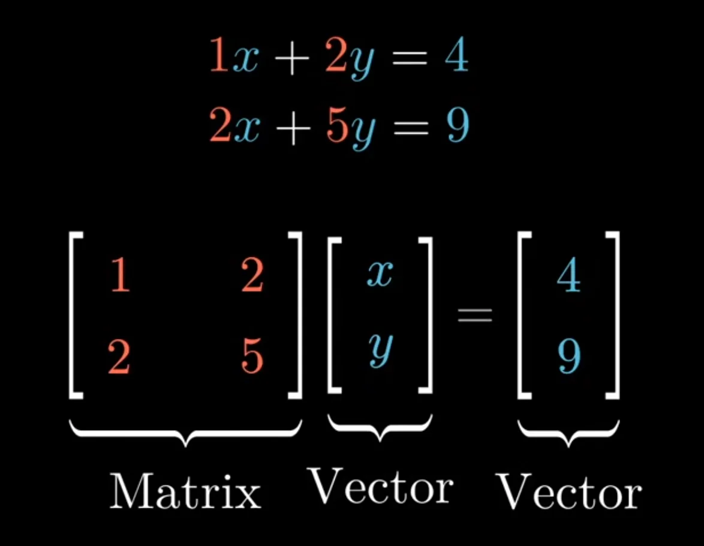
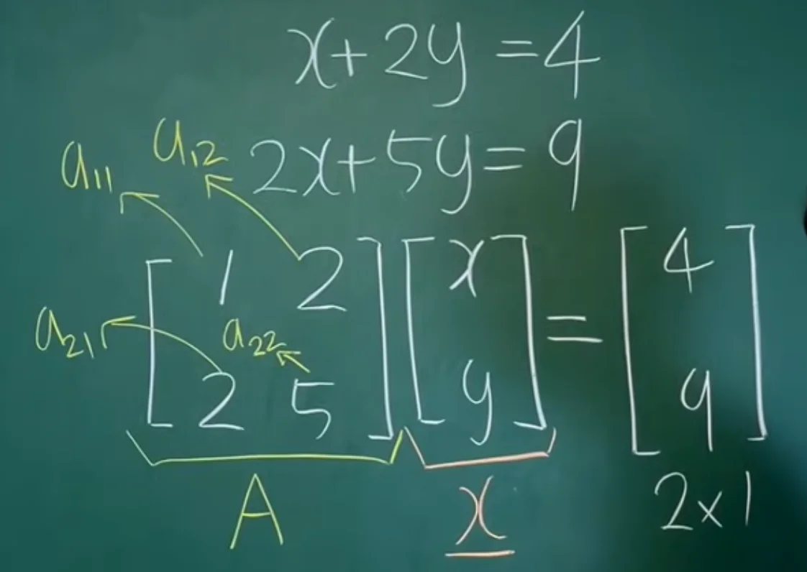

[&#91;선대&#93; 1&#45;2강&#46; 행렬과 벡터 &#124; 모든 것의 시작은 연립일차방정식&#33;]()

- <code class="language-math">x &#43; 2y = 4</code>

- <code class="language-math">2x &#43; 5y = 9</code>

첫번째 식에 2를 곱해서 빼면 y를 구할 수 있다&#46; 그러면 x, y의 해를 구하는 것이 가능하다&#46; 

미지수의 개수 즉, 차원이 같은 경우 앞의 계수를 통해서 답을 구할 수 있다&#46; 

이를 수학적으로 표현한 것이 행렬과 백터이다&#46; 

