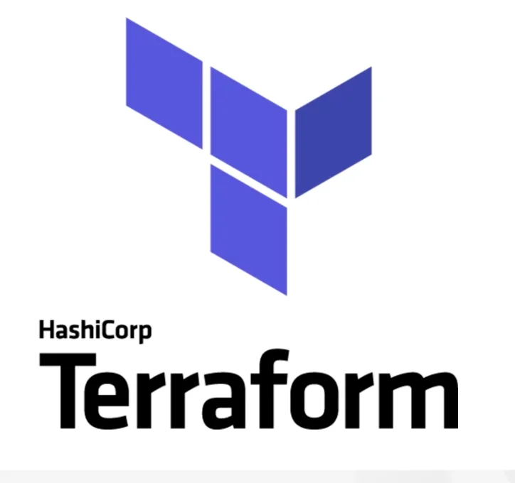
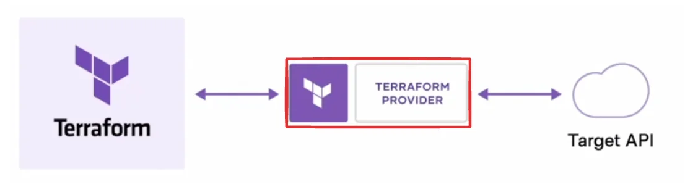
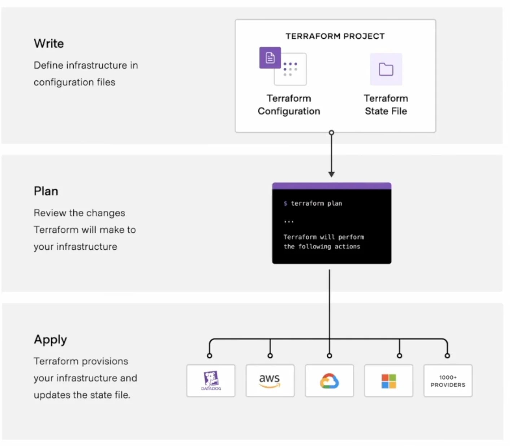
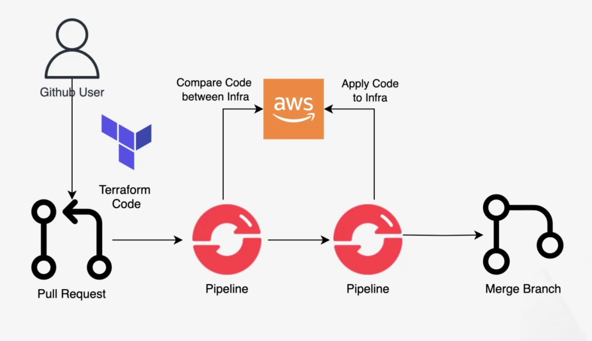
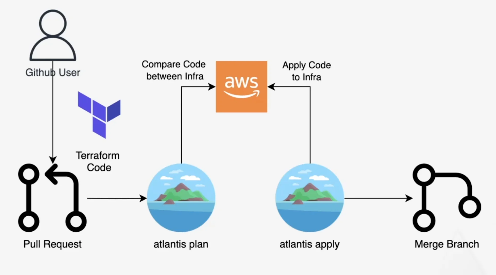
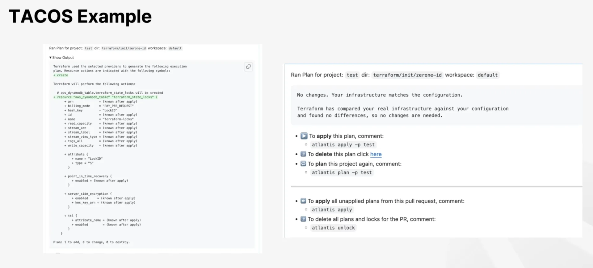

## Terraform

---

> 📖 
> 
> 
> 
> 
> 
> HashiCorp 사에서 만든 인프라 프로비저닝(IaC) 도구이다&#46; 
> 
> - <code>AWS</code>·<code>Azure</code>·<code>GCP</code>·<code>온프레미스</code>·<code>SaaS</code> 등 <strong><u>다양한 리소스를 </u></strong><strong><u>하나의 선언적 구성 파일로 관리</u></strong> 가능하다&#46; 
> 
> - HCL 문법 사용하고 있으며, 내부적으로 <code>json</code>, <code>yaml</code> 등과 같은 형태로 사용할 수 있도록 지원한다&#46;
> 
> - <code>“원하는 최종 상태(desired state)”</code>를 <code>HCL(HashiCorp Configuration Language)</code>로 적어두면, Terraform이 현재 상태와 비교해 필요한 생성·수정·삭제 작업(plan)을 계산하고 적용(apply)한다&#46;
> 
> - 오픈소스로 시작했으나, 현재는 라이센스가 변경되었다&#46;

동작 방식

테라폼의 프로바이더를 통해 특정 리소스를 정의하게  되면 지정한 엔드포인트의 API를 호출해 실제 리소스의 프로비저닝 하는 방식이다&#46; 

- 각 서비스 마다 프로바이더를 제공하며 설정 파일을 통해 조작하여 인프라를 구성한다&#46; 

- CRD, CRUD 와 같은 API를 문법을 통해서 호출하는 것과 같다&#46;

- <code>Write</code>
    - 내가 구성하고 싶은 인프라를 테라폼 파일이나 스테이트 파일에 정의를 한다&#46; 

- <code>Plan</code>
    - 내가 구성한 파일 실제 리소스에 어떻게 생성되는지  볼수 있는 단계이다&#46; 

    - 로컬 환경에서도 권한이 있으면 실행 가능하다&#46; 

    - 흔히 remote, github 와 같은 환경에서 자동 실행해주는 Plan 도구를 활용해서 해당 결과를 다른 사람들과 공유해 많이 사용하게 된다&#46; 

- <code>Apply</code>
    - 실제 Write 과정에서 구성된 Configuration을 가지고 Plan을 통해 결과를 확인하고 예상된 결과와 일치하면 Apply를 통해 실제 환경에 반영한다&#46; 

    - ex) SaaS &#45; DataDog, AWS, GCP, Azure 등 매우 많은 프로바이더들이 제공된다&#46; 

왜  Terraform 을 사용하는가?

- <code>자동화</code>
    - 코드로 실행되기 때문에 여러 인프라를 빠르게 구성할 수 있고, 서버 운영 및 관리 자동화가 가능하다&#46; 

- <code>인프라 추적</code>
    - 변경되는 인프라에 대해 코드를 관리함으로써 쉽게 추적 가능하다&#46; 

- <code>구성 표준화 </code>
    - 동일한 서비스를 다른 환경에 올리더라도 구성을 표준화시켜 리소스 생성이 가능하다&#46; 

- <code>형상 관리</code>
    - Git 을 통한 형상 관리가 가능하다&#46; 
        - 어떤 리소스가 변경되는지 파악 가능

- <code>리뷰 및 안정</code>
    - 여러 사람이 코드를 리뷰하고, 승인해 줌으로써 실수를 예방할 수 있음

GitOps, Terraform

> 📖 
> 
> 
> 
> GitOps는 <code>Single Source of Truth</code> 즉, <strong><u>단일 소스 코드 원칙에 형상이 같</u></strong>다는 것을 보장할 수 있다&#46; 따라서 Terraform에 GitOps 패턴을 사용하면 위 그림과 같이 작업 가능하다&#46; 

- Terraform을 통해 인프라를 코드 레벨로 버전 관리 및 협업 진행이 가능해진다&#46; 

## <strong>TACOS </strong>( <strong><u>T</u></strong>erraform <strong><u>A</u></strong>utomation and <strong><u>CO</u></strong>laboration <strong><u>S</u></strong>oftware )

---

> 📖 
> 
> 
> 
> <strong><code>TACOS</code></strong><strong>는 </strong><strong><u>Terraform 워크플로우를 자동화·표준화·협업 가능</u></strong><strong>하게 만들어주는 </strong><strong><code>플랫폼/툴</code></strong><strong>들을</strong><strong> 묶어서 부르는 용어로 </strong><strong><u>팀·조직 단위에서 Terraform을 자동화하고 협업</u></strong>하기 위해 사용한다&#46;

- <code>Collaboration</code>
    - Git Tools을 통한 코드 관리로 여러 작업자가 인프라 코드를 공유해 협업 가능하다&#46; 

- <code>Remote Operation</code>
    - Local 환경에서 실행하는 것이 아닌, <strong><u>Remote 환경에서 실행</u></strong>

    - 작업자들 간에 결과를 공유 하면서 리뷰

- <code>Security</code>
    - RBAC이나 Audit, 민감 정보는 노출하지 않음으로써 인프라와 코드 자체에 대한 보안성 유지

### TACOS Tools

> 많은 타코스 툴들이 존재하지만, 아래 3가지 툴 추천

- <code>Atlantis</code> ( 실습 )

- <code>Terraform Cloud</code>

- <code>테라쿠베</code>

### <code>Atlantis</code> flow

예시) IaC 테스트용 pr

