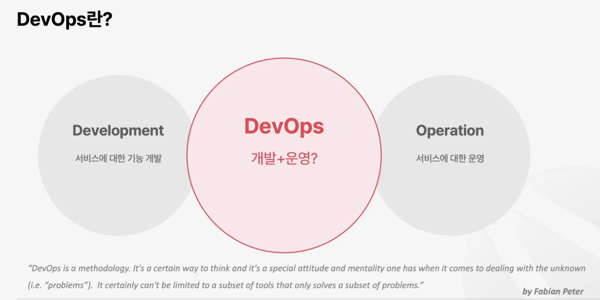
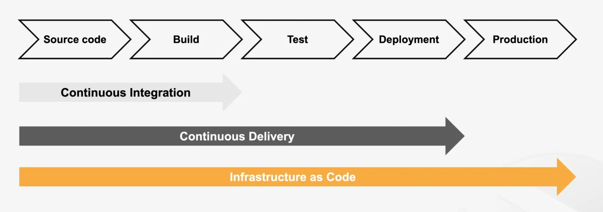
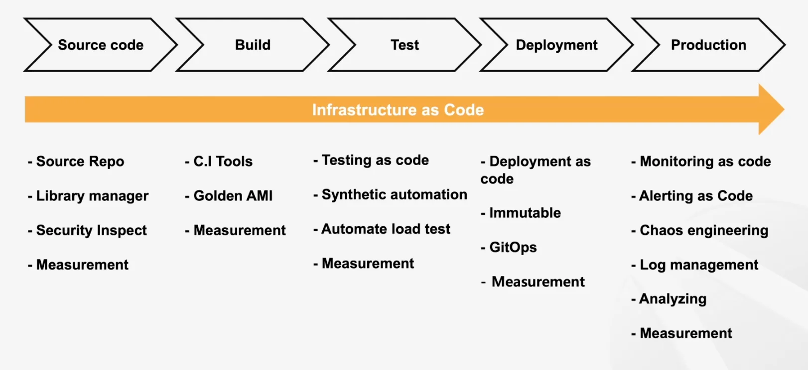
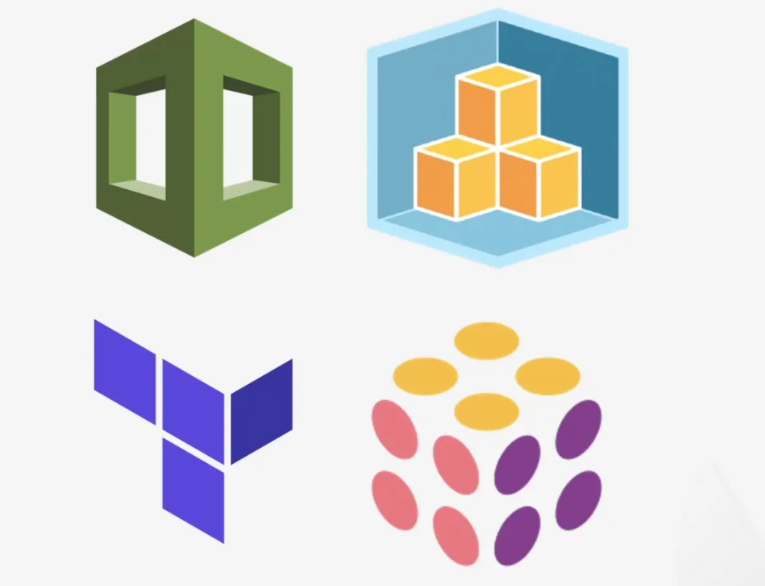
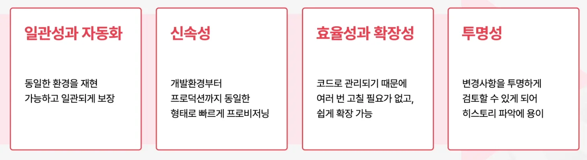

## DevOps

> 데브옵스는 방법론이다&#46; 알려지지 않은 것을 다룰 때 갖는 특별한 태도와 사고방식이다&#46; 

### DevOps  5가지 철합

- <code>문화(Culture)</code>&#58; 하나의 문화를 만든다&#46;

- <code>자동화(Automation)</code>&#58; 자동화를 통해 효율성 및 빠른 속도 지향

- <code>측정(Measurement)</code>&#58; 지표를 측정ㄹ하여 지속적으로 개선

- <code>공유(Share)</code>&#58; 공유를 통한 발전

- <code>축적(File Up &#38; Pipe Up)</code>&#58; 기록을 축적하고 더욱 개선

### CI/CD

- 개발 및 베포의 모든 과정에 <code>IaC</code>가 해당된다&#46;

1. Source code
    - 소스 레포 관리

    - 라이브러리 매니저 툴 설치 및 구성

    - 시큐리티(보안)을 지키기 위해 소스코드 레포 검사

1. Build
    - Jenkins, Github Action, GitLab Runner 와 같은 CI Tool세팅

    - GoldemAMI 와 같은 프로비저닝을 위한 준비 진행

1. Test
    - 테스트 케이스 정의

    - 자동화 테스트 셋업

    - Synthentic 

1. Deployment
    - 베포 전략
        - 블루그린 베포 전략

        - 카나리 베포 전략 

        - 롤링 베포 전략 

        

        등에 맞춰서 환경 구성 가능

    - 이 모든 과정을 immutable 하게 코드로 관리

1. Production
    - 모니터링 추가

    - 로그 관리

    - 카오스 엔지니어링을 통한 서비스

    - 인프라에 대한 레이턴시 측정

## Infrastructure as Code

[What is Infrastructure as Code with Terraform? &#124; Terraform &#124; HashiCorp Developer]()

> ✏️ 
> 
> - 인프라를 코드 레벨로 구성 파일을 통해 정의하여 관리
> 
> - IaC를  통해 <strong><u>리소스 구성을 정의하고 버전 관리, 재사용 및 공유</u></strong>함으로써 <strong><u>안전하고 일관적이며 반복 가능한 방식으로 인프라를 구축, 변경 및 관리</u></strong>할 수 있다&#46; 

### IaC에 대한 접근 방식

- 선언형
    - 구성하려는 최종 리소스와 설정을 선언하여 생성, 수정 및 삭제

    - ex) terraform

- 명령형
    - CLI를 통한 작업

    - Option에 따라 원하는 대로 생성, 수정 및 삭제

### IaC Tools

두가지 특성(선언형, 명령형)을 가진 다양한 프로비저닝 도구가 존재한다&#46; 

그중 선언형에 가까운 툴들을 소개한다&#46;

- 클라우트 포메이션
    - JSON, YAML 형태로 정의된 템플릿을 가지고 스택이라는 개념을 만들어서 인프라를 생성한다&#46; 

    - AWS에 종속적인 리소스이다&#46;

- AWS CDK (Cloud Develop kit)
    - 코드로써 관리하는 인프라  즉, 선언형 IaC 이다&#46;

    - 여러 프로그래밍 언어를 통해서 API를 호출함으로써 실제 리소스를 관리할 수 있다&#46; 

- Terraform
    - HCL, Paschoff Language 라는 선언형 문법을 통해서 프로비저닝한다&#46;

- 플루미
    - 선언형 IaC 도구

    - 자바스크립트, 하이스턴과 같은 다양한 언어를 통해 인프라 구성 가능

- 이외 다양한 IaC 도구들이 존재한다&#46; 

### DevOps에 IaC가 필요한 이유

