<a id="373eda9b0fe180dcad49e863f927056d"></a>

## Terraform 설치

[Install &#124; Terraform &#124; HashiCorp Developer]()

<a id="373eda9b0fe18052966ddddb29bae263"></a>

```bash
# macos 기준
brew tap hashicorp/tap
brew install hashicorp/tap/terraform

# 확인
terraform version
```

<a id="2c1eda9b0fe180ad8b8cce9ba879e03d"></a>

## Terraform CLI

[Terraform CLI overview &#124; Terraform &#124; HashiCorp Developer]()

> ✏️ 
> 
> - 모든 명령어에는 <code>terraform</code> prefix가 붙는다 &#46;
> 
> - <code>init</code> → <code>plan</code> → <code>apply</code> → <code>destroy</code> 
> 
> - 더 많은 명령어가 존재한다&#46; 자세한 내용은 공식 문서 확인

> ❗ 
> 
> <a id="373eda9b0fe1808b993ae5e623fd8a3f"></a>
> 
> 초기화 시 terraform configuration file을 먼저 정의해야 한다&#46;
> 
> 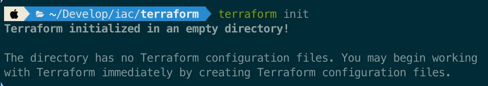

<details>
<summary><code>init</code></summary>

[terraform init command reference &#124; Terraform &#124; HashiCorp Developer]()

<a id="2c1eda9b0fe180e3b545ce0f3b81e9e6"></a>

```bash
terraform init [options]
```

- 새로운 프로젝트 시작, 벡엔드 설정 변경, 프로바이더나 모듈 표준을 변경 했을 때 등 <strong><u>기존 디렉토리에서 새로운 작업을 시작</u></strong>할 때 사용

- 모듈 <br>→ 모듈과 관련된 리소스 패키지 다운<br>→ S3 백엔드 저장 <br>→ 상태에 접근 가능

</details>

<details>
<summary><code>fmt</code></summary>

[terraform fmt command reference &#124; Terraform &#124; HashiCorp Developer]()

<a id="374eda9b0fe1807db0fccb0838346b1c"></a>

```bash

```

- 여러 협업자가 같은 파일을 작업할 때 유용
    - 테라폼 작성 시 문법에 대한 스타일 가이드

    - 린트, 포맷팅을 통해 코드 일관성 유지 → 가독성 ↑

</details>

<details>
<summary><code>plan</code> </summary>

[terraform plan command reference &#124; Terraform &#124; HashiCorp Developer]()

> ✏️ 
> 
> <a id="374eda9b0fe1806f880ad399f942a9c6"></a>
> 
> 작성한 테라폼 소스가 실제 리소스에 어떻게 반영될 지 계획을 보여주는 명령어<br>실제 리소스에 반영되지 않기 때문에, 여러번 실행해도 상관없음

<a id="2c1eda9b0fe1800685b7d6b7e20d7c44"></a>

```bash
terraform plan
```

<details>
<summary><strong>옵션 &#45; Destroy mode (</strong><strong><code>&#45;destroy</code></strong><strong>)</strong></summary>

<a id="374eda9b0fe180018382d60b80c57b9f"></a>

```bash
terraform plan -destory
```

- 테라폼의 <strong><u>리소스 제거 계획을 확인</u></strong> 가능
    - <code>terraform destroy</code> or <code>terraform apply &#45;destory</code>의 계획 확인

</details>

<details>
<summary><strong>옵션 &#45;  Refresh&#45;only mode (</strong><strong><code>&#45;refresh&#45;only</code></strong><strong>)</strong></summary>

<a id="374eda9b0fe180adb66cd0888dcd75a0"></a>

```bash
terraform plan -refresh-only
```

- 테라폼 리소스에 대한 리프레쉬 계획 확인

</details>

</details>

<details>
<summary><code>apply</code></summary>

[terraform apply command reference &#124; Terraform &#124; HashiCorp Developer]()

<a id="2c1eda9b0fe180f1a595c42f50f875ce"></a>

```bash
terraform apply
```

- <code>plan</code>을 통해 올바른 계획인지를 확인한 후, <code>apply</code> 명령어를 통해 실제 인프라 리소스 반영

- 실제 실행 전 계획을 확인 후 <code>yes</code> 입력을 통해 생성

</details>

<details>
<summary><code>destroy</code></summary>

[terraform destroy command reference &#124; Terraform &#124; HashiCorp Developer]()

<a id="2c1eda9b0fe1808ba6aade05cd72a4e7"></a>

```bash
# 실제 리소스 삭제
terraform destroy

# 동일한 의미
terraform apply -destroy

# 리소스 삭제에 대한 계획 확인
terraform plan -destroy
```

- <code>terraform apply</code>에 대한 <code>&#45;destroy</code> 옵션은 Terraform v0&#46;15&#46;2 이후 버전부터 지원한다&#46; 

</details>

<details>
<summary><code>console</code></summary>

[terraform console command reference &#124; Terraform &#124; HashiCorp Developer]()

<a id="2c1eda9b0fe1802e8b50d5b24b109c18"></a>

```bash
terraform console
```

- 표현식을 평가하기 위한 <strong><u>대화형 콘솔을 연</u></strong>다<br>이를 통해 실제 설정 파일에 적용하기 전, <strong><u>표현식(함수, 변수…)의 I/O 값을 확인</u></strong>할 수 있다&#46; 

<a id="2c1eda9b0fe180eb833ac3ce71d372e2"></a>

#### 예제

> <code>terraform console</code>을 통해 콘솔창을 연 다음 아래 예제가 실행됨

<details>
<summary>ex 1) 파이프(<code>&#124;</code>)</summary>

<a id="2c1eda9b0fe180c2bce8e3a78ba9d7e6"></a>

```bash
echo 'split(",", "foo,bar,baz")' | terraform console

# 출력 
tolist([
  "foo",
  "bar",
  "baz",
])
```

</details>

<details>
<summary>ex 2) 객체 &#45; 필드, 메서드 출력</summary>

<a id="2c1eda9b0fe180b6b0d0d3510fa617dd"></a>

```bash
variable "apps" {
  type = map(any)
  default = {
    "foo" = {
      "region" = "us-east-1",
    },
    "bar" = {
      "region" = "eu-west-1",
    },
    "baz" = {
      "region" = "ap-south-1",
    },
  }
}

resource "random_pet" "example" {
  for_each = var.apps
}

```

<a id="2c1eda9b0fe180968843e03b9f9ab190"></a>

```bash
> var.apps.foo

# 출력
{
  "region" = "us-east-1"
}
```

<a id="2c1eda9b0fe18017803ad9d0fe7b7d10"></a>

```bash
> { for key, value in var.apps : key => value if value.region == "us-east-1" }

# 출력
{
  "foo" = {
    "region" = "us-east-1"
  }
}
```

</details>

<details>
<summary>ex 3) 함수 출력</summary>

<a id="2c1eda9b0fe18054bea4c0c9ce0d25af"></a>

```bash
> cidrnetmask("172.16.0.0/12")

# 출력
"255.240.0.0"
```

</details>

</details>

<details>
<summary><code>import</code></summary>

[terraform import command reference &#124; Terraform &#124; HashiCorp Developer]()

<a id="2c1eda9b0fe18029bb1fd35ac18f910d"></a>

```bash
terraform import [options] ADDRESS ID
```

- 기존 리소스들을 terrform으로 가져온다&#46; 
    - ‣

- 수동으로 리소스 구축 후, 코드화를 시킬려고 할 때 많이 사용
    - 이전에 수동으로 많이 만들었던 리소스들을  테라폼 도입을 통해 새로 프로비저닝을 할수 없는 상황이 되면 terraform import를 통해서 이전 리소스들을 코드화 시켜 관리할 때 용이

</details>

<details>
<summary><code>force&#45;unlock</code></summary>

[terraform force&#45;unlock command reference &#124; Terraform &#124; HashiCorp Developer]()

<a id="2c1eda9b0fe180d6873bf0f1d744923e"></a>

```bash
terraform force-unlock [options] LOCK_ID
```

- AWS 환경에서 테라폼을 관리하게 되면, S3와 다이나모 DB로 구성할 수 있다&#46;

- 이때 다이나모 DB에 락 ID를 통해 DB에 락을 걸 수 있는데,  <br>특정 사용자가 <code>apply</code>를 치다가  <code>ctrl &#43; C</code> 와 같은 abort(중단)을 하는 경우,  락이 풀리지 않아 DB에 락이 계속 걸려 있는 오류가 발생된다&#46; 
    <a id="2c1eda9b0fe18025ae27fa5f268c3744"></a>

    여기서 <code>force&#45;unlock</code>을 통해 강제로 락을 풀어서 해결한다&#46;

</details>

<details>
<summary><code>output</code></summary>

[terraform output command reference &#124; Terraform &#124; HashiCorp Developer]()

<a id="2c1eda9b0fe180b28226eb8a30f3450c"></a>

```bash
terraform output [options] [NAME]
```

- 정의된 output 값들을 출력(확인)

<a id="374eda9b0fe180e0b1e6e70e70966a56"></a>

#### 예시

<details>
<summary>예시 1  &#45; output 전체 변수 출력</summary>

<a id="374eda9b0fe1800b889adf668fda568f"></a>

```json
// outputs.tf
output "instance_ips" {
  value = aws_instance.web.*.public_ip
}

output "lb_address" {
  value = aws_alb.web.public_dns
}

output "password" {
  sensitive = true
  value     = var.secret_password
}
```

<a id="374eda9b0fe18029b41ee43b6ac9cf43"></a>

```python
terraform output
""" 출력값
instance_ips = [
  "54.43.114.12",
  "52.122.13.4",
  "52.4.116.53"
]
lb_address = "my-app-alb-1657023003.us-east-1.elb.amazonaws.com"
password = <sensitive>
"""
```

- <code>sensitive = true</code> 값은 <strong>&#60;sensitive&#62;로 마스킹 처리되어 출력</strong>

</details>

<details>
<summary>예시 2 &#45; 특정 output 변수 출력</summary>

<a id="374eda9b0fe1805ba9c7e56b2b6e3c93"></a>

```json
terraform output lb_address
"my-app-alb-1657023003.us-east-1.elb.amazonaws.com"
```

- 변수명을 지정하며 특정 값만 확인 가능

</details>

</details>

> 여러 프로젝트를 terraform으로 관리하면 각 프로젝트 마다 state로 관리된다<br>이를 확인하는 명령어가 아래와 같다&#46; 

<details>
<summary><code>state list</code></summary>

[terraform state list command reference &#124; Terraform &#124; HashiCorp Developer]()

<a id="2c1eda9b0fe180009ca1fbfbe14c20a1"></a>

```bash
terraform state list [options] [address...]
```

- 지정한 백엔드의 생성된 리소스들에 대해서 출력

- 같은 프로젝트에 구성된 state(리소스)들을 확인 간으
    - 컨테이너, 이미지 둘다 확인 가능
        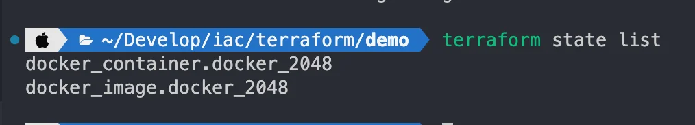

<a id="374eda9b0fe1802db338f9dca1fa9393"></a>

### 예시 

<details>
<summary>프로젝트 내 생성된 모든 리소스(state) 조회</summary>

<a id="374eda9b0fe180d4bf98ed82cd5934ca"></a>

```json
terraform state list

""" 출력 예시
aws_instance.foo
aws_instance.bar[0]
aws_instance.bar[1]
module.elb.aws_elb.main
"""
```

</details>

<details>
<summary>특정 리소스(들) 조회 (필터링)</summary>

- 필터링&#58; 리소스
    <a id="374eda9b0fe180e6bb56f9d6b4c885eb"></a>

    ```json
    terraform state list aws_instance.bar

    aws_instance.bar[0]
    aws_instance.bar[1]
    ```

- 필러링&#58; 모듈
    <a id="374eda9b0fe1809e9213eb4cedb1ef88"></a>

    ```json
    terraform state list module.elb

    module.elb.aws_elb.main
    module.elb.module.secgroups.aws_security_group.sg
    ```

- 필러링&#58; ID
    <a id="374eda9b0fe1804c87d8c816ee4eec70"></a>

    ```json
    terraform state list -id=sg-1234abcd

    module.elb.aws_security_group.sg
    ```

</details>

</details>

<details>
<summary><code>state mv</code></summary>

[terraform state mv command reference &#124; Terraform &#124; HashiCorp Developer]()

<a id="2c1eda9b0fe180c29b69c89bef2f246e"></a>

```bash
terraform state mv [options] SOURCE DESTINATION
```

- <code>mv</code> cli 와 동일 
    - 생성한 state의 이름만 변경 가능
        - 잘못된

        - 실제 리소스는 변경되지 않음

    - 해당 state 이동 가능

- 예제는 공식 문서 확인

</details>

<details>
<summary><code>state rm</code></summary>

[terraform state rm command reference &#124; Terraform &#124; HashiCorp Developer]()

<a id="2c1eda9b0fe18066adbacee56142f0b0"></a>

```bash
terraform state rm [options] ADDRESS...
```

- state 제거

- 테라폼 리소스들 간의 종속성이 존재하는 경우, 상위부터 차례로 제거 가능

- 1&#46;7 이상부터 <code>remove</code> 키워드로 대체

</details>

<a id="2c1eda9b0fe1800c9687ff2ada60aac9"></a>

## 실습

[Build infrastructure &#124; Terraform &#124; HashiCorp Developer]()

<a id="373eda9b0fe1800ab7dcefc9a99ebd6c"></a>

```bash
# terraform 설치가 정상 완료되었다는 가정 하에 진행
mkdir demo
cd demo

# 1. config 파일 정의
touch main.tf
touch provider.tf
touch outputs.tf

# 2. terraform 초기화
terraform init

# 3. terraform 리소스 생성 계획 확인
terraform plan

# 4. terraform 실제 리소스 생성
terraform apply

# 5. terraform 리소스 제거
terraform apply -destroy

```

<details>
<summary>provider&#46;tf</summary>

<a id="373eda9b0fe18016a18bdd1c14e916a1"></a>

```json
terraform {
  required_providers {
    docker = {
      source = "kreuzwerker/docker"
      version = "~> 4.2.0"
    }
  }
}

provider "docker" {}
```

</details>

<details>
<summary>main&#46;tf</summary>

<a id="373eda9b0fe1807ab3fcccc53b50a282"></a>

```json
resource "docker_image" "nginx" {
  name         = "nginx:latest"
  keep_locally = false
}

resource "docker_container" "nginx" {
  image = docker_image.nginx.image_id
  name  = "tutorial"
  ports {
    internal = 80
    external = 8000
  }
}
```

</details>

<details>
<summary>outputs&#46;tf</summary>

<a id="374eda9b0fe180dfa515c05f9f972637"></a>

```json
output "docker_container_id" {
	value = docker_container.nginx.id
}

output "docker_container_network_data" {
	value = docker_container.nginx.network_data
}
```

<a id="374eda9b0fe180e387cdda3a14ef448b"></a>

현재 리소스의 output 값을 알아야 value로 지정할 수 있다&#46; 

</details>

<a id="374eda9b0fe180e3a298ca091981186e"></a>

### Config 파일 정의

<a id="374eda9b0fe1808f8fdcfeeb17e340ce"></a>

#### outputs&#46;tf

> ✏️ 
> 
> <a id="374eda9b0fe180e080bdf17306ff9b5c"></a>
> 
> <code>outputs&#46;tf</code> 는 현재 리소스의 output 값을 알아야 value로 지정할 수 있다&#46; <br>따라서 terraform에서 지원하는 사용하는 리소스의 output 형태를 확인하고 그에 맞게 value를 설정한다&#46; 

[Terraform Registry]()

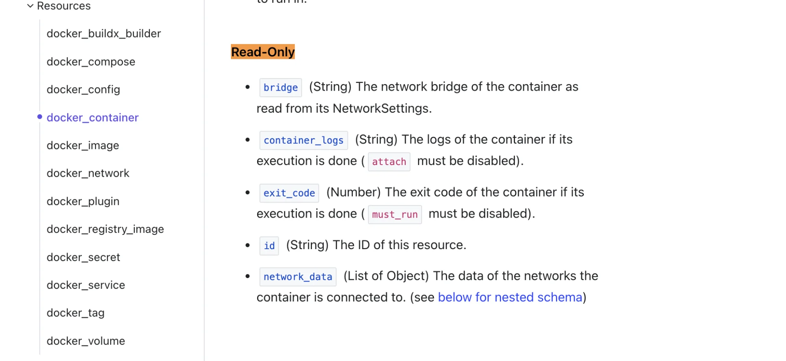

- 테라폼에서 지원하는 <strong><u>docker contianer 리소스에 대한 하는 output 형태</u></strong> 5가지
    - <code>bridge</code>

    - <code>container&#95;logs</code>

    - <code>exit&#95;code</code>

    - <code>id</code>

    - <code>network&#95;data</code>

<a id="374eda9b0fe180128364c857ea29eb07"></a>

이 중 <code>id</code>, <code>network&#95;data</code>를 outputs value로 설정

<a id="374eda9b0fe180b2baeac8c1ddb7e29c"></a>

```json
output "docker_container_id" {
	value = docker_container.nginx.id
}

output "docker_container_network_data" {
	value = docker_container.nginx.network_data
}
```

<a id="374eda9b0fe180f4b2c4dd3d69f4202c"></a>

### terform 실행

<details>
<summary>1&#46;  terraform 초기화</summary>

<a id="374eda9b0fe180fa928cfa95366e6a42"></a>

```json
terraform init
```

<details>
<summary>init → plugin, backend 실행</summary>

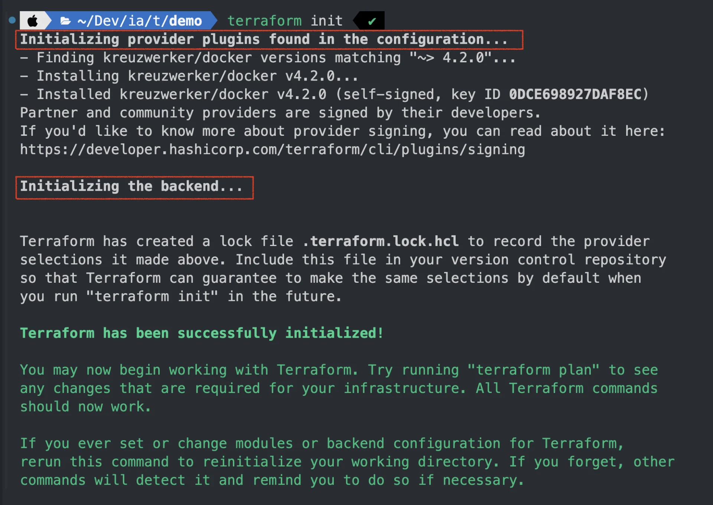

</details>

</details>

<details>
<summary>2&#46;  terraform 리소스 생성 계획 확인</summary>

<a id="374eda9b0fe180bdb58bfdda9d27ed42"></a>

```bash
terraform plan
```

<details>
<summary>설정한 main, output에 따라 리소스를 생성 계획 확인</summary>

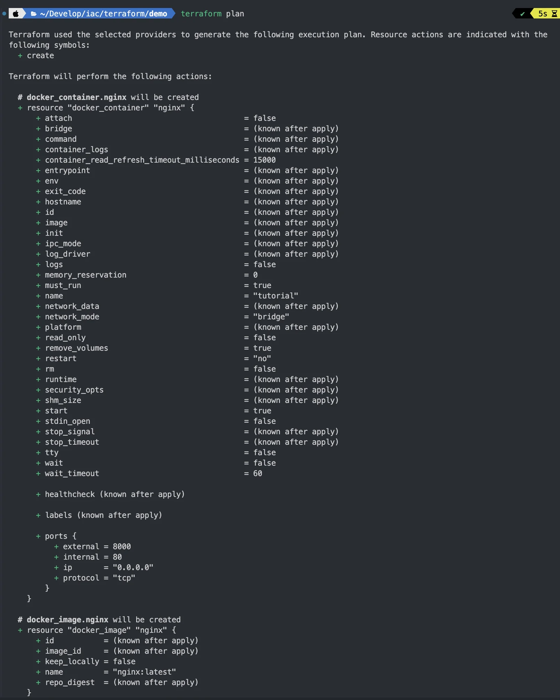

</details>

</details>

<details>
<summary>3&#46;  terraform 리소스 생성</summary>

<a id="374eda9b0fe180c0b25ef5879dfa42d0"></a>

```bash
terraform apply 
# yes
```

- <code>terraform plan</code>에서 확인한 계획을 가지고 실제 리소스를 생성한다&#46;
    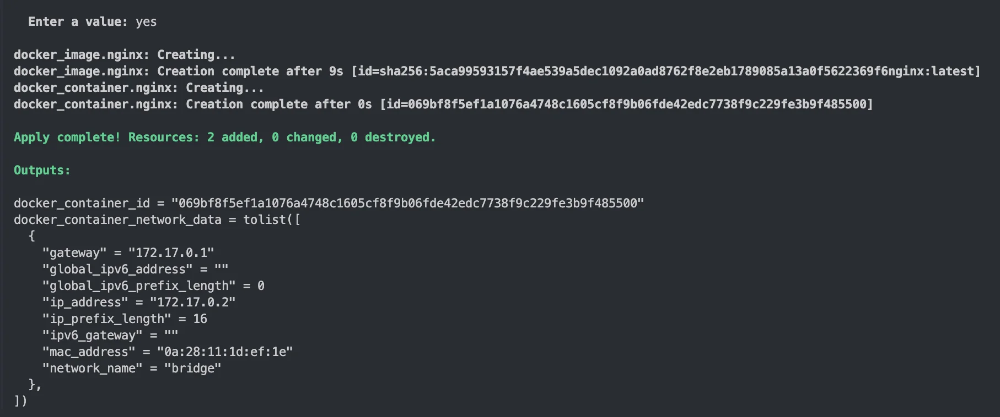

    - 생성된 컨테이너의 세부 정보들이 이미지와 같이 로그 값으로 출력된다&#46; 

- 로그로 출력된 id와 실제 생성된 도커 컨테이너 id 가 동일한 것을 확인할 수 있다&#46; 
    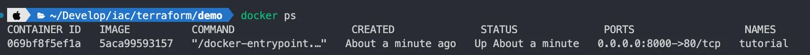

- 생성된 컨테이너 포트로 접속 시 정상 실행된 것을 확인 가능
    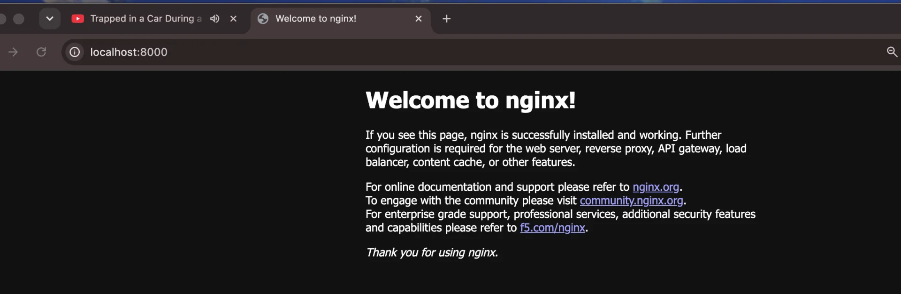

</details>

<a id="374eda9b0fe180a8a56ffd592c1c377b"></a>

### 이미지 바꿔서 실습

<details>
<summary>변경할 컨테이너 이미지 복사&#58; <code>2048</code></summary>

[ECR Public Gallery]()

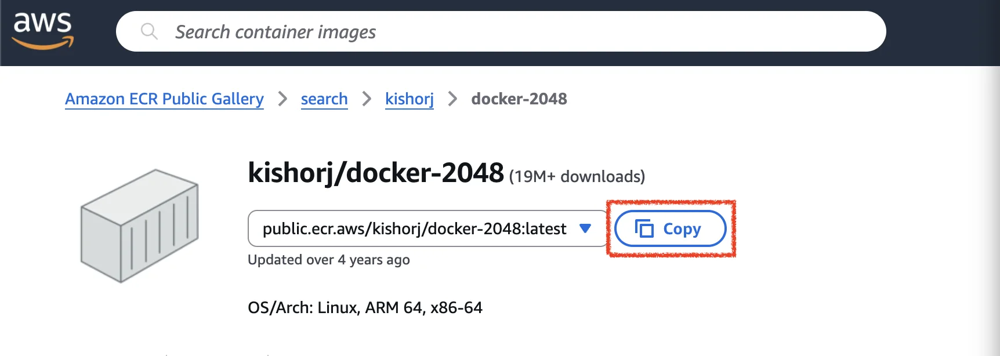

</details>

<details>
<summary>config에 이미지 변경</summary>

<a id="374eda9b0fe18009ab65dd564f8def38"></a>

```json
// main.tf
resource "docker_image" "docker_2048" {
  name         = "public.ecr.aws/kishorj/docker-2048:latest"
  keep_locally = false
}

resource "docker_container" "docker_2048" {
  image = docker_image.docker_2048.image_id
  name  = "tutorial"
  ports {
    internal = 80
    external = 8080
  }
}

// outputs.tf
output "docker_container_id" {
	value = docker_container.docker_2048.id
}

output "docker_container_network_data" {
	value = docker_container.docker_2048.network_data
}
```

</details>

<details>
<summary>plan 확인</summary>

<a id="374eda9b0fe18073b4f3e7211016190f"></a>

```json
terraform plan
```

- 출력되는 실행 계획(plan) 확인 시 <strong><u>변경된 컨테이너 이미지 빌드</u></strong> 및 <strong><u>이전 빌드한 이미지 제거 계획</u></strong>까지 잡혀있는 것을 확인할 수있다&#46; 

<details>
<summary>출력 확인</summary>

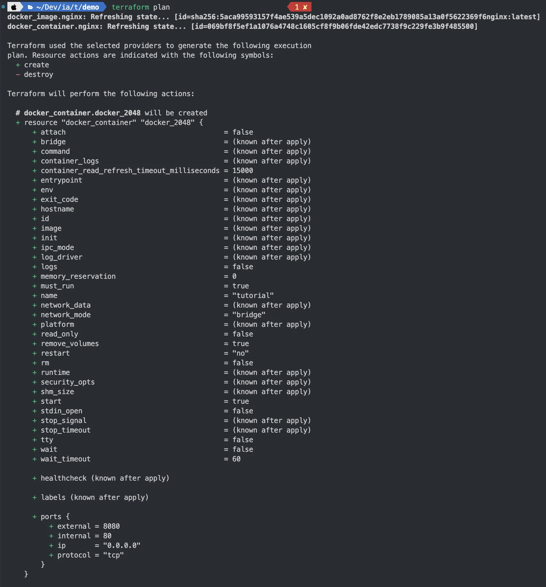

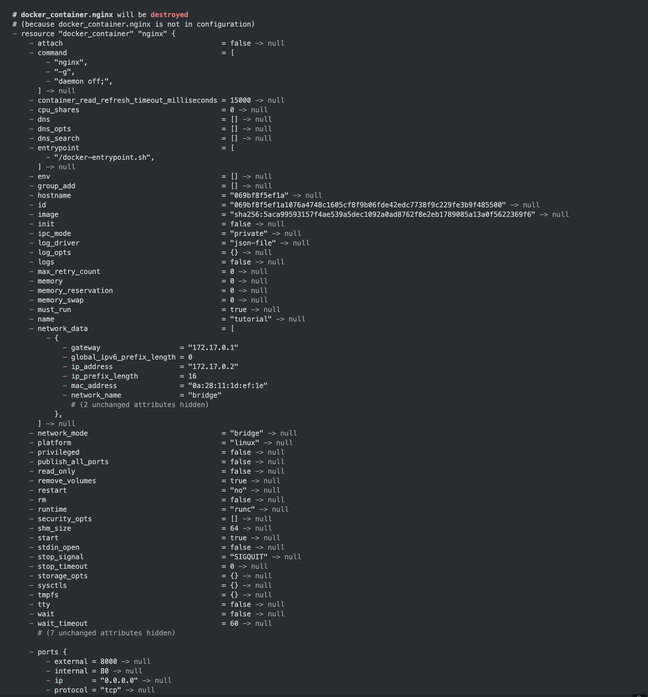

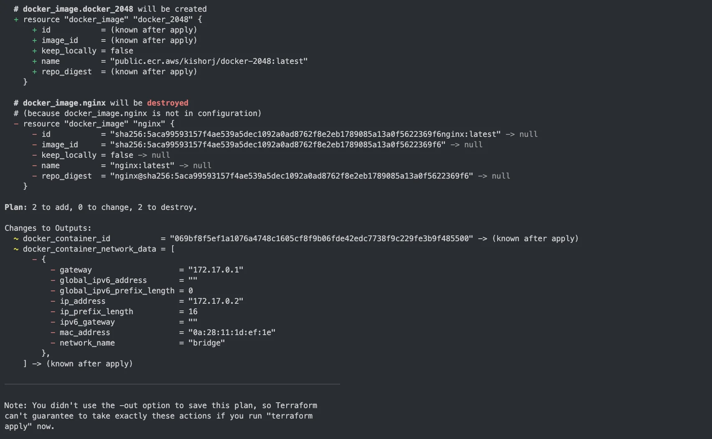

</details>

</details>

<details>
<summary>plan 실행 (실제 리소스 생성)</summary>

<a id="374eda9b0fe1800289c6c874c17adb05"></a>

```bash
terraform apply
# yes
```

<details>
<summary>이전에 생성한 nginx 리소스가 정리되고 새로 설정한 2048 리스소가 생성된 것을 확인할 수 있다&#46; </summary>

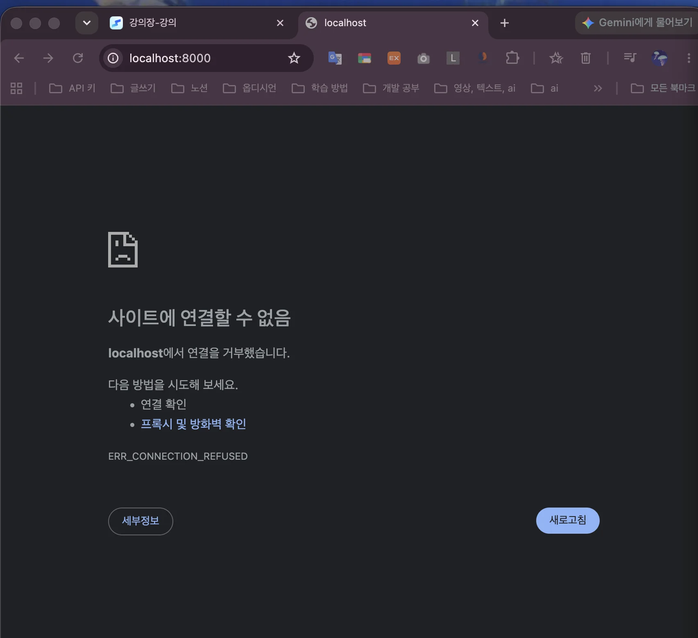


</details>

</details>

<details>
<summary>리소스 제거</summary>

<a id="374eda9b0fe180b58092eb32b4356567"></a>

```bash
terraform apply -destroy
```

<details>
<summary>로그 확인</summary>

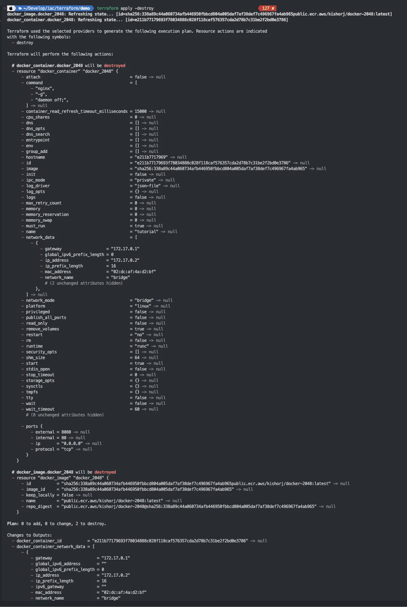

</details>

</details>
