> 
> 
> <a id="3c2eda9b0fe1806eb73ae65c953fb850"></a>
> 
> 목차
> 
> - [명령어](#3c2eda9b0fe180bb99dae4627a722624)
> - [저급 언어 두 종류: 기계어, 어셈블리어](#3c2eda9b0fe180fea75fe475a5f79e9c)
> - [[고급 언어 → 저급 언어]로 변환되는 대표적인 방식: 컴파일, 인터프리트](#3c2eda9b0fe1800dbdd6d5c1c763d711)
> - [[ 실습] 컴파일 - 명령어 관찰](#3c2eda9b0fe180dca6bbf3e238b78ddf)
> - [CLI](#3c2eda9b0fe18056a389d5983d4dc702)
> - [명령어 구조](#3c2eda9b0fe1803a9480fef9c50c0749)
> - [명령어](#3c4eda9b0fe18006ac20e750514ced05)
> - [오퍼랜드(피연산자)의 개수는 유동적이다. ](#3c4eda9b0fe180e9b798ded97848f620)
> - [지원하는 연산 과정에 따라 실제 실행 명령어의 개수가 달라진다. (연산 비용 최적화)](#3c4eda9b0fe1800190b4cde7f7fd2481)
> - [연산코드의 종류](#3c4eda9b0fe180108058efc098da8661)
> - [주소 지정](#3c4eda9b0fe180e48d81e831c2d1ec8d)
> - [🧐 왜 데이터를 직접 명시하지 않고 위치를 명시하는가?](#3c4eda9b0fe18095ad2fcd5171f2c4dc)
> - [주소 지정 ](#3c7eda9b0fe180a0b1ddd765d40b7b5c)
> - [주소 지정 방법](#3c7eda9b0fe1806fa741e951b250a37e)

<a id="3c2eda9b0fe180bb99dae4627a722624"></a>

## 명령어

---

> 
> 
> <a id="3c2eda9b0fe180b788b9f4fbe17de54c"></a>
> 
> <strong>소스코드 → 명령어</strong>
> 
> 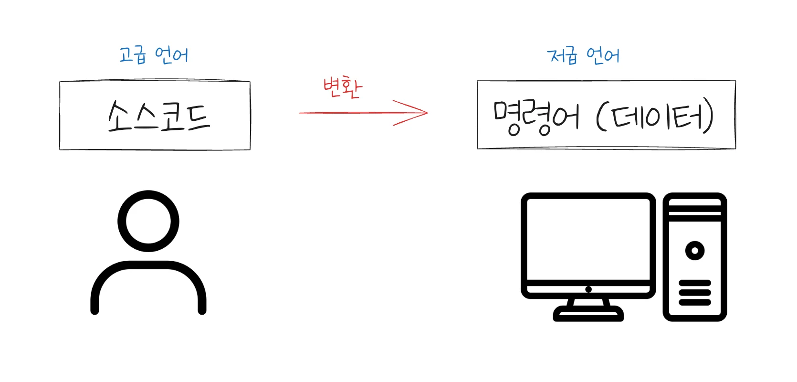
> 
> <a id="3c2eda9b0fe1801a8ae4d561b6049263"></a>
> 
> <code>고급언어</code>로 작성된 <strong><u>소스코드</u></strong>는 내부적으로 <code>저급언어</code>로 구성된 명<strong><u>령어와 데이터</u></strong>로 변환된다&#46; 
> 
> - <code>소스코드</code>는 사람(개발자)가 이해하기 편한 <strong><u>고수준 언어</u></strong>이다&#46; 
>     - ex) C, Java, Python …
> 
> - <code>명령어와 데이터</code>는 컴퓨터가 이해가기 편한 <strong><u>저수준 언어</u></strong>이다&#46; 
>     - ex) 기계어, 어셈블리어 …

<a id="3c2eda9b0fe180fea75fe475a5f79e9c"></a>

### 저급 언어 두 종류&#58; <code>기계어</code>, <code>어셈블리어</code>

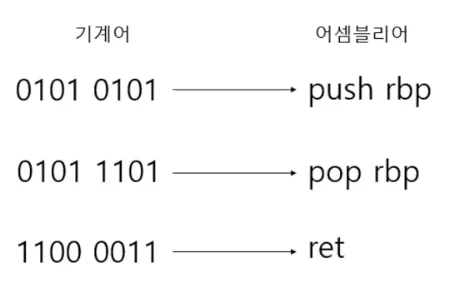

<details>
<summary>기계어 (machine code)</summary>

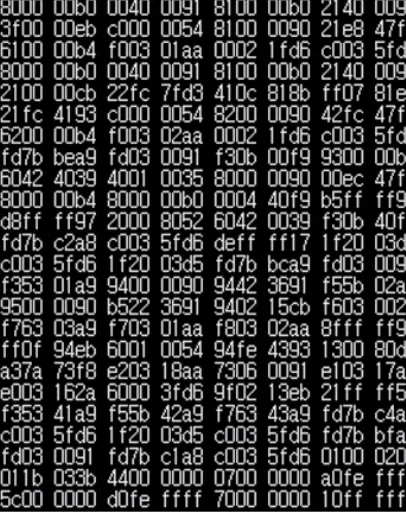

- 16 진수 → 2진수(0, 1) 
    <a id="3c2eda9b0fe18062855ac0818c43f30e"></a>

    = 컴퓨터가 직접 이해하는 가장 저수준의 언어 

</details>

<details>
<summary>어셈블리어 (assembly language)</summary>

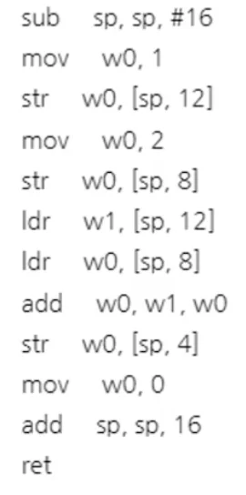

- 기계어를 사람이 보기 편하게 만든 언어 

- CPU가 어떤 명령어를 실행하는지 사람이 보기 편하게 만든 언어

</details>

> ✏️ 
> 
> <a id="3c2eda9b0fe18007b9dfc47692312821"></a>
> 
> <strong><code>CPU의 종류</code></strong><strong>, </strong><strong><code>고급어 → 저급어 변환 프로그램(컴파일러)</code></strong><strong>에 따라 <br>기계어, 명령어가 달라질 수 있다&#46; </strong>

<a id="3c2eda9b0fe180809e86edade40e4784"></a>

기게어, 어셈블리어는 통일되어 있는 정보가 아니다&#46; 

<a id="3c2eda9b0fe180228b7ee0240fd27fdf"></a>

같은 소스코드가 변환된 기계어 or 어셈블리어라고 할지라도 CPU의 종류에 따라서 기계어가 달라질 수 있다&#46; 

<a id="3c2eda9b0fe180c696d5f82e043c412d"></a>

또한 컴파일러의 종류에 따라서도 달라질 수 있다&#46; 

<a id="3c2eda9b0fe1800dbdd6d5c1c763d711"></a>

### <strong>&#91;고급 언어 → 저급 언어&#93;</strong>로 변환되는 대표적인 방식&#58; <code>컴파일</code>, <code>인터프리트</code>


<details>
<summary>컴파일</summary>

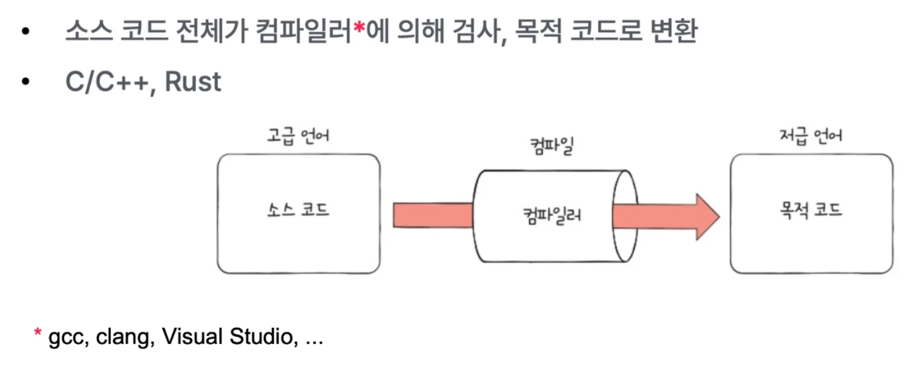

- 컴파일러라는 프로그램에 의해 소스 코드 전체가 한번 전부 검사된다&#46; 
    - 올바른 문법인지, 불필요한 코드는 없는지, 성능을 어떻게 낮출 수 있는지 등&#46;&#46; 

- 컴파일러를 통해 <code>소스코드(고급 언어)</code>를 <code>목적 코드(명령어, 저급언어)</code>로 변환시킨다&#46; 

- ex) 컴파일러 &#45; gcc, clang, Visual Studio …

- ex) 컴파일 언어 &#45; C/C&#43;&#43;, Rust …

</details>

<details>
<summary>인터프리트</summary>

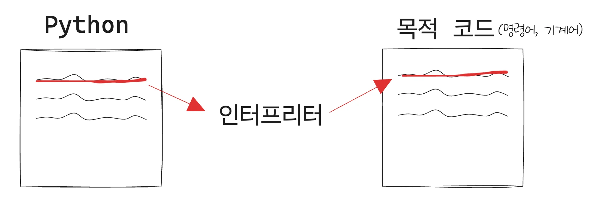

- 소스코드 한 줄씩 인터프리터에 의해 검사, 목적 코드로 변환

- Python, JavaScript

</details>

> 🤔 
> 
> > 누가 더 빠르나
> 
> <a id="3c2eda9b0fe180c2bf99ef0b27c91a7f"></a>
> 
> 컴파일이 된 상태에서는 컴파일 언어가 더 빠르다&#46;
> 
> - 한줄 씩 인터프리터에 의해 검사하는 것보다 컴파일된 내용(기계어, 0/1)을 한번에 검사하는 게 더 빠름
> 
> > 오류 
> 
> - 인터프리터는 한줄씩 실행하기 때문에, n 번째에서 오류가 발생되면 n&#45;1 줄 까지 실행된다&#46; 
> 
> - 컴파일은 한번에 검사를 하기 떄문에 오류가 있으면 실행되지 않는다&#46; 
>     - 컴파일 에러

> ☝🏻 
> 
> <a id="3c2eda9b0fe1800db8b7c7a5ef1f71a8"></a>
> 
> 주의
> 
> - 소스코드가 저급 언어로 변환되는 대표적인 방식일 뿐 <strong><u>컴파일 방식과 인터프리트 방식은 완전히 구분되는 개념</u></strong>은 아니다&#46; 
> 
> - 컴파일 언어의 특성과 인터프리트 언어의 특성을 모두 갖춘 언어도 존재
>     - 컴파일, 인터프리트 동시 &#45; <code>Python</code>, <code>Java</code>

<a id="3c2eda9b0fe180dca6bbf3e238b78ddf"></a>

### &#91; 실습&#93; 컴파일 &#45; 명령어 관찰

[Compiler Explorer]()

<details>
<summary>ex) c</summary>

<a id="3c2eda9b0fe180f883cdd9091c7eaa32"></a>

```c
# include <stdio.h>

int main()
{
    int a = 1;
    int b = 2;
    int c = a + b;
    printf("%d\n", c);
    return 0;
}
```

</details>

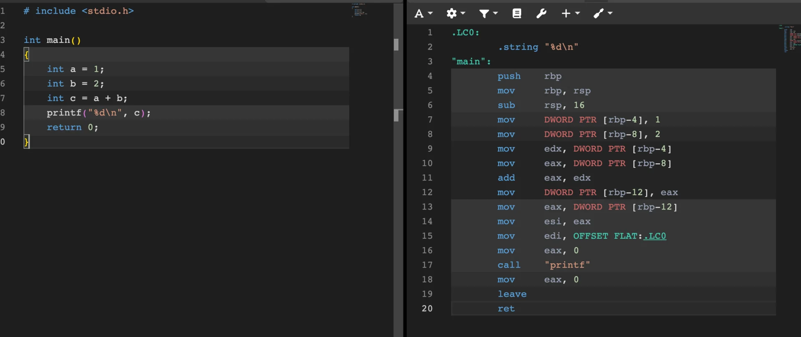

<a id="3c2eda9b0fe18037adbbecee510051f0"></a>

같은 <code>소스코드</code>라도 <code>cpu</code>, <code>컴파일러</code>의 종류의 따라서 <u>변환되는 결과가 달</u>라질 수 있다&#46;

<details>
<summary>다양한 종류의 컴파일러들이 존재</summary>

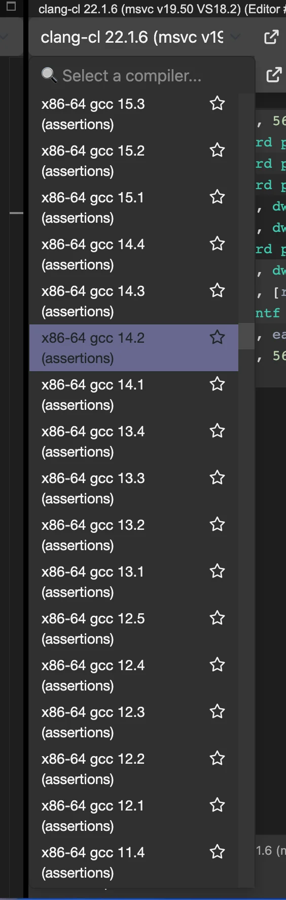

</details>

<a id="3c2eda9b0fe18056a389d5983d4dc702"></a>

#### CLI

<details>
<summary>ex) hello&#46;c</summary>

<a id="3c2eda9b0fe1806e94ccf4bdabaea761"></a>

```c
# include <stdio.h>

int main()
{
    printf("hello world\n");
    return 0;
}
```

</details>

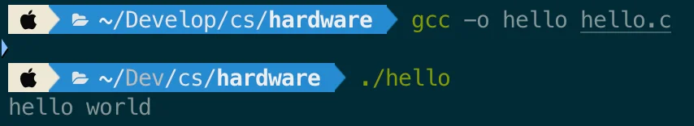

<a id="3c2eda9b0fe1802d80bcd7f7d881bb77"></a>

```bash
# gcc를 통해 hello.c 를 컴파일에 hello 파일에 쓴다. 
gcc -o hello hello.c

# 출력: hello world
./hello
```

<a id="3c2eda9b0fe1802cbe82c5b5df240f94"></a>

```bash
# 어셈블리어 변환 - hello.S 에 저장
gcc -S hello.c -o hello.S

cat hello.S
```

<details>
<summary>출력값 확인</summary>

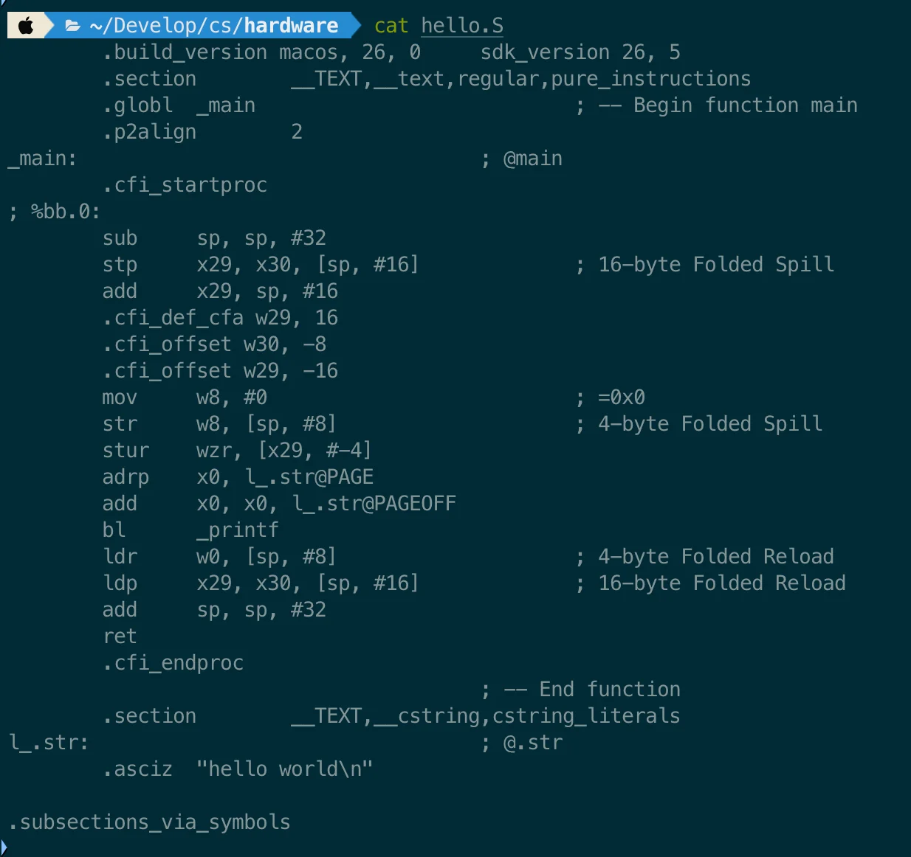

<a id="3c2eda9b0fe180c4bf5ee1b97cbda682"></a>

```bash
.build_version macos, 26, 0	sdk_version 26, 5
	.section	__TEXT,__text,regular,pure_instructions
	.globl	_main                           ; -- Begin function main
	.p2align	2
_main:                                  ; @main
	.cfi_startproc
; %bb.0:
	sub	sp, sp, #32
	stp	x29, x30, [sp, #16]             ; 16-byte Folded Spill
	add	x29, sp, #16
	.cfi_def_cfa w29, 16
	.cfi_offset w30, -8
	.cfi_offset w29, -16
	mov	w8, #0                          ; =0x0
	str	w8, [sp, #8]                    ; 4-byte Folded Spill
	stur	wzr, [x29, #-4]
	adrp	x0, l_.str@PAGE
	add	x0, x0, l_.str@PAGEOFF
	bl	_printf
	ldr	w0, [sp, #8]                    ; 4-byte Folded Reload
	ldp	x29, x30, [sp, #16]             ; 16-byte Folded Reload
	add	sp, sp, #32
	ret
	.cfi_endproc
                                        ; -- End function
	.section	__TEXT,__cstring,cstring_literals
l_.str:                                 ; @.str
	.asciz	"hello world\n"

.subsections_via_symbols
```

</details>

<a id="3c2eda9b0fe1803a9480fef9c50c0749"></a>

## 명령어 구조

> 
> 
> <a id="3c4eda9b0fe180429b07d4cda459d364"></a>
> 
> 프로그램을 이루는 정보&#58; <code>명령어</code> &#43; <code>데이터</code>
> 
> 

<a id="3c4eda9b0fe18006ac20e750514ced05"></a>

### 명령어

> ✏️ 
> 
> 
> 
> - 연산 코드&#58; <code>수행할 동작 (동사)</code>
> 
> - 오퍼랜드(피연산자)&#58; <code>명령의 대상 (목적어)</code>
>     > 🤔 
>     > 
>     > <a id="3c4eda9b0fe180edbb58fe0a49daed45"></a>
>     > 
>     > 레지스터&#58; CPU에 있는 작은 임시 저장장치
> 
>     - 대상(데이터), <strong><u>대상 위치(레지스터 이름, 메모리 주소)</u></strong> 등
> 
> <a id="3c4eda9b0fe1805cae54c7b242ab8a1d"></a>
> 
> <code>⇒ 오퍼랜드(데이터)</code>로 <code>연산 코드(실행)</code>를 수행해라 

> ☝🏻 
> 
> <a id="3c4eda9b0fe1807c8997cf63ee16ea1f"></a>
> 
> CPU 마다 <strong><u>연산코드의 종류와 오퍼랜드를 나타내는 양상이 다르다</u></strong>&#46; <u>CPU 종류를 막론</u>하고 CPU가 이해하는 <u><code>명령어</code></u><u>는 크게 </u><u><code>연산코드</code></u><u>와 </u><u><code>오퍼랜드</code></u>로 이뤄져 있다&#46; 

<details>
<summary>ex) 문장</summary>

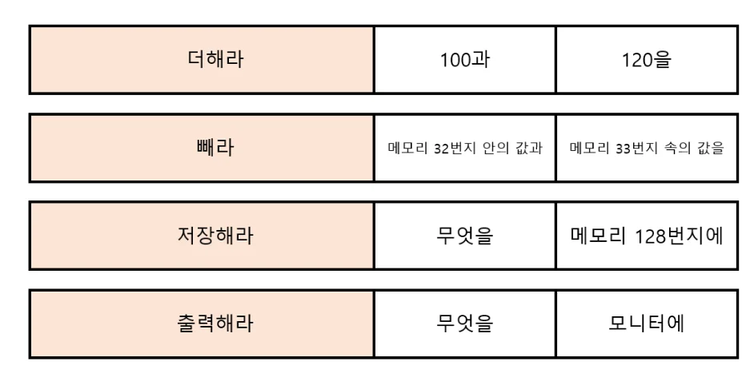

- <strong><u>무엇을 대상</u></strong>으로 <strong><u>무엇을 수행</u></strong>해라

</details>

<details>
<summary>ex) 기계어</summary>

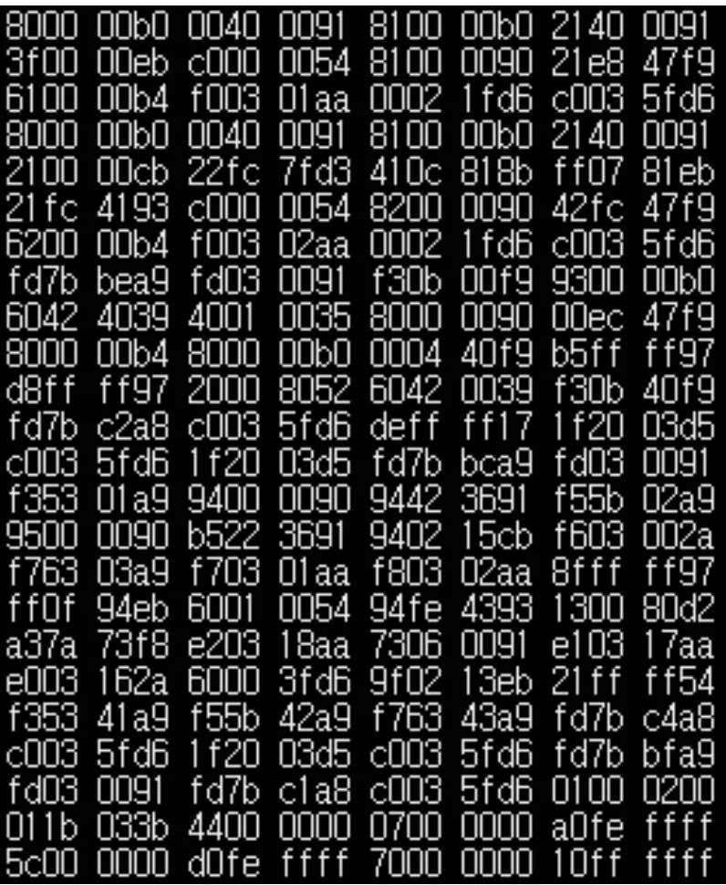

- 구성된 숫자들을 해석하면 <code>명령어(연산 코드)</code> 와 <code>데이터(오퍼랜드)</code> 로 이뤄진 것을 알 수 있다&#46; 

</details>

<details>
<summary>ex) 어셈블리어</summary>

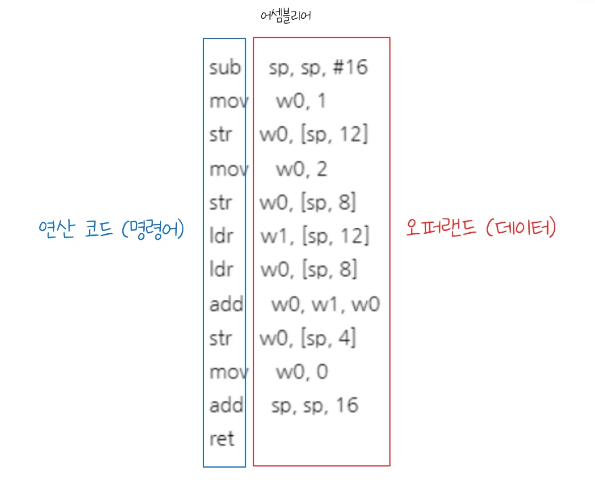

</details>

<a id="3c4eda9b0fe180e9b798ded97848f620"></a>

### 오퍼랜드(피연산자)의 개수는 유동적이다&#46; 

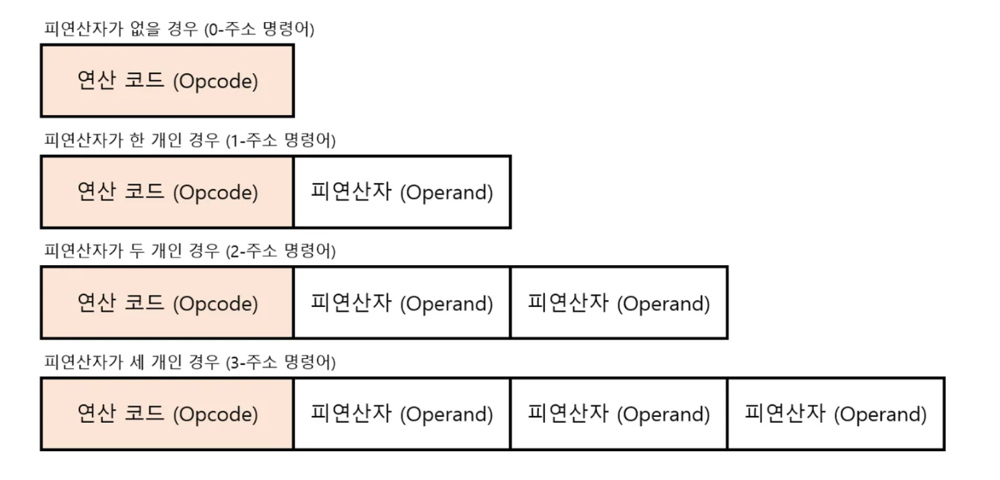

- 오퍼랜드(피연산자)가 없거나, 하나, 둘, 셋 등을 가질 수 있다&#46; 

<a id="3c4eda9b0fe1800190b4cde7f7fd2481"></a>

### 지원하는 연산 과정에 따라 실제 실행 명령어의 개수가 달라진다&#46; (연산 비용 최적화)

> ✏️ 
> 
> <a id="3c4eda9b0fe180f6b9d6f107045da800"></a>
> 
> <strong><u>오퍼랜드의 개수</u></strong>에 따라서 <strong>같은 코드를 실행하는 명령어의 개수가 달</strong>라질 수 있다&#46; 

> 동일한 코드 <code class="language-math">X = ( A &#43; B ) &#42; C</code> 실행

- <strong><u>오퍼랜드가 2개</u></strong>인 경우 아래 <strong>4 단계로 실행</strong>된다&#46; 
    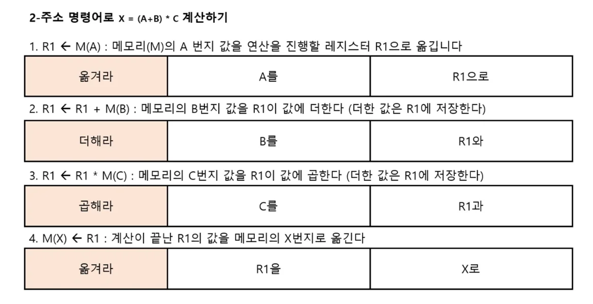

- <strong><u>오퍼랜드가 3개</u></strong>인 경우 아래 <strong>2 단계로 실행</strong>된다&#46; 
    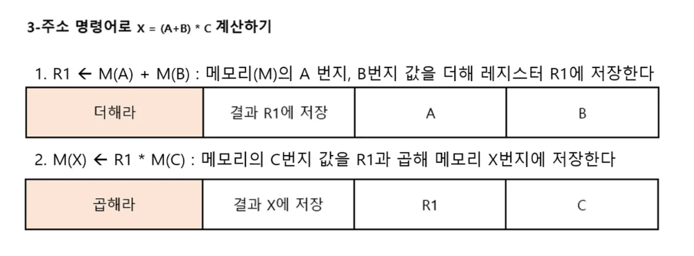

<a id="3c4eda9b0fe180108058efc098da8661"></a>

### 연산코드의 종류

> ✏️ 
> 
> <a id="3c4eda9b0fe180f2a518d4830cd15ac1"></a>
> 
> 연산 코드의 종류는 CPU마다 다를 수 있지만, <br> 아래 4개의 경우는 공통적으로 사용한다&#46;

<details>
<summary>데이터 전송&#58; <code>MOVE</code>, <code>STORE</code>, <code>LOAD (FETCH)</code>, <code>PUSH</code>, <code>POP</code> </summary>

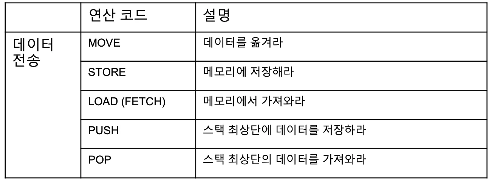

</details>

<details>
<summary>산술/논리 연산</summary>

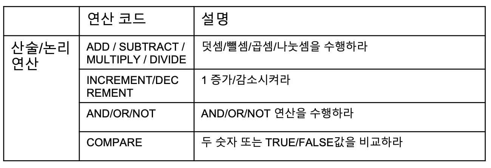

</details>

<details>
<summary>제어 흐름 변경&#58; <code>JUMP</code>, <code>CONDITIONAL JUMP</code>, <code>HALT</code>, <code>CALL</code>, <code>RETURN</code> </summary>

> ✏️ 
> 
> <a id="3c4eda9b0fe180828760f28c5eafd80e"></a>
> 
> CPU는 기본적으로 메모리에 있는 명령어들을 하나씩 가져와서 순차적으로 실행한다&#46; 
> 
> - 이를 <code>JUMP</code>, <code>CONDITIONAL JUMP</code>를 통해 특정 명령어로 건너뛴다&#46; 
> 
> - 또한 <code>CALL</code>, <code>RETURN</code>을 통해 특정 함수를 실행 후 다시 되돌아갈 수 있다&#46;
>     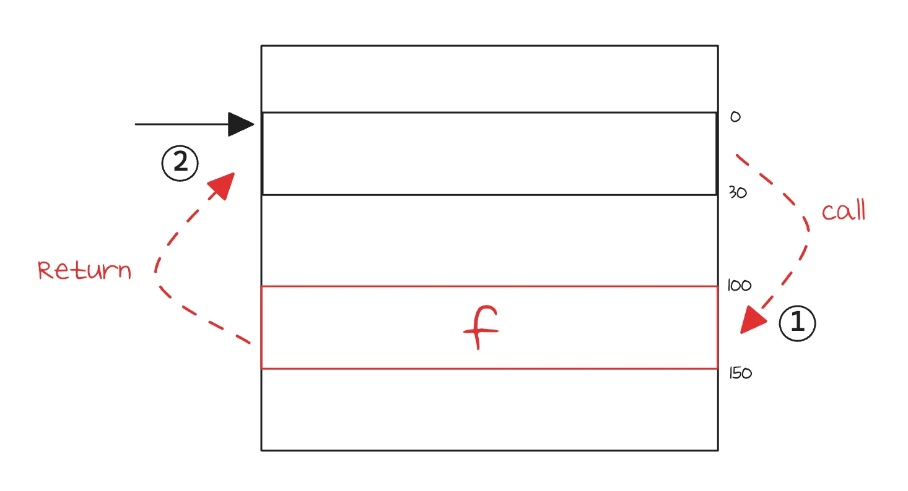

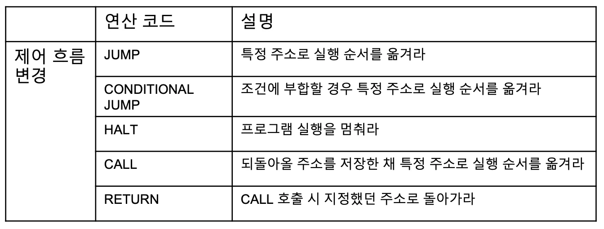

</details>

<details>
<summary>입출력 제어&#58; <code>READ(INPUT)</code>, <code>WRITE(OUTPUT)</code>, <code>START IO</code>, <code>TEST IO</code></summary>

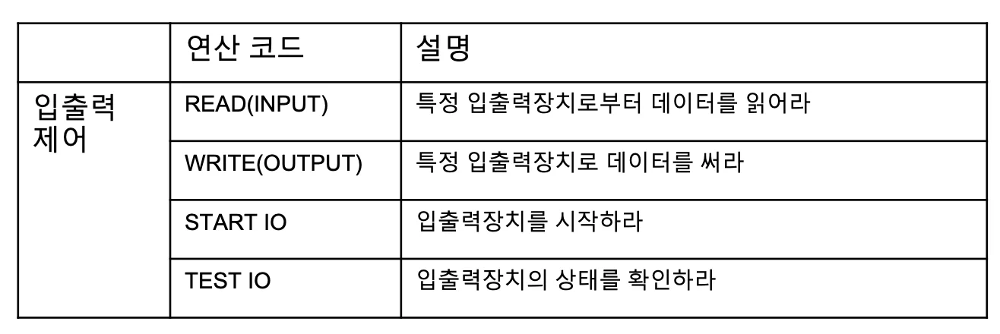

> 🤔 
> 
> <a id="3c4eda9b0fe1802f95e9c344a288dc79"></a>
> 
> <code>특정 입출력 장치</code>&#58; 하드디스크, 마이크, 모니터 등
> 
> <a id="3c4eda9b0fe1800aa5c3ef0f63f03b15"></a>
> 
> 이때, 어떻게 입출력 장치를 특정 지을 수 있는지는 이후 챕터에서 학습한다&#46;

- ex)
    - CPU가 하드디스크에 READ 명령어를 통해 데이터를 읽어온다&#46; 

    - CPU가 모니터에 WRITE 명령어를 통해 화면(RGB)을 보여준다&#46; 

    - CPU가 마이크에 READ를 해 소리에 대한 데이터를 읽어온다&#46; 

</details>

<a id="3c4eda9b0fe180e48d81e831c2d1ec8d"></a>

## 주소 지정

> 명령어의 동작을 이해하기 위한 <code>주소 지정</code>에 대해서 학습

> 
> 
> <a id="3c4eda9b0fe180d78579f0c6b0e91dab"></a>
> 
> <strong><code>주소 지정</code></strong>
> 
> - <strong>명령어 = 연산 코드 &#43; 오퍼랜드</strong>
> 
> - <code>주소 지정</code>은 <strong><u>연산 코드의 대상이 되는 데이터가 실제로 명령어 안에 없</u></strong>는 경우, 즉, 데이터가 <strong><u>메모리의 주소나 레지스터에 저장</u></strong>되어 있는 경우 <strong><u>어떻게 연산코드의 대상 데이터를 찾</u></strong><strong><u>아갈 수 있는 지</u></strong>에 대한 방법을 말한다&#46; 
> 
> - <code>주소 지정</code>은 <strong><u>cpu 마다 조금씩 차이</u></strong>가 있다&#46; <strong><u>다양한 주소 지정 방식들이 있</u></strong>을 수 있다&#46; 따라서 해당 챕터에서는 cpu의 종류를 막론하고 <strong><u>대부분 공통적으로 사용되는 주소 지정 방식들</u></strong>에 대해서 학습한다&#46;

<a id="3c4eda9b0fe18095ad2fcd5171f2c4dc"></a>

### 🧐 왜 데이터를 직접 명시하지 않고 위치를 명시하는가?

> ☝🏻 
> 
> <a id="3c7eda9b0fe18036b5dac26dd9f2e590"></a>
> 
> <strong><u>명령어의 길이</u></strong>가 <strong><u>한정</u></strong>되어 있기 때문이다&#46; 

> 명령어는 연산코드와 오퍼랜드로 이뤄져 있으며, 이 명령어 안에는 여러 개의 오퍼랜드가 존재할 수 있다&#46; 

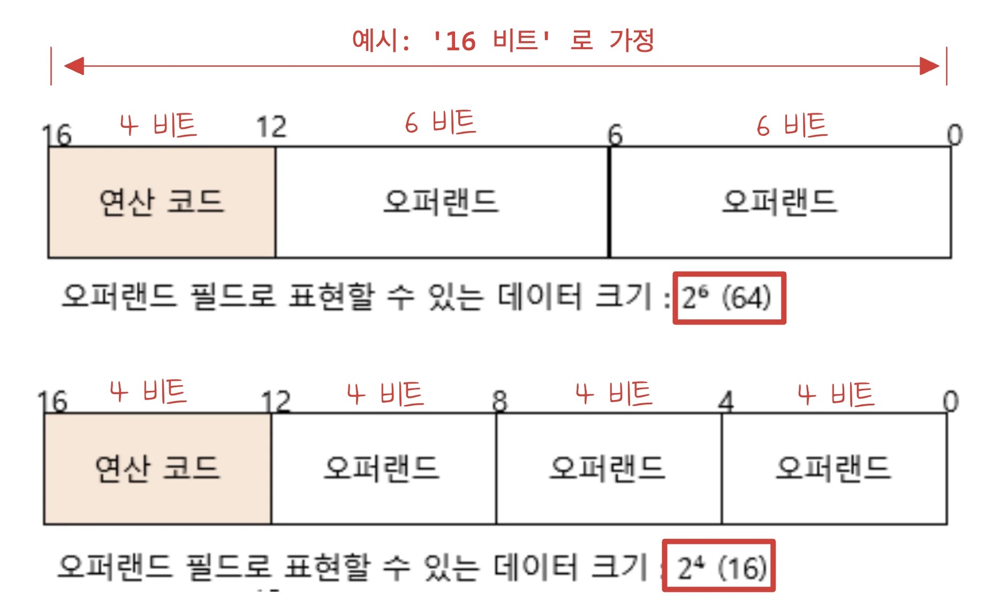

<a id="3c7eda9b0fe180e6b341f6f2b21208ec"></a>

위 예시처럼, 명령어가 16 비트를 가진다고 한다면 실제 각 오퍼랜드가 가질 수 있는 데이터의 크기는 아래와 같다&#46; 

- ex 1) 연산 코드&#58; 1, 오퍼랜드&#58; 2
    - 연산코드&#58; <code>4비트</code>

    - 오퍼랜드&#58; 
        - 각각 <code>6비트</code> (<code class="language-math">2^6</code>) 

        - 하나의 오퍼랜드에서의 데이터 크기&#58; <code>64</code>

- ex 2) 연산 코드&#58; 1, 오퍼랜드&#58; 3
    - 연산코드&#58; <code>4비트</code>

    - 오퍼랜드&#58; 
        - 각각 <code>4비트</code> (<code class="language-math">2^4</code>)

        - 하나의 오퍼랜드에서의 데이터 크기&#58; <code>16</code>

<a id="3c7eda9b0fe180169ef6c701a2ca69ce"></a>

따라서 위와 같이 <strong>명시할 수 있는 데이터의 크기가 작</strong>기 때문에 (<strong>오퍼랜드 개수가 많</strong>이질수록) 연산 코드의 대상이 되는 데이터를 직접 명시하기 보다는 그 <strong><u>데이터가 저장되어 있는 공간, 즉 주소(레지스터 이름, 메모리 주소)을 명시</u></strong>한다&#46;

<a id="3c7eda9b0fe180a0b1ddd765d40b7b5c"></a>

### 주소 지정 

> 🤔 
> 
> <a id="3c7eda9b0fe1806ea037cc870908ded8"></a>
> 
> <code>유효 주소</code>
> 
> <a id="3c7eda9b0fe1801ba06bd4781eefe98e"></a>
> 
> 연산 코드에 사용할 데이터가 저장된 위치, 즉 <strong><u>연산의 대상이 되는 데이터가 저장된 위치 </u></strong>
> 
> 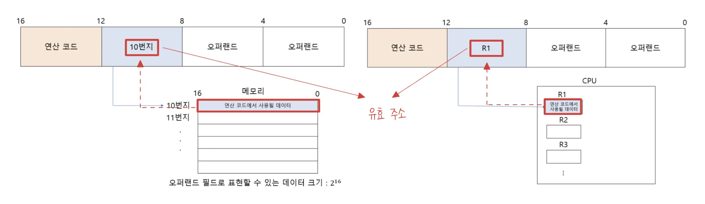
> 
> <a id="3c7eda9b0fe1801593a1ccc9ca0a9fd2"></a>
> 
> → 주소 지정&#58; <strong><u>유효 주소를 찾</u></strong>는 방법 (CPU 마다 차이 있음)

<details>
<summary>예시) 주소 지정  </summary>

- ex 1) 메모리 주소
    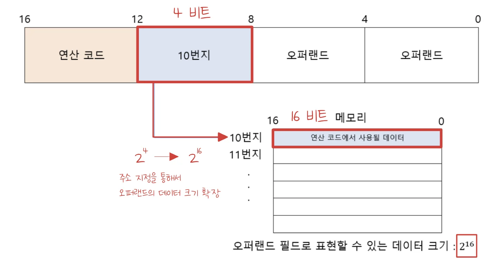

- ex 2) 레지스터
    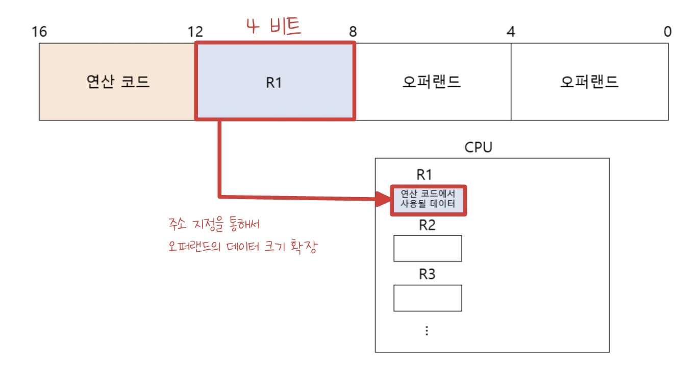

</details>

<a id="3c7eda9b0fe1806fa741e951b250a37e"></a>

### 주소 지정 방법

> 이후 챕터에서 더 자세히 학습
> 
> - 특정 레지스터를 이용하여 가능한 특수한 주소 지정에 대해 추가 학습

> ✏️ 
> 
> <a id="3c7eda9b0fe180cf96e6c777c06a429c"></a>
> 
> CPU가 레지스터에 접근하는 속도보다 메모리에 접근하는 속도가 훨씬 더 느리다&#46; 
> 
> <a id="3c7eda9b0fe1801aa4f3c54b209c88b5"></a>
> 
> 따라서 메모리에 접근하는 것은 레지스터에 접근해 해결 가능하다면 지양하는 것이 좋다&#46; 
> 
> - CPU 접근 속도&#58; <code>레지스터  &#62;&#62;&#62;  메모리</code>

<details>
<summary>1&#46; 즉시 주소 지정</summary>

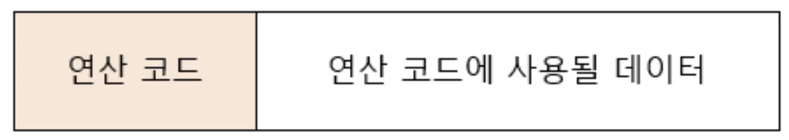

- 연산에 사용할 데이터를 오퍼랜트 필드에 직접 명시

- <strong><u>가장 빠른 실행 방법,</u></strong> But <strong><u>데이터 크기 제한</u></strong>
    - 이론적으로는 빠르지만, 많이 사용되지 않음

</details>

<details>
<summary>2&#46; 직접 주소 지정</summary>

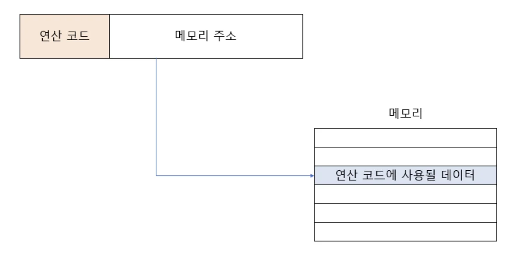

- 오퍼랜드 필드에 유효 주소 명시

- 오퍼랜드 필드로 표현 가능한 메모리 주소 크기에 제한<br>즉, <strong><u>오퍼랜드 크기 만큼의 메모리 주소를 할당</u></strong> 가능
    - 최근 메모리 주소 크기가 점점 더 커지고 있다&#46; <br>따라서 명령어 내부 할당 가능한 오퍼랜드 크기만큼으로<br>메모리 주소를 다 나태내기 어려울 수 있다&#46; 

    <a id="3c7eda9b0fe1800f9afbe57cfc510690"></a>

     → 이를 해결하기 위해 <code>간접 주소 지정</code> 방법이 나옴

</details>

<details>
<summary>3&#46; 간접 주소 지정</summary>

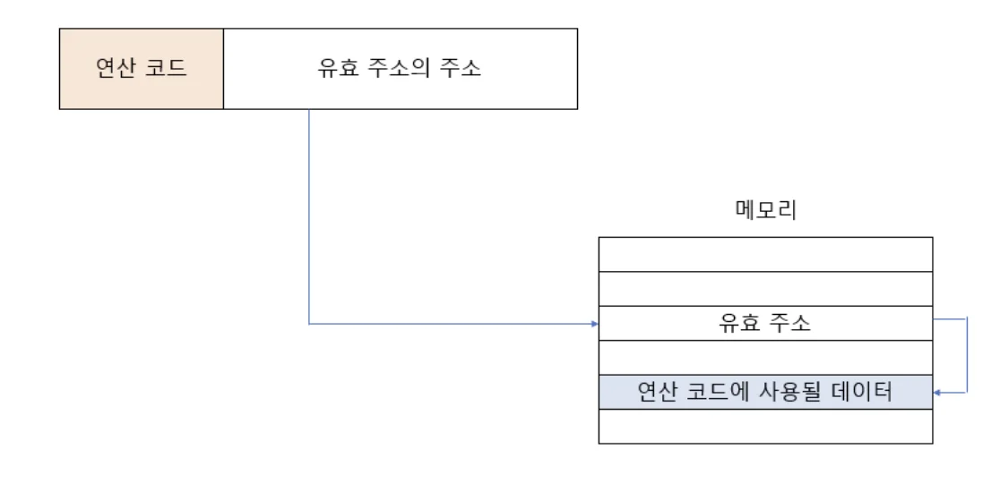

- 오퍼랜드 필드에 유효주소의 주소 명시

- 유효 주소 <strong><u>크기에 제한은 없</u></strong>으나, <strong><u>속도가 비교적 느림</u></strong>
    - 메모리 2번 접근

</details>

<details>
<summary>4&#46; 레지스터 주소 지정</summary>

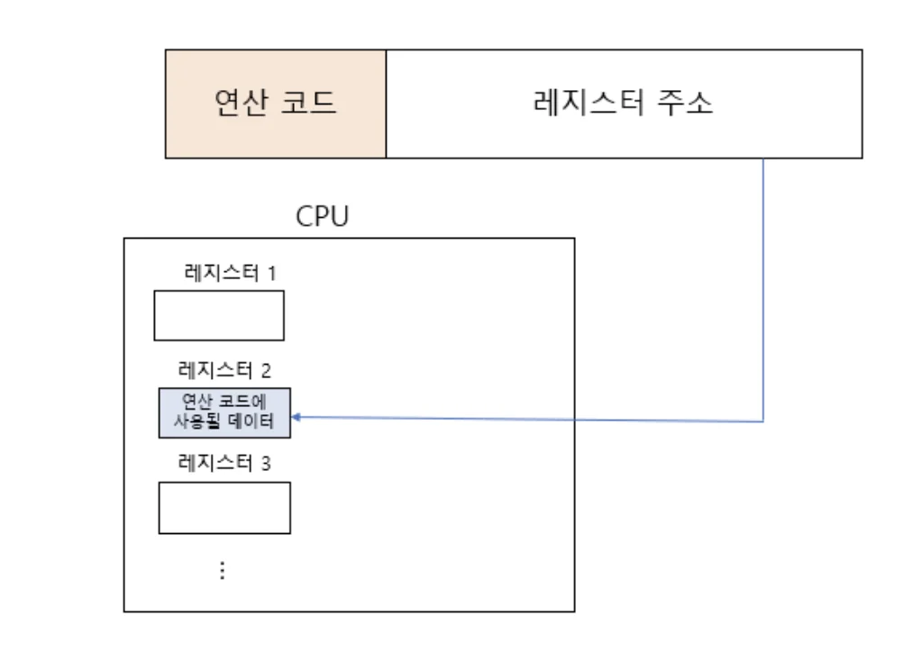

- 연산에 사용할 데이터를 레지스터에 저장 후, <br>해당 레지스터 주소를 오퍼랜드 필드에 명시

- <strong><u>레지스터 접근</u></strong>은 <strong><u>메모리보다 빠름</u></strong>

</details>

<details>
<summary>5&#46; 레지스터 간접 주소 지정</summary>

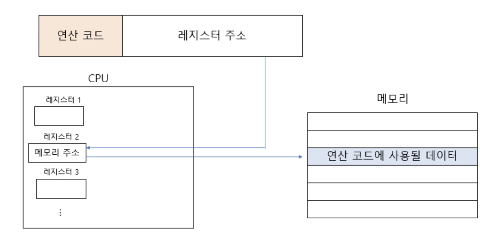

- 연산에 사용할 <strong><u>데이터 메모리 저장</u></strong>

- 그 <code>주소(유효 주소)</code>를 <strong><u>저장한 레지스터를 오퍼랜드 필드에 명시</u></strong>

- 이때, <strong><u>메모리 접근 한 번</u></strong>만 일어남
    - 레지스터 1번 → 메모리 1번

    - 따라서 간접 주소 지정 방식보다 더 빠름

</details>
