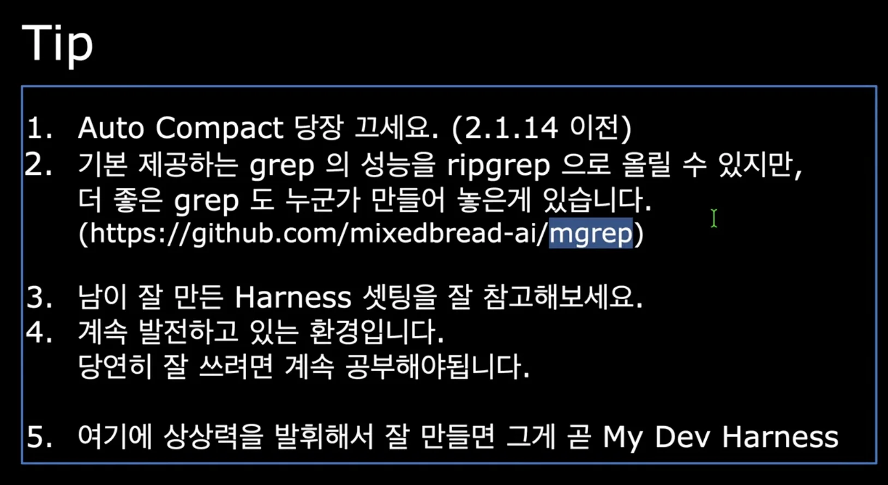
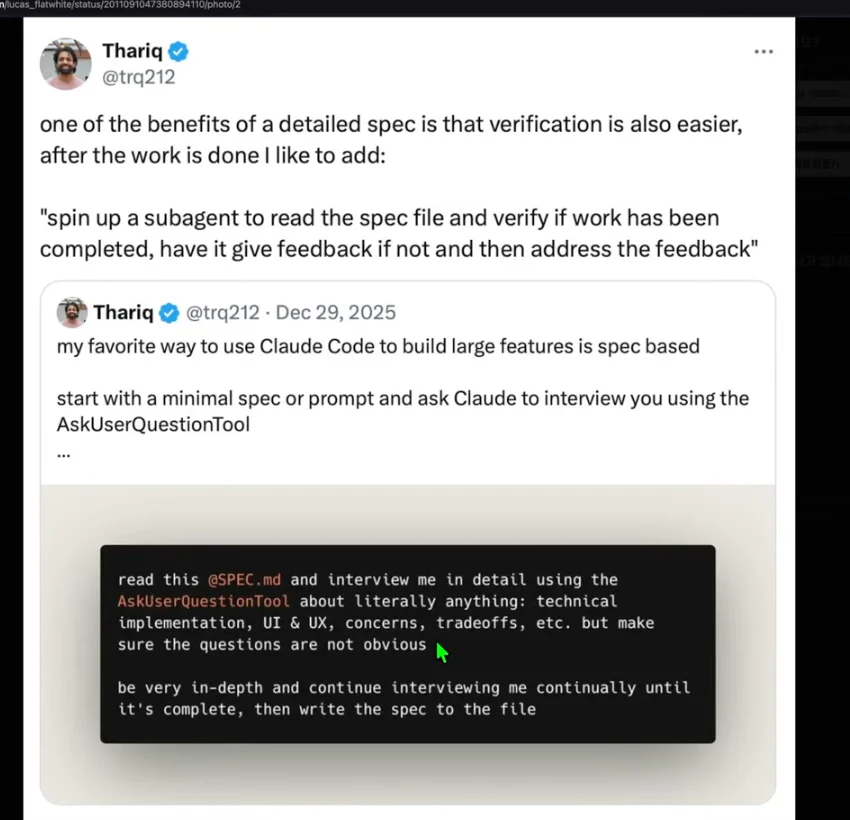

reference

- ‣

- ‣

- ‣

- 

## 컨텍스트 엔지니어링

## 참고할 만한 레퍼런스

[Anthropic x Forum Ventures 해커톤 해커톤 우승자 팁](#/post/313eda9b-0fe1-807e-859c-feab26261440)

- ‣

- ‣

- ‣

- ‣

- ‣

- ‣

- ‣

## 추가 팁

### 프론트

- playright agent

- vercel 에이전트 브라우저
    [agent-browser](https://github.com/vercel-labs/agent-browser)

    - e2e 테스트 

- vercel react best pratice
    [agent-skills](https://github.com/vercel-labs/agent-skills)

- stitch&#45;ai&#45;mcp
    [stitch-ai-mcp](https://github.com/StitchAI/stitch-ai-mcp)

    - stich로 디자인을 하고 mcp로 입힌다&#46; 
        - 구글 &#45; 공짜로 이용 가능

### 데브옵스

> ✏️ 
> 
> 
> 
> 코드 레퍼를 주고 가져오라고 지시 후 <strong><u>내부 SDK를 가져와 스킬로 생성</u></strong>

[azure-pipelines-agent](https://github.com/microsoft/azure-pipelines-agent)

- 공식 스킬들

- GCP MCP 지원

- AWS MCP 지원

### TDD

켄트백 스킬을 프롬프트로 

- 코드 전체 아키텍처를 판단하는 스킬을 만들고,
    - 백엔드 성격에 따른 트래픽 구성 및 발전 아키텍처를 물어본다&#46;

- AskUserQuestionTool
    

### 서칭

[Code Search &#124; Grep by Vercel]()

- 코드의 핵심 기능 바로 서칭 가능
    - 굉장히 빠름

> ☝🏻 
> 
> 
> 
> 클로드 코드 기본 웹서치가 별로다
> 
> 
> 
> 기본 웹서치 사용 x 
> 
> 
> 
> 클로드 전역 시스템 프롬프트에  2개 실행하도록 처리 ( 파이썬 실행 )

### tavilly search

[Tavily]()

- 기본 웹서치 툴 &#45; 일반적인 지식

- 클로드 코디 웹서치  &#45; 디나이

### exa search

[Exa]()

- exa search mcp &#45; 일부 무료

- 1000건까지 무료

- api 키를 아에 안넣고도 무료로 사용가능하다&#46;
    

    ‣

- 코드 스니펫 검색

-  코드 서칭
    - context(exa code)

    - 1차 exa 서칭 → tavily 웹서치 대용으로 사용 중이다&#46;

    - context7는 공식 문서만 가져온다&#46; 
        - 정확한 키워드를 아는 경우 exa가 더 좋았다&#46;

### gemini

[gemini-cli](https://github.com/google-gemini/gemini-cli)

재미니 모델에 기본적으로 웹서치가 포함되어 있다&#46; 

- raddit, 유튜브 서칭 가능

> 🤔 
> 
> 
> 
> cli 도구들을 잘 엮어서 써야한다&#46; 
> 
> 
> 
> 결국은 구글을 통해 탐색 → 구글 주식? 구매?

### agent&#45;council

[agent-council](https://github.com/team-attention/agent-council)

- 코덱스, 재미니

- qwen&#45;code 
    - 퀄리티 좋다&#46; sonet 비슷

    - GLM이 좀더 좋다&#46;

    - 가진 기능이 좋다&#46; 

    - gemini cli 기반으로 만들어져 웹서칭 기능이 좋다&#46; 

    - 다 가져올 수 있다? 

### 대한민국 하네스

MoAI&#45;ADK

[moai-adk](https://github.com/modu-ai/moai-adk)

- 클로드 코드에 GLM을 세팅해서 사용하고 있다&#46; 

- 자세한 내용&#58; <a href="#/post/312eda9b-0fe1-806e-86d7-f34cfc05ed83">페이지</a>
