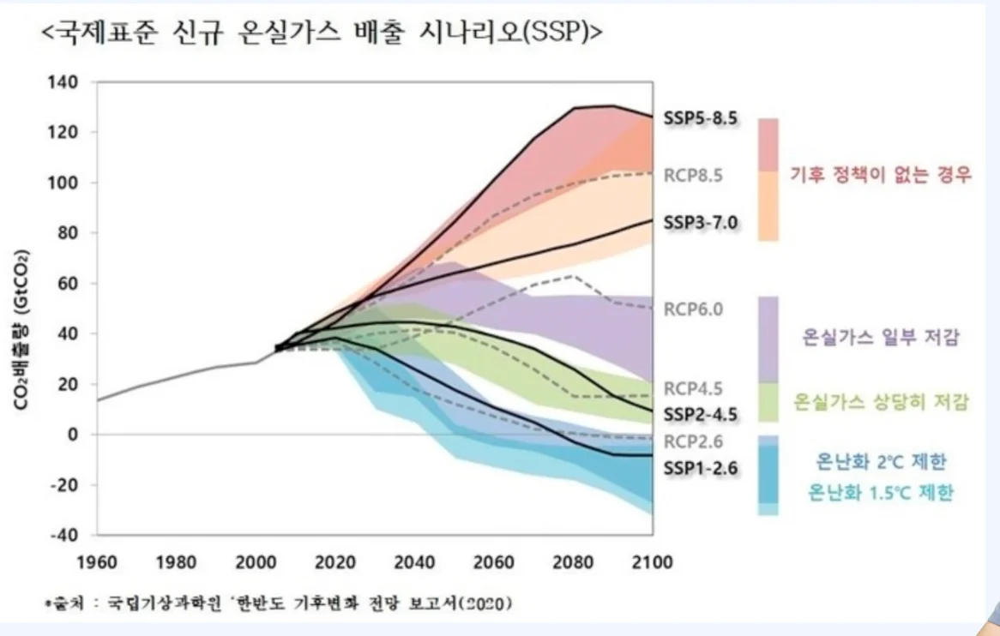
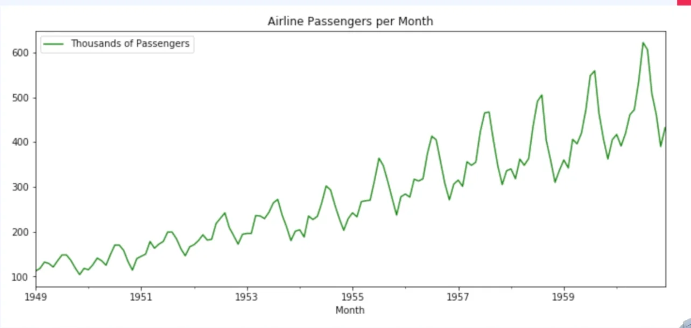
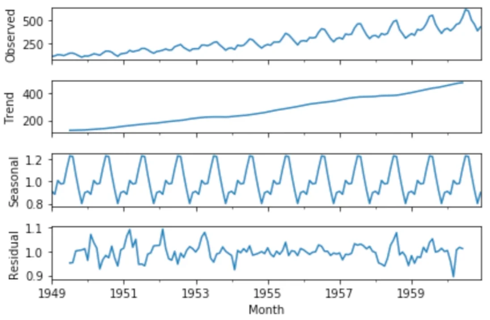
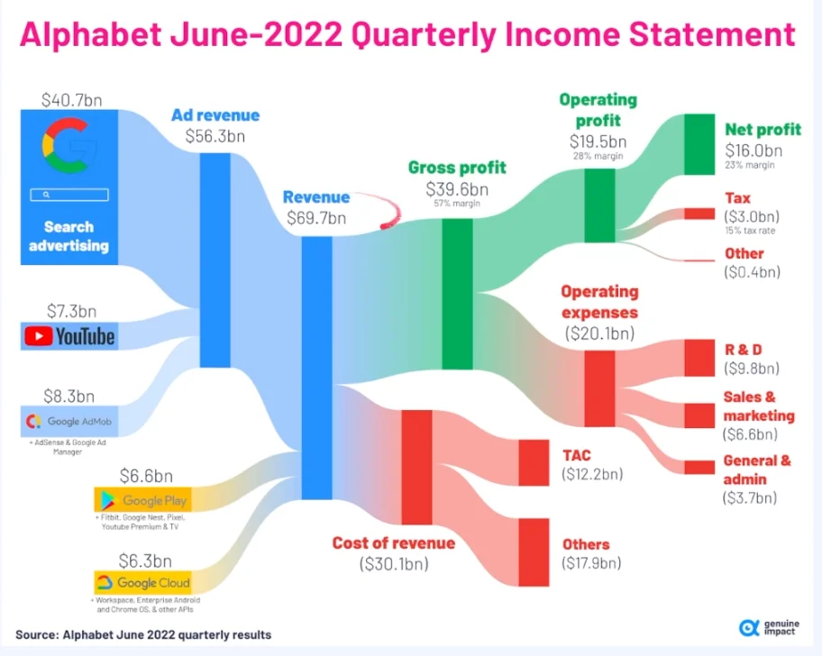

> 
> 
> 
> 
> <strong>목차</strong>
> 
> - [통계학](#327eda9b0fe180f88920f671524092c7)
> - [기본적인 통계 기초가 필요한 이유](#327eda9b0fe1801994a5dbef6dced617)
> - [[예시] 통계 분석 활용 ](#3efeda9b0fe180fda736f75d6eef609a)
> - [통계적 분석](#3efeda9b0fe180d88313ea41a945fa33)
> - [강의에서 다루는 통계학(수학)](#327eda9b0fe180f3950eeadf9b1c55d9)

## 통계학

---

> 📖 
> 
> 
> 
> <code>통계학</code> 이란
> 
> 
> 
> <u>산술적 방법</u>을 기초로 하여, <strong><u>다량의 데이터를 관찰하고 정리 및 분석</u></strong>하는 방법을 연구하는 수학의 한 분야
> 
> - <strong><u>불확실성 속에서 유의미한 정보를 찾</u></strong>아냄
> 
> - <strong><u>부분 →</u></strong> <strong><u>전체</u></strong> <strong>추론</strong><strong> (예측)</strong>

> 
> 
> 
> 
> <code>학문으로서의 통계학</code>과 <code>실무 능력으로서의 통계학</code>은 기준이 약간 다르다&#46;  사용하는 툴들에서 기본 제공하는 기능들이 많기 때문에 해당 강의에서는  <strong><u>실무자로써 이를 잘 활용</u></strong>하는 방법론을 배운다&#46;

### 기본적인 통계 기초가 필요한 이유

> ✏️ 
> 
> 
> 
> <strong>기본적인 통계 기초가 필요한 이유</strong>
> 
> - <code>OKR</code>, <code>KPI</code> 등 <strong><u>지표를 통한 방법론</u></strong>
>     - 적절한 지표를 선정하는 방법과 기준
> 
>     - 추상적인 목표에 대한 측정 가능한 핵심 지표 설정
> 
> - <code>Growth Marketing</code> (<code>performance marketing</code>)

- 비지니스 근거가 되는 데이터 수치는 이미 다양한 도구를 통해서 수집, 가공, 시각화가 이루어지고 있다&#46; 

- 데이터를 기반으로 수많은 의사 결정을 수행하는 것은 더이상 데이터 직군 종사자만의 일이 아니다&#46; 

### &#91;예시&#93; 통계 분석 활용 

<strong>&#91;예시 1&#93;</strong> 국제 표준 신규 온실가스 배출 시나리오

기후 정책의 강도에 따른 2100년까지(21세기)의 탄소 배출량 시나리오

- 정책에 따른 온실가스 수치의 수렴의 예측치를 나타냄

- 이러한 <code>예측치</code>를 바탕으로 <strong><u>앞으로의 기후 정책에 대한 결정</u></strong>을  해당 예측 시나리오 바탕으로 <strong>측정 및 수정</strong>하여 진행 가능

<strong>&#91;예시 2&#93;</strong> 비행기 탑승객 수 

- 1949년 부터 약 15년 간 비행기 탑승객 수를 월단위로 분석한 지표

- 이러한 수치 그래프를 통해 패턴을 파악하고 경향성을 예측하여 이후  수치 예측
    - 주기성 (계절성 예측)

#### 통계적 분석

- 통계 모형&#58; <code>시즈널 아리마 </code>

- <code>Observed (관측값)</code>&#58; 위의 관측한 수치 

- <code>Trend (경향성)</code>
    - 시장의 크기가 점차 성장하는 것 확인

- <code>Seasonal (계절성)</code>
    - 월에 따라 주기적으로 수요 정도 측정 가능

- <code>Residual</code>&#58; 위 두개를 제외한 나머지 잔차에 해당하는 수치

관측 지표를 바탕으로 요인에 따라 나눠서 분석 → 이를 통해서 유의한 분석 결과를 도출한다&#46;

<strong>&#91;예시 3&#93; 시각화</strong>

> 데이터 분석 수치를 바탕으로 시각화하여 의사결정 수단에 활용

- 주요 빅테크 기업의 2022년 매출 시각화

⇒ 수치 변동 모니터링 → 원인 분석 → 대응, 의사결정 수단으로 사용

### 강의에서 다루는 통계학(수학)

> ✏️ 
> 
> 
> 
> 통계학의 기본 개념은 고등하교 수학을 바탕으로 구성된다&#46; 
> 
> - ex&#46; 확률과 통계 &#45; <code>모집단</code>, <code>표본</code>, <code>신뢰구간</code> 등
> 
> - ex&#46; 기하와 벡터 &#45; <code>공간벡터</code>, <code>평면</code> 등
> 
> 
> 
> 위 개념들을 바탕으로 
> 
> - <code>정규성 검정</code>, <code>분산 분석</code> 등 <strong><u>통계량</u></strong> 분석
> 
> - <strong><u>선형대수학</u></strong>을 바탕으로한 <code>주성분분석(PCA)</code>

고등학교에서 요구하는 학업 성취 능력은 ‘정확한 계산’, ‘개념과 정리의 수학적 응용’, ‘문제를 풀기 위한 다양한 계산적 스킬 활용’이었다&#46; 

즉, 실무자에게 필요한 적용 방법 및 수치에 대한 해석에 대해서는 다루지 않았다&#46;

따라서 이번 강의에서는 확률과 통계의 개념을 빠르게 정리하고  통계적 방법론을 활용하여 분석 기법을 적용하는 실습 과정을 주로 다루며 배운다&#46;

→ 해당 강의를 통해서 단순 개념을 넘어 아래와 같은 실무 능력으로 확장

- 강의를 통해 <strong><u>기본적인 용어와 개념 이해</u></strong>

- 수식 자체보다 <strong><u>수식에 담긴 직관적인 의미</u></strong> 전달

- 실습을 통해 <strong><u>실제 수식에 대한 통계량 산출</u></strong>

- 차트를 통한 <strong><u>시각화</u></strong> 및 <strong><u>통계량 해석</u></strong>

> ✏️ 
> 
> 
> 
> 실무적 요구 능력
> 
> - 통계 수치 해석
> 
> - 올바른 인과관계 분석
> 
> - 인사이트 도출
