> 
> 
> 
> 
> <strong>목차</strong>
> 
> - [베이즈 정리](#301eda9b0fe180f3b4a4dce8955c4013)
> - [1. 이유 불충분의 원리 (The Principle of Insufflcient Reason)](#301eda9b0fe180b48befc4c8b8c004b8)
> - [2. 설문 조사 및 확률 계산](#301eda9b0fe1807199f9d5960c5a902f)
> - [3. 베이즈 정리](#301eda9b0fe180079447f2707e6e6f03)
> - [4. 베이즈 정리 2 - 사각형 시각화 ](#301eda9b0fe18024a98cc653215e25fa)
> - [5. 베이즈 정리 3 - 수식 ](#301eda9b0fe180e09265cf2b9e1a70af)
> - [6. 사전 확률에 대한 주관적인 설정](#301eda9b0fe180478b9ef94fca2936d9)
> - [Netflix 추천 알고리즘](#301eda9b0fe180fab49ef67f87a72bdb)
> - [1. 콜드 스타트 ( 사전 확률 )](#301eda9b0fe180a0abcbce5c740a7fa8)
> - [2. 베이즈 정리 1 - 장르](#301eda9b0fe180088ca9e67a6ebad681)
> - [사전 설문](#301eda9b0fe180618eddc936f519abb1)
> - [베이즈 정리](#301eda9b0fe180528afeeb5ebc4330dd)
> - [3. 사후 확률 업데이트 1](#301eda9b0fe18048b956fdf2353fd02a)
> - [3. 베이즈 정리 2 - 장르, 배우](#301eda9b0fe1809aab0eed0c85bf88b8)
> - [배우, 장르](#301eda9b0fe1800f8314e8424853c04b)
> - [베이즈 정리:  액션 영화에 라이온 레이놀즈 나오면 사용자가 좋아할 확률](#301eda9b0fe180d094ebcfb20aefe56d)

## 베이즈 정리

[베이즈 정리를 이해하는 가장 쉬운 방법]()

### 1&#46; 이유 불충분의 원리 (The Principle of Insufflcient Reason)

- 아무 정보가 없는 상황에서 확률을 동등하게 생각 ( 수학자 라플라스 )
    - 사전 확률&#58; <code>50%</code>
        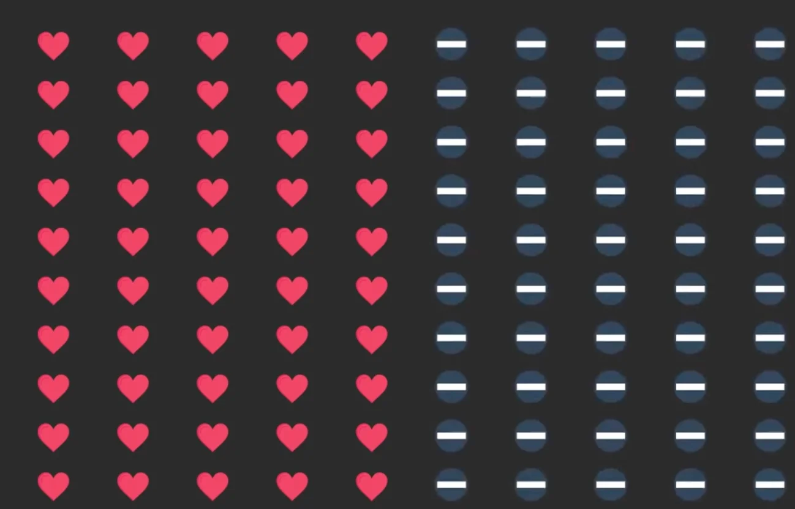

        - 좋아하는 사람이 있는 확률&#58; <code>50%</code>

        - 좋아하는 사람이 없는 확률&#58; <code>50%</code>

### 2&#46; 설문 조사 및 확률 계산

🧐 조건부 확률

>  <code class="language-math">P( 객체 &#124; 조건)</code>

- 해당 조건에 만족하는 객체의 확률

- 좋아하는 사람일 때 초콜릿을 줄 확률
    

    - 좋아하는 사람에게 초콜릿을 줄 확률&#58; <code>40%</code>

    - 따라서 좋아하는 사람에게 초콜릿을 주지 않을 확률&#58; <code>60%</code> 
        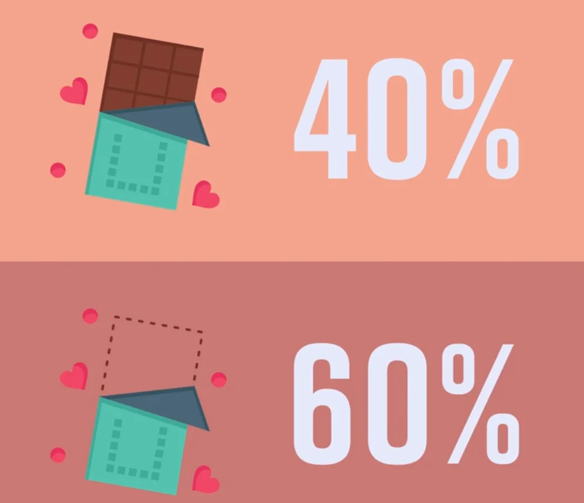

- 좋아하지 않는 사람에게 초콜릿을 줄 확률
    

    - 좋아하지 않는 사람에게 초콜릿을 줄 확률&#58; <code>30%</code>

    - 따라서 좋아하지 않는 사람에게 초콜릿을 주지 않을 확률&#58; <code>70%</code>
        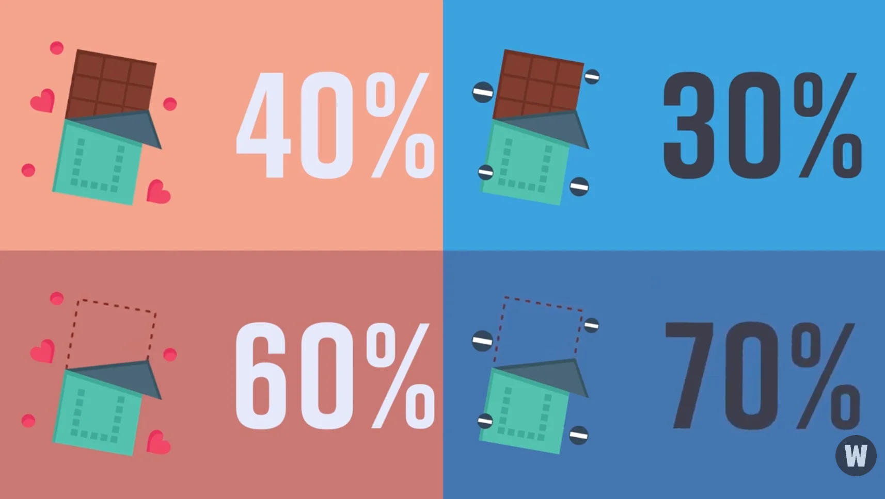

### 3&#46; 베이즈 정리

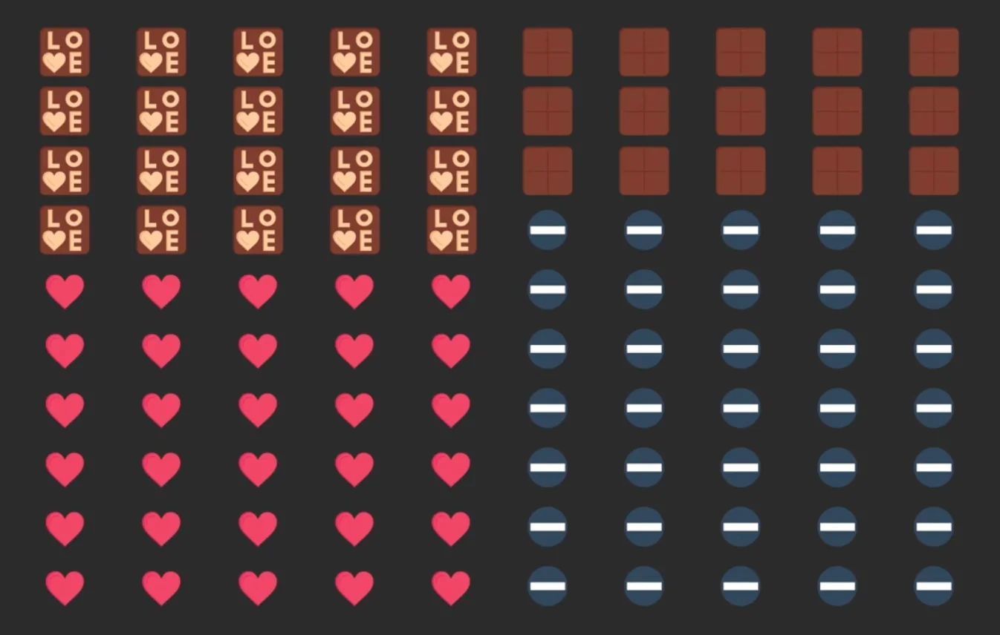

- 좋아하는 사람 여부
    - 인기 있는 사람&#58; <code>50%</code>

    - 인기 없는 사람&#58; <code>50%</code> 

- 초콜릿 받음
    - 인기 있는 사람&#58; 50% &#42; <code>40%</code>

    - 인기 없는 사람&#58; 50% &#42; <code>30%</code>

- <code>아는 값</code>&#58; 좋아하는 사람이 초콜릿을 줄 확률
    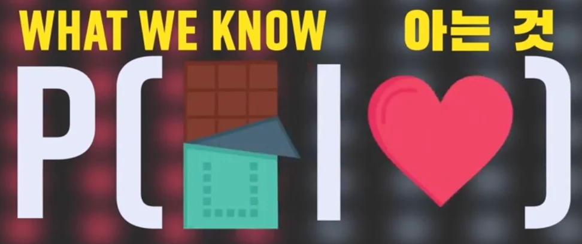

- <code>구하려는 값</code>&#58; 초콜릿을 받을 때, 그 사람이 날 좋아할 확률
    

    - 조건은 초콜릿을 받을 때 이다&#46; 즉, 초콜릿을 받지 않은 상황은 필요하지 않다&#46; 

    - 따라서 이를 제거하고 확률을 구한다 &#46;
        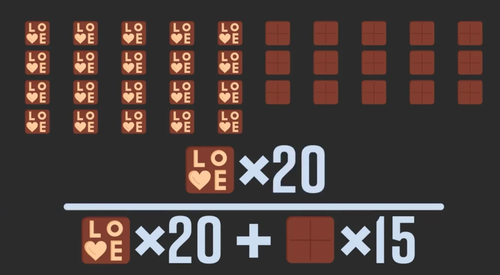

        

        ⇒ <code>57%</code>

        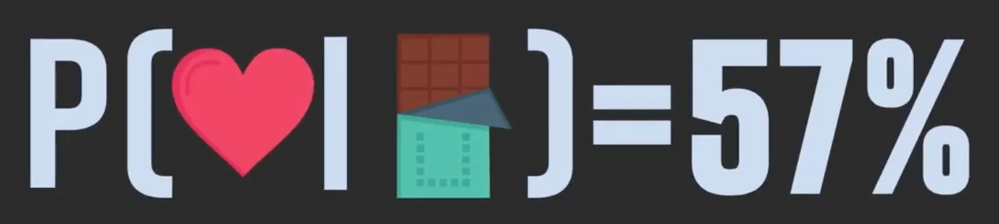

- 사후 확률 업데이트 
    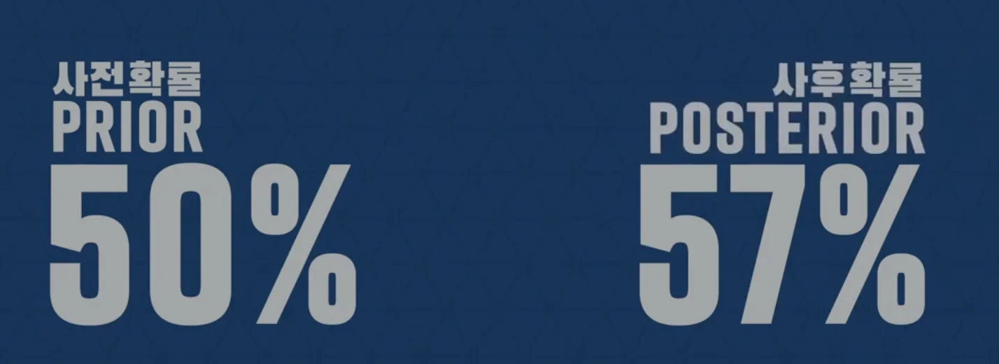

    - 사전 확률을 바탕으로 사후확률을 얻는 것이 베이즈 정리(Bates’ Theorem) 이다&#46;

    

    
셜록 홈즈 대사

    

    

### 4&#46; 베이즈 정리 2 &#45; 사각형 시각화 

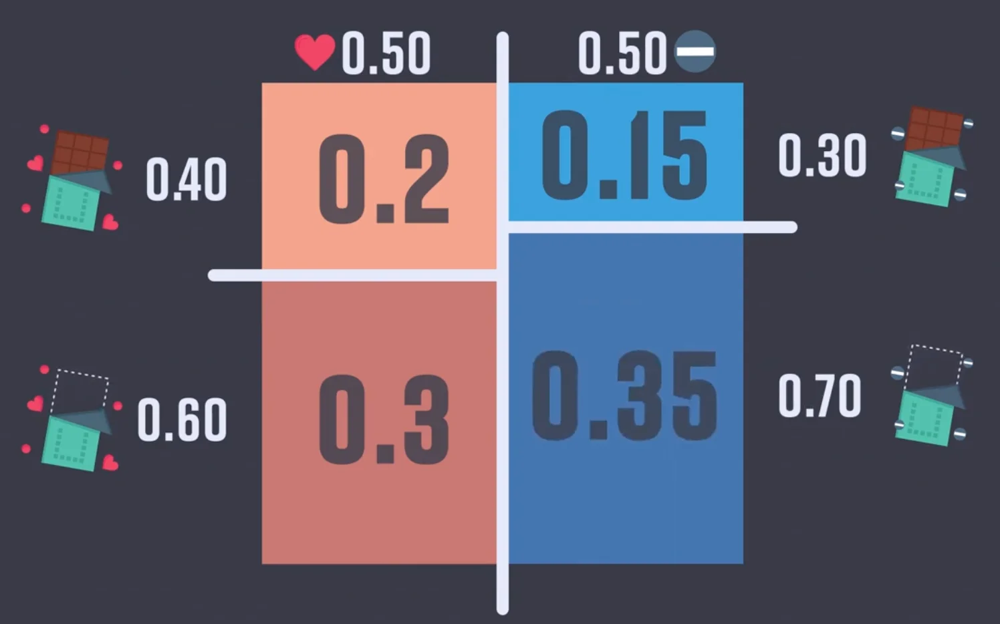

- 위와 같이 전체 확률을 1(100%)로 <code>가로 &#42; 세로</code> 의 곱을 통해  전체 확률을 쉽게 시각화 할 수 있다&#46; 

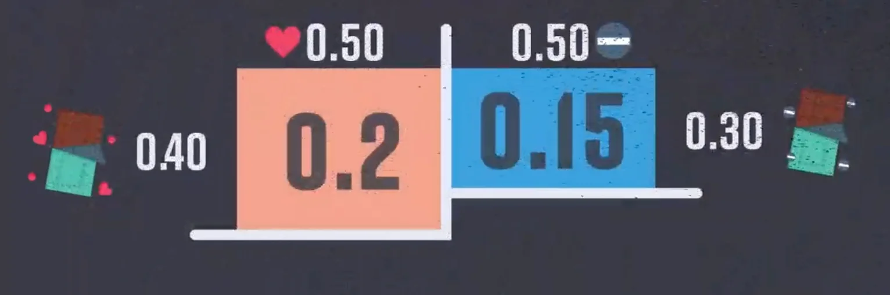

- 초콜릿을 받은 관찰 영역만 남김
    - 초콜릿을 받았을 경우, 그 사람이 나를 좋아할 확률이다&#46; 즉, 초콜릿을 받지 않은 경우는 제외한다&#46;

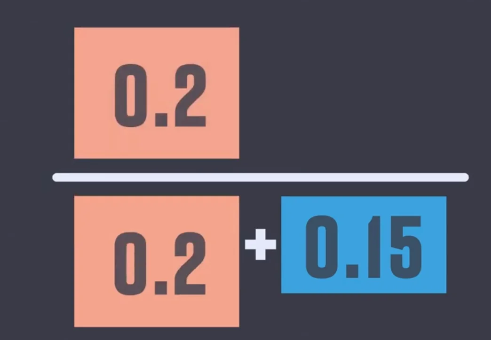

- 초콜릿을 받았을 경우, 그사람이 날 좋아할 확률이다&#46; 

- 계산 결과는 위와 동일하다&#46;  ( 57% )

### 5&#46; 베이즈 정리 3 &#45; 수식 

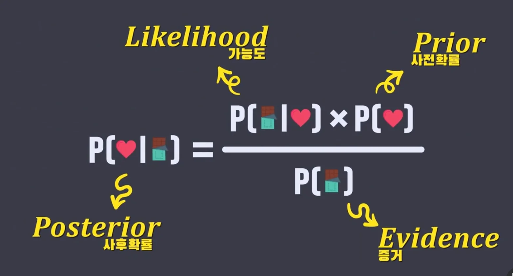

- 수식으로 표현하면 위와 같다&#46; 

- 어려워 보이지만 핵심 개념은 사각형을 생각하면 쉽게 구할 수 있다&#46;

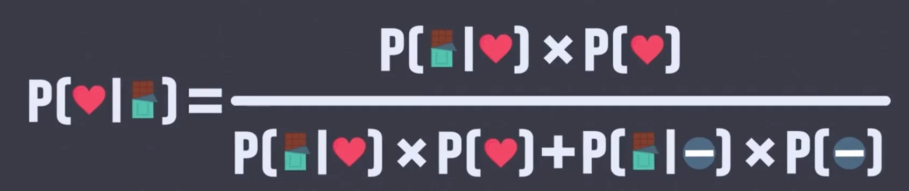

- 위와 같이 표기도 가능

### 6&#46; 사전 확률에 대한 주관적인 설정

> ✏️ 
> 
> 
> 
> 새로운 정보와 객관적인 확률 계산을 통해 더 정확한 확률들로 나아간다&#46; 
> 
> 
> 
> 따라서 데이터가 많을 수록 올바른 의사결정 확률이 높아진다&#46; 
> 
> - 이를 통해 사전확률을 지속적으로 업데이트 한다&#46; 
>     - 사람의 의사결정 방식과 유사하며
> 
>     - 경영학의 린(Lean Startup) 과 같다&#46;
> 
> - 인공지능의 의사결정에 사용

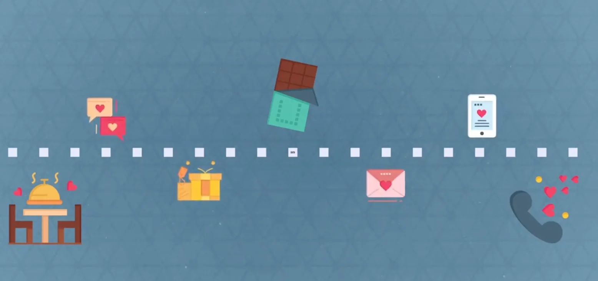

- 단순히 초콜릿만을 받은 사실 뿐만 아니라, <strong><u>데이트, 밤 늦게까지 전화 등의 데이터</u></strong>를 통해 ‘초콜릿을 준 사람이 나를 좋아하는가?’에 대한 확률을 지속적으로 업데이트 한다&#46; 

## Netflix 추천 알고리즘

[디즈니가 넷플릭스를 넘기 어려운 이유 &#124; 인공지능과 알고리즘, 나이브 베이즈 분류]()

### 1&#46; 콜드 스타트 ( 사전 확률 )

사전 확률을 50%, 50% 으로 일반적인 가정을 진행한다&#46; 

이후 사용자의 좋아요 데이터를 통해 

### 2&#46; 베이즈 정리 1 &#45; 장르

### 사전 설문

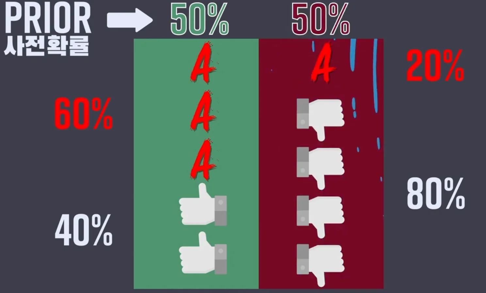

- 장르 (사전 확률)
    - 좋아하는 장르&#58; <code>50%</code>

    - 싫어하는 장르&#58; <code>50%</code>

- 좋아요 / 싫어요
    - 좋아하는 장르에서의 액션 장르, 좋아요&#58; <code>60%</code>

    - 싫어하는 장르에서의 액션 장르, 싫어요 &#58; <code>20%</code>

### 베이즈 정리

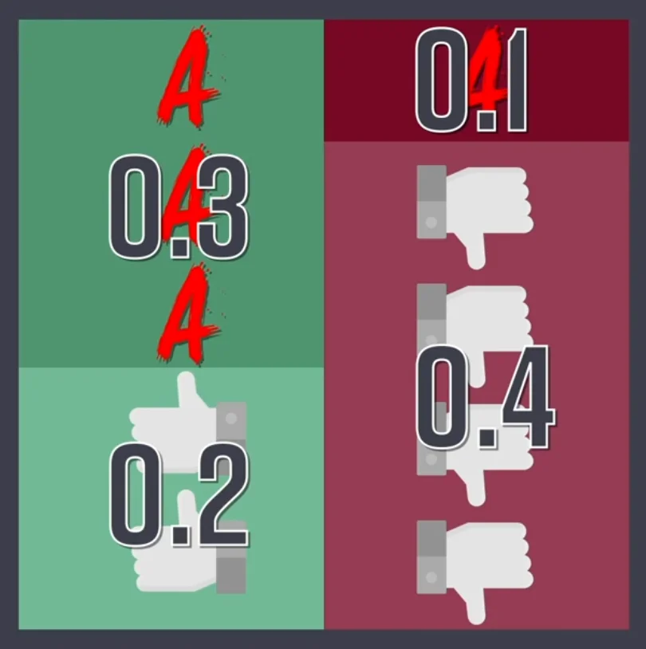

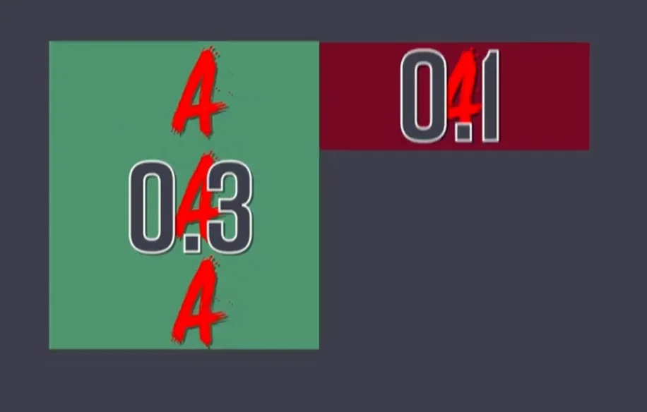

시청자가 액션 영화를 봤을 때 <code>좋아요</code>를 누를 확률

- 액션 장르&#58; <code>0&#46;4</code>
    - 좋아요&#58; <code>0&#46;3</code>

    - 싫어요&#58; <code>0&#46;1</code>

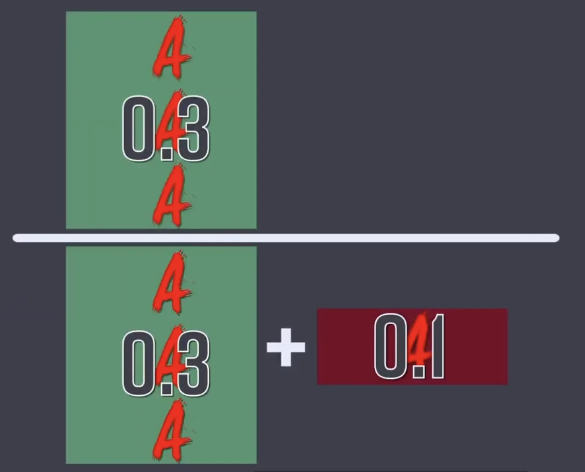

- 0&#46;3 / 0&#46;4 = <code>75% </code>

### 3&#46; 사후 확률 업데이트 1

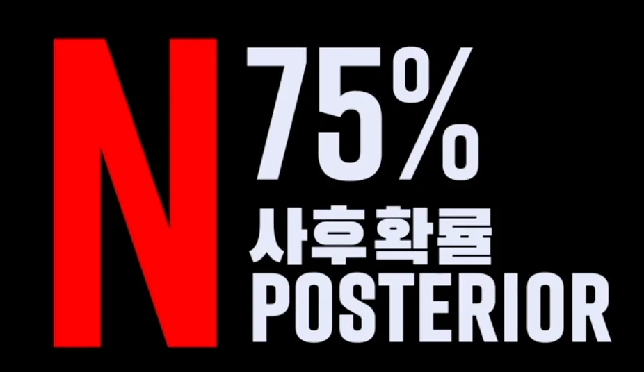

베이즈 정리를 통해 나온 액션 영화에서 좋아요를 누를 확률을 75%로 업데이트 진행

이후 시청자에게 액션 영화를 더 노출 시킴

### 3&#46; 베이즈 정리 2 &#45; 장르, 배우

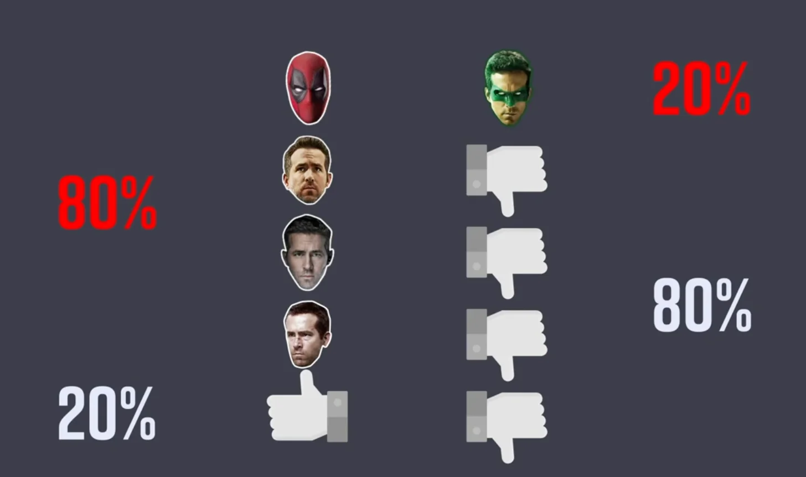

- 좋아요, 싫어요 영화&#58; 각각 <code>50%</code>

- 라이온 레이놀즈가 나온 영화
    - 좋아요&#58; <code>80%</code>

    - 싫어요&#58; <code>20%</code>

    

    인공지능이 사용자가 라이온 레이놀즈가 나온 영화를 좋아한다는 것을 학습

### 배우, 장르

그렇다면 <u>액션 영화</u>에 <u>라이온 레이놀즈</u>가 나오면 얼마나 시청자가 좋아할 것인가?

- 베이즈 정리를 통해 구할 수 있음

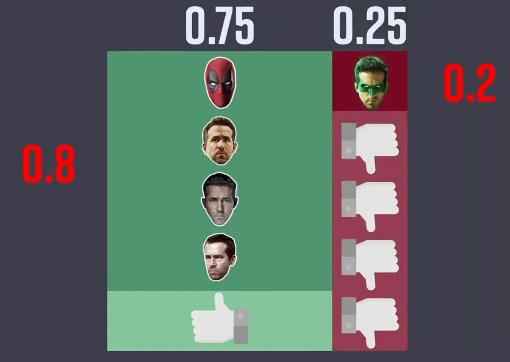

- 장르에 대한 베이즈 정리 값을 사전 확률로 업데이트
    - 사용자가 액션 확률을 좋아할 확률(<code>75%</code>)
        - 그 반대인 싫어할 확률을 자동으로 <code>25%</code> 가 됨

- 이전에 조사한 레이즈 놀즈가 나오는 영화에 대한 좋아요, 싫어요 확률을 사용
    - 이온 레이놀즈가 나온 영화
        - 좋아요&#58; <code>80%</code>

        - 싫어요&#58; <code>20%</code>

### 베이즈 정리&#58;  <u>액션 영화</u>에 <u>라이온 레이놀즈</u><strong> 나오면 사용자가 좋아할 확률</strong>

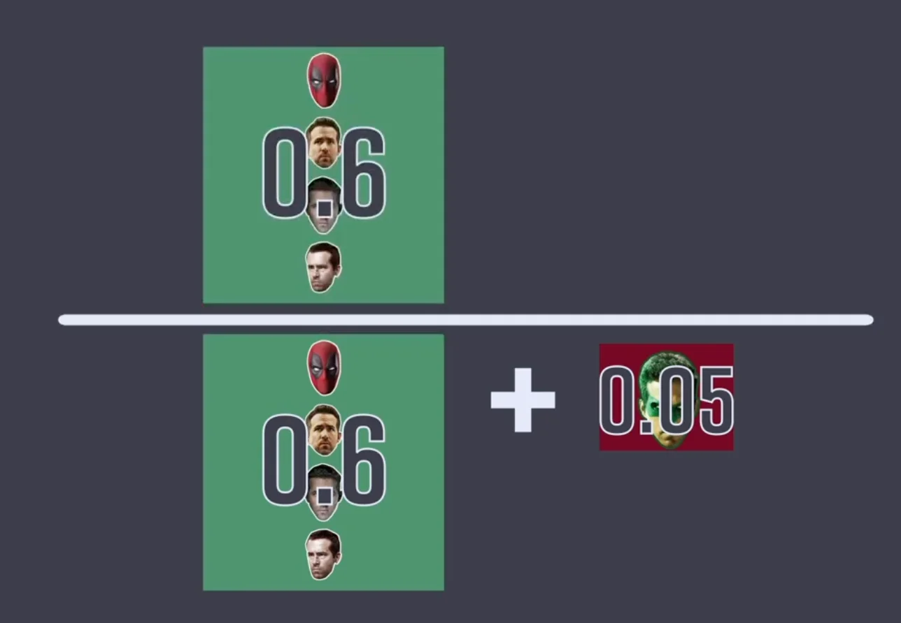

- 0&#46;6 / 0&#46;65 = 0&#46;923 ( <code>92&#46;3%</code> )
    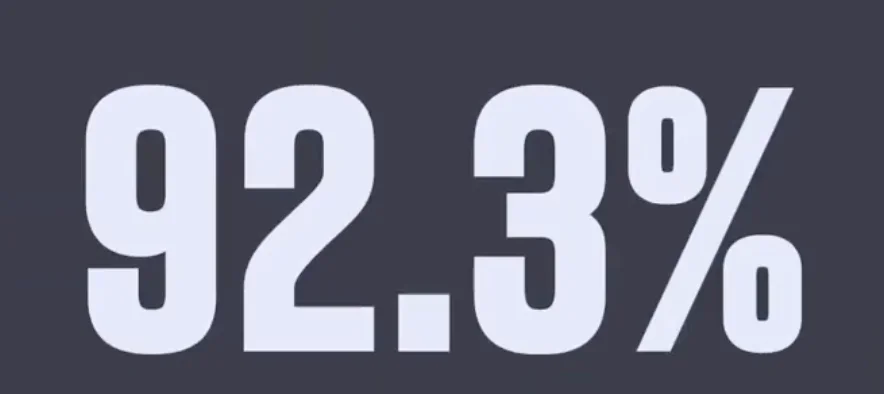

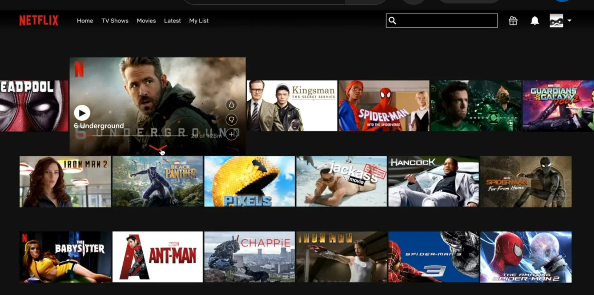

따라서 netflix에서는 사용자에게 <code>액션 &#43; 라이언 레이즈놀즈</code> 영화를 사용자에게 더 많이 노출 시킨다&#46; 

> 
> 
> 
> 
> <strong>정리</strong>
> 
> 
> 
> 넷플리스에서는 <code>나이브 레이즈(레이즈 정리)</code> 알고리즘 사용해 사용자의 정보를 통해 학습하면서 사용자의 선호도 확률을 업데이트하고 그에 맞는 컨텐츠를 노출시킨다&#46;
> 
> - 물론 레이즈 알고리즘만을 사용하지 않는다&#46;  여러 알고리즘을 섞어서 사용한다&#46;  → 정확도 상승
>     - Matrix factorization
> 
>     - RBM
> 
>     - GBDT
> 
>     - TF&#45;IDF
> 
> - 섬세하게 영화를 분류하기 위해 영화에 태그를 다는 태거를 고용하고 있다&#46; 
>     - 데이터 라벨링
