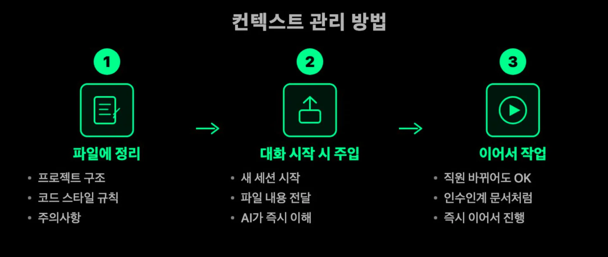
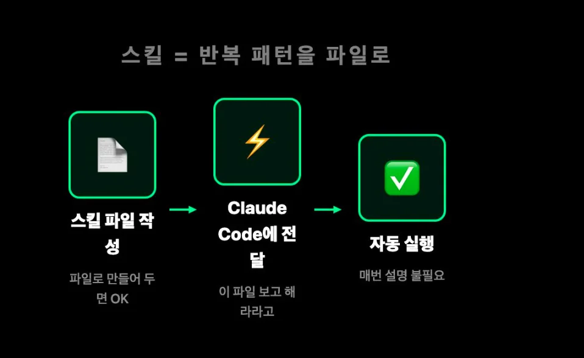
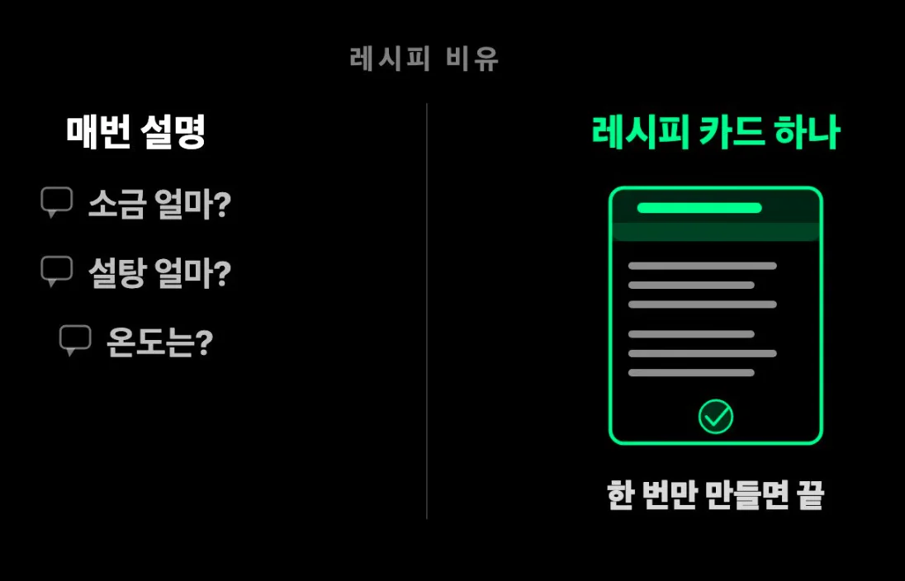
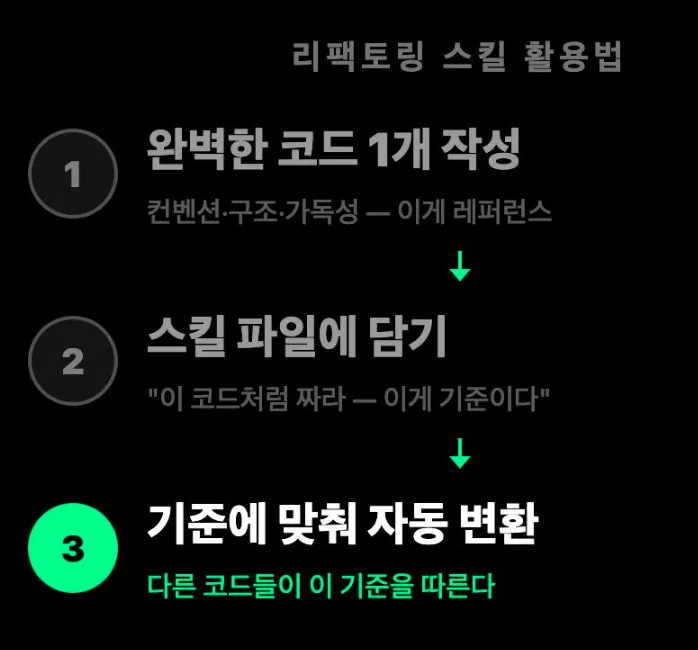
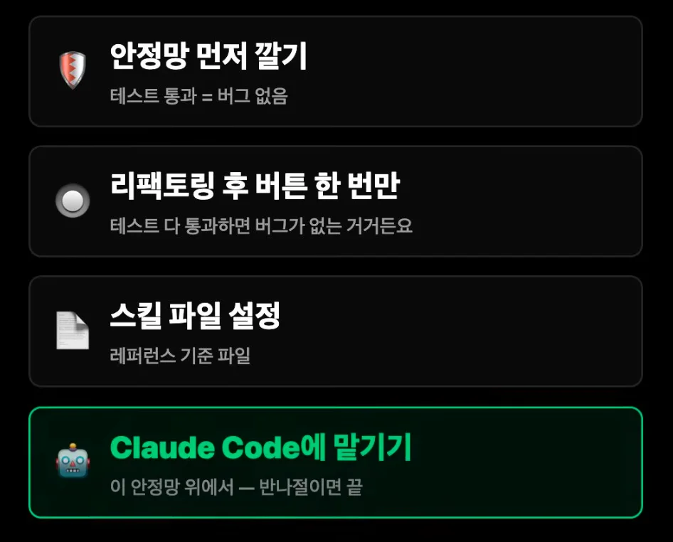

[개발자가 사라지고 있습니다]()

## 1&#46; 컨텍스트 정의

- <code>claude&#46;md</code>에서 관리
    - 컨벤션&#58; 코드 스타일 규칙

    - 프로젝트 구조

    - 주의사항

## 2&#46; 스킬

작업 진행하면서 매번 반복되는 패턴들을 스킬로 정의

- 리펙토링 업무에 적극 활용
    

## 3&#46; 테스트 코드 먼저 작성

- TDD 

## 4&#46; 작업 순서

1. 테스트 코드 

1. 스킬 설정 

1. 클로드코드  → 리펙토링

1. 테스트
