

## 1&#46; ‘강화학습’이란 무엇인가?

> ✏️ 
> 
> 
> 
> <code>강화학습</code>은 <strong>학습 주체</strong>가 <strong><u>환경과 상호작용</u></strong>을 통해 <strong><u>어떤 학습이 좋고 나쁜지를 분별</u></strong>하고 이를통해 <strong>좋은 행동을 찾</strong>도록 <strong><u>학습</u></strong>하는 것을 말한다&#46; 

### 🧐 <u>환경과 상호작용</u>을 하기 위해서는 어떤 조건들이 필요한가?

1. <strong><u>환경의 상태</u></strong><strong><u>에 대해 </u></strong><strong><u>인식</u></strong>하고 <strong><u>정보를 얻</u></strong>을 수 있어야 한다&#46; ( 눈, 코, 귀 등 )

1. <strong><u>환경에서 행동을 취</u></strong>할 수 있어야 한다&#46; ( 걷기, 뛰기, 물건 집기, 던기지 밥먹기 등)

### 강화학습 과정

---

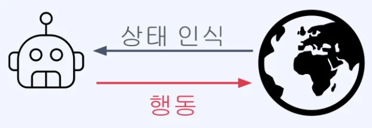

- 다양한 시도를 통해 어떤 결과를 얻게 되는지 파악
    

    → 어떤 상황이 좋거나 나쁜지, 특정 상황마다 어떤 행동이 좋거나 나쁜지 파악

- 이후 자신의 행동에 따라 어떤 결과를 얻게 될지 생각하며, 주어진 상황에서 어떻게 행동할지 결정
    

    → 경험을 토대로 어떤 상황이 주어지면 그에 따른 행동이 정해짐

### 강화학습 예시

---

> ✏️ 
> 
> 
> 
> 많은 생명체가 강화학습의 원리로 학습을 진행함&#46;
> 
> 1. 학습 주체가 환경의 상태를 인식하고 행동을 취하여 상호작용하며,
> 
> 1. 자기 행동에 따른 결과의 좋고 나쁨의 정도로,
> 
> 1. 자기의 행동을 발전/억제해 가는 과정

- 예시 1) 동물 &#45; 사자 
    

    - 사자는 처음 태어나면 걷는 것 조차도 못 함&#46;    → 강화학습&#58; 걷는 것을 배워야 무리(어미)와 잘 동행할 수 있고 이후 삶에 도움이 됨 (좋음)&#46;

    - 걷기 이외에 뛰기, 사냥하기 등 자신의 삶에 도움이 되는 다양한 행동을 배워감&#46;

- 예시 2) 사람 &#45; 농구
    

    - 농구를 처음 시작하는 사람의 경우, 슛을 제대로 날려 바구니를 맞추는 것도 어려움&#46;
        

        → 반복해서 슛을 시도하며, 골이 더 잘 들어가는 슛 자세를 계속해서 찾아감&#46;

    - 슛 이외에도 드리블, 레이업 등 골을 넣는데 도움이 되는 다양한 기술을 시도하며 배워감&#46;

## 2&#46; ‘강화학습’의 학습 목표

### 강화학습의 <u>보상(Reward)</u>이란?

---

강화학습에서 <code>보상(reward)</code>은 <strong><u>학습주체(에이전트)</u></strong>가 <strong><u>어떤 행동을 취</u></strong>했을 때, <strong><u>그 결과가 얼마나 </u></strong><strong><u>좋고 나쁜</u></strong><strong><u>지</u></strong>를 <strong>수치</strong>로 표현한 신호이다&#46; 

<strong>보상은 행동 직후 즉시 발생하지 않을 수도 있다&#46; </strong>운동을 매일 한다고 해서 당장 내일 건강해지지 않는 것처럼, 보상은 지연되어 나타나기도 한다&#46;

우리 일상에서도 보상은 자연스럽게 존재한다&#46;

| 행동 | 보상 |
| --- | --- |
| 뜨거운 여름날 시원한 레몬에이드를 마심 | <code>&#43;50</code> |
| 농구에서 골을 넣음 | <code>&#43;10</code> |
| 게임에서 이김 | <code>&#43;20</code> |
| 핸드폰 보며 걷다가 넘어짐 | <code>&#45;20</code> |
| 내기 게임에서 짐 | <code>&#45;100</code> |
| 어머니의 꽃병을 실수로 깨뜨림 | <code>&#45;1000</code> |

### 학습 목표&#58; 즉각적인 보상이 아닌, <u>보상의 합</u>

---

그렇다면 강화학습의 궁극적인 목표는 무엇일까? 단순히 지금 당장 큰 보상을 얻는 것일까?

아래의 예시를 보자

> <strong>중간고사 전날 밤, 공부를 하나도 안 한 상황</strong>
> 
> - <strong>게임을 한다</strong> → <code>&#43;20</code> &#46;&#46;&#46; 그런데 다음날 시험을 망친다 → <code>100</code> → <strong>합계&#58; </strong><strong><code>&#45;80</code></strong>
> 
> - <strong>공부를 한다</strong> → <code>20</code> &#46;&#46;&#46; 그런데 다음날 시험을 잘 본다 → <code>&#43;100</code> → <strong>합계&#58; </strong><strong><code>&#43;80</code></strong>

게임을 하면 지금 당장은 기분이 좋다&#46; 하지만 결과적으로 손해이다&#46; 

강화학습의 에이전트도 마찬가지다&#46;<u> </u><strong><u>즉각적인 보상이 크</u></strong><strong>더라도 </strong><strong><u>이후에 더 큰 손해</u></strong><strong>를 낳는 행동은 </strong><strong>좋은 행동이 아니다</strong><strong>&#46;</strong> 반대로, 지금의 보상을 포기하더라도 <strong><u>장기적으로 더 높은 총합을 만드는 행동</u></strong>이 <strong><u>좋은 행동</u></strong>이다&#46;

따라서 <strong><code>강화학습의 학습목표</code></strong>는 <strong><u>특정 기간 동안 얻는 </u></strong><strong><u>보상의 합</u></strong><strong> </strong><code class="language-math">G&#95;t</code><strong>로 정의한다&#46; </strong>

- <code class="language-math">G&#95;t = R&#95;{t&#43;1} &#43; R&#95;{t&#43;2} &#43; &#92;cdots</code>

### <code>할인율(Discount Factor)</code>&#58; 미래 보상의 가중치

---

보상의 합 공식에서 한 발 더 나아가면, 실제로는 <strong>할인율(Discount Factor), </strong><code class="language-math">&#92;gamma</code><strong>를 도입한 형태를 사용</strong>한다&#46;<strong> </strong>

- <code class="language-math">G&#95;t = R&#95;{t&#43;1} &#43; &#92;gamma R&#95;{t&#43;2} &#43; &#92;gamma^2 R&#95;{t&#43;3} &#43; &#92;cdots</code> 
    - <code class="language-math">&#92;gamma &#92;text{ &#58; Discount factor}, ( &#92;; 0 &#92;le &#92;gamma &#92;le 1 )</code> 

> <strong>할인율(Discount Factor, </strong><code class="language-math">&#92;gamma</code><strong>) 이 의미하는것</strong>

할인율은 쉽게 말해 <strong><u>“미래 보상을 얼마나 중요하게 볼 것인가”</u></strong>를 결정하는 파라미터다&#46; 

- <code class="language-math">&#92;gamma = 0</code><strong> </strong>
    - 오직 지금 당장의 보상만 고려 →  <code class="language-math">Gt=Rt&#43;1</code>

    - 극단적으로 근시안적인 에이전트

- <code class="language-math">&#92;gamma = 1</code> 
    - 미래 보상을 현재와 동등하게 고려 →  <code class="language-math">Gt=Rt&#43;1&#43;Rt&#43;2&#43;⋯</code>

    - 장기적 관점을 최대로 반영

또한 <strong><u>수학적으로도 중요</u></strong>한 이유가 있다&#46; 

<code class="language-math">&#92;gamma &#60; 1</code> 이면 무한히 이어지는 <strong><code>보상의 합</code></strong>이 <strong><u>발산하지 않고 </u></strong><strong><u>수렴</u></strong>하게 되어 <strong><u>학습이 안정적</u></strong>으로 이루어진다&#46;

따라서 <u>어떤 에이전트를 설계</u>하느냐에 따라<u> 적절한 </u><code class="language-math">&#92;gamma</code><u> 값이 달</u>라지며, 이는 곧 그 에이전트의 <strong>&#34;성향&#34;</strong> 을 결정한다고도 볼 수 있다&#46;

### 예시) 강화학습 목표값 구하기

---

1. 시험 공부를 하나도 하지 않은 중간고사 전달, <code>Discount factor = 0&#46;1</code>
    - 게임을 한다&#58; <code>&#43;20</code> → 중간고사를 망친다&#58; <code>&#45;100</code> 
        - → 목표값&#58; <code class="language-math">&#43;20 &#43; 0&#46;1 &#42; (&#45;100) = &#43;10</code>

    - 공부를 한다&#58; <code>&#45;20</code> → 중간고사를 잘본다&#58; <code>&#43;100</code> 
        - → 목표값&#58; <code class="language-math">&#45;20 &#43; 0&#46;1&#42;(&#43;100) = &#45;10</code>

1. 시험 공부를 하나도 하지 않은 중간고사 전달, <code>Discount factor = 0&#46;9</code> 
    - 게임을 한다&#58; <code>&#43;20</code> → 중간고사를 망친다&#58; <code>&#45;100</code> 
        - → 목표값&#58; <code class="language-math">&#43;20 &#43; 0&#46;9 &#42; (&#45;100) = &#45;70</code>

    - 공부를 한다&#58; <code>&#45;20</code> → 중간고사를 잘본다&#58; <code>&#43;100</code> 
        - → 목표값&#58; <code class="language-math">&#45;20 &#43; 0&#46;9&#42;(&#43;100) = &#43;70</code>

1. 치즈를 좋아하는 쥐, <code>Discount factor = 0&#46;9</code> 
    

    - 전기 충격 목표값&#58; <code class="language-math">0 &#43; 0&#46;9 &#42; 0 &#43; 0&#46;9^2&#42;(&#45;100) = &#45;81</code>

    - 치즈 획득 목표값&#58; <code class="language-math">0 &#43; 0&#46;9 &#42; 0 &#43; 0&#46;9^2&#42;(&#43;100) = &#43;81</code>

## 3&#46; ‘강화학습’의 특징

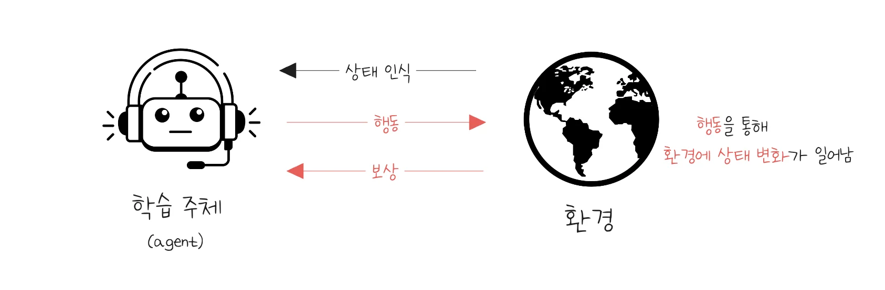

- 강화학습에서 <u>학습을 진행</u>하기 위해서는 <code>환경</code>과 <code>학습 주체</code>가 필요하다&#46; 

- <code>학습 주체</code>는 <strong><u>환경의 상태를 인식</u></strong>하고, <strong><u>행동을 취</u></strong>할 수 있어야 한다&#46; 

- 일반적으로 <strong><u>학습 주체가 취한 행동</u></strong>은 <strong><u>환경의 상태에 변화를 일</u></strong>으킨다&#46; 

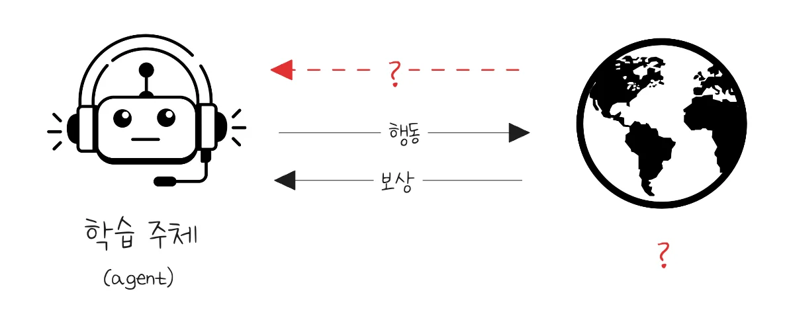

- 학습 주체는 <strong><u>환경에 대한 </u></strong><strong><u>불확실성</u></strong> 가운데 학습을 진행한다&#46;
    - <strong><u>환경의 작동</u></strong><u> 메커니즘을 모르는 상태</u>로 학습 진행

- 학습 주체는 어떤 행동이 <strong><u>목표값 최대화</u></strong>에 도움이 되는지 <strong><u>직접 시도</u></strong>하며 <strong>시행착오</strong>를 통해 학습
    

     → Trial&#45;error&#45;learning

- <strong><u>목표값을 최대화</u></strong>하기 위한 <strong>행동을 배운다</strong>는 것은, <strong><u>주어진 환경의 상태</u></strong>에서 <strong><u>어떤 행동을 취하는게 좋은지 학</u></strong>습하는 과정을 말함
    - <code class="language-math">action = MyAction(state)</code>

<strong><u>현재 취하는 행동</u></strong>이 <strong><u>나중에 얻게 될 보상에도 영향</u></strong>을 끼치므로,  <strong>미래를 고려</strong>해서 행동을 취해야한다&#46; 

- 일반적으로 강화학습은 학습데이터가 주어지지 않으며, 환경만 주어진 상태에서 직접 학습 데이터를 수집함

- 이때 자주 발생하는 문제가 바로 exploration &#38; exploitation trade off 이다&#46;( 강화학습의 중요한 특성 )
    - <strong><code>탐험 (Exploration)</code></strong><strong>&#58; 아직 해보지 않은(or 좋지 않았던) 행동을 시도해서 새로운 가능성을 찾기</strong>

    - <strong><code>탐사 (Exploitation)</code></strong><strong>&#58; 이미 잘 되는 행동을 반복해서 높은 보상을 얻기</strong>

예시 &#45; exploration &#38; exploitation trade off  

1. 자주 가는 맛집을 갈 것인가(exploitation), 새로 생긴 식당을 갈 것인가(exploration)?
    - 보장된 행복 vs 새롭거나 더 큰 행복의 가능성  (= 더 큰 불행의 가능성)

1. 잘 아는 종목 위주로 투자해서 수익(exploitation), 새로운 종목을 찾아볼 것인가(exploration)?
    - 보장된 기대 수익 vs 더 큰 수익의 가능성 (= 더 큰 손해의 가능성)

## 4&#46; 강화학습, 지도학습, 비지도학습 비교

### 머신러닝이 푸는 문제의 유형

딥러닝을 포함한 머신러닝이 다루는 문제는 크게 세 가지로 구분할 수 있다&#58; <strong><code>분류</code></strong>, <strong><code>군집화</code></strong>, <strong><code>회귀</code></strong>

- <strong><code>분류 (Classification)</code></strong>
    

    데이터가 어떤 <strong>부류(class)에 속하는지</strong> 알아내는 문제다&#46; 출력값이 이산적인 카테고리로 정해져 있다는 것이 특징이다&#46;

    > <strong>예시) </strong>자동차의 길이, 너비, 높이, 바퀴 크기, 엔진 마력 등의 특징(feature)을 보고 경차 / 준중형차 / 중형차 / 대형차 중 하나로 분류하는 문제

- <strong><code>군집화 (Clustering)</code></strong>
    

    비슷한 특징을 가진 데이터 인스턴스끼리 <strong>그룹으로 묶는</strong> 문제다&#46; 분류와 달리 사전에 정해진 카테고리가 없으며, 데이터의 구조를 스스로 발견한다&#46;

    > <strong>예시) </strong>자동차 특징들을 기반으로 유사한 인스턴스끼리 묶으면 자연스럽게 그룹이 형성된다&#46; 다만 각 그룹에 &#34;경차&#34;, &#34;준중형차&#34; 같은 의미 있는 이름을 붙이는 것은 사람의 해석을 필요로 하는 경우가 많다&#46;

- <strong><code>회귀 (Regression)</code></strong>
    

    연속적인 수치 출력값을 예측하는 문제다&#46; 입력 특징들과 출력값 사이의 관계를 학습하여, 새로운 입력에 대한 값을 추정한다&#46;

    > <strong>예시)</strong>  자동차의 너비, 높이, 바퀴 크기, 엔진 마력은 알고 있지만 길이를 모를 때, 다른 데이터 인스턴스들을 근거로 해당 자동차의 길이를 예측하는 문제&#46;

### 문제 유형과 학습 방식의 관계

---

분류, 군집화, 회귀 문제를 푸는 방법은 머신러닝 말고도 많다&#46; 규칙을 직접 코딩할 수도 있고, 통계적 방법을 쓸 수도 있다&#46; 그렇다면 왜 머신러닝인가?

바로 <strong><u>데이터가 있</u></strong><strong>기 때문</strong>이다&#46; 머신러닝은 본질적으로 <strong>&#34;데이터로부터 패턴을 학습해서 문제를 푸는 방법&#34;</strong> 이다&#46; 규칙을 사람이 직접 정의하는 대신, 데이터에서 스스로 규칙을 찾아낸다&#46;

여기서 자연스럽게 다음 질문이 이어진다&#46;

> <strong>&#34;그 데이터가 어떤 형태로 주어지느냐?&#34;</strong>

이것이 바로 학습 방식을 결정하는 기준이다&#46;

- 데이터에 <strong>정답(label)까지 포함</strong>되어 있다면 → <strong><code>지도 학습</code></strong>

- 데이터는 있지만 <strong>정답이 없다</strong>면 → <strong><code>비지도 학습</code></strong>

- 데이터 자체가 없고 <strong>환경만 주어진다</strong>면 → <strong><code>강화학습</code></strong> (환경과 상호작용하며 데이터를 직접 수집)

즉, 학습 방식은 문제 유형이 아니라 <strong>가용한 데이터의 형태</strong>에 따라 결정된다&#46; 그렇기 때문에 같은 문제라도 데이터 상황에 따라 다른 학습 방식으로 접근할 수 있다&#46;

예를 들어 <strong>분류 문제</strong>를 놓고 보면&#58;

- 각 데이터에 정답 레이블이 붙어 있다면 → 지도 학습으로 직접 분류기를 학습

- 레이블 없이 데이터만 있다면 → 비지도 학습으로 유사한 것끼리 군집화한 뒤, 사람이 각 그룹에 의미를 부여하는 방식으로 간접적으로 접근

결국 문제 유형과 학습 방식의 관계는 아래와 같이 정리된다&#46;

|  | 분류 | 군집화 | 회귀 | 순차적 의사결정 |
| --- | --- | --- | --- | --- |
| <strong>지도 학습</strong> | ✅ 대표적 | ❌ | ✅ 대표적 | ⚠️ 제한적 활용 |
| <strong>비지도 학습</strong> | ⚠️ 간접 활용 | ✅ 대표적 | ⚠️ 간접 활용 | ❌ |
| <strong>강화학습</strong> | ⚠️ 간접 활용 | ❌ | ⚠️ 간접 활용 | ✅ 대표적 |

한 가지 주목할 점은 강화학습이 대응되는 문제 유형이 <strong><u>순차적 의사결정</u></strong>이라는 것이다&#46;  분류나 회귀가 단발성 예측 문제인 것과 달리, 순차적 의사결정은 지금의 행동이 이후 상태에 영향을 미치는 <strong><u>연쇄적인 구조</u></strong>를 가진다&#46; 이런 문제는 정답 데이터도, 고정된 데이터셋도 존재하지 않기 때문에 지도·비지도 학습으로는 직접적으로 접근하기 어렵다&#46;  강화학습이 독립적인 패러다임으로 존재하는 이유가 여기에 있다&#46;

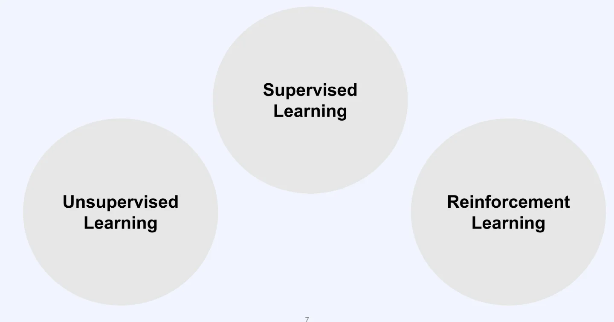

> 🤔 
> 
> 
> 
> 강화학습은 지도·비지도 학습과 다르다
> 
> - 강화학습은 앞의 두 방식과 근본적으로 다른 패러다임에 속한다&#46; 각각을 좀 더 구체적으로 비교해보자&#46;

### 지도 학습 vs 강화학습

<strong>지도 학습</strong>은 입력 데이터와 정답(label)이 쌍으로 주어진다&#46; 모델은 이 데이터를 통해 패턴을 익히고, 이후 처음 보는 데이터에 대해서도 잘 <strong>추정하고 일반화</strong>하는 것이 목표다&#46; 학습 데이터가 고정되어 있기 때문에,  탐색과 활용 사이의 균형 문제(Exploration &#38; Exploitation trade&#45;off)가 발생하지 않는다&#46;

강화학습의 관점에서 보면, 지도 학습은 마치 매 상태(state)마다 정답 행동(action)이 주어진 것과 같다&#46;

반면 <strong>강화학습</strong>은 사전에 수집된 학습 데이터 없이, 환경만 주어진 상태에서 시작한다&#46;  에이전트는 환경과 직접 상호작용하며 데이터를 스스로 수집하고, 보상 신호를 기반으로 어떤 행동이 좋은지 시행착오를 통해 알아간다&#46; 정답이 주어지지 않기 때문에, 다양한 행동을 직접 시도해보는 과정이 필수적이다&#46;

### 비지도 학습 vs 강화학습

<strong>비지도 학습</strong>은 정답(label) 없이 데이터만 주어진다&#46; 목표는 데이터의 내재된 구조(hidden structure)를 스스로 찾아내는 것이다&#46; 역시 학습 데이터가 고정되어 있어 Exploration &#38; Exploitation trade&#45;off가 존재하지 않는다&#46;

강화학습과의 핵심적인 차이는 <strong>목적함수</strong>에 있다&#46; 비지도 학습은 데이터를 잘 표현하는 구조를 학습하는 게 목표지만, 그 구조가 곧바로 보상의 합을 최대화하는 방향으로 이어지지는 않는다&#46; 

강화학습의 목표는 데이터 표현이 아니라 <strong>누적 보상의 최대화</strong>이기 때문이다&#46;

### 강화학습 안에서의 지도·비지도 학습 활용

지도 학습과 비지도 학습이 강화학습과 다른 패러다임에 속한다고 해서 함께 쓰이지 못하는 건 아니다&#46; 오히려 복잡한 환경에서는 이 둘을 적극적으로 활용하는 것이 효과적이다&#46;

환경이 복잡할수록 순수한 시행착오만으로 학습하는 것은 기하급수적으로 어려워진다&#46; 바둑의 경우 가능한 경우의 수가 <code class="language-math">10^{170}</code>에 달하기 때문에, 밑바닥부터 탐색하는 것은 사실상 불가능하다&#46;

이런 문제를 해결하기 위해 두 가지 방식이 활용된다&#46;

- <strong>지도 학습 활용</strong>
    - 인간의 게임 기록처럼 사전에 수집된 데이터로 기본적인 행동 방식을 먼저 학습한 뒤,  강화학습으로 성능을 추가로 개선하는 방식이다&#46; 

    - AlphaGo가 대표적인 사례다&#46;

- <strong>비지도 학습 활용</strong>
    - 강화학습 과정에서 스스로 수집한 데이터에 비지도 학습을 적용해 상태 정보의 유의미한 표현(representation)을 먼저 학습시킬 수 있다&#46; 

    - 예를 들어 Auto&#45;encoding으로 상태를 압축하거나, 다음 상태와 보상을 예측하는 모델을 학습시키는 방식이다&#46; 환경에서 얻는 상태 정보가 크고 복잡할수록, 이 representation의 품질이 전체 학습 성능에 크게 영향을 미친다&#46;

레거시 (정리 필요)

### 지도 학습 vs 강화학습

<strong>지도학습 </strong>

- 지도 학습은 학습 데이터가 정답과 함께 주어짐

- 학습 데이터를 통해 배운 후, <u>경험해보지 못</u>한 데이터에 대해서도 잘 <strong><u>추정</u></strong>하고 <strong><u>일반화</u></strong>하는 것이 목표

- 고정된 데이터에서 학습을 하기 때문에 exploration &#38; exploitation trade&#45;off가 존재하지 않음

- 강화학습 관점에서 볼 때, 지도학습은 학습 데이터의 state마다 정답 action이 주어진 것과 같음 

<strong>강화학습</strong>

- 일반적으로 강화학습은 학습 데이터 없이, 환경만 주어진 상태에서 학습
    - 환경과 상호작용을 통해 학습 데이터 직접 수집

- 강화학습은 학습을 하기 위한 신호로서 보상이 존재하지만, 정답이 주어진 것은 아님

- 강화학습은 직접 다양한 행동을 시도하며 시행착오를 겪어 어떤 행동이 좋은지 알아내야 됨

- <code class="language-math">action = MyAction(stat)</code>

### 비지도 학습 vs 강화학습

<strong>비지도 학습</strong>

- 학습 데이터가 정답(label) 없이 주어짐

- 학습 데이터를 잘 표현하기 위한 hidden structure를 학습합

-  고정된 데이터에서 학습을 하기 때문에 exploration &#38; exploitation trade&#45;off가 존재하지 않음

<strong>강화학습</strong>

- 일반적으로 학습 데이터없이, <strong><u>환경만 주어진</u></strong> 상태에서 학습함

- 데이터를 잘 표현하는 hidden structure를 만들어도 그것이 직접적으로 <strong><u>목표값을 최대화하지 않</u></strong>음

### 강화학습에서 지도 및 비지도 학습 활용

- 지도 및 비지도 학습은 강화학습에 효과적으로 활용될 수 있음

- 환경이 복잡하고 어려울수록 밑바닥에서부터 시행착오를 통해 학습하는 것은 기하급수적으로 어려워짐
    - 시행착오를 통해 경험해야 할 경우의 수가 너무 많음 ( 바둑 &#126;= <code class="language-math">10^{17}</code> )

- 따라서 인간의 게임 기록을 기반으로 지도 학습으로 먼저 학습한 후, 강화학습을 진행 ( 지도학습 )
    

    → 기본적인 플레이 방법을 익힌 후, 강화학습을 통해 성능을 더욱 개선하는 형태

- 직접 수집한 데이터 내에서, 유의미한 hidden structure를 학습시킬 수 있음
    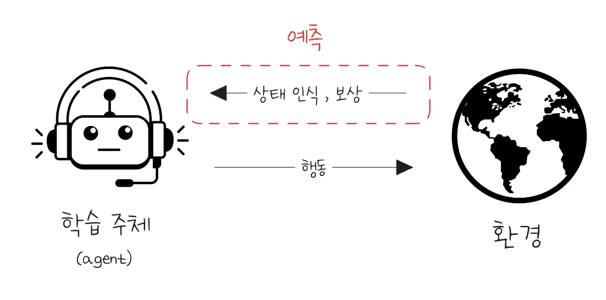

    - 행동에 따른 <u>상태 정보와 보상</u>을<strong><u> 예측</u></strong>하도록 hidden structure를 학습함 ( 비지도 학습 )

    - 수집한 데이터 중  <strong><u>상태</u></strong>에 대해서 auto&#45;encoding 등의 <strong><u>비지도 학습</u></strong> 적용 가능
        

        → 환경에서 얻게 되는 상태 정보가 <u>크고 복잡</u>할수록, <strong><u>학습 성능에 영향을 많</u></strong>이 끼침

## 5&#46; ‘강화학습’의 정형화 &#45; 기본 개념

### 강화학습의 정형화된 표현

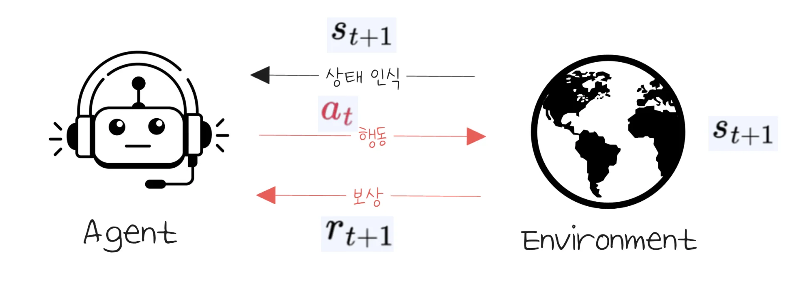

- <code>Agent</code>&#58; 환경과 상호작용을 하며 학습을 진행하는 주체

- <code>Environment</code>&#58; Agent가 상호작용을 진행하는 대상이 되는 객체

- <code class="language-math">s&#95;t</code><code> (state)</code>&#58; 특정 시점 t의 환경의 상태

- <code class="language-math">a&#95;t</code><code> (action)</code>&#58; 특정 시점 t에 agent가 취한 행동

- <code class="language-math">r&#95;{t&#43;1}</code><code> (reward)</code>&#58; 특정 시점에 t&#43;1에 agent가 받은 보상

- <code>Transition</code>&#58; 환경이 action을 받아 next state로 변화되는 현상

- <code class="language-math">(s&#95;t, a&#95;t, r&#95;{t&#43;1}, s&#95;{t&#43;1})</code>(transition tuple)&#58; 한 번의 상호작용에 대한 정보

### Episode, trajectory and policy

일반적으로 환경과의 상호작용은 한 번으로 끝나는 것이 아니라, 계속해서 이어진다&#46; 

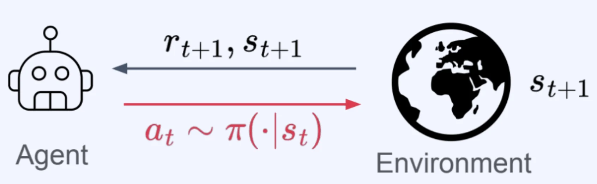

- <code class="language-math">E=(s&#95;0, a&#95;0, r&#95;1, s&#95;1, &#92;cdots, s&#95;{T&#45;1}, a&#95;{T&#45;1}, r&#95;T, s&#95;T)</code> (episode)
    - 환경과 상호작용의 시작부터 끝까지 모든 state, action, reward

- <code class="language-math">H&#95;t = E=(s&#95;0, a&#95;0, r&#95;1, s&#95;1, &#92;cdots, s&#95;{t&#45;1}, a&#95;{t&#45;1}, r&#95;t, s&#95;t)</code> (history)
    - 환경과 상호작용의 시작부터 특정 시점 t까지의 state, action, reward

- <code class="language-math">T = (s&#95;t, a&#95;t, r&#95;{t&#43;1}, s&#95;{t&#43;1}, &#92;cdots , s&#95;{t&#43;L&#45;1}, a&#95;{t&#43;L&#45;1}, r&#95;{t&#43;L}, s&#95;{t&#43;L})</code> (trajectory)
    - 특정 시점부터 시작된 임의의 길이의 state, action, reward 배열

- <code class="language-math">&#92;pi</code> (policy)
    - Agent의 행동 방식 (일반적으로 확률 분포)

- <code class="language-math">&#92;pi(a&#95;t&#124;s&#95;t)</code>
    - 특정 시점 t에서 주어진 state, <code class="language-math">s&#95;t</code>에서 특정 행동 <code class="language-math">a&#95;t</code>를 선택할 확률

### Policy (detail)

> ✏️ 
> 
> - <code class="language-math">&#92;pi</code> (policy)&#58; Agent의 행동 방식 (일반적으로 확률 분포)
> 
> - <code class="language-math">&#92;pi(a&#95;t&#124;s&#95;t)</code>&#58; 특정 시점 t에서 주어진 state, <code class="language-math">s&#95;t</code>에서 특정 행동 <code class="language-math">a&#95;t</code>를 선택할 확률

Agent Policy는 일반적으로 아래의  두 형태를 지닌다&#46;

- <strong>Discrete Distribution</strong>
    

- <strong>Continuous Distribution</strong>
    

### Transition (detail)

Transition이 발생하는 과정을 더 자세히 소개

- Transition에 <strong><u>randomness가 없</u></strong>는 경우, 아래와 같이 표현됨
    - Detreministic environment

    - <code class="language-math">s&#95;{t&#43;1} = f&#95;T(s&#95;t, a&#95;t)</code>
        - <code class="language-math">f&#95;t</code>&#58; Transition function

- Transition에 <strong><u>randomness가 있</u></strong>는 경우, 아래와 같이 표현됨
    - Stochastic environment

    - <code class="language-math">s&#95;{t&#43;1} </code><code> &#126; </code><code class="language-math">P(&#92;cdot&#124;s&#95;t, a&#95;t)</code>
        - <code class="language-math">P(&#92;cdot&#124;s&#95;t, a&#95;t)</code>&#58; Transition probability

### Environment 예시들

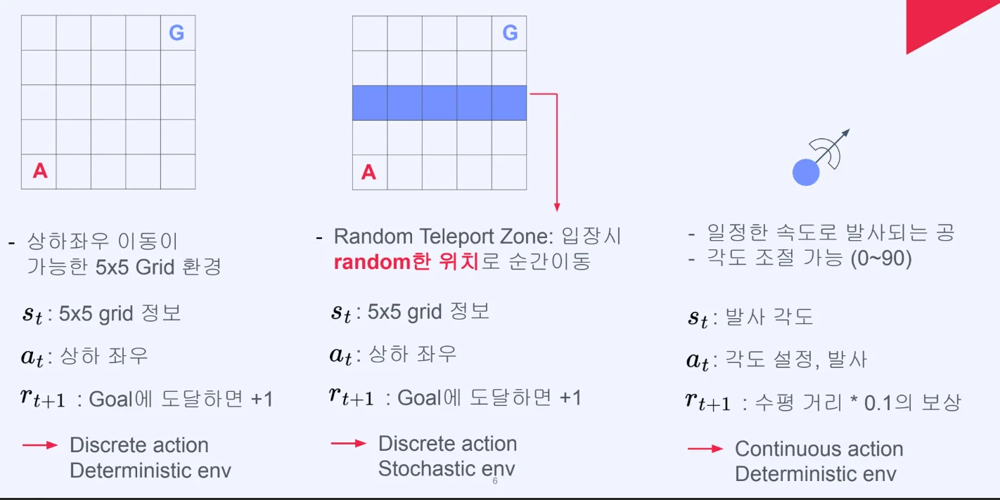

예시 1) <code>Discrete action</code>, <code>Deterministic env</code>

> 상하좌우 이동이 가능한 5x5 Grid 환경

- <code class="language-math">s&#95;t</code>&#58; 5 x 5 grid 정보

- <code class="language-math">a&#95;t</code>&#58; 상하 좌우

- <code class="language-math">r&#95;{t&#43;1}</code>&#58; Goal에 도달하면 &#43; 1

예시 2) <code>Discrete action</code>, <code>Stochastic env</code>

> Random Teleport Zone&#58; 입장 시 <strong><u>random한 위치</u></strong>로 순간이동

- <code class="language-math">s&#95;t</code>&#58; 5 x 5 grid 정보

- <code class="language-math">a&#95;t</code>&#58; 상하 좌우

- <code class="language-math">r&#95;{t&#43;1}</code>&#58; Goal에 도달하면 &#43; 1

예시 3) <code>Continuous action</code>, <code>Deterministic env</code>

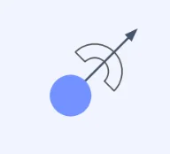

> 
> 
> 
> 
> &#45; 일정한 속도로 발사되는 공 &#45; 각도 조절 기능 (0&#126;90)

- <code class="language-math">s&#95;t</code>&#58; 발사 각도

- <code class="language-math">a&#95;t</code>&#58; 각도 설정, 발사

- <code class="language-math">r&#95;{t&#43;1}</code>&#58; 수평 거리 &#42; 0&#46;1 의 보상

### Partial observability

- 만약 환경의 상태를 <strong><u>부분적</u></strong>으로만 볼 수 있다면?

- 환경의 상태 중 일부를 <strong><u>특정 transformation(변환)</u></strong>을 통해서 얻게 됨

- 환경의 작동과 관려된 전체 상태는 상호작용이 진행되며 내부적으로 계속 업데이트 됨&#46;

- <code class="language-math">s&#95;{t&#43;1} = f&#95;T(s&#95;t, a&#95;t)</code> or <code class="language-math">s&#95;{t&#43;1}</code><code> &#126; </code><code class="language-math">P(&#92;cdot&#124;s&#95;t, a&#95;t</code><code>)</code>

### 강화학습 정형화 예시 

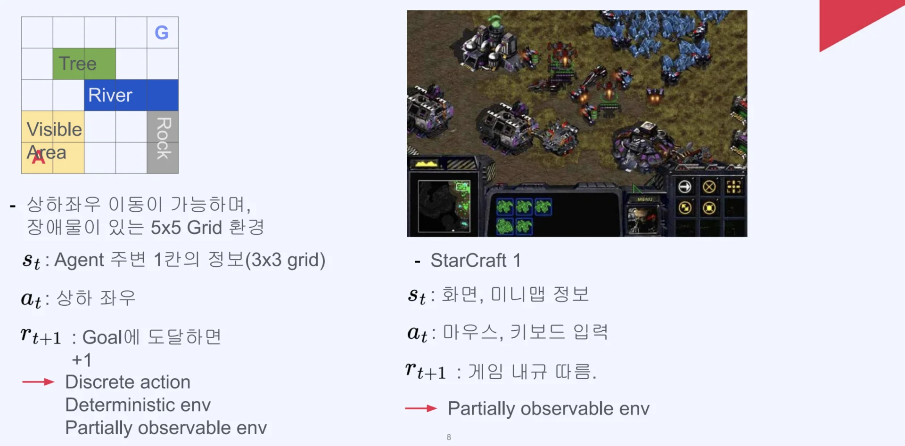

‣

## 6&#46; 강화학습의 정형화 — Return, Value Function, 그리고 학습 과정

### Return이란?

---

강화학습에서 에이전트가 최대화하고자 하는 값을 <strong>return</strong>이라고 한다&#46;

> <code class="language-math">G&#95;t = R&#95;{t&#43;1} &#43; {&#92;gamma}R&#95;{t&#43;2} &#43; {&#92;gamma}^2R&#95;{t&#43;3} &#43; &#92;cdots</code>

- <code class="language-math">&#92;gamma&#58; Discount factor, 0 ≤ &#92;gamma ≤ 1</code>
    - <code class="language-math">&#92;gamma</code>(감마)가  1에 가까울수록 미래 보상을 현재와 거의 동일하게 취급하고,  0에 가까울수록 즉각적인 보상을 중시한다&#46;

### Return은 Random Variable이다

---

Return은 <strong>확률변수(random variable)</strong>다&#46; 에이전트의 policy가 확률적이거나, 환경의 state transition이 확률적이라면 동일한 state에서 출발하더라도 매번 다른 return을 얻게 된다&#46;

- <strong>예시</strong>(<code class="language-math">&#92;gamma = 1</code>인 경우, 특정 state에서 출발한 4가지 시나리오)
    

    | 시나리오 | 보상 구성 | Return | 발생 확률 |
    | --- | --- | --- | --- |
    | 1 | &#43;10, &#43;5 | 15 | 0&#46;56 |
    | 2 | &#43;10, −5 | 5 | 0&#46;14 |
    | 3 | −10, &#43;100 | 90 | 0&#46;27 |
    | 4 | −10, −100 | −110 | 0&#46;03 |

같은 출발점에서도 어떤 행동을 선택하느냐, 환경이 어떻게 반응하느냐에 따라 return이 완전히 달라진다&#46; 이처럼 return의 확률적 성질은 <strong>policy에 의존</strong>한다&#46;

### Value function, Action&#45;value function

---

<code>Return</code>이 확률변수이기 때문에, 강화학습에서는 <strong><u>return의 기댓값을 기준</u></strong>으로 판단한다&#46; 이를 위한 두 가지 핵심 함수가 바로 <strong>value function</strong>과 <strong>action&#45;value function</strong>이다&#46;

- Value Function
    > <code class="language-math">V^&#92;pi(s&#95;t)= E&#95;{&#92;pi}&#91;G&#95;t&#124;s&#95;t&#93;</code>

    - 특정 state(<code class="language-math">s&#95;t</code>)에서 policy(<code class="language-math">&#92;pi</code>)에 따를 때 평균적으로 얻게 되는 return&#46; 

    - 즉, <strong>어떤 state가 얼마나 좋고 나쁜지</strong>를 나타내는 척도다&#46;

- Action&#45;value function
    > <code class="language-math">Q^{&#92;pi}(s&#95;t, a&#95;t) = E&#95;{pi}&#91;G&#95;t&#124;s&#95;t,a&#95;t&#93;</code> 

    - state <code class="language-math">s&#95;t</code>에서 action <code class="language-math">a&#95;t</code>를 선택한 뒤 policy <code class="language-math">&#92;pi</code>를 따를 때(행동 했을 때)의 평균적으로 얻게 되는 return&#46;

    - <strong>Q&#45;function</strong>이라고도 불리며, <strong>주어진 state에서 특정 action이 얼마나 좋고 나쁜지</strong>를 나타내는 척도다 ( 실용적으로는 이 해석이 더 자주 쓰인다&#46; )

    - 두 함수 모두 <strong>policy </strong><code class="language-math">&#92;pi</code><strong>에 의존하며</strong> Policy가 바뀌면 value function과 action&#45;value function도 함께 바뀐다&#46;

    ---

    

      → 어떤 (state, action)이 얼마나 <strong><u>좋거나 나쁜지</u></strong>에 대한 <strong><u>척도</u></strong>라 할 수 있음

    

      → 주어진 state에서 특정 action이 얼마나 좋거나 나쁜지에 대한 첫도라 할 수 있음 ( 보통 이 의미로 더 자주 해석됨 )

### 강화학습의 반복 사이클

---

> ✏️ 
> 
> - <code>Value function</code>과 <code>action&#45;value function</code>은 환경과의 상호작용을 통해 얻은 데이터로부터 <strong>추정(estimate)</strong>된다&#46; 
> 
> - 그리고 이 추정값을 바탕으로 policy를 개선한다&#46; 
> 
> - 개선된 policy는 다시 새로운 데이터를 만들어내고, 
> 
> - 이 사이클이 반복된다&#46;

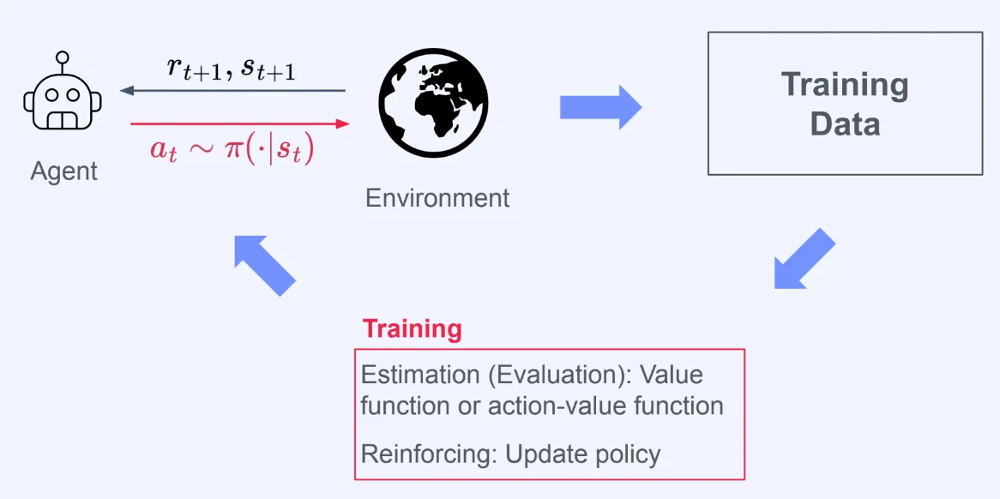

1. 환경과 상호작용 → 학습 데이터 수집

1. <code class="language-math">V(s)</code>, <code class="language-math">Q(s,a)</code> 추정 (value function, action&#45;value function 추정)

1. Policy 업데이트 (강화)

1. 개선된 Policy로 다시 상호작용 → (반복)
