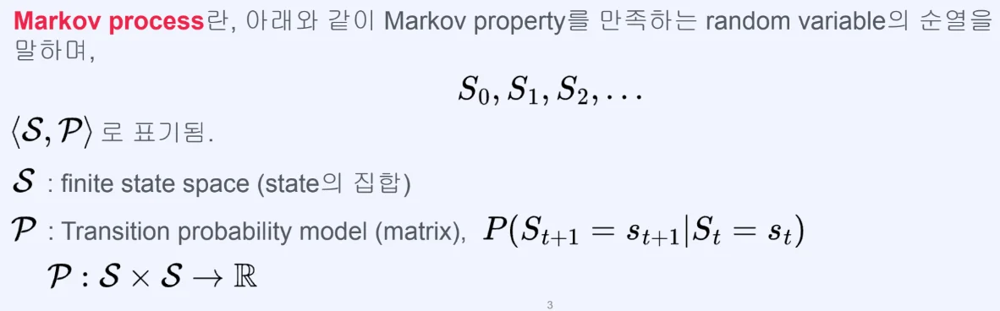
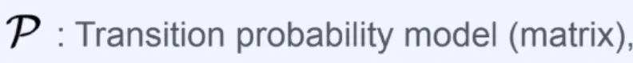
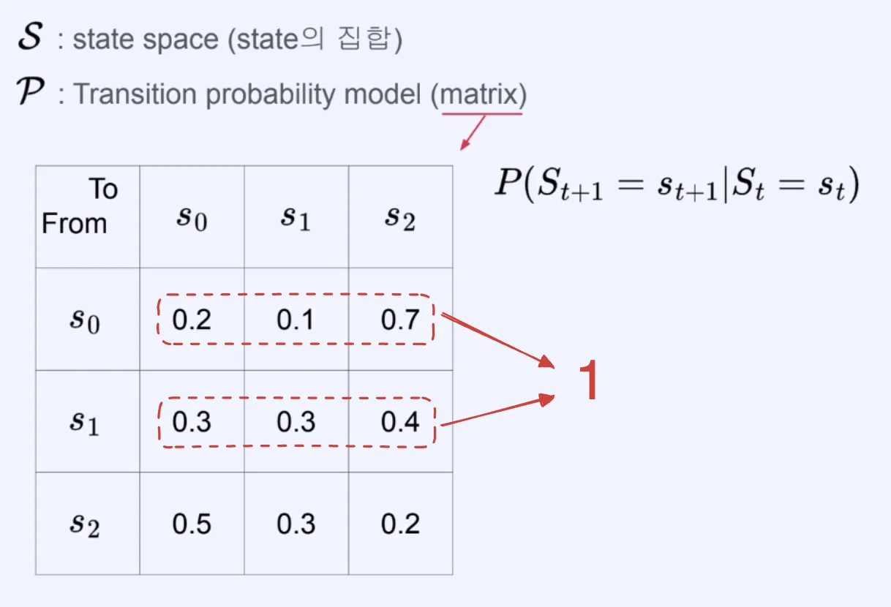
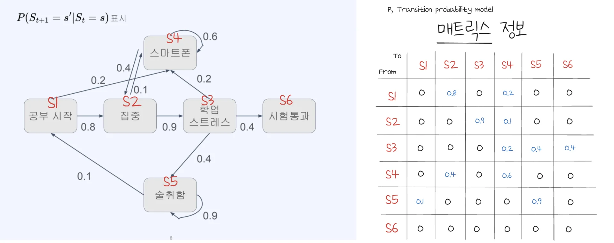
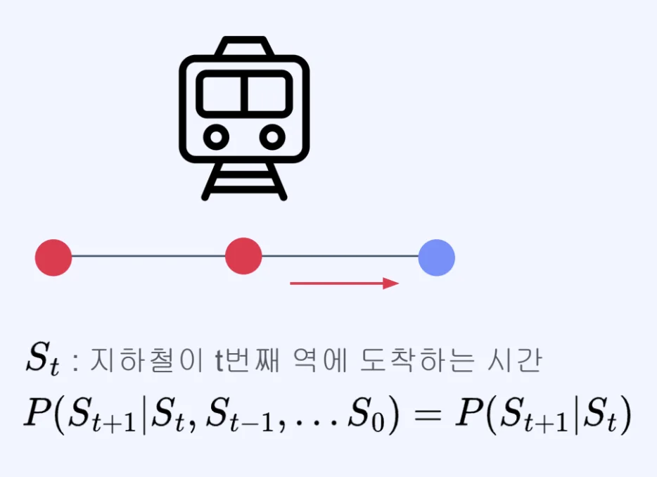

> 🤔 
> 
> 
> 
> 강화학습은 <strong><u><code>마르코프 의사 결정 과정(Markov decision process, MDP)</code></u></strong><strong><u>의 개념을 활용</u></strong>한 것이다&#46;  그러므로 <code>MDP</code>에 대해 잘 이해하는 것이 강화학습 시스템 개발에 있어 중요하다&#46; 

## 마르코프 가정 (Markov assumption)

---

미래 정보를 예측하기 위해 <strong><u>모든 과거 상태</u></strong>가 다 <strong>필요하지 않</strong>고, <strong><u>가장 최근의 상태</u></strong>만 있어도 충분하다&#46; 

> <em>“</em><em><u>상태</u></em><em>가 </em><em><strong><u>연속</u></strong></em><em>적인 시간에 따라 이어질 때, </em><em><strong>어떠한 시점의 상태</strong></em><em>는 바로 </em><em><strong><u>그 이전의 상태에만 영향</u></strong></em><em>을 받</em><em>는다”</em>

현재의 상태가 바로 이전 상태에만 영향을 받는다는 가정은 억지같아 보일 수 있지만,  직관적으로 <u>현재의 상태가 이전 상태에 가장 큰 영향</u>을 받고, <u>이전 상태는 그 이전 상태에 큰 영향</u>을 받는 <strong>순차적인 과정의 반복</strong>이라 생각하면 나름 합리적 가정이라 볼 수 있다&#46;

결정적으로 마르코프 가정으로 <strong><u>어려운 문제들을 단순화</u></strong>하고 <strong><u>만족스러운 결과를 얻</u></strong>는 경우가 많다&#46;

수식&#58; <code class="language-math">P(S&#95;1&#124;S&#95;1, S&#95;2, &#92;dots , S&#95;{t&#45;1}) = P(S&#95;t&#124;S&#95;{t&#45;1})</code>

- <code class="language-math">P(S&#95;1&#124;S&#95;1, S&#95;2, &#92;dots , S&#95;{t&#45;1})</code> (좌변)
    -  어떠한 시점 <code class="language-math">t</code> 에서의 상태 <code class="language-math">S&#95;t</code> 는 최초의 상태 <code class="language-math">S&#95;1</code>에서 바로 이전의 상태 <code class="language-math">S&#95;{t&#45;1}</code>까지 영향을 받는다는 뜻이다&#46; 

    - 이는 연속적으로 존재하여 일어나는 일련의 상태들을 확실하게 표현하지만, 이를 실제로 계산하기는 매우 어렵다&#46; 

---

- <code class="language-math">P(S&#95;t&#124;S&#95;{t&#45;1})</code> (우변)
    - 좌변의 식을 마르코프 가정을 적용시키면 우변과 같이 단순화할 수 있다&#46; 
        - 마르코프 가정을 적용 시, 상태 <code class="language-math">S&#95;t</code>는 바로 이전 상태인 <code class="language-math">S&#95;{t&#45;1}</code>에 가장 큰 영향을 받고 <code class="language-math">S&#95;{t&#45;1}</code> 는 <code class="language-math">S&#95;{t&#45;2}</code>에서 가장 큰 영향을 받는다&#46; 

        - 이러한 <strong>연쇄적으로 과정들을 반복</strong>하면 <u>모든 이전 상태가 반영</u>되는 <code class="language-math">P(S&#95;t&#124;S&#95;{t&#45;1})</code> 표현으로 <strong>단순화 </strong>할 수 있다&#46; 

- <code class="language-math">S&#95;t</code>&#58; Markov라 표현

## 마르코프 과정 (Markov Process)

---

> ✏️ 
> 
> 
> 
> 마르코프 과정(Markov Process)은 <strong>마르코프 가정을 만족</strong>하는 <strong><u>연속적인 일련의 상태</u></strong>이다&#46; 마르코프 과정은 일련의 상태 <code class="language-math">&#60;S&#95;1, S&#95;2, &#92;cdots , S&#95;t&#62;</code>와 <code>상태 전이 확률(state transition probability)</code>로 구성된다&#46; 

### 마르코프 과정 (Markov Process)

- finite state space (유한한 state 집합)

- random variable S가 취할 수 있는 가능한 모든 값의 집합

- Transition probability model (metrix)

- <code class="language-math">P(S&#95;{t&#43;1} = s&#95;{t&#43;1} &#124; S&#95;{t} = s&#95;{t})</code>

- P라는 함수가 S(state) 두개를 받아서 0 &#126; 1 사이의 확률값,  실수를 가진다는 의미인다&#46; 

### <strong>상태 전이 확률(state transition probability)에 대한 매트릭스(P) 표현</strong>

- state space가 <code class="language-math">s&#95;0</code>, <code class="language-math">s&#95;1</code>, <code class="language-math"> s&#95;2</code> 3개가 있다고 가정했을 때,  Transition이 일어날 수 있는 경우는 위 3 x 3 매트릭스로 표현할 수 있다&#46; 

- 현재 state에다 다음 state로 갈 모든 확률의 합은 1이다&#46; 
    - <code class="language-math">s&#95;0</code>→ <code class="language-math">s&#95;0</code> = 0&#46;2, 

    - <code class="language-math">s&#95;o</code><code class="language-math">s&#95;0</code><code class="language-math">s&#95;1</code> = 0&#46;1 

    - <code class="language-math">s&#95;o</code> → <code class="language-math"> s&#95;2</code> = 0&#46;7
        

        ⇒ 0&#46;2 &#43; 0&#46;1 &#43; 0&#46;7 = 1

### <strong>n&#45;th order Markov process</strong>

<em>→ </em><strong><u>미래 정보를 예측</u></strong>하기 위해 <strong><u>모든 과거 상태</u></strong>가 <strong>다 필요하지 않</strong>고, <strong><u>가장 최근의 n개의 상태</u></strong>만 있어도 충분하다&#46;

- <code class="language-math">P(S&#95;{t&#43;1} = s&#95;{t&#43;1} &#92;mid S&#95;t=s&#95;t, &#92;dots , S0 = s0)</code>
    

    <code class="language-math">= P(S&#95;{t&#43;1} = s&#95;{t&#43;1}&#124;S&#95;{t} = s&#95;t, &#92;dots ,</code>  <code class="language-math">S&#95;{t&#45;n&#43;1} = s&#95;{t&#45;n&#43;1}</code> <code class="language-math">)</code>

→ 앞서 살펴본 마르코프 프로세스는 <strong>first order Markov process</strong> 라고 할 수 있다&#46; 

### 마르코프 프로세스 예시

- 그래프, 매트릭 예시
    

- 현실에서의 Markov process 예시
    

    
<strong>예시 1) 로또 복권</strong>

    

    - 어떻게 state를 설정하느냐에 따라 마르코프 프로세스가 될 수도 있고 안될 수 도 있다&#46; 
        

        - <code class="language-math">t</code> 까지 뽑힌 공이기 때문에 <code class="language-math">S&#95;t</code>에 이전 state들이 포함되어 있다&#46; 

        

        - <code class="language-math">t</code> 에 뽑힌 공이기 때문에 <code class="language-math">S&#95;t</code>에 이전 state들을 모두 알아야 한다&#46;

    

    

    
<strong>예시 2) 지하철 도착시간</strong>

    

    - 다음 정거장에서 도착 시간은 이전 정거장에서의 도착 시간만 알면 유추할 수 있다&#46; 

    

## 마르코프 의사 결정과정(Markov decision process, MDP)

---

<code>마르프 의사 결정 과정(Markov Decision Process, MDP)</code>은 <strong><u>마르코프 과정을 기반</u></strong>으로한 의사 결정 모델이다&#46;

> 
> 
> 
> 
> <strong>수식 및 기호의미</strong>
> 
> > <code class="language-math">MDP = (S,</code>  <code class="language-math">A</code> <code class="language-math">,P, R, &#92;gamma)</code>
> 
> - <code class="language-math">S</code>&#58; 상태(state) 집합
> 
> - <code class="language-math">A</code>&#58; 행동(action) 집합
> 
> - <code class="language-math">P</code>&#58; 상태 전이 확률(state transition probability) 행렬
> 
> - <code class="language-math">R</code>&#58; 보상(reward) 함수 
> 
> - <code class="language-math">&#92;gamma</code>&#58; 할인 요인(discount factor)

상태 집합, <code class="language-math">S</code>

- 상태 집합은 MDP에서 가질 수 있는 모든 상태의 집합을 말한다&#46; 
    - <code class="language-math">S = &#92;{ s&#95;1, s&#95;2, &#92;dots, s&#95;{&#124;S&#124;} &#92;}</code>

- 어떠한 시점에서의 상태 <code class="language-math">S&#95;t</code>는 상태 집합 <code class="language-math">S</code>에 포함된 특정 상태가 된다&#46; 
    - <code class="language-math">S&#95;t = s</code>, <code class="language-math">s &#92;isin S</code>

행동 집합, <code class="language-math">A</code>

- 행동 집합은 행동 주체인 에이전트가 할 수 있는 모든 행동의 집합을 말한다&#46; 
    - <code class="language-math">A = &#92;{ a&#95;1, a&#95;2, &#92;dots , a&#95;{&#124;A&#124;} &#92;}</code>

- 상태와 동일하게 어떤 시점에서의 행동 <code class="language-math">A&#95;t</code> 는 행동 집합 <code class="language-math">A</code> 포함된 특정 상태가 된다&#46; 
    - <code class="language-math">A&#95;t = a</code>, <code class="language-math">a &#92;isin A</code>

<strong>상태 전이 확률, </strong><code class="language-math">P</code>

> <code class="language-math">P&#95;{s,s&#39;}^a = P&#91;S&#95;{t&#43;1}=s&#39; &#92;mid S&#95;t=s, A&#95;t=a &#93;</code>

- 마르코프 과정에서의 상태 전이 확률은 아래와 같다&#46;&#46; 
    - <code> </code><code class="language-math">P(s’ &#92;mid s)</code>  or <code class="language-math">P&#95;{s, s’} = P(S&#95;{t&#43;1} = s &#124; S&#95;t = s)</code><code> </code>

    - 미래 상태(s’)를 예측하기 위해 현재의 상태(s)만을 고려한다&#46; 

- 여기서 행동 a 가 추가된 것이 MDP이다&#46; 
    - <code class="language-math"> P(s’ &#92;mid s, a)</code> or <code class="language-math"> P&#95;{s, s’}^a = P&#91;S&#95;{t&#43;1} = s &#124; S&#95;t = s, A&#95;t = a &#93;</code>

    - 미래 상태(s’)를  예측하기 위해 현재 상태(s)와 행동(a)를 고려한다&#46; 

- <code class="language-math">P&#95;{s,s&#39;}^a</code>&#58;  에이전트가 어떠한 상태 <code class="language-math">s</code>에서 행동 <code class="language-math">a</code>를 취했을 때 상태 <code class="language-math">s’</code>으로 변할 확률이다&#46; 

보상 함수, <code class="language-math">R</code>

- 에이전트가 어떠한 상태에서 취한 행동에 대해 보상을 내리기 위한 함수

- <code class="language-math">R&#95;s^a = E&#91;R&#95;{t&#43;1} &#124; S&#95;t = s, A&#95;t = a &#93;</code>

- <code class="language-math">R&#95;s^a</code>&#58; 상태 s 에서 행동 a를 했을 때 보상의 기댓값을 수치로 반환한다&#46; 

할인 요인, <code class="language-math">&#92;gamma</code>

- 과거의 행동을 얼마나 방영할 지를 정하는 0 ≤ <code class="language-math">&#92;gamma</code> ≤1 사이의 값

- ex)
    - 보상 = 1, 할인요인(<code class="language-math">&#92;gamma</code>) = 1
        

        ⇒ &#60; 1, 1, 1, 1, 1 &#62;

    - 보상 = 1, 할인요인(<code class="language-math">&#92;gamma</code>) = 0&#46;9
        

        ⇒ &#60; 1, 0&#46;9, 0&#46;81, 0&#46;729, 0&#46;6561 &#62;

정책, <code class="language-math">&#92;pi</code>

- 에이전트는 어떠한 상태 s에서 수행할 행동 a를 정해야 하는데, 이를 정책(policy)라고 한다&#46; 
    - <code class="language-math">&#92;pi(a&#124;s) = P&#91;A&#95;t = a &#124; S&#95;t = s &#93;</code> 

    - 정책 <code class="language-math">&#92;pi</code> 는 보상을 최대화하는 방향으로 갱신된다&#46; 

