> 
> 
> 
> 
> <strong>목차</strong>
> 
> - [케글 (Kaggle)](#327eda9b0fe1810f89f6f7cf8f605736)
> - [실습 - 데이터셋: Titanic](#327eda9b0fe180a49028eae504249b84)
> - [엑셀 실습](#3efeda9b0fe180eab427da2c7343d42b)
> - [세팅](#3efeda9b0fe180aeb2dbc6e0b3a372d8)
> - [[실습 1] 기술 통계법](#3efeda9b0fe180a9a8adedbc49f61259)
> - [분석 결과](#3efeda9b0fe180e29957d88c0b60123c)
> - [[실습 2] 공분산 분석, 상관 관계 분석](#3efeda9b0fe1808aa35bf659e35fcc97)
> - [공분산 분석](#3efeda9b0fe180fcbca2da2a2eced11e)
> - [상관 관계 분석](#3efeda9b0fe1806f8ac7f4e3c4bfa352)
> - [분석 결과](#3efeda9b0fe180cb8161f837f89aa939)

## 케글 (Kaggle)

---

> 📖 
> 
> 
> 
> 케글이란?
> 
> - <code>데이터 분석 경진대회 플랫폼</code>
>     - 기업 또는 단체에서 빅데이터 제공
> 
>     - 데이터 과학자들이 이를 해결하는 모델을 개발하고 경쟁
> 
> - <code>데이터 과학자 커뮤니티</code>
>     - 캐글에서 제공하는 데이터와 문제를 바탕으로 의견 공유
> 
>     - 기업은 이를 바탕으로 정보와 인사이트 도출
> 
>     - 유저는 다양한 데이터 및 분석 경험

[Kaggle&#58; Your Machine Learning and Data Science Community]()

### 실습 &#45; 데이터셋&#58; <strong><code>Titanic</code></strong>

[Titanic &#45; Machine Learning from Disaster]()

> ✏️ 
> 
> 
> 
> 머신러닝과 같은 AI 분야에서는 <code>학습을 위한 데이터셋</code>과, 이를 <strong><u>평가</u></strong>하기 위한 <code>테스트 데이터셋</code>을 따로 만든다&#46;

- <strong>Data Dictionary</strong>
    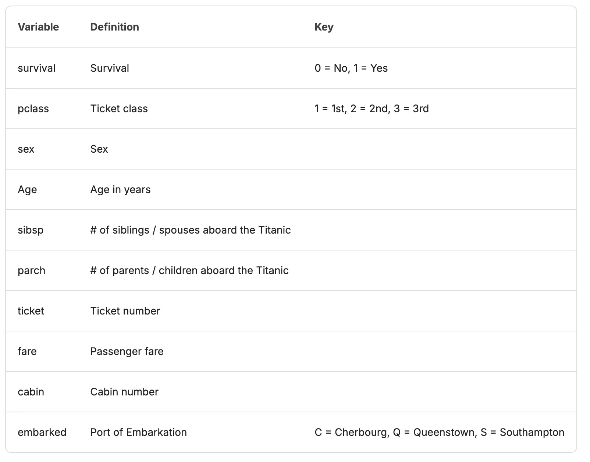

- 데이터 확인
    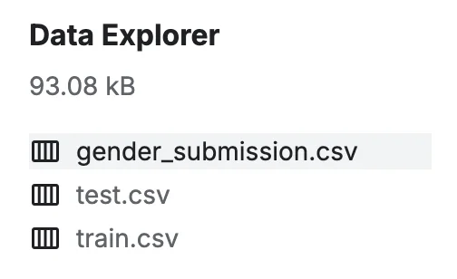

    - <a href="https://1drv.ms/x/c/59beeffe0a71da57/IQCMxePlsqwPT7nnjOqK0-5IAZoYENwqtJb3ooryflmi1Dc?e=sQwaSD">gender&#95;submission&#46;csv</a>

    - <a href="https://1drv.ms/x/c/59beeffe0a71da57/IQCMxePlsqwPT7nnjOqK0-5IAZoYENwqtJb3ooryflmi1Dc?e=sQwaSD">test&#46;csv</a>

    - train&#46;csv

## 엑셀 실습

---

> ☝🏻 
> 
> 
> 
> 숫자 값이 아닌 경우 즉, 글자 데이터가 관측값이 존재할 경우
> 
> 
> 
> 분석 결과에 이상이 생길 수 있음

### 세팅

셀 텍스트 길이 맞춤

> 텍스트 길이 맞춤

<code>cmd &#43; a</code> &#42; 2 → 아래 동그라미 더블 클릭

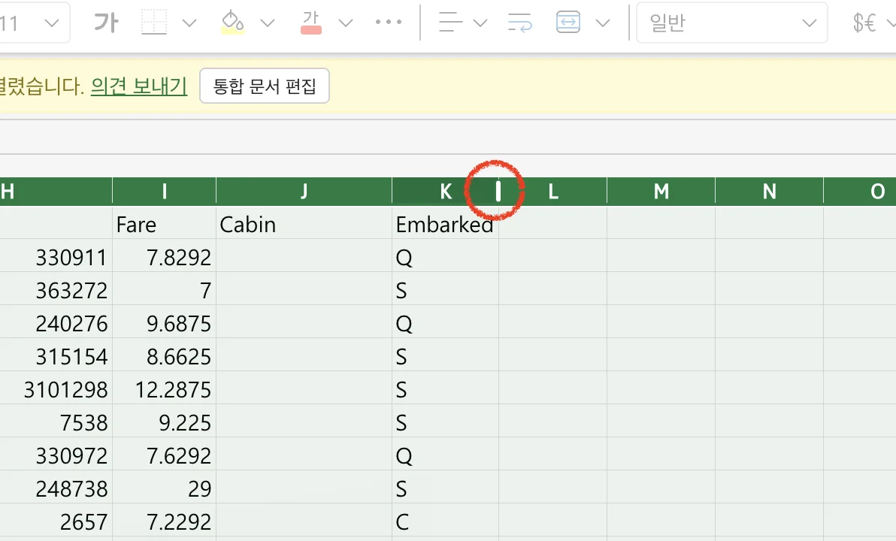

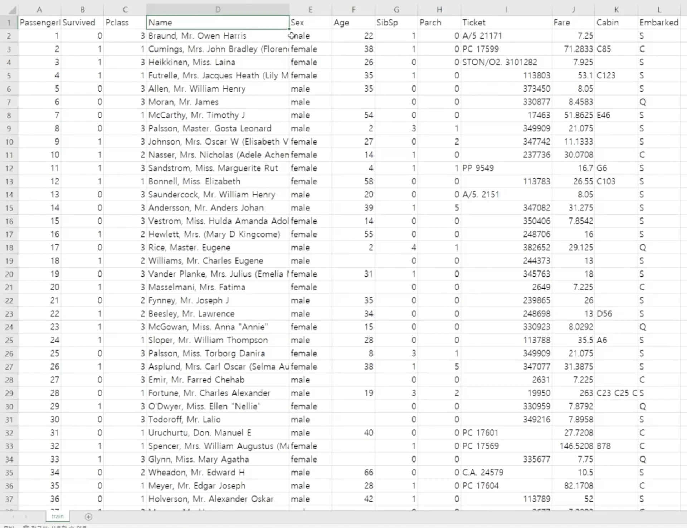

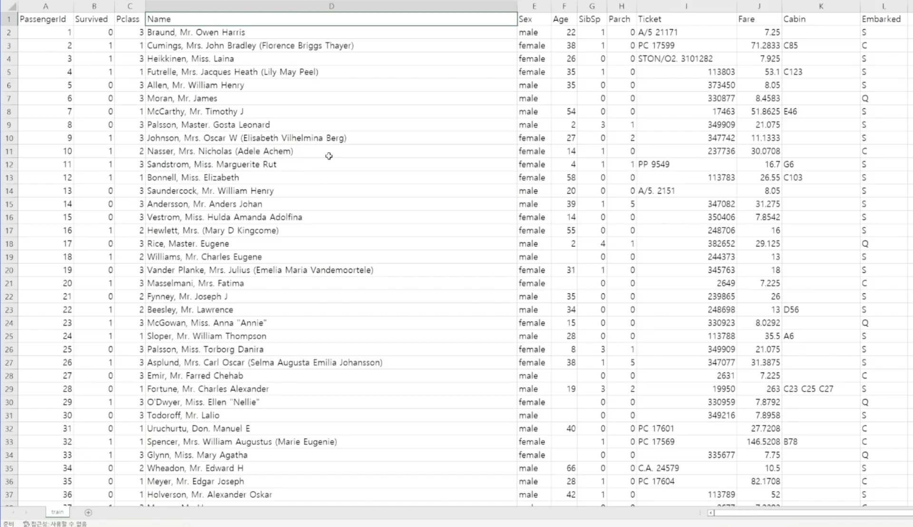

분석 도구 팩

분석 도구 팩 설정

1. 옵션
    

1. 추가 기능 &#45; <code>관리&#58; Excel 추가 기능</code> &#45; <code>이동</code> 버튼 클릭
    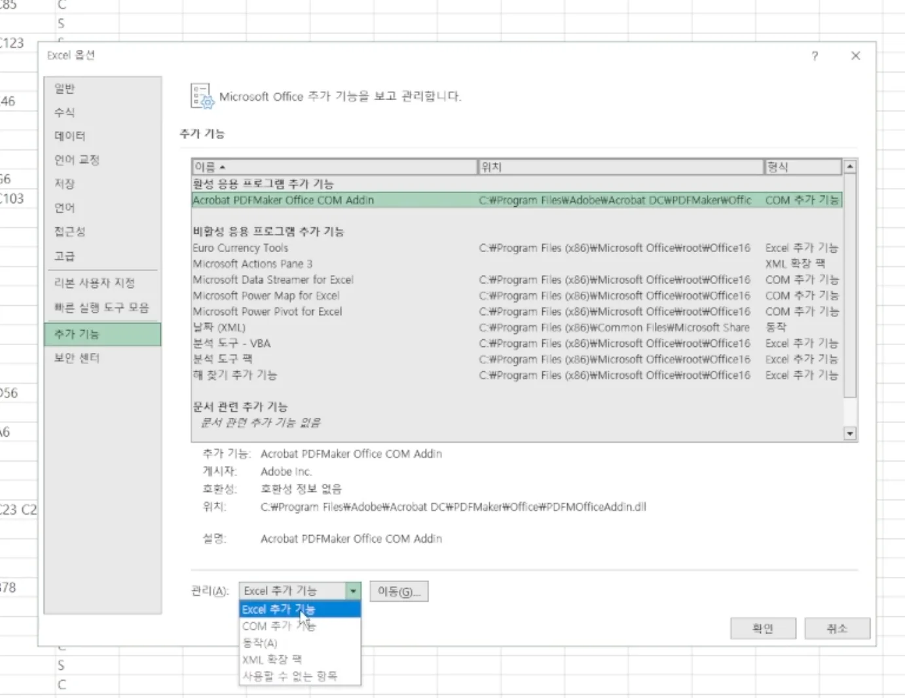

1. 추가 기능 &#45; <code>분석 도구 팩</code>  활성화
    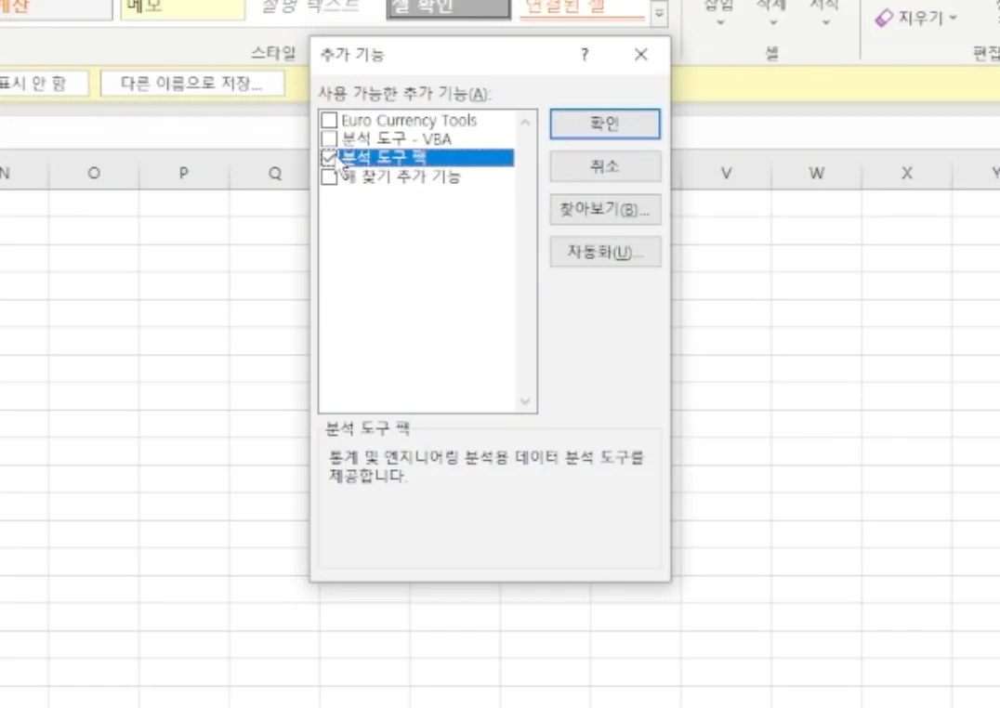

적용 확인

- 적용 전
    

- 적용 후
    

### &#91;실습 1&#93; <code>기술 통계법</code>

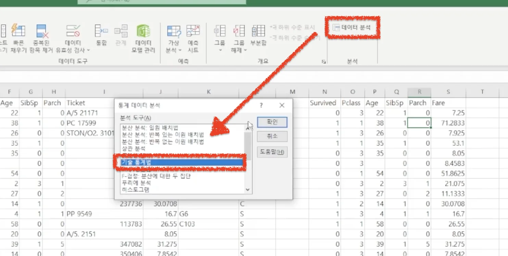

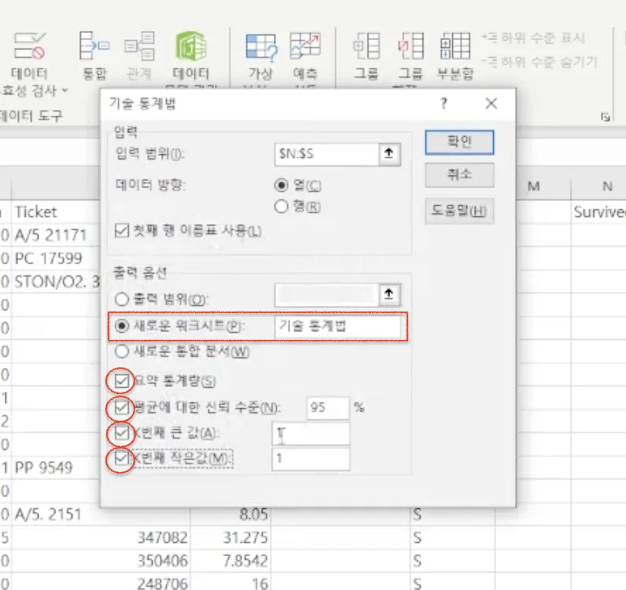

- 체크
    - 요약 통계량

    - 평균 신뢰 수준&#58; <code>95%</code>

    - K번째 큰 값&#58; 1

    - K번째 작은 값&#58; <code>1</code>

#### 분석 결과

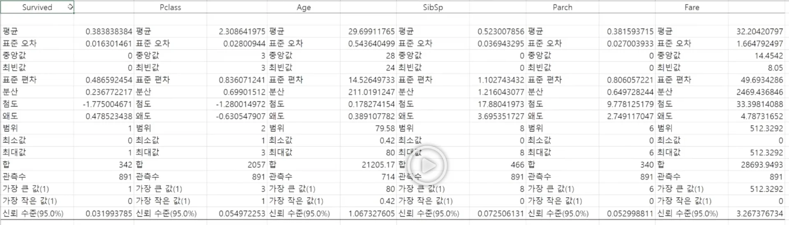

기술 통계법 활용 시 위와 같이 분석 지표들을 구할 수 있다&#46;

- <code>평균</code>

- <code>표준 오차</code>

- <code>중앙값</code>

- <code>최빈값</code>

- <code>표준 편차</code>

- <code>분산</code>

- <code>첨도</code>

- <code>왜도</code>

- <code>범위</code>
    - 최대 &#45; 최소

- <code>최소값</code>

- <code>최대값</code>

- <code>관측수</code>
    - 결측치 값이 제외된 카운팅

    - 전체 수와 실제 해당 군의 관측수의 차이가 결측치의 개수이다&#46; 

- <code>k 번쨰로 크고 작은 값</code>

- <code>신뢰 수준</code>

### &#91;실습 2&#93; <code>공분산 분석</code>, <code>상관 관계 분석</code>

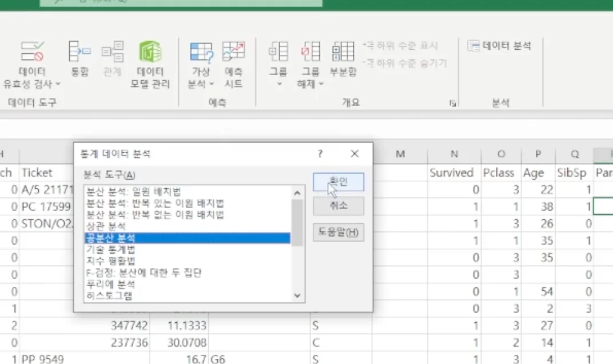

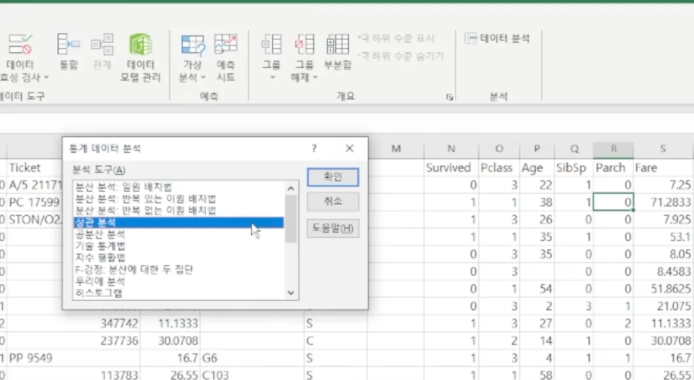

#### 공분산 분석

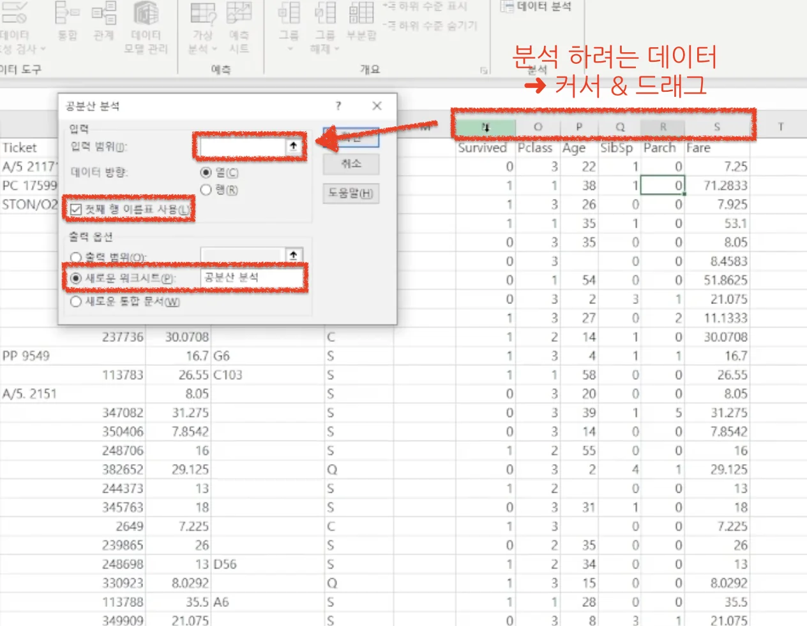

- 관측 데이터 
    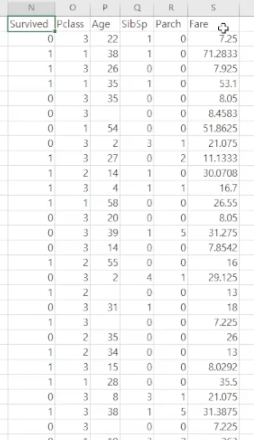

- 분석 결과
    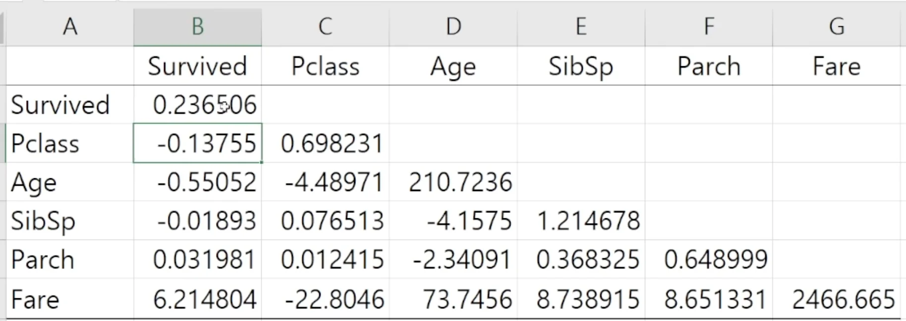

    

    
양수, 음수 의미 ( ⇒ 시각화를 통해 더 정확한 의미 판단 가능 )

    > 각 비교군들에 대한 상대적인 수치값 차이 비중

    - 양수 → 양의 상관관계
        - ex) <code>Survived ↔ Fare</code>&#58; 6&#46;214804
            - 생존(Survived) 과 운임료(Fare)는 양의 상관관계를 가짆다&#46; 

            - 즉, 운임료를 많이 낸 경우 1등석 좌석을 앉았으며 이때, 생존 확률이 더 높았다는 것을 시사한다&#46; 

    - 음수 → 음의 상관관계
        - ex) <code>Age ↔ Pclass</code>&#58; &#45;4&#46;48971
            - 1등석 → 나이가 많은 사람 비중 큼

            - 3등석 → 나이가 적은 사람 비중 큼

            

            음수값이 큰 경우 이러한 경향성이 더 크게 나타나는 것을 의미함

    

    

    
대각선 기준 왼쪽 아래만 존재하는 이유

    - 대각선 기준 같은 값&#58; <code>A ↔ B</code> =  <code>B ↔ A </code>따라서 중복으로 보여줄 필요가 없음

    

    

    
최소값, 최대값의 수치에 따라서 공분산의 범위가 차이 난다&#46; 

    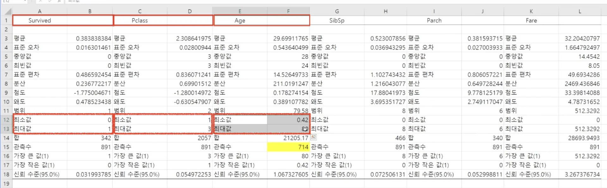

    - 최소, 최대값 수치에 따라 공분산 분석에서 나오는 수치의 범위가 달라진다&#46; 
        - Survived&#58; <code>0, 1</code>

        - Pclass&#58; <code>1 &#126; 3</code>

        - Age&#58; <code>0&#46;42 &#126; 88</code>

    - 따라서 해당하는 공분산의 수치가 크다고 해서 더 큰 상관관계를 가지는 것은 아니다&#46; 
        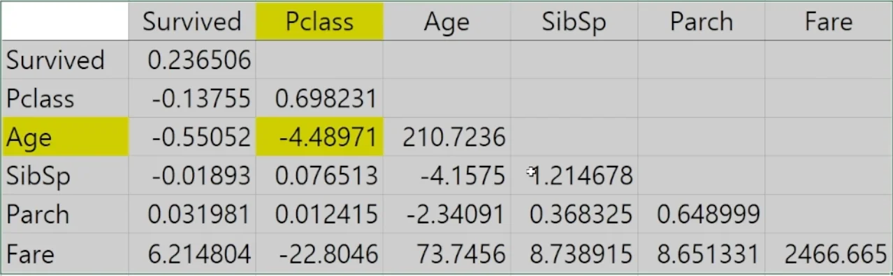

        - 이를 평준화하여 비교하는 것이 <code>상관 관계 분석</code>이다&#46; 

    

#### 상관 관계 분석

함수를 통해서 변수로도 사용 가능

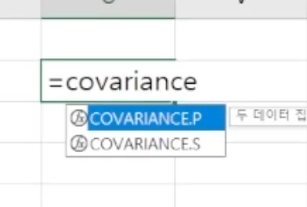

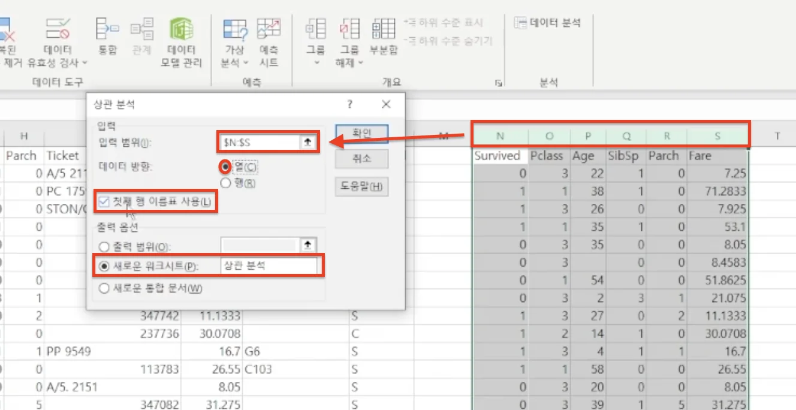

#### 분석 결과

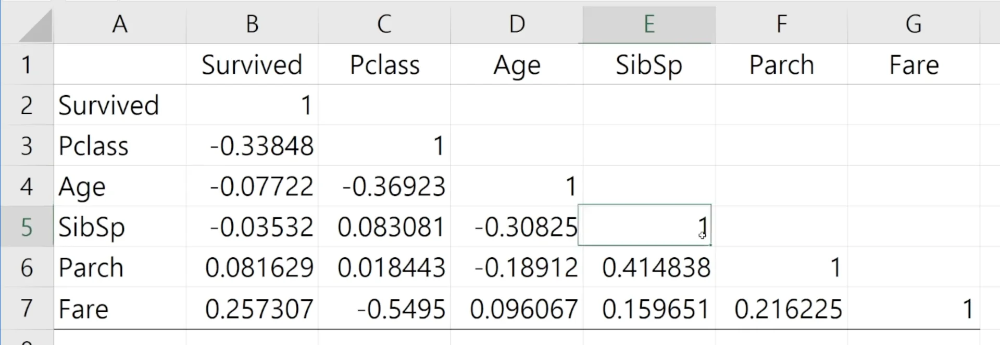

> ✏️ 
> 
> - 공분산과 다르게 <strong><u>스케일이 더 균일</u></strong>함
>     - <code>&#45;1 &#126; 1</code> 사이의 값을 가짐
> 
> - 각각 어떤 상관관계를 가지는 지 좀 더 균일하게 관찰 가능함

> 🤔 
> 
> 
> 
> <strong><u>인과를 해석</u></strong>하는데 있어서는 <strong><u>더 고차원적인 방법</u></strong><u>이 필요</u>함

- <code>Survived ↔ Pclass</code>&#58; &#45;0&#46;33848 (음의 상관관계)
    - Pclass 가 작을 수록 즉, 좌석이 더 고급일 수록 생존 확률이 더 높음

- <code>Survived ↔ Fare</code>&#58; 0&#46;257307 (양의 상관관계)
    - 운임료가 더 높을 수록 생존 확률이 더 높음

- <code>Fare ↔ Plcass</code>&#58; &#45;0&#46;5495 (음의 상관관계)
    - 좌석이 더 고급일수록 (1등석일 수록), 더 많은 운임료를 지불함

- <code>Age ↔ Pclass</code>&#58; &#45;0&#46;36923 (음의 상관관계)
    - 나이가 더 많을수록, 1등석 즉, 더 좋은 좌석을 앉음
