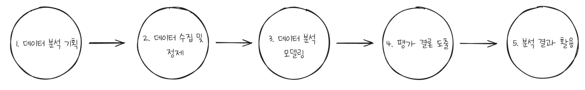
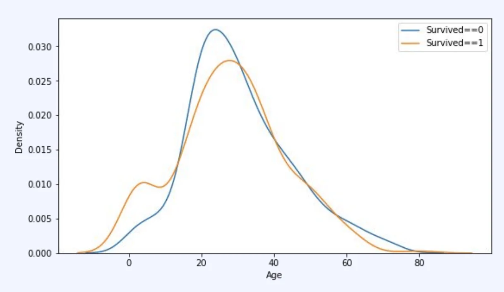
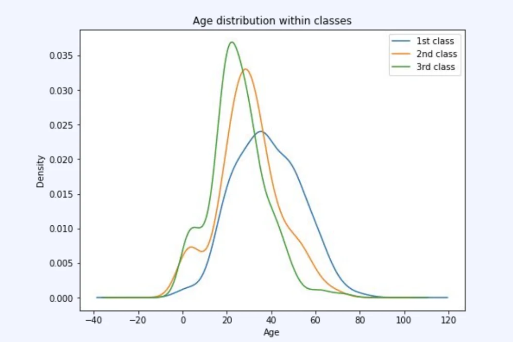
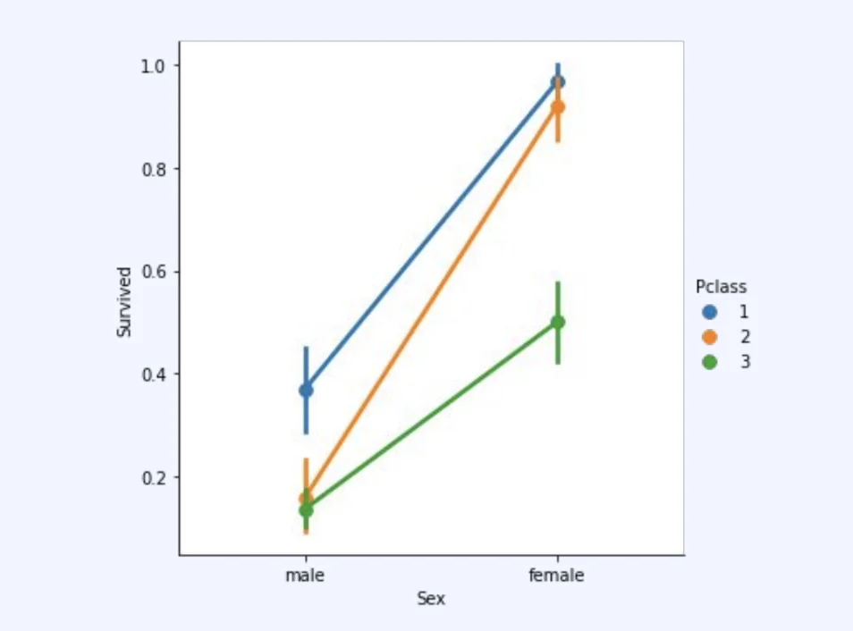
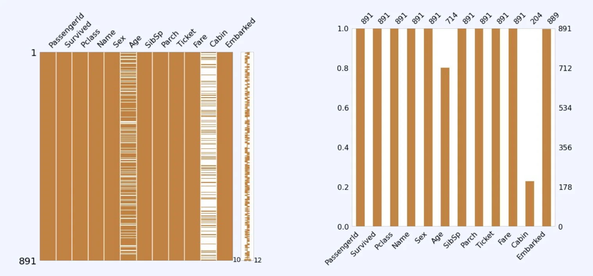

> 
> 
> 
> 
> <strong>목차</strong>
> 
> - [데이터 분석 단계](#327eda9b0fe181dab100fbc966fcd167)
> - [탐색적 데이터 분석 (EDA)](#327eda9b0fe18068ba9adc2aa31c630c)
> - [[예시] 분포 탐색  - 타이타닉 생존 유무](#327eda9b0fe180b1ac56dec7ebb62a7e)
> - [[예시] 결측치 탐색 ](#327eda9b0fe180d4833feaf9372edac1)

## 데이터 분석 단계

---

> ✏️ 
> 
> 
> 
> 데이터 분석 과정은 아래 <strong><u>5단계</u></strong>로 이뤄진다&#46; 

데이터 분석 과정 1 단계&#58; <code>데이터 분석 기획</code>

> ✏️ 
> 
> 
> 
> <code>데이터 분석 기획</code>
> 
> 
> 
> 어떤 데이터를 바탕으로 어떤 것을 예측할 것이며, 이를 활용해서 어떤 개선점들을 찾을 지에 대해 기획하는 단계

- <code>문제 정의 &#45; 비지니스 이해 및 목표 설정</code>
    - 비지니스적으로 어떤 것을 이루고자 하는지
        - 비즈니스적인 목표에 대해서 분석 진행하는 것이기 때문에  어떤 것을 이루고 싶은지에 대해서 먼저 정확해야 한다&#46; 

        - 정의된 문제를 푸는 방법론이 데이터 분석이 아닐 수도 있다&#46; 

- <code>프로젝트 정의</code>
    - 어떤 데이터를 바탕으로 어떤 것을 예측/측정할 것 인지

데이터 분석 과정 2 단계&#58; <code>데이터 수집 및 정제</code>

> ✏️ 
> 
> 
> 
> <code>데이터 수집 및 정제</code>
> 
> 
> 
> 앞선 기획 단계에서 정의된 데이터를 수집 및 정제
> 
> - 데이터를 잘 수집하고 정제해 좋은 데이터를 만들수 있으며 이를 통해 이후 모델링 과정에서 유의미한 결과물이 나올 수 있음
> 
> - 그러나 이 과정이 쉽지 않음

- <code>데이터 수집 </code>
    - 분석에 필요한 데이터를 어떻게 수집할 것인지

- <code>데이터 정제 &#45; 전처리, 검증</code>
    - 수집된 데이터의 정합성, 무결성 등을 검증
        - <code>잔차</code>, <code>결측치</code>(비어있는 값, 잘못된 값 등)들을 잘 검증하고 정제해야 함

데이터 분석 과정 3 단계&#58; <code>데이터 분석 모델링</code>

> ✏️ 
> 
> 
> 
> <code>데이터 분석 모델링</code>
> 
> 
> 
> 수집 및 정제된 데이터를 바탕으로 예측하고자 하는 결과를 만들어내는 모델링 진행

- <code>탐색적 데이터 분석 (EDA)</code>
    - 통계량 확인 및 시각화를 통한 데이터 특성 파악
        - 수집한 데이터가 각각 어떤 특징을 가지는지에 대해서 먼저 탐색 필요 

    - ex) 의료 &#45; 특정 질병 유무 판별
        - 1 만건에 데이터 수집 → 실제 질병에 걸림 사람의 데이터 100명
            - 이러한 경우, 제대로 예측이 안됨 

        - 따라서 <strong><u>데이터 비율, 밸런싱이 중요</u></strong>
            - 이를 통해 모델을 만들고 학습 시켜 결과를 만들었을 때 더 유의미한 결과값이 나올 수 있음

- <code>모델링</code>
    - 예측을 위한 수학적, 통계적 모델링
        - 머신러닝 모델 or 기초 통계 모델 등

데이터 분석 과정 4 단계&#58; <code>평가 및 결론 도출</code>

- 모델링을 통해 생성된 결과를 활용하여 결론 도출
    - 서비스에 적용해야 성능을 확인할 수 있는 경우도 있으며  바로 정확도나 스코어를 통해 확인할 수도 있다 &#46;

- 성능에 대한 평가
    - 도메인에 따라, 비즈니스적 요구에 따라 성능의 기준은 달라짐
        - 상황에 따라 70%의 정도의 정확도도 충분할 수 있음

        - ex) 
            - 병 진단 → 99% 의 정확도도 리스크가 있음

            - 추천 시스템 → 잘못된 추천 영상이 뜬다고 해도 리스크가 크지 않음
                - 물론 더 정확한 개인 맞춤 서비스도 중요함

    - 상황에 따라 위의 과정을 수정해가며 성능을 개선
        - 요구사항에 못 미치는 결과물이 나왔을 경우 앞선 단계를 재수행하고 새로운 변수를 탐색해 가면서 수정
            - ex) 데이터 재수집 및 재검증, 새로운 모델링 등

이러한 과정을 통해서 진행된 결과물들이 안좋게 나오는 경우도 굉장히 많음

데이터 분석 과정 5 단계&#58; <code>분석 결과의 활용</code>

데이터 분석 프로젝트의 결과물은 모델에 따라 큰 차이점을 보임

- 시스템 구현
    - 주기적으로 업데이트

- 비지니스 인사이트
    - 의사 결정에 도움

    - 시각화(대시보드 등)

- 서비스에 활용
    - 모델을 활용하여 서비스에 적용

## 탐색적 데이터 분석 (<code>EDA</code>)

---

> 📖 
> 
> - <strong><code>EDA</code></strong><strong> </strong>(<strong><u>E</u></strong>xploratory <strong><u>D</u></strong>ata <strong><u>A</u></strong>nalysis)
>     - <strong><u>기초적인 통계</u></strong> 개념으로 <strong>데이터 전체</strong>를 파악
> 
>     - <strong><u>데이터 형질</u></strong>에 대한 <strong>도메인 개념 축적</strong>
>         - 데이터 인밸런스 및 한쪽에 쏠려있는 경우  → 시각화를 통해 확인 (EDA)
> 
>     - <strong><u>전처리 방향성</u></strong> 제시
>         - 결측치, 이상치 확인 → 수집, 검증 및 전처리 단계의 방향성 제시
> 
> - <strong><code>데이터 전처리</code></strong>
>     - 데이터 분석에 앞서 전처리 과정을 통한 <strong><u>데이터 가공 및 변환</u></strong>
>         - EDA 이후 비어있는 결측치들에 대해서 어떻게 채워나갈 지

### &#91;예시&#93; 분포 탐색  &#45; 타이타닉 생존 유무

ex) 전체 연령대 데이터 

- 시각화 → EDA
    > <code>노란색</code> 생존자, <code>파란색</code>&#58; 사망자

    - 20 &#126; 30 비율이 높음

    - 0 &#126; 15 세 사이의 생존자 비율이 더 높음
        

        → 아이와 여성들 부터 구출됨

    - 15 &#126; 35 세 사망자 비율이 더 높음
        - 대부분 생존하지 못함

    - 60 이상
        - 위와 동일

ex) 1등석, 2등석, 3등석의 연령대 비율

- 1등석에 탄 사람 
    - → 부 축적 

    - → 다른 좌석들 보다 중심 축이 더 고령으로 관측됨

- 2등석도 3등석에 비해 더 연령대가 높은 것으로 확인됨

ex) 1등석, 2등석, 3등석의 성별 비율

- 남성에 비해 여성의 생존율이 더 높은 비율을 가짐
    - 여성들 더 많이 생존함

- 1 등석이 2, 3 등석 보다 더 높은 생존율을 보임

> 🤔 
> 
> 
> 
> <strong>범주형 변수</strong>
> 
> 
> 
> 군집 자체를 다르게 볼 수 있는 것을 범주형 변수라고 한다&#46; 
> 
> - ex) 1등석, 2등석, 3등석
> 
> - ex) 남성, 여성

### &#91;예시&#93; 결측치 탐색 

- EDA &#45; 데이터 시각화
    - 하얀색 &#45; 비워짐 → 결측치 파악

    - 이를 통해 결측치를 어떻게 채워 놓을 지에 대한 방향성 탐색
