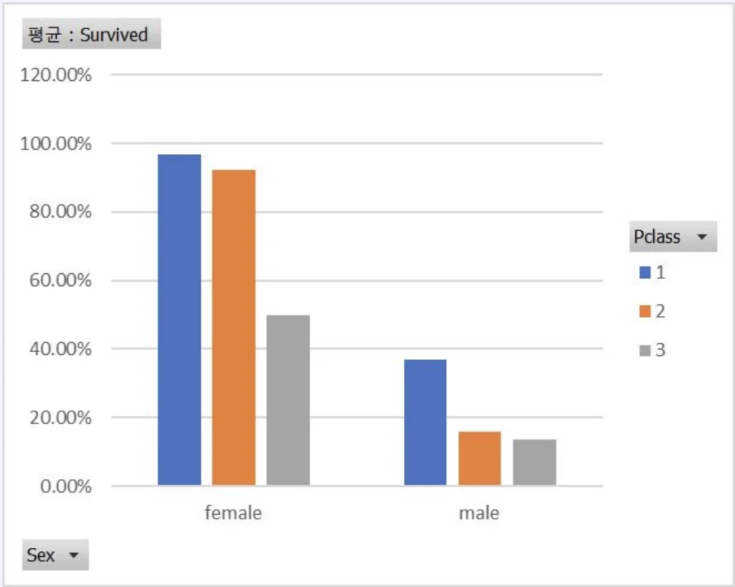
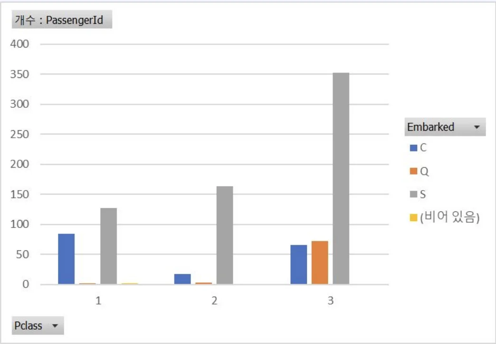

> 
> 
> 
> 
> <strong>목차</strong>
> 
> - [데이터 탐색 사례 ](#329eda9b0fe1817ab2f6c72405503a1e)
> - [ 대표값](#329eda9b0fe1811f9cf3f73003fc047e)
> - [엑셀을 활용한 EDA](#329eda9b0fe180ffbd6df19864412dab)
> - [파이썬을 활용한 EDA](#3f2eda9b0fe180b99c43f0aa8d56cb21)
> - [ 차트](#329eda9b0fe180d7a1afc39d426b1e31)
> - [ 상관관계](#329eda9b0fe180f68ed1d767fbdfc921)
> - [ 결측치, 이상치](#329eda9b0fe1806f9887d23af3d30e89)

## 데이터 탐색 사례 

---

###  대표값

#### 엑셀을 활용한 EDA

- 엑셀 내장함수를 활용한 수치 요약

- 엑셀 피벗 차트를 활용한 시각화
    

    

#### 파이썬을 활용한 EDA

###  차트

###  상관관계

###  결측치, 이상치
