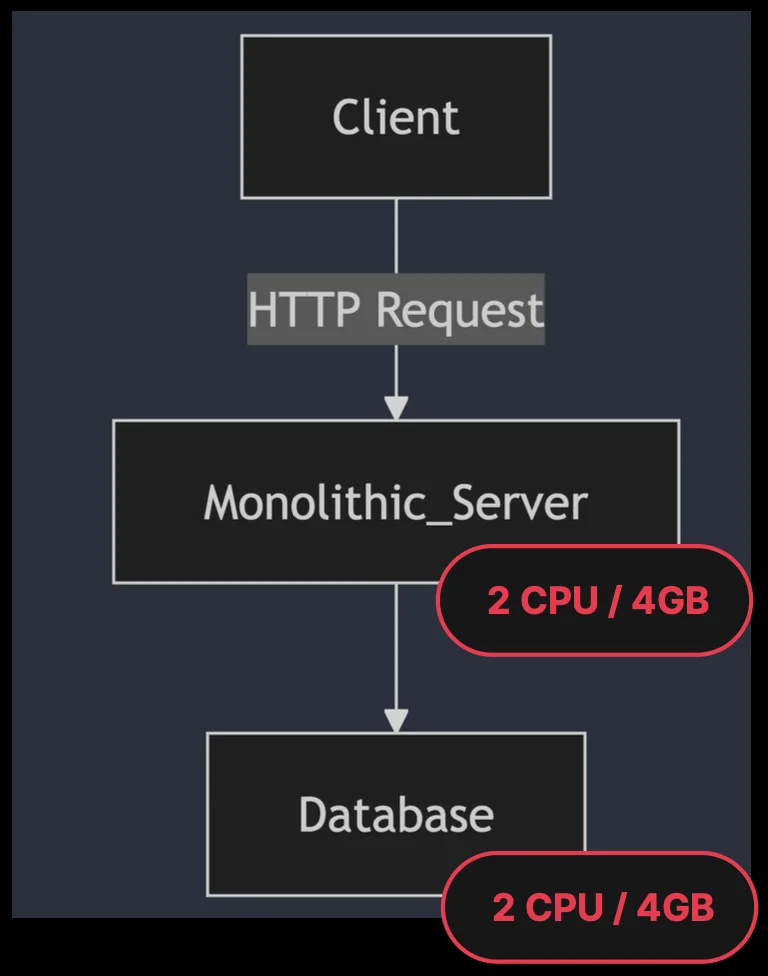
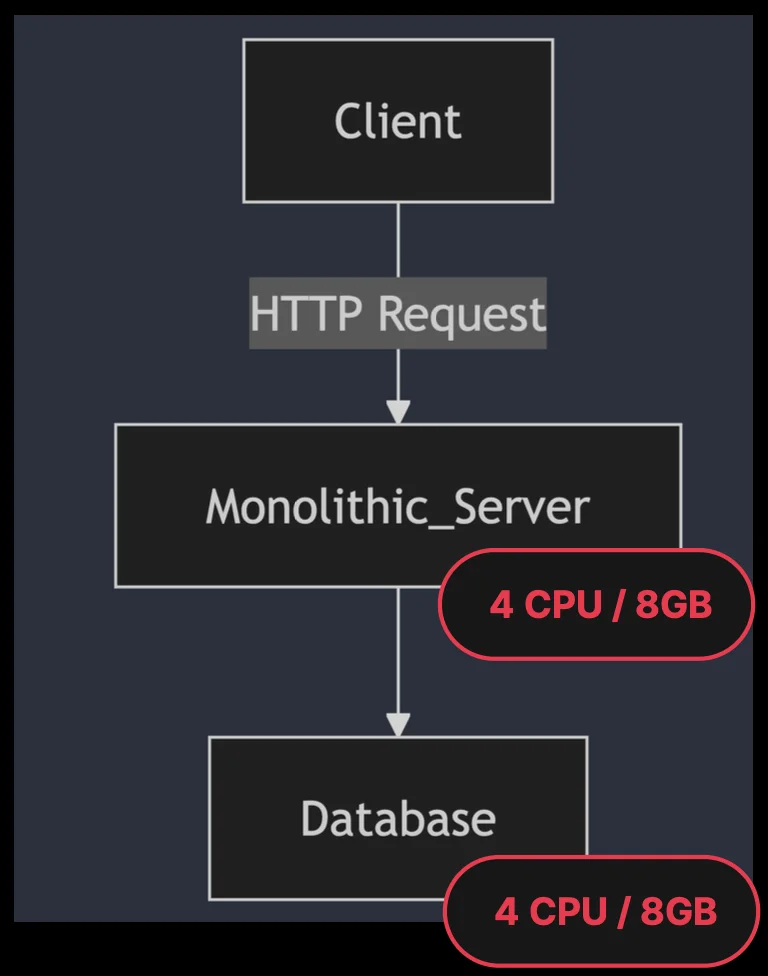
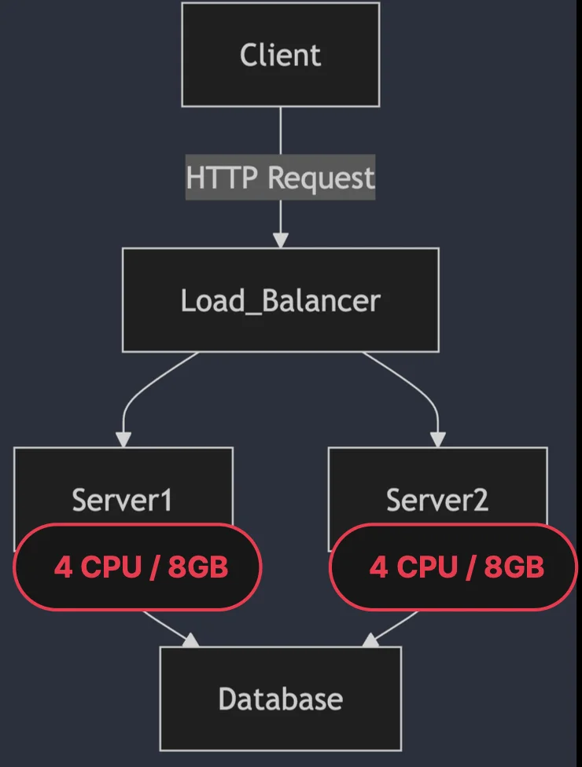
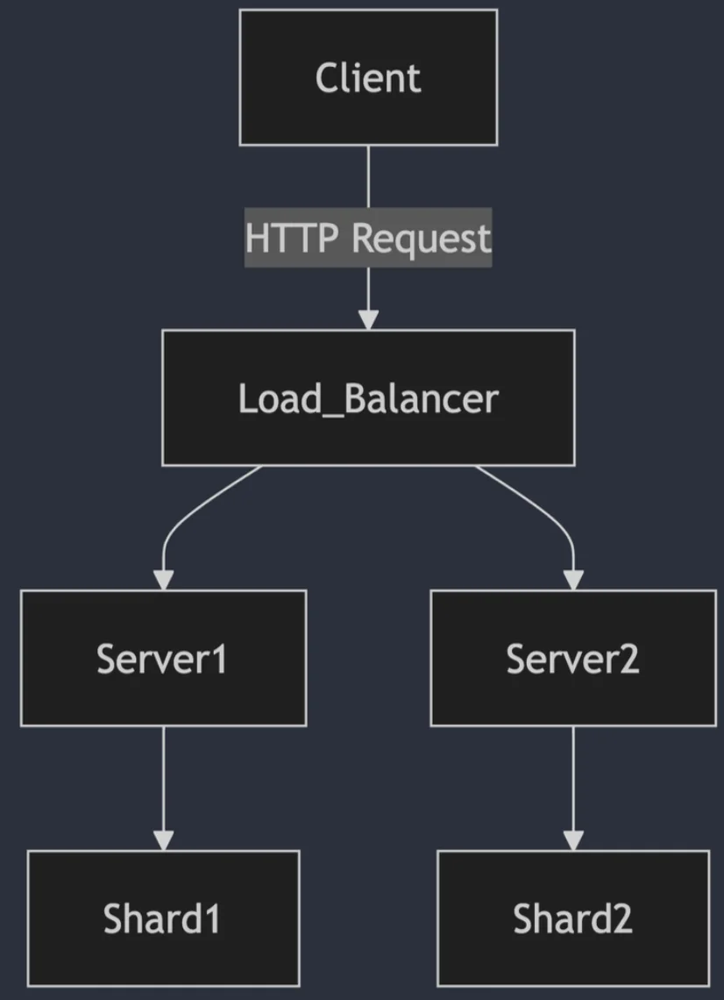
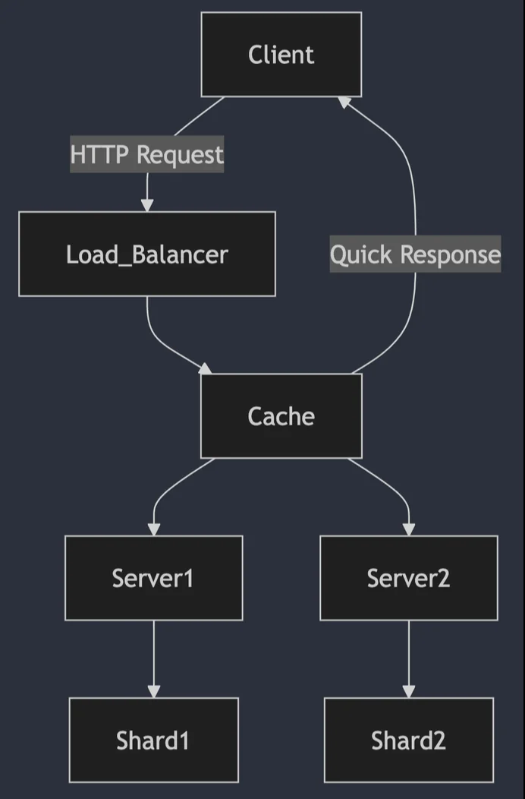
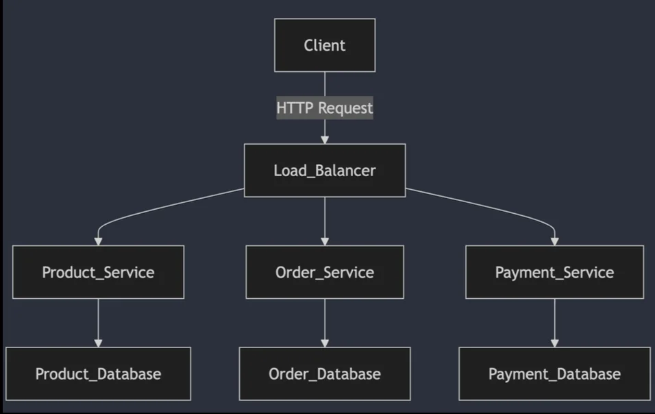
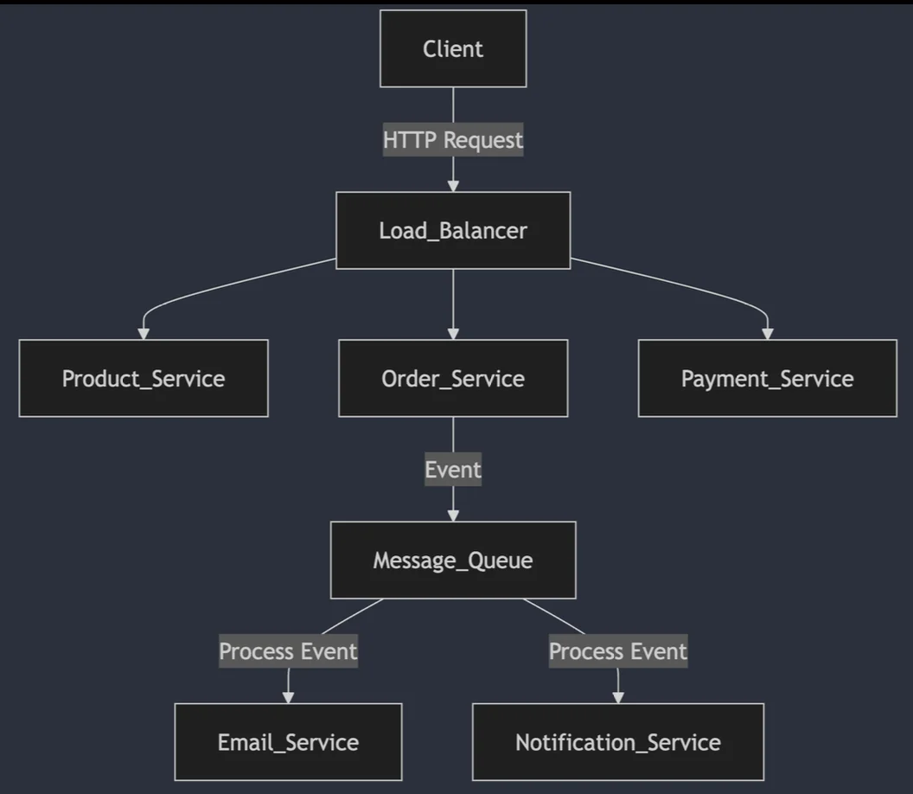

> 
> 
> 
> 
> <strong>목차</strong>
> 
> - [시스템 확장의 필요성과 기본 개념](#32eeda9b0fe18058bc99d9a04ac07e97)
> - [확장의 기본 개념: 수직 확장 (Vertical Scaling)](#330eda9b0fe180a5a168f6265f6ae439)
> - [확장의 기본 개념: 수평 확장 (Horizontal Scaling)](#330eda9b0fe180adbcc3fe7ec3e87a7a)
> - [확장성을 고려한 아키텍처 설계의 실제 사례와 전략](#330eda9b0fe18047a95bf62217a5bf43)
> - [Monolithic 한 소규모 쇼핑몰에서 대형 쇼핑몰로 발전하기](#330eda9b0fe180dab478eeae02218e3c)
> - [1.  Monolithic 아키텍처 (소규모 쇼핑몰)](#330eda9b0fe180cab936cc1fd46d8c7b)
> - [2. 수직 확장(Vertical Scaling) 적용](#330eda9b0fe18019b406c85b6e4d4d5f)
> - [3. 수평 확장(Horizontal Scaling) 도입](#330eda9b0fe18001a890d6657cf9be25)
> - [4. 데이터베이스 분산 및 샤딩(Database Sharding)](#330eda9b0fe180b48a8ccbc915f63aab)
> - [5. 캐싱(Caching) 적용](#330eda9b0fe1802190e1dc8e936a14c0)
> - [6. 마이크로서비스(Microservices) 도입](#330eda9b0fe1809389d8c18b68d54f19)
> - [7. 비동기 이벤트 처리 도입](#330eda9b0fe180b1b5b6eead9abe4af0)
> - [확장성과 시스템 아키텍처의 적정성](#330eda9b0fe1808ba7cfd082be68cbe9)
> - [오버엔지니어링을 피해야 하는 이유](#330eda9b0fe180aca27ae2afadb87624)
> - [시스템 상태에 맞는 구조 선택의 중요성](#330eda9b0fe18074b787da0fd74d1565)
> - [적절한 시점에서의 아키텍처 전환](#330eda9b0fe1808fbb85e36aa2c80217)

# 시스템 확장의 필요성과 기본 개념

---

> 📖 
> 
> 
> 
> <strong>시스템 확장의 필요성</strong>
> 
> - <code>성능 저하와 사용자 증가</code>
> 
> - <code>가용성과 신뢰성</code>
> 
> - <code>비지니스 성장과 확장성</code>

> 🤔 
> 
> 
> 
> <strong>확장성의 주요 도전 과제</strong>
> 
> - <code>데이터 일관성</code>&#58; 분산된 환경에서 데이터의 일관성을 유지하는 것이 어려움
> 
> - <code>복잡성 증가</code>&#58; 여러 시스템을 연동하면서 관리와 운영이 복잡해질 수 있음
> 
> - <code>비용 문제</code>&#58; 서버 추가 및 관리, 인프라 확장에 따른 비용 증가

### 확장의 기본 개념&#58; <code>수직 확장 (Vertical Scaling)</code>

> ✏️ 
> 
> 
> 
> 기존 서버의 성능을 업그레이드하여 처리 능력을 향상시키는 방법

| 장점 | 단점 |
| --- | --- |
|   • <code>간단한 적용</code>  &#45; 기존 시스템을 크게 변경하지 않고도 하드웨어 성능 업그레이드만으로 문제 해결이 가능함 |   • <code>물리적 한계</code>  &#45;  수직 확장은 하드웨어의 물리적 한계에 도달하면 더이상 확장할 수 없음 |
|   • <code>적은 복잡성</code>  &#45;  시스템 아키텍처를 변경하지 않고, 하드웨어 업그레이드로 성능을 높일 수 있어 관리가 비교적 간단 |   • <code>단일 장애 지점(Single Point of Failure)</code>  &#45; 한 서버에 모든 것을 집중시키면, 그 서버에 장애가 발생하면 전체 시스템이 멈출 수 있음 |

### 확장의 기본 개념&#58; <code>수평 확장 (Horizontal Scaling)</code>

> ✏️ 
> 
> 
> 
> 수평 확장은 여러 대의 서버를 추가하여 트래픽 분산 시켜 처리
> 
> - 각 서버가 동일한 작업을 수행하며, 로드 벨런서를 통해 요청을 여러 서버에 분산시킨다&#46;

| 장점 | 단점 |
| --- | --- |
|   • <code>무한한 확장성</code>   &#45;  이론적으로는 서버를 무한히 추가할 수 있기 때문에 트래픽 증가에 매우 유연하게 대응할 수 있음  &#45;  대규모 시스템에서 자주 사용하는 방식 |   • <code>복잡한 아키텍처</code>   &#45;  수평 확장은 서버 간 데이터 동기화나 일관성 문제를 해결해야 하는 등 복잡한 설계가 필요 |
|   • <code>고가용성</code>   &#45;  여러 서버로 분산된 구조이기 때문에, 하나의 서버에 문제가 발생해도 나머지 서버가 계속 운영될 수 있음  &#45;  단일 장애 지점을 제거하고, 서비스 가용성을 높이는데 큰 역할 |   • <code>데이터 일관성 문제</code>   &#45; 여러 서버에서 동시에 데이터를 처리할 때 일관성 문제가 발생할 수 있으며, 이를 해결하기 위해 추가적인 설계나 관리가 필요 |

# 확장성을 고려한 아키텍처 설계의 실제 사례와 전략

---

## Monolithic 한 소규모 쇼핑몰에서 대형 쇼핑몰로 발전하기

> ✏️ 
> 
> 
> 
> <strong><code>1단계</code></strong><strong>&#58; Monolithic 아키텍처 (소규모 쇼핑몰)</strong>
> 
> 
> 
> <strong><code>2단계</code></strong><strong>&#58; 수직 확장(Vertical Scaling) 적용</strong>
> 
> 
> 
> <strong><code>3단계</code></strong><strong>&#58; 수평 확장(Horizontal Scaling) 도입</strong>
> 
> 
> 
> <strong><code>4단계</code></strong><strong>&#58; 데이터베이스 분산 및 샤딩(Database Sharding)</strong>
> 
> 
> 
> <strong><code>5단계</code></strong><strong>&#58; 캐싱(Caching) 적용</strong>
> 
> 
> 
> <strong><code>6단계</code></strong><strong>&#58; 마이크로서비스(Microservices) 도입</strong>
> 
> 
> 
> <strong><code>7단계</code></strong><strong>&#58; 비동기 이벤트 처리 도입</strong>

### 1&#46;  <strong>Monolithic 아키텍처 (소규모 쇼핑몰)</strong>

> ✏️ 
> 
> 
> 
> <strong><u>소규모 쇼핑몰</u></strong>은 <code>Monolithic</code> 구조로 시작
> 
> - 모든 기능(상품 관리, 주문 처리, 결제 시스템 등)이 하나의 코드베이스에 포함되어 실행

- <code>장점</code>
    - 개발이 쉽고, 초기 리소스가 적게 들어가며 유지보수가 간편

- <code>단점</code> 
    - 트래픽이 적을 때는 괜찮지만, 사용자가 증가할 수록 시스템 성능이 떨어진다&#46; 

    - 이는 결국 사용자 경험이 떨어지고, 유저 이탈률을 높인다&#46;

### <strong>2&#46; 수직 확장(Vertical Scaling) 적용</strong>

> ✏️ 
> 
> - <code>서버 성능 한계</code>
>     
> 
>     서비스가 지속되면서 사용자 트래픽이 증가함, 기존의 컴퓨팅 자원만으로는 한계를 가짐
> 
> - <code>성능 업그레이드</code>
>     
> 
>     더 많은 트래픽을 처리하기 위해 기존 서버의 CPU, 메모리, 디스크 용량 등을 업그레이드
> 
>     
> 
>     더 빠른 CPU나 더 많은 RAM을 추가여 사용자 요청 처리

- <code>장점</code>
    - 단순 컴퓨팅 자원을 업그레이드 하는 것으로 빠른 문제해결이 가능함

    - 스케일 아웃 시 고려해야 할 다양한 문제점들을 고려하지 않아도 됨

- <code>단점</code> 
    - 수직적 확장에는 <strong><u>물리적 한계</u></strong>가 있기 때문에, 트래픽 증가가 계속되면 서버 성능을 더 이상 업그레이드 할 수 없음

    - 성능 개선의 한계 도달 → <strong>시스템이 더이상 트래픽을 감당하지 못</strong>함

### <strong>3&#46; 수평 확장(Horizontal Scaling) 도입</strong>

> ✏️ 
> 
> - <code>단일 서버 구조의 한계</code>
>     
> 
>     스케일업 만으로는 성능 개선의 한계점에 도달함 따라서 스케일아웃 방식으로 아키텍처를 개선
> 
> - <strong><u><code>다중 서버 구조</code></u></strong><code>로 전환</code>
>     - 트래픽과 데이터의 지속적인 증가로 인해 여러 대의 서버로 트래픽을 분산시키는 수평 확장이 필요해짐
> 
>     - 로드밸런서를 사용해 사용자 요청을 여러 대의 서버로 분산하여 처리

- <code>장점</code>
    - <code>확장성 증가</code> &#45; 트래픽에 따라 서버를 유연하게 추가 가능

    - <code>시스템의 고가용성 및 내결함성 확보</code> &#45; 서버가 여러 대로 분산되기 때문에, 하나의 서버가 장애가 나도 다른 서버가 계속 운영되어 가용성을 높일 수 있음 

- <code>단점</code>
    - 확장된 아키텍처에 대한 복잡성이 증가함

    - 관리 포인트가 늘어남

### <strong>4&#46; 데이터베이스 분산 및 샤딩(Database Sharding)</strong>

> ✏️ 
> 
> - <code>데이터베이스 성능 한계</code>
>     
> 
>     수평적 확장(스케일 아웃)을 통해 서버가 분산되었지만, 데이터베이스에서 병목이 발생됨
> 
>     
> 
>     데이터베이스는 한 대에서 모든 트랜잭션을 처리하기 때문에 성능 저하가 발생할 수 있음
> 
> - <code>샤딩 도입</code>
>     
> 
>     데이터를 여러 개의 샤드(Shard)로 분리하여, 각 샤드가 독립적으로 데이터를 처리함

- <code>장점</code>
    - 데이터베이스 성능 병목을 해소하고, 확장성을 증가시킴

- <code>단점</code>
    - 아키텍처 복잡성 증가 및 유지보수 포인트 증가

### <strong>5&#46; 캐싱(Caching) 적용</strong>

> ✏️ 
> 
> - <code>캐싱 도입 이전 구조의 한계</code>
>     
> 
>     대규모 사용자 증가에 따라 자주 조회되는 데이터들에 대해서 I/O 비용에 대한 효율화가 필요해짐
> 
> - <code>자주 사용되는 데이터 최적화</code>
>     
> 
>     대규모 사용자가 동시에 접속할 때, 자주 조회되는 데이터를 데이터베이스에서 매번 조회하는 대신, 캐시에 저장해 빠르게 응답 가능
> 
>     
> 
>     <code>Redis</code>, <code>Memcached</code> 같은 <strong><u>인메모리 기반 캐시 시스템</u></strong>을 사용하여 <strong><u>데이터베이스 부하를 줄</u></strong>이고 <strong><u>응답 시간을 단축</u></strong>함
> 
>     
> 
>     <strong><u>네트워크 및 디스크 I/O 비용을 제거</u></strong>함으로써 더 빠른 응답 처리 가능

- <code>장점</code>
    - 캐싱을 통해 <strong>데이터베이스에 대한 요청이 크게 줄</strong>어들어 <strong><u>서버 부하를 줄</u></strong>여줌

    - <strong><u>인메모리</u></strong><strong><u>에 올라간 데이터를 조회</u></strong>하기 때문에 <strong>네트워크(서버↔DB) 및 디스크 I/O 비용이 줄</strong>이면서 <strong><u>더 빠르게 사용자에게 응답</u></strong> 가능함

    - 특히, <strong><u>트래픽이 폭증</u></strong>하는<strong> </strong><strong><code>이벤트</code></strong><strong>나 </strong><strong><code>프로모션 기간</code></strong>에 큰 도움을 줌

### <strong>6&#46; 마이크로서비스(Microservices) 도입</strong>

> ✏️ 
> 
> - <code>Monolithic 구조의 한계</code>
>     
> 
>     쇼핑몰이 더 커지면서 Monolithic 구조는 너무 복잡해지고, 기능별로 독립적인 확장과 베포가 어려워짐
> 
> - <code>마이크로서비스로 전환</code>
>     
> 
>     각 기능을 독립적인 마이크로서비스로 분리하여 운영
> 
>     
> 
>     상품 관리, 주문 처리, 결제 시스템 등을 각각 별도의 서비스로 분리하고, 이들 간의 통신은 API를 통해 이루어짐

- <code>장점</code>
    - 각 서비스가 독립적으로 베포, 확장될 수 있어 유연성이 증가함

    - 특정 기능에 트래픽이 몰릴 경우, 해당 기능만 확장

- <code>단점</code>
    - 시스템의 복잡성이 크게 증가

    - 트랜잭션 처리 등 기술적인 처리 난이도가 증가함

### <strong>7&#46; 비동기 이벤트 처리 도입</strong>

> ✏️ 
> 
> - <code>비동기 이벤트 처리 도입</code>
>     - 특정 작업(에&#58; 주문 완료 시 이메일 발송, 알림 전송)이 실시간으로 처리되지 않고 비동기적으로 처리
> 
>     - 주요 트랜잭션이 완료된 후 시간이 오래 걸리는 작업은 메시지 큐로 전달되어 처리

- <code>장점</code>
    - 비동기 처리로 인해 메인 프로세스의 성능을 유지하면서, 시간이 걸리는 작업은 나중에 처리할 수 있어 응답성을 높이고 시스템을 효율적으로 운영 가능

## 확장성과 시스템 아키텍처의 적정성

### 오버엔지니어링을 피해야 하는 이유

- <code>불필요한 복잡성 증가</code>
    - 처음부터 마이크로서비스나 비동기 처리 같은 복잡한 구조를 적용하면, 트래픽이 적은 시점에서는 관리와 운영이 과도하게 복잡해질 수 있음

    - 이는 시스템의 성능을 보장하기보다는 오히려 개발과 베포 속도를 늦추고, 개발 리소스를 낭비하게 만듦

- <code>비용과 리소스 낭비</code>
    - 초기에는 트래픽이 크지 않기 때문에, MSA나 비동기 처리를 적용하는 데 필요한 인프라 비용과 개발 시간이 낭비될 수 있음

    - 작은 팀이나 빠른 서비스 출시가 중요한 상황에서는 불필요한 투자가 될 수 있음

### 시스템 상태에 맞는 구조 선택의 중요성

- <code>단계적 확장</code>
    - <strong><u>처음</u></strong><strong>에는 </strong><strong><u>모놀리식 구조로 시작</u></strong>하여 <strong><u>트래픽 증가나 비지니스 확장</u></strong>에 따라 점차 수평 확장, 데이터베이스 샤딩, 캐싱, 마이크로서비스 등으로 전환하는 것이 일반적인 권장 방식

- <code>필요에 따라 확장</code>
    - 서비스가 성장하고 트래픽이 증가할 때, 그에 맞춰 필요한 부분만 비동기 처리로 전환하거나, 특정 기능만 마이크로서비스로 분리하는 것이 좋음

    - 시스템의 유연성을 유지하면서도 불필요한 복잡성을 최소화

### 적절한 시점에서의 아키텍처 전환

- <code>지나친 최적화 경계</code>
    - 초기에 지나친 아키텍처 최적화를 시도하면, 나중에 변경이나 수정이 어려워질 수 있음

    - <strong><u>기술 부채를 최소화</u></strong>하고, <strong>서비스 요구에 맞춰 단계별로 적절한 시점에서 아키텍처를 전환</strong>하는 것이 중요

- <code>트래픽 급증 대응</code>
    - 사용자가 폭발적으로 증가하거나 트래픽이 급증할 경우에만 수평 확장과 마이크로서비스를 도입하여 스템을 확장하는 것이 효율적
